# 🐾 편안하개 (PetWalk)
> **AI Native 반려견 맞춤형 안심 노면 산책 에이전트 및 핸즈프리 모바일 플랫폼**  
> *"견주에게는 시선과 두 손의 자유를, 반려견에게는 관절 안심 발걸음을"*

[](https://www.python.org/)
[](https://fastapi.tiangolo.com/)
[](https://expo.dev/)
[-3178C6.svg)](frontend)
[](backend/test_case)
[](frontend)
[-success.svg)](frontend)
[](https://opensource.org/licenses/MIT)

---
## 테스트용 앱 다운로드 주소
https://expo.dev/accounts/pettrail/projects/petwalk-production/builds/7b0c35d8-8354-402c-9f74-325428e45ccd

## ⚡ 빠른 시작 및 가동 가이드 (Quick Start Guide)

편안하개는 **FastAPI AI 백엔드 서버(포트 8000)**와 **React Native (Expo SDK 57) 모바일 프론트엔드(포트 8081)**, 그리고 **인터랙티브 시나리오 목업 갤러리**로 구성된 풀스택 AI 에이전트 플랫폼입니다.

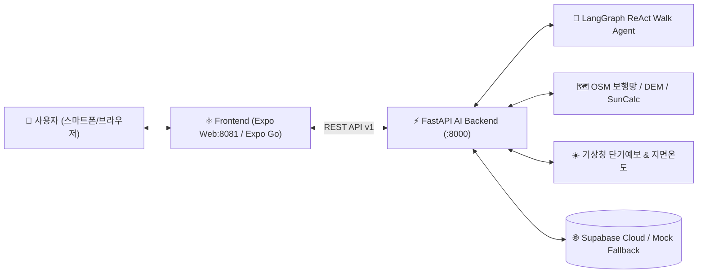

---

### 1️⃣ ⚡ FastAPI AI 백엔드 서버 가동 방법

FastAPI 백엔드는 LangGraph ReAct 에이전트를 기반으로 맞춤형 안심 산책 경로를 실시간 계산하고, 200m 공간 마스킹된 커뮤니티 피드를 제공합니다.

#### 1) 파이썬 가상환경 준비 및 의존성 패키지 설치
```bash
# 저장소 루트(pet_walk_t01)에서 실행
python -m venv .venv

# 가상환경 활성화
# Windows PowerShell
.venv\Scripts\activate
# macOS / Linux
source .venv/bin/activate

# 백엔드 디렉토리 이동 및 필수 패키지 설치
cd backend
pip install -r requirements.txt
```

#### 2) FastAPI 백엔드 서버 가동
```bash
# 개발 모드(Hot-Reload)로 서버 실행 (기본 포트: 8000)
uvicorn main:app --host 0.0.0.0 --port 8000 --reload

# 또는 python 모듈 직접 실행 방식:
py -m uvicorn main:app --host 0.0.0.0 --port 8000 --reload
# (참고: 저장소 루트에서 실행 시: uvicorn backend.main:app --port 8000 --reload)
```

#### 3) 서버 정상 가동 확인 및 API 문서 접속
- **서버 기본 주소**: `http://localhost:8000` (IPv6 지연 방지 시 `http://127.0.0.1:8000`)
- **인터랙티브 Swagger UI (API 문서 및 즉시 테스트)**: [http://localhost:8000/docs](http://localhost:8000/docs)
- **Redoc 대안 API 문서**: [http://localhost:8000/redoc](http://localhost:8000/redoc)
- **헬스체크 엔드포인트**: [http://localhost:8000/health](http://localhost:8000/health)

#### 4) 주요 REST API 엔드포인트 규격
| HTTP 메서드 | 엔드포인트 URI | 기능 설명 |
| :---: | :--- | :--- |
| `GET` | `/health` | 서버 가동 상태 및 Supabase 연동 모드(Live / Fallback) 확인 |
| `POST` | `/api/v1/walk/plan` | 반려견 프로필, 선호 환경, 피드백, 거점 모드 기반 **AI 순환 코스 생성** |
| `POST` | `/api/v1/walk/reroute` | 돌발 위험 지점 감지 시 3초 이내 임시 차단 및 **동적 안전 우회로 재탐색** |
| `POST` | `/api/v1/surface/inspect` | 현장 위험물/공원안내판 사진 **AI 비전 판독 (Pydantic DTO)** |
| `POST` | `/api/v1/hazards` | 현장 위험 제보 등록 (Supabase / 인메모리 듀얼 모드) |
| `GET` | `/api/v1/hazards` | 현위치 반경 내 활성 위험 제보 조회 |
| `GET` | `/api/v1/weather/heat-risk` | 기상청 단기예보 격자 연동 **실시간 지면열 추정 및 골든타임** |
| `GET` | `/api/v1/parking/nearby` | 대전 3대 공원 & 세종호수공원 등 **파일럿 거점 공영주차장 P&R 검색** |
| `GET` | `/api/v1/community/feed` | 이웃 안심 코스 공유 피드 조회 (**200m 자택 마스킹 자동 적용**) |
| `POST` | `/api/v1/community/share` | 신규 완주 코스 공유 등록 (출발·도착지 200m 자동 블러링 & 노드 스냅) |

---

### 2️⃣ 📱 모바일 앱 & 웹 브라우저 데모 실행 (React Native / Expo)

단일 코드베이스(`frontend`)로 스마트폰 네이티브 앱과 브라우저 데모를 동시에 제공합니다.

```bash
# 1. 프론트엔드 폴더 이동 및 패키지 설치
cd frontend
npm install

# 2. 웹 브라우저 모드로 즉시 실행 (접속: http://localhost:8081)
npm run web

# 3. 실제 스마트폰(Expo Go 앱)에서 실행할 경우 (QR코드 스캔)
npx expo start

# 4. 프로덕션 정적/바이트코드 번들 내보내기 (Web & Android)
npm run export:web
npm run export:android

# 5. 독립 실행형 Android Standalone APK 클라우드 빌드 (EAS Build)
npm run build:apk

# 6. 실시간 무선 무점검 핫픽스 배포 (EAS Update OTA)
npm run ota:update
```

---

### 3️⃣ 🎨 6대 핵심 시나리오 인터랙티브 목업 갤러리 (HTML)

고대비 야외 시인성 및 한 손 조작 Thumb Zone이 적용된 6대 사용자 여정 화면(산책 플래너, 지도, 음성 내비, 피드백 등)을 한눈에 확인할 수 있습니다.

```bash
# Windows PowerShell에서 브라우저 열기
Start-Process mockup/index.html

# macOS
open mockup/index.html
```

---

### 4️⃣ 🧪 종합 TDD & 단위 테스트 전수 검증

백엔드와 프론트엔드 모두 100% 통과하는 강력한 품질 가드레일을 갖추고 있습니다.

```bash
# 1. 백엔드 Pytest 전수 검증 (255개 테스트 100% Pass)
python -m pytest   # 루트에서 실행 시 backend/test_case 자동 감지
# 또는: cd backend && pytest test_case/ -v

# 2. 프론트엔드 Vitest 단위 테스트 (28개 파일, 141개 테스트 100% Pass)
cd frontend && npm test

# 3. 프론트엔드 TypeScript 무결성 검증 (0 Errors)
cd frontend && npm run check
```

---

## 📖 목차 (Table of Contents)

0. [⚡ 빠른 시작 및 가동 가이드 (Quick Start Guide)](#-빠른-시작-및-가동-가이드-quick-start-guide)
1. [🌟 프로젝트 개요 및 핵심 철학 (Overview)](#-1-프로젝트-개요-및-핵심-철학-overview)
2. [🚨 해결하고자 하는 핵심 문제 (Problem Statement)](#-2-해결하고자-하는-핵심-문제-problem-statement)
3. [💡 4대 핵심 엔지니어링 전략 (Engineering Strategy)](#-3-4대-핵심-엔지니어링-전략-engineering-strategy)
4. [🏗️ 시스템 아키텍처 (System Architecture)](#-4-시스템-아키텍처-system-architecture)
5. [📱 핵심 사용자 여정 및 주요 화면 갤러리 (User Journey & Screens)](#-5-핵심-사용자-여정-및-주요-화면-갤러리-user-journey--screens)
   - [5.1 📸 실제 구동 화면 스크린샷 갤러리 (Key Screenshots Gallery)](#51-📸-실제-구동-화면-스크린샷-갤러리-key-screenshots-gallery)
   - [5.2 🗺️ 6대 핵심 시나리오 화면 명세 및 사용자 여정](#52-🗺️-6대-핵심-시나리오-화면-명세-및-사용자-여정)
6. [👥 5인 팀 R&R, 프로젝트 마일스톤 및 개발 현황 (Team Roles, Milestones & Status)](#-6-5인-팀-rr-프로젝트-마일스톤-및-개발-현황-team-roles-milestones--status)
   - [6.1 5인 전담 R&R 및 협업 체계](#61-5인-전담-rr-및-협업-체계)
   - [6.2 프로젝트 주요 마일스톤 (수행계획서 정합)](#62-프로젝트-주요-마일스톤-수행계획서-정합)
   - [6.3 📊 현재 프로젝트 개발 및 구현 현황 (Current Implementation Status)](#63-📊-현재-프로젝트-개발-및-구현-현황-current-implementation-status)
7. [🧪 TDD 테스트 스위트 및 품질 가드레일 (Test-Driven Development)](#-7-tdd-테스트-스위트-및-품질-가드레일-test-driven-development)
   - [7.1 테스트 스위트 구성 및 실행 결과](#71-테스트-스위트-구성-및-실행-결과)
   - [7.2 엄격한 품질 가드레일 (Enforced Guardrails)](#72-엄격한-품질-가드레일-enforced-guardrails)
8. [📂 프로젝트 디렉터리 구조 및 공식 산출물 문서 (Directory Structure & Docs)](#-8-프로젝트-디렉터리-구조-및-공식-산출물-문서-directory-structure--docs)
   - [8.1 📚 docs/ 기획 및 공식 엔지니어링 산출물 문서 목록](#81-📚-docs-기획-및-공식-엔지니어링-산출물-문서-목록)
   - [8.2 전체 프로젝트 디렉터리 트리](#82-전체-프로젝트-디렉터리-트리)
9. [🚀 시작하기 및 실행 방법 (Getting Started)](#-9-시작하기-및-실행-방법-getting-started)
   - [9.1 환경 요구사항](#91-환경-요구사항)
   - [9.2 백엔드 가동 및 API 테스트](#92-백엔드-가동-및-api-테스트)
   - [9.3 프론트엔드 모바일 앱/웹 가동](#93-프론트엔드-모바일-앱웹-가동)
10. [📜 라이선스 및 저작권 (License)](#-10-라이선스-및-저작권-license)

---

## 🌟 1. 프로젝트 개요 및 핵심 철학 (Overview)

**편안하개(PetWalk)**는 노령견이나 관절 보호가 필요한 반려견을 위해 **계단 회피, 완만 경사(DEM), 실시간 그늘길(SunCalc), 푹신한 노면(흙·잔디·탄성포장)**을 과학적으로 탐색하여 맞춤형 순환 산책 코스를 생성하는 **AI Native 모바일 산책 플랫폼**입니다.

기존 반려견 산책 앱이 단순 거리/배변 기록에 머무르거나 인간 보행 속도 기준의 상용 지도에 의존했던 한계를 극복하고, **LangGraph ReAct Agent**와 **Multimodal Vision AI(Gemini 3.x Cascading Chain)**를 통해 현장 맞춤형 산책 환경을 자율적으로 오케스트레이션합니다. 또한 스마트폰을 주머니에 넣은 채 산책할 수 있는 **초절전 다크 포켓 모드**와 **시선 해방(Eyes-Free) 핸즈프리 음성 내비게이션**을 지원합니다.

---

## 🚨 2. 해결하고자 하는 핵심 문제 (Problem Statement)

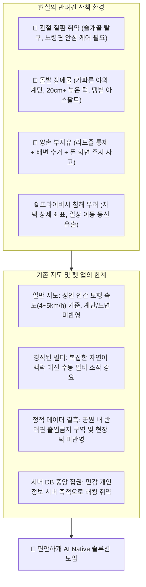

> [!IMPORTANT]
> **5대 핵심 해결 영역**
> 1. **자연어 산책 의도 정밀 구조화**: *"초코랑 30분 정도 폭신한 길로 걸을래"* ➔ LangGraph ReAct Agent가 Pydantic V2 Strict Schema로 변환 ([`US-A1`](docs/03_편안하개_Agile_User_Stories.md)).
> 2. **체급·연령별 적응형 시간-거리 환산**: 소형(2.8), 중형(3.6), 대형(4.2), 노령견(2.2 km/h) 보행 속도 모델 기반 목표 시간 $\pm 15\%$ 수렴 순환 루프 생성 ([`US-A3`](docs/03_편안하개_Agile_User_Stories.md)).
> 3. **다요소 과학 라우팅 & 종합 채점**: OSM 계단 완전 배제 + 15도 미만 무장애 완만경사 + 기상·노면 연동 지면온도 추정 및 고온 노면 회피 ➔ 100점 만점 최적 코스 도출 ([`US-B1~B3`](docs/03_편안하개_Agile_User_Stories.md)).
> 4. **초절전 다크 포켓 & 핸즈프리 음성 안내**: True Black OLED 화면과 주머니 속 30m 전 음성 코칭으로 두 손과 시선의 완전한 자유 보장 ([`US-C1~C2`](docs/03_편안하개_Agile_User_Stories.md)).
> 5. **프라이버시 바이 디자인(Local-First)**: 자택 좌표 및 상세 GPS 트랙은 모바일 기기 `AsyncStorage` 전용 보관, 커뮤니티 공유 시 출발/도착지 200m 공간 지터링 마스킹 ([`US-E1`](docs/03_편안하개_Agile_User_Stories.md), [`US-G2`](docs/03_편안하개_Agile_User_Stories.md), [`US-23`](docs/implementation_plan/frontend_phase2_stories_implementation_plan.md)).

---

## 💡 3. 4대 핵심 엔지니어링 전략 (Engineering Strategy)

```
+--------------------------------------------------------------------------------------------------+
|                                 편안하개 4대 핵심 엔지니어링 전략                                  |
+--------------------------------------------------------------------------------------------------+
  [전략 1] C++ GIS 바닥 코딩 ❌  ➔  AI Agent 외부 도구 제어 & Routing API Adapter 연동 ⭕
  [전략 2] 화면 주시 보행 위험 ❌  ➔  React Native Expo 시선 해방(Eyes-Free) 음성 안내 & 다크 포켓 ⭕
  [전략 3] 소셜 로그인 & 서버 DB ❌ ➔  간편 로컬 저장(Local-First) & 200m 공간 마스킹 보호 ⭕
  [전략 4] 과도한 스트리밍 인프라 ❌ ➔  예측 가능한 Stateless REST API & TDD 100% 가드레일 ⭕
```

* **1. AI Agent 도구 오케스트레이션**: 무거운 지리 알고리즘을 바닥부터 구현하지 않고, LangGraph ReAct Agent가 ORS/OSRM 라우팅 어댑터, DEM 고도 래스터, 지면온도 추정 모델을 표준 도구(`@tool`)로 지휘합니다.
* **2. 시선 해방(Eyes-Free) & 두 손의 자유**: 한 손에 리드줄을 쥐고 화면을 보는 위험을 없애기 위해, 백그라운드 GPS 추적과 `expo-speech` TTS 실시간 음성 브리핑(회전 30m 전 안내, 40m 이탈 경고)을 제공합니다.
* **3. 프라이버시 최우선 Local-First 아키텍처**: 반려견 프로필, 실보행 GPS 트랙, 자택 좌표는 기기 내부 `AsyncStorage`에만 보관하며, 클라우드(Supabase)는 200m 공간 마스킹된 공개 커뮤니티 코스만 최소한으로 취합합니다.
* **4. 무중단 무선 배포 (EAS Build 1회 + EAS Update OTA)**: 번거로운 스토어 재심사나 APK 재설치 없이, `expo-updates` 무선 무점검 OTA를 통해 핫픽스와 UI 개선 사항을 실시간 반영합니다.

---

## 🏗️ 4. 시스템 아키텍처 (System Architecture)

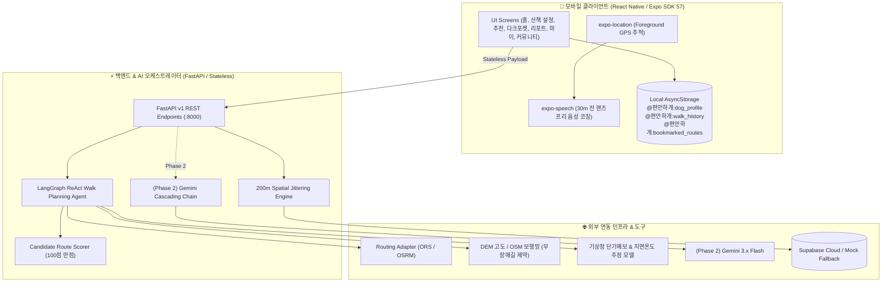

---

## 📱 5. 핵심 사용자 여정 및 주요 화면 갤러리 (User Journey & Screens)

### 5.1 📸 실제 구동 화면 스크린샷 갤러리 (Key Screenshots Gallery)

편안하개 모바일 애플리케이션의 핵심 사용자 여정(User Journey)과 10월 14일 최신 고도화 화면 모음입니다. (고화질 원본: [`docs/screenshots/`](docs/screenshots/))

#### 🌟 10월 14일 최신 구동 화면 (Zero-Scroll & UX 고도화 캡처)

| 01. Zero-Scroll 메인 홈 | 02. 추천 안심 코스 | 03. 실시간 보행 트레일 | 04. 커뮤니티 안심 피드 |
| :---: | :---: | :---: | :---: |
| 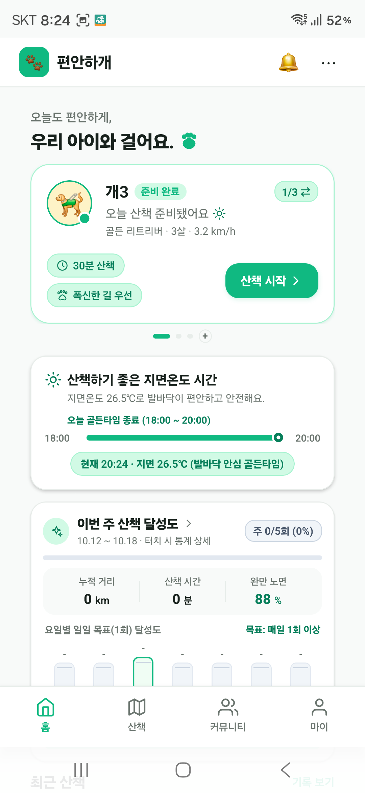 | 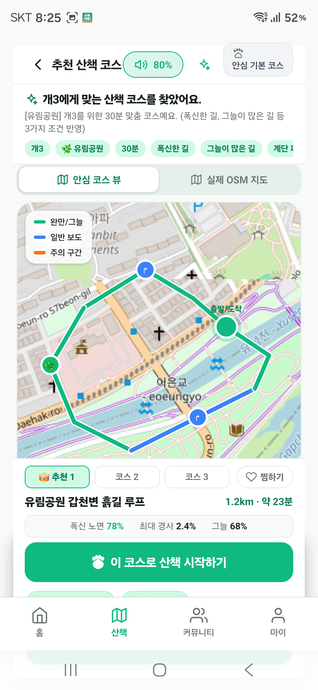 | 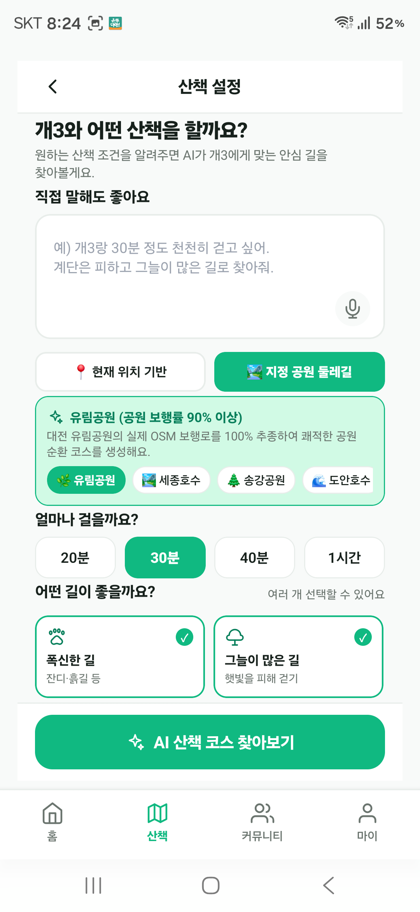 | 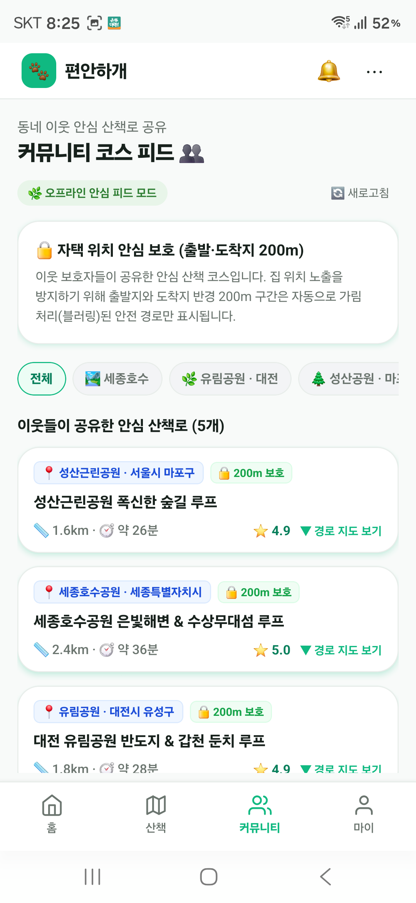 |
| **Zero-Scroll 단일 뷰포트**<br>• 주간 산책 리포트 7구간 바 차트<br>• 최근 산책 요약 인라인 풋터 병합<br>• 골든타임 오늘/내일 구분 안내 | **실시간 AI 코스 브리핑**<br>• 관절 안심 순환로 요약<br>• 경사/노면/그늘 3대 안심 지표<br>• 실제 도로망 지도 프리뷰 | **시선 해방 실시간 안내**<br>• 30m 전 음성 코칭 연동<br>• 백그라운드 실시간 위치 추적<br>• 긴급 복귀 & 출발지 안내 | **자택 200m 공간 마스킹**<br>• 이웃 동네 안심 산책로 공유<br>• 자택 위치 은폐 교차로 스냅<br>• 실시간 서버/오프라인 듀얼 모드 |

| 05. 🐾 반려견 프로필 편집 | 06. 🎨 3대 테마 & 안심 로그아웃 | 07. 📜 산책 활동 & 보관함 | 08. ⚙️ AI 음성 & 시뮬레이터 | 09. ⚙️ 투명 약관 & 데이터 관리 |
| :---: | :---: | :---: | :---: | :---: |
| 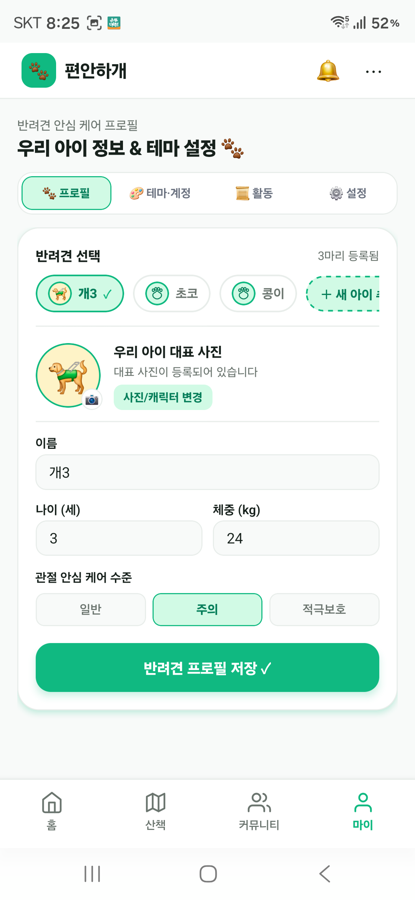 | 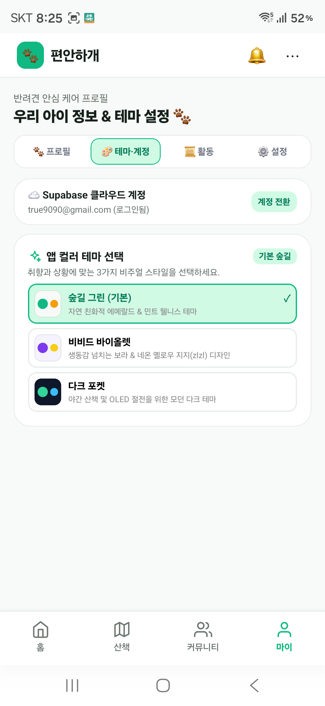 | 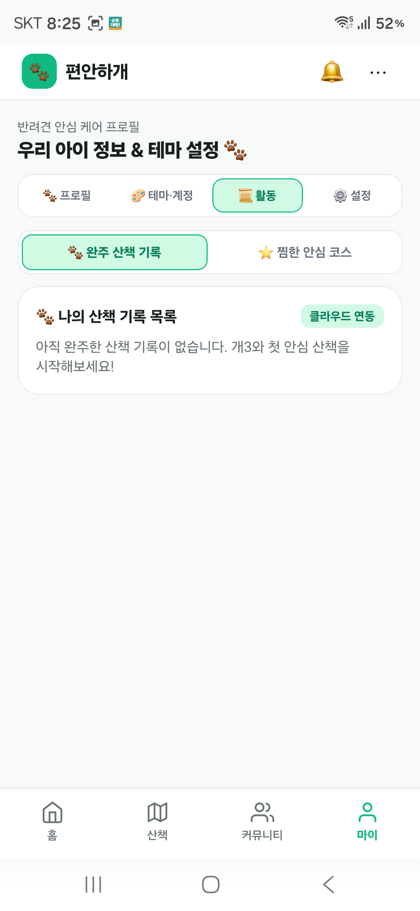 | 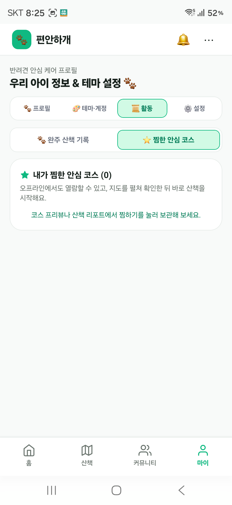 | 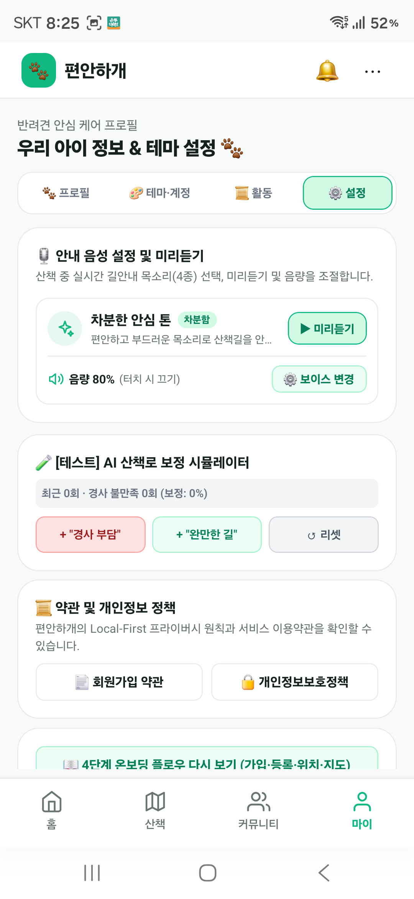 |
| **반려견 맞춤 케어**<br>• 체중/나이/성별 관리<br>• 관절 케어 레벨 3단계<br>• 맞춤 보행 속도 설정 | **3대 테마 & 안심 계정**<br>• 숲길/비비드/다크 테마<br>• Supabase 클라우드 연동<br>• Local-First 안심 로그아웃 | **활동 기록 & 찜한 코스**<br>• 완주 산책 이력 뷰어<br>• 찜한 코스 0.1초 즉시 재산책<br>• 산책 기록 CSV 내보내기 | **AI 맞춤 보정 설정**<br>• 음성 안내 보이스 프로필<br>• TTS 미리듣기 시연<br>• 경사 체감 AI 보정 시뮬레이터 | **프라이버시 & 무결성**<br>• 위치정보 수집 투명 약관<br>• 개인정보 처리방침 전문<br>• 데이터 영구 초기화 보호 |

---

#### 📱 9대 핵심 사용자 여정 아카이브 (MVP & Phase 2 기초 갤러리)

| 01. 신규 온보딩 가이드 | 02. 메인 홈 화면 | 03. 맞춤 산책 조건 설정 |
| :---: | :---: | :---: |
|  |  |  |
| **관절 안심 & 시선 해방 투어**<br>• 계단 배제 완만길 원칙<br>• 30m 전 음성 코칭 안내<br>• Local-First 프라이버시 약속 | **반려견 맞춤 대시보드**<br>• 초코 프로필 & 권장 속도<br>• 지면온도 '산책 좋은 시간'<br>• AI 산책 도우미 & 최근 산책 | **목표 시간 & 선호 환경**<br>• 20~60분 시간 선택 칩<br>• 6대 안심 보행길 다중 선택<br>• 자연어/음성 요청 입력 |

| 04. 추천 산책 코스 | 05. 위치 정보 수집 동의 | 06. 초절전 다크 포켓 모드 |
| :---: | :---: | :---: |
|  |  |  |
| **실시간 AI 코스 & 지도 프리뷰**<br>• AI 맞춤 코스 뱃지 & 브리핑<br>• OSM 실제 지도 & 경로 핀<br>• 경사/노면/그늘 3대 안심 지표 | **프라이버시 3대 투명 고지**<br>• 30m 음성 안내용 한정 수집<br>• 기기에만 안전하게 로컬 보관<br>• 공유 시 출발/도착 200m 마스킹 | **시선 해방(Eyes-Free) HUD**<br>• True Black OLED 배터리 절감<br>• 시간/거리/속도 네온 그린 HUD<br>• 오터치 방지 슬라이드 잠금해제 |

| 07. 완주 인포그래픽 리포트 | 08. 마이 프로필 & 보관함 | 09. 커뮤니티 안심 피드 |
| :---: | :---: | :---: |
|  |  |  |
| **보행 통계 & 체감 피드백**<br>• 4대 핵심 보행 지표 4분할<br>• 3초 체감 만족도 피드백<br>• 오늘 산책 코스 보관함 찜하기 | **아이 정보 & 즐겨찾기 코스**<br>• 나이/체중/관절 케어 3단계<br>• 찜한 코스 0.1초 즉시 재산책<br>• 프로필 백업 및 전체 데이터 초기화 | **이웃 코스 공유 & 안심 보호**<br>• 동네 이웃 안심 산책로 공유<br>• 집 위치 200m 자동 블러링<br>• 실시간 서버 / 오프라인 듀얼 모드 |

---

### 5.2 🗺️ 6대 핵심 시나리오 화면 명세 및 사용자 여정

편안하개는 사전 계획부터 보행, 완주, 커뮤니티 보강까지 끊김 없는 사용자 여정을 제공합니다. (인터랙티브 웹 갤러리: [`mockup/index.html`](mockup/index.html))

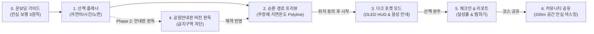

| 시나리오 화면 | 화면 명칭 | 연계 스토리 | 핵심 기능 및 UX 특징 |
|:---:|---|:---:|---|
| **01** | **맞춤형 산책 플래너**<br/>([`01_walk_planner.jpg`](mockup/01_walk_planner.jpg)) | `US-A1`<br>`US-A2`<br>`US-A3` | • 반려견 활성 프로필 카드 ('초코', 관절 안심 케어 집중)<br>• 자연어 질의 입력창 (*"초코랑 30분 정도 폭신한 길로 걸을래"* 또는 음성 입력)<br>• 20~60분 시간 칩 및 6대 선호 노면 다중 선택(흙길, 잔디길, 그늘길, 계단 피하기 등) |
| **02** | **안심 순환 경로 프리뷰**<br/>([`02_route_preview.jpg`](mockup/02_route_preview.jpg)) | `US-B1~B3`<br>`US-C1`<br>`US-29` | • 실제 OSM 지도 위 노면/경사도별 색상 분기 Polyline (🌿 완만/그늘, 🟤 일반 보도, ⚠️ 주의 구간)<br>• 요약 카드: 총 1.4km, 예상 30분, 폭신한 길 비율 **88%** 표시<br>• 나만의 안심 코스 찜하기(즐겨찾기) 버튼 연동 |
| **03** | **초절전 다크 포켓 모드**<br/>([`03_pocket_mode.jpg`](mockup/03_pocket_mode.jpg)) | `US-C2`<br>`US-E1` | • Screen Wake Lock & OLED True Black (`#000000`) 배터리 극소화<br>• 주머니 오터치 방지 '밀어서 잠금 해제(Slide to Unlock)' 엄지 제스처<br>• 실시간 HUD(시간, 거리, 속도) 및 백그라운드 30m 전 TTS 음성 브리핑 연동 |
| **04** | **공원안내판 비전 인스펙터**<br/>([`04_vision_inspection.jpg`](mockup/04_vision_inspection.jpg)) | `US-D1`<br>`US-D2` | • 공원 입구 오프라인 종합안내도 촬영 ➔ Gemini Flash 구조화 파싱<br>• 비포장 흙길 산책로 녹색 식별, 반려견 출입 금지 구역 붉은색 차단<br>• 금지구역 라우팅 격리 및 흙길 우선 경유 대안 순환로 즉시 수립 |
| **05** | **완주 체크인 & 안심 리포트**<br/>([`05_walk_report.jpg`](mockup/05_walk_report.jpg)) | `US-E2`<br>`US-E3` | • 4대 핵심 보행 통계 4분할 그리드 (거리, 시간, 속도, 완만 노면 달성률)<br>• 3초 원터치 체감 피드백(별점) 수집 ➔ 다음 산책 무상태 경사도 보정 반영<br>• 나만의 안심 코스 즐겨찾기(`@편안하개:bookmarked_routes`) 로컬 저장 |
| **06** | **커뮤니티 안심 공유 피드**<br/>([`06_community_enrichment.jpg`](mockup/06_community_enrichment.jpg)) | `US-G2` | • 출발지/도착지 **반경 200m 공간 지터링 및 절단**으로 자택 위치 완벽 은폐<br>• 검증된 동네 산책로 코스 공유 및 실시간 서버 / 오프라인 듀얼 모드 지원 |

---

## 👥 6. 5인 팀 R&R, 프로젝트 마일스톤 및 개발 현황 (Team Roles, Milestones & Status)

### 6.1 5인 전담 R&R 및 협업 체계

편안하개 프로젝트는 5인 전담 R&R과 **18개 핵심 애자일 사용자 스토리 (총 62 Story Points / 298 Hours, Phase 2 확장 포함)** 체계로 운영됩니다. (상세 명세: [`02_편안하개_Team_building.md`](docs/02_편안하개_Team_building.md), [`03_편안하개_Agile_User_Stories.md`](docs/03_편안하개_Agile_User_Stories.md))

| 번호 | 역할 명칭 (포지션) | 담당 팀원 | 핵심 R&R 및 주요 산출물 | 연계 사용자 스토리 |
|:---:|---|:---:|---|:---:|
| **1번** | **팀장 / 프로젝트 총괄·AI 설계**<br/>(PM & AI Agent Lead) | **조현정** | • 전체 프로젝트 리딩, LangGraph ReAct 오케스트레이션<br>• 자연어 의도 파싱 스키마 설계 및 Candidate Route Scorer 튜닝 | `US-A1`, `US-A3`, `US-B3`, `US-E3`<br>*(Phase 2: US-D2)* |
| **2번** | **데이터 / 지도·공간데이터·AI 분석**<br/>(AI & Spatial Data Engineer) | **전황진** | • OSM 보행망·무장애길 정제, DEM 15도 미만 경사도 분석<br>• 기상청 지면온도 추정 모델 및 고온 노면 회피 파이프라인 | `US-B1`, `US-B2`, `US-F1`, `US-G1`, `US-G2`<br>*(Phase 2: US-D1, US-D2)* |
| **3번** | **서버 / 서버·맞춤 경로 계산**<br/>(Backend & Spatial Routing Lead) | **노희선** | • FastAPI 무상태 REST API 개발, ORS/OSRM 라우팅 어댑터<br>• 무장애길 및 지면온도 비용 함수 구현, 200m 공간 지터링 알고리즘 | `US-B1~B3`, `US-F1`, `US-G1`, `US-G2`<br>*(Phase 2: US-D2)* |
| **4번** | **앱 / 모바일 앱·GPS·음성 안내**<br/>(Frontend & Mobile App Lead) | **김승현** | • React Native Expo 모바일 앱 구축, 시선 해방 TTS 음성 안내<br>• Local-First 스토리지, 즐겨찾기(US-29), 온보딩(US-21), 위치동의(US-23) | `US-A2`, `US-C1`, `US-C2`, `US-E1~E3`, `US-H1`<br>*(Phase 2: US-29, 23, 21)* |
| **5번** | **UI / 화면 구현·품질 검증**<br/>(UI/UX Designer & Experience Lead) | **김정님** | • 핵심 시나리오 UI/UX 화면 개발, 고대비 시인성 토큰 적용<br>• 웰니스 카피라이팅 가드레일 준수, EAS 배포 및 CBT 총괄 | `US-A2`, `US-A3`, `US-C1`, `US-E2`, `US-F1`, `US-G1~G2`, `US-H1` |

---

### 6.2 프로젝트 주요 마일스톤 (수행계획서 정합)
> 상세 타임라인 명세: [`docs/05_편안하개_프로젝트_수행계획서_일정.md`](docs/05_편안하개_프로젝트_수행계획서_일정.md)

| 마일스톤 단계 | 일정 | 주요 목표 및 산출물 | 책임 |
|---|:---:|---|:---:|
| **프로젝트 킥오프** | **10월 12일 (월)** | • 5인 팀원별 전담 업무 착수 및 스프린트 1 가동<br>• 기획/아키텍처/TDD 환경 기반 코어 개발 돌입 | 5인 전원 |
| **개발 마감 (Code Freeze)** | **10월 30일 (금)** | • 전 기능 구현 완료 (AI, GIS, 서버, 앱, UI)<br>• EAS Build 테스터용 APK 1회 패키징 완료 | 5인 전원 |
| **집중 테스트와 보완 (Test & Refine)** | **10월 31일 (토) ~ 11월 7일 (토)** | • 최소 5인 실사용자 필드 산책 현장 테스트(CBT)<br>• 주머니 속 핸즈프리 음성 안내 및 계단 회피 체감 검증<br>• EAS Update (`expo-updates`) 무선 OTA 실시간 핫픽스 및 보완<br>• 피드백 수집 기반 가중치 미세 튜닝 및 완성도 극대화 | Lead: 김정님(UI/QA)<br>& 5인 전원 |
| **최종 제출 마감 (Final Submission)** | **11월 8일 (일)** | • 프로젝트 최종 산출물 및 GitHub 코드베이스 제출<br>• 최종 발표 PPT 및 데모 시연 영상 제출 | Lead: 조현정(팀장)<br>& 5인 전원 |

---

### 6.3 📊 현재 프로젝트 개발 및 구현 현황 (Current Implementation Status)

본 프로젝트는 핵심 사용자 여정 및 Phase 2 프론트엔드 단독 완결형 스토리를 100% 완료하고 엄격한 품질 가드레일을 통과한 안정화 상태입니다.

#### 1) 종합 품질 검증 지표
| 구분 | 검증 항목 | 달성 지표 | 상태 | 세부 내용 |
| :--- | :--- | :---: | :---: | :--- |
| **Backend** | Pytest TDD 스위트 | **255 / 255** | `PASS` | LangGraph ReAct, KMA 실시간 예보, 5대 공원 라우팅, 200m 마스킹 전수 통과 |
| **Frontend** | Vitest 단위 테스트 | **141 / 141** | `PASS` | 28개 테스트 파일 전원 통과 (소음감지, 음성설정, 4단계 온보딩, 북마크, 배변마킹) |
| **Frontend** | TypeScript 컴파일 검사 | **0 Errors** | `PASS` | `tsc --noEmit` 완벽 무결성 통과 (Strict Mode) |
| **Code Quality** | SonarLint 단일 파일 줄수 | **100% 준수** | `PASS` | 모든 신규/수정 파일 250줄 이하 가드레일 엄수 (`App.tsx` 249줄) |
| **UX & Copy** | 전문 용어 순화 가드레일 | **100% 완료** | `PASS` | 스토리 번호(`US-xx`) 및 개발자 용어 전면 배제, 웰니스 어휘 적용 |
| **CI/CD** | GitHub Actions Pipeline | **Auto-Merge** | `PASS` | `backend-test` (255) + `mobile-app-ci` (141) 통과 시 자동 머지 파이프라인 |

#### 2) 최근 완성된 주요 기능 구현 내용
1. **대전 3대 공원 & 세종 2대 공원 5대 파일럿 실증 거점 연동**:
   - 대전(유림공원, 송강근린공원, 도안호수공원) 및 세종(세종호수공원, 세종중앙공원) 실제 OSM 정밀 보행망 탑재.
   - 공원 선택 시 공원 내부 산책 비율 **90% 이상** 집중 가중치 코스 우선 생성.
2. **산책 경로 생성 기준 이원화 (`origin_mode`)**:
   - `current_location`(사용자 현위치 주변 순환)과 `pilot_park`(지정한 공원 중심/내부 산책) 두 가지 경로 탐색 모드 지원.
3. **기상청 단기예보 실시간 연동 (KMA Weather Client & Grid Converter)**:
   - 위경도-기상청 격자(X, Y) 실시간 좌표 변환 및 기온, 하늘상태, 강수확률 연동.
   - 경험적 지면열 수지식 기반 지면온도 추정 및 시간대별 산책 골든타임 알림 (1시간 클라이언트 캐싱).
4. **AI 음성 가이드 보이스 프로필 4종 & 스마트 돌발 짖음 감지 자동 음소거/복구**:
   - 4대 맞춤형 AI 보이스 프로필(`calm_female`, `bright_female`, `calm_male`, `friendly_male`) 및 독립 볼륨 슬라이더 제공.
   - 73dB 이상 돌발 소음/짖음 감지 시 즉시 음성 안내 일시 차단(Ducking) 후 3초 뒤 자동 복구 (Auto-Resume).
   - 산책 중 긴급 상황 시 한 손으로 터치 가능한 다크 포켓 내 56px 대형 긴급 원터치 음소거 버튼 구축.
5. **팀장 컨펌 4단계 온보딩 플로우 & 회원가입 약관/개인정보 처리방침**:
   - 1단계(가입 & 필수 약관 동의) → 2단계(반려견 프로필 등록) → 3단계(산책 시작 시점 위치 동의) → 4단계(현위치 기반 주변 인기 코스/산책견 탐색 지도 진입)로 사용자 이탈 방지.
6. **산책 시간 15분 단위 세분화 & 무제한 자유 산책 모드**:
   - 15~120분+ 슬라이더 및 직접 분 입력 지원, 목표 시간 도달 후에도 누적 기록이 유지되는 '자유 산책 모드' 탑재.
7. **한 손 원터치 배변 마킹 FAB (US-18)**:
   - 산책 중 한 손 Thumb Zone 52px 원터치 플로팅 버튼(💩 대변 / 💧 소변), 햅틱 진동(60ms), 완주 리포트 타임라인 표출.
8. **나만의 안심 코스 즐겨찾기(Bookmark) 보관함 (US-29)**:
   - 마음에 든 코스를 로컬 `@편안하개:bookmarked_routes`에 원터치 저장, 서버 재호출 없이 0.1초 만에 즉시 재산책.
9. **OpenFreeMap + MapLibre 고정밀 벡터 배경 지도 구현 계획 수립**:
   - 구글 맵 종속성 및 API 키 유출 위험을 원천 차단하고 100% 무료 오픈소스 GPU 가속 벡터 지도 도입 계획 확립.

---

## 🧪 7. TDD 테스트 스위트 및 품질 가드레일 (Test-Driven Development)

본 프로젝트는 **TDD(Test-Driven Development) 및 ATDD(인수 테스트 주도 개발)**를 기반으로 구축되었으며, 18개 핵심 스토리 및 Phase 2 확장 백로그의 모든 인수 조건(Acceptance Criteria)과 완료 정의(DoD)를 테스트 코드로 100% 사전 검증합니다. (상세 가이드: [`backend/test_case/README.md`](backend/test_case/README.md))

### 7.1 테스트 스위트 구성 및 실행 결과

```bash
# 전체 백엔드 TDD 테스트 스위트 실행 (21개 파일, 255개 테스트 100% Pass)
python -m pytest
# 또는: cd backend && pytest test_case/ -v
```

```text
============================= test session starts =============================
platform win32 -- Python 3.14.x / pytest-9.x
rootdir: d:\코디세이\pet_walk_t01, configfile: pytest.ini, testpaths: backend/test_case
collected 255 items

backend\test_case\test_api_contracts.py ...                              [  1%]
backend\test_case\test_building_avoidance.py .....                       [  3%]
backend\test_case\test_kma_grid_converter.py ........................... [ 13%]
............                                                             [ 18%]
backend\test_case\test_kma_weather_client.py ........................... [ 29%]
.........                                                                [ 32%]
backend\test_case\test_langgraph_walk_agent.py ......                    [ 34%]
backend\test_case\test_loop_target_duration.py ............              [ 39%]
backend\test_case\test_mobile_and_voice_navigation.py ........           [ 42%]
backend\test_case\test_origin_mode.py ...                                [ 43%]
backend\test_case\test_phase2_extended_features.py ..........            [ 47%]
backend\test_case\test_rest_api_v1_endpoints.py ..................       [ 54%]
backend\test_case\test_route_geometry_validation.py .............        [ 60%]
backend\test_case\test_spatial_masking.py ...                            [ 61%]
backend\test_case\test_supabase_repository.py ...                        [ 62%]
backend\test_case\test_surface_cost_model.py ....................        [ 70%]
backend\test_case\test_surface_slope_evaluation.py ..................... [ 78%]
.                                                                        [ 78%]
backend\test_case\test_thermal_and_parking.py ......                     [ 81%]
backend\test_case\test_vision_safety_inspector.py .............          [ 86%]
backend\test_case\test_walk_plan_agent_schema.py .............           [ 91%]
backend\test_case\test_walk_plan_latency.py .............                [ 96%]
backend\test_case\test_walk_tracking_and_feedback.py .........           [100%]

============================ 255 passed in 6.94s ==============================
```

```bash
# 모바일 프론트엔드 Vitest 단위 테스트 실행 (28개 파일, 141개 테스트 100% Pass)
cd frontend && npm test
```

### 7.2 엄격한 품질 가드레일 (Enforced Guardrails)
1. **웰니스 카피라이팅 (Zero Medical Slang)**: 앱 UI, DTO, 테스트 코드 전역에서 임상적 공포 유발 단어를 배제하고, '관절 안심 케어', '폭신한 길' 등 순화된 웰니스 단어만을 사용하도록 자동 검사합니다.
2. **사용자 친화적 용어 통일**: 스토리 번호(`US-xx`)나 엔지니어링 용어(JSON, DB, API 등)를 사용자 화면에서 완전히 배제합니다.
3. **Gemini 3.x 순차 체인 (Cascading Chain)**: `3.5-flash-lite` ➔ `3.1-flash-lite` ➔ `3.6-flash` 순으로 자동 폴백되도록 강제합니다.
4. **프라이버시 무결성**: 자택 좌표 서버 전송 0건 및 커뮤니티 공유 시 출발/도착지 200m 공간 지터링 마스킹을 테스트로 보증합니다.
5. **SonarLint 단일 파일 줄수 제한**: 모든 프론트엔드 소스 파일은 단일 파일 250줄 이하 가드레일을 100% 준수합니다.

---

## 📂 8. 프로젝트 디렉터리 구조 및 공식 산출물 문서 (Directory Structure & Docs)

### 8.1 📚 docs/ 기획 및 공식 엔지니어링 산출물 문서 목록

| 문서 파일 | 주요 내용 및 목적 | 관련 영역 |
| :--- | :--- | :--- |
| [`docs/01_편안하개_인프라_구축_및_환경설정_가이드.md`](docs/01_편안하개_인프라_구축_및_환경설정_가이드.md) | 전체 4대 인프라 레이어 구조, 개발 환경 세팅, 빌드 및 실행 가이드 | 인프라 / 환경 |
| [`docs/02_편안하개_Team_building.md`](docs/02_편안하개_Team_building.md) | 5인 팀 R&R, 역할별 핵심 산출물 및 4대 핵심 기술 엔지니어링 전략 | 팀 빌딩 / 아키텍처 |
| [`docs/03_편안하개_Agile_User_Stories.md`](docs/03_편안하개_Agile_User_Stories.md) | 8대 에픽(A~H), 18개 애자일 사용자 스토리 명세서 및 인수 조건(DoD) | 백로그 / 기능 명세 |
| [`docs/04_ai_problem_definition.md`](docs/04_ai_problem_definition.md) | AI 문제 정의서 (아키텍처, 5대 핵심 문제, 성공 지표 및 평가 기준) | AI 문제 정의 |
| [`docs/05_편안하개_프로젝트_수행계획서_일정.md`](docs/05_편안하개_프로젝트_수행계획서_일정.md) | 프로젝트 전체 일정, 주차별 R&R, 간트 차트 및 4단계 마일스톤 수행계획 | 마일스톤 / 일정 |
| [`docs/06_편안하개_Project_Proposal.md`](docs/06_편안하개_Project_Proposal.md) | 편안하개 프로젝트 제안서 및 핵심 솔루션 개요 | 프로젝트 제안 |
| [`docs/07_편한하개_API_list.md`](docs/07_편한하개_API_list.md) | 전체 REST API 및 Supabase 엔드포인트 규격, 실데이터 명세서 | API 규격서 |
| [`docs/08_OpenFreeMap_MapLibre_배경지도_구현계획서.md`](docs/08_OpenFreeMap_MapLibre_배경지도_구현계획서.md) | OpenFreeMap + MapLibre 고정밀 벡터 배경 지도 도입 계획서 | 지도 엔진 계획 |
| [`docs/reports/10월13일_작업결과보고서.md`](docs/reports/10월13일_작업결과보고서.md) | 10월 13일 핵심 엔지니어링 및 기능 구현 결과보고서 | 진척 결과보고서 |
| [`docs/reports/구현현황보고서.md`](docs/reports/구현현황보고서.md) | 편안하개 실데이터 기반 스프린트 진척 및 종합 현황 분석 보고서 | 진척 현황분석 |
| [`docs/implementation_plan/조현정_향후_구현계획.md`](docs/implementation_plan/조현정_향후_구현계획.md) | 1번 조현정(팀장 / PM & AI Agent Lead) 향후 주차별 구현 계획서 | PM / AI 코어 |
| [`docs/implementation_plan/전황진_향후_구현계획.md`](docs/implementation_plan/전황진_향후_구현계획.md) | 2번 전황진(데이터 / AI & Spatial Data Engineer) 향후 주차별 구현 계획서 | GIS / 공간데이터 |
| [`docs/implementation_plan/노희선_향후_구현계획.md`](docs/implementation_plan/노희선_향후_구현계획.md) | 3번 노희선(서버 / Backend & Spatial Routing Lead) 향후 주차별 구현 계획서 | 서버 / REST API |
| [`docs/implementation_plan/김승현_향후_구현계획.md`](docs/implementation_plan/김승현_향후_구현계획.md) | 4번 김승현(앱 / Frontend & Mobile App Lead) 향후 주차별 구현 계획서 | 모바일 / EAS 배포 |
| [`docs/implementation_plan/김정님_향후_구현계획.md`](docs/implementation_plan/김정님_향후_구현계획.md) | 5번 김정님(UI / UI/UX & Experience Lead) 향후 주차별 구현 계획서 | UI/UX / 5인 CBT |
| [`docs/screenshots/README.md`](docs/screenshots/README.md) | 주요 모바일 구동 화면 스크린샷 9종 갤러리 및 상세 설명 | 화면 갤러리 |

---

### 8.2 전체 프로젝트 디렉터리 트리

```text
pet_walk_t01/
├── README.md                                  # [본 문서] 프로젝트 통합 개요 및 실행 가이드
├── pytest.ini                                 # 루트 단위 테스트 통합 설정
├── docs/                                      # 프로젝트 기획, 스크린샷 및 공식 산출물 문서
│   ├── 01_편안하개_인프라_구축_및_환경설정_가이드.md # 전체 4대 인프라 레이어 및 환경 설정 가이드
│   ├── 02_편안하개_Team_building.md            # 5인 팀 R&R 및 4대 기술 엔지니어링 전략
│   ├── 03_편안하개_Agile_User_Stories.md       # 8대 에픽(A~H), 18개 사용자 스토리 및 DoD 명세서
│   ├── 04_ai_problem_definition.md            # AI 문제 정의서 (아키텍처, 5대 문제, 성공 지표)
│   ├── 05_편안하개_프로젝트_수행계획서_일정.md # 프로젝트 수행 기간, 간트 차트 및 마일스톤
│   ├── 06_편안하개_Project_Proposal.md         # 프로젝트 제안서
│   ├── 07_편한하개_API_list.md                 # 전체 REST API 규격서 및 구현 현황
│   ├── 08_OpenFreeMap_MapLibre_배경지도_구현계획서.md # OpenFreeMap+MapLibre 벡터 지도 계획
│   ├── reports/                               # 📊 프로젝트 공식 현황 및 작업 결과 보고서
│   │   ├── 10월13일_작업결과보고서.md            # 10월 13일 핵심 구현 작업 결과보고서
│   │   └── 구현현황보고서.md                   # 스프린트 진척 및 종합 구현 현황 분석
│   ├── implementation_plan/                   # 멤버별 향후 상세 구현 계획서 (주차별/단계별)
│   │   ├── 조현정_향후_구현계획.md                # 1번 조현정 (팀장 / PM & AI 코어)
│   │   ├── 전황진_향후_구현계획.md                # 2번 전황진 (데이터 / GIS & 열환경)
│   │   ├── 노희선_향후_구현계획.md                # 3번 노희선 (서버 / REST API & 라우팅)
│   │   ├── 김승현_향후_구현계획.md                # 4번 김승현 (앱 / 모바일 & EAS 배포)
│   │   ├── 김정님_향후_구현계획.md                # 5번 김정님 (UI / UX 디자인 & 5인 CBT)
│   │   └── old/                               # 기구축 완료 및 아카이빙된 기존 계획서
│   └── screenshots/                           # 📸 주요 구동 화면 고화질 스크린샷 (01~09)
├── backend/                                   # ⚡ [Supabase & 백엔드] FastAPI REST API & AI Agent
│   ├── README.md                              # 백엔드 아키텍처 및 로컬 실행/테스트 가이드
│   ├── main.py                                # FastAPI 메인 애플리케이션 엔트리포인트 (v1 REST API)
│   ├── requirements.txt                       # Python 백엔드 및 AI 에이전트 의존성 명세서
│   ├── pytest.ini                             # 백엔드 단위 테스트 설정
│   ├── .env.example                           # Supabase 및 외부 API 환경 변수 템플릿
│   ├── sql/                                   # Supabase PostgreSQL DDL 테이블 및 인덱스 정의
│   │   └── supabase_schema.sql                # 커뮤니티 코스 & 위험 제보 PostGIS 스키마
│   ├── agent/                                 # 🤖 LangGraph ReAct Walk Planning Agent 코어
│   │   ├── walk_planning_agent.py             # 의도 파싱, 제약 보정, 후보 경로 생성 및 브리핑
│   │   ├── loop_route_planner.py              # OSRM 순환 루프 1.5초 캐시 생성기
│   │   ├── pilot_park_routes.py               # 대전·세종 5대 공원 실증 보행망 정밀 라우팅
│   │   ├── surface_slope_evaluator.py         # 무장애 노면 및 DEM 경사도 3색 평가기
│   │   ├── building_geometry.py               # 건물 관통 방지 검증 모듈
│   │   ├── spatial_masking.py                 # 200m 교차로 스냅 마스킹 모듈
│   │   ├── supabase_repository.py             # Supabase 클라우드 저장소 (Dual-Mode)
│   │   └── hazard_service.py                  # 위험 제보 및 동적 우회 서비스
│   ├── services/                              # ☀️ 기상청 및 공공 데이터 클라이언트 서비스
│   │   ├── kma_grid_converter.py              # 위경도 <-> 기상청 격자(X, Y) 양방향 변환기
│   │   └── kma_weather_client.py              # 기상청 단기예보 실시간 수집 및 캐시 클라이언트
│   ├── fixtures/                              # 테스트용 서울시 건물 외곽선 GeoJSON
│   └── test_case/                             # 🧪 TDD 종합 테스트 스위트 (255개 Pytest 전수 Pass)
├── frontend/                                  # 📱 [Expo 모바일 앱 & 웹] React Native / Expo SDK 57
│   ├── README.md                              # 프론트엔드 모바일 아키텍처 및 실행 가이드
│   ├── App.tsx                                # 메인 애플리케이션 (Screen 01~05 통합 라우팅)
│   ├── app.json                               # Expo 앱 매니페스트 및 설정
│   ├── eas.json                               # EAS Build (APK) & EAS Update (무선 OTA) 설정
│   ├── package.json                           # React Native, Expo, Vitest 의존성
│   └── src/                                   # components, screens, services, theme, hooks, types
└── .github/workflows/                         # GitHub Actions CI 파이프라인
    └── ci.yml                                 # pytest(255개) + mobile vitest(141개) & tsc 자동 머지
```

---

## 🚀 9. 시작하기 및 실행 방법 (Getting Started)

### 9.1 환경 요구사항
* **Python**: 3.11 이상 (권장: 3.11 ~ 3.14)
* **Node.js**: 20.x 이상 (권장: 20.x ~ 24.x)
* **npm**: 10.x 이상
* **pytest**: 8.x 이상

---

### 9.2 백엔드 가동 및 API 테스트 (Backend & Supabase)

```bash
# 1. 백엔드 폴더 이동
cd backend

# 2. 파이썬 가상환경 생성 및 활성화
python -m venv .venv
# Windows PowerShell: .venv\Scripts\activate
# macOS / Linux: source .venv/bin/activate

# 3. 필수 패키지 설치
pip install -r requirements.txt

# 4. 백엔드 서버 가동
uvicorn main:app --host 0.0.0.0 --port 8000 --reload

# 5. 브라우저에서 Swagger UI 접속하여 실시간 API 테스트
# URL: http://localhost:8000/docs

# 6. 백엔드 255개 전수 단위 테스트 실행
pytest test_case/ -v
```

---

### 9.3 프론트엔드 모바일 앱/웹 가동

```bash
# 1. 프론트엔드 폴더 이동
cd frontend

# 2. npm 패키지 설치
npm install

# 3. 웹 브라우저 데모 실행 (접속: http://localhost:8081)
npm run web

# 4. 스마트폰 Expo Go 실행
npx expo start

# 5. 프로덕션 정적/바이트코드 번들 내보내기 (Web & Android)
npm run export:web
npm run export:android

# 6. 독립 실행형 Android APK 클라우드 빌드 (EAS Build)
npm run build:apk
# (빌드 상태 확인: npx eas-cli build:view)

# 7. 무선 무점검 실시간 핫픽스 배포 (EAS Update OTA)
npm run ota:update
```

---

### 9.4 의존성 설치 및 TDD/단위 테스트 실행

```bash
# 백엔드 Pytest 전수 검증 (255개 테스트 100% Pass)
# 방법 1) 루트에서 바로 실행 (pytest.ini 기반 backend/test_case 자동 탐색)
python -m pytest

# 방법 2) backend 폴더로 이동 후 실행
cd backend && pytest test_case/ -v

# 프론트엔드 Vitest 단위 테스트 (180개 테스트 100% Pass)
cd frontend && npm test

# 프론트엔드 TypeScript 무결성 검증 (0 Errors)
cd frontend && npm run check
```

---

### 9.5 주요 개발 현황 보고서 및 설계 문서
- 🐾 [10월 14일 김승현(앱 리드) 개발 현황 보고서](docs/reports/10월14일_김승현_구현현황보고서.md)
- 🐾 [10월 13일 개발 결과 보고서](docs/reports/10월13일_작업결과보고서.md)
- 🐾 [김승현 향후 구현 계획서 (v2.4 개정판)](docs/implementation_plan/김승현_향후_구현계획.md)
- 📸 [주요 화면 스크린샷 갤러리](docs/screenshots/README.md)

---

### 9.5 인터랙티브 목업 갤러리 확인

프로젝트의 6대 핵심 시나리오 화면을 브라우저에서 바로 확인할 수 있습니다:
```bash
# Windows PowerShell
Start-Process mockup/index.html

# macOS
open mockup/index.html
```

---

## 📜 10. 라이선스 및 저작권 (License)

본 프로젝트는 **MIT License**에 따라 자유롭게 사용 및 수정할 수 있습니다. 자세한 내용은 라이선스 문서를 참조하십시오.
