# 🐾 편안하개 (PetWalk)
> **AI Native 반려견 맞춤형 안심 노면 산책 에이전트 및 핸즈프리 모바일 플랫폼**  
> *"견주에게는 시선과 두 손의 자유를, 반려견에게는 관절 안심 발걸음을"*

> **현재 코드 기준 (2026-10-25):** 이 저장소는 Expo SDK 57 모바일 앱과 FastAPI 백엔드로 구성됩니다. 산책 설정에서 코스 2·3 재생성을 지원하고, 지정 공원 경로는 후보 풀에서 직전 경로와 겹침이 낮은 코스 및 반대 방향 코스를 우선 제공합니다. 코스 카드에는 순환 진입점과 바퀴 수를 표시할 수 있습니다. 실제 배포 상태와 테스트 통과 수는 이 갱신에서 확인하지 않았으므로 아래의 배포 링크와 누적 테스트 수는 **마지막 기록값**으로 봐 주세요. 최신 코드 기준 요약은 [현재 코드 상태 보고서](docs/reports/2026-10-25_현재_코드_기준_상태.md), API는 [API 명세](docs/07_편안하개_API_list.md), 실행·배포 안내는 [백엔드 가이드](docs/09_백엔드_서버_실행_배포_가이드.md)를 참고하세요.

[](https://www.python.org/)
[](https://fastapi.tiangolo.com/)
[](https://expo.dev/)
[-3178C6.svg)](frontend)
[](backend/test_case)
[](frontend)
[-success.svg)](frontend)
[](https://opensource.org/licenses/MIT)

---
## 테스트용 앱 다운로드 주소
https://expo.dev/artifacts/eas/VBEa7RZrgonb30FUxB63-3YPJXY6IOlySrvw32uJJrg.apk

## 웹 서비스 데모 주소
https://pet-walk-t01-1.onrender.com

## 웹 서비스 운영 서버 주소
https://pet-walk-t01-z095.onrender.com

## ⚡ 빠른 시작 및 가동 가이드 (Quick Start Guide)

편안하개는 **FastAPI AI 백엔드 서버(포트 8000)**와 **React Native (Expo SDK 57) 모바일 프론트엔드(포트 8081)**, 그리고 **인터랙티브 시나리오 목업 갤러리**로 구성된 풀스택 AI 에이전트 플랫폼입니다.

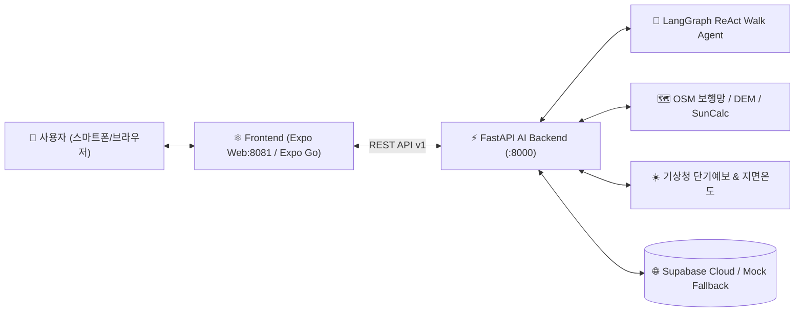
## 📖 목차 (Table of Contents)

0. [⚡ 빠른 시작 및 가동 가이드 (Quick Start Guide)](#-빠른-시작-및-가동-가이드-quick-start-guide)
1. [🌟 프로젝트 개요 및 핵심 철학 (Overview)](#-1-프로젝트-개요-및-핵심-철학-overview)
2. [🚨 해결하고자 하는 핵심 문제 (Problem Statement)](#-2-해결하고자-하는-핵심-문제-problem-statement)
3. [💡 4대 핵심 엔지니어링 전략 (Engineering Strategy)](#-3-4대-핵심-엔지니어링-전략-engineering-strategy)
4. [🏗️ 시스템 아키텍처 (System Architecture)](#-4-시스템-아키텍처-system-architecture)
5. [📱 핵심 사용자 여정 및 주요 화면 갤러리 (User Journey & Screens)](#-5-핵심-사용자-여정-및-주요-화면-갤러리-user-journey--screens)
   - [5.1 📸 실제 구동 화면 스크린샷 갤러리 (Key Screenshots Gallery)](#51-📸-실제-구동-화면-스크린샷-갤러리-key-screenshots-gallery)
   - [5.2 🗺️ 6대 핵심 시나리오 화면 명세 및 사용자 여정](#52-🗺️-6대-핵심-시나리오-화면-명세-및-사용자-여정)
6. [👥 5인 팀 R&R, 프로젝트 마일스톤 및 개발 현황 (Team Roles, Milestones & Status)](#-6-5인-팀-rr-프로젝트-마일스톤-및-개발-현황-team-roles-milestones--status)
   - [6.1 5인 전담 R&R 및 협업 체계](#61-5인-전담-rr-및-협업-체계)
   - [6.2 팀원별 담당 사용자 스토리 요약](#62-팀원별-담당-사용자-스토리-요약)
   - [6.3 프로젝트 주요 마일스톤 (수행계획서 정합)](#63-프로젝트-주요-마일스톤-수행계획서-정합)
   - [6.4 📊 2026-10-21 구현 현황 기록](#64-📊-현재-프로젝트-개발-및-구현-현황-2026-10-21-기록)
7. [🧪 TDD 테스트 스위트 및 품질 가드레일 (Test-Driven Development)](#-7-tdd-테스트-스위트-및-품질-가드레일-test-driven-development)
   - [7.1 테스트 스위트 구성 및 실행 결과](#71-테스트-스위트-구성-및-실행-결과)
   - [7.2 엄격한 품질 가드레일 (Enforced Guardrails)](#72-엄격한-품질-가드레일-enforced-guardrails)
8. [📂 프로젝트 디렉터리 구조 및 공식 산출물 문서 (Directory Structure & Docs)](#-8-프로젝트-디렉터리-구조-및-공식-산출물-문서-directory-structure--docs)
   - [8.1 📚 docs/ 기획 및 공식 엔지니어링 산출물 문서 목록](#81-📚-docs-기획-및-공식-엔지니어링-산출물-문서-목록)
   - [8.2 전체 프로젝트 디렉터리 트리](#82-전체-프로젝트-디렉터리-트리)
9. [🚀 시작하기 및 실행 방법 (Getting Started)](#-9-시작하기-및-실행-방법-getting-started)
   - [9.1 환경 요구사항](#91-환경-요구사항)
   - [9.2 백엔드 가동 및 API 테스트](#92-백엔드-가동-및-api-테스트-backend--supabase)
   - [9.3 프론트엔드 모바일 앱/웹 가동](#93-프론트엔드-모바일-앱웹-가동)
   - [9.4 의존성 설치 및 TDD/단위 테스트 실행](#94-의존성-설치-및-tdd단위-테스트-실행)
   - [9.5 주요 개발 현황 보고서 및 설계 문서](#95-주요-개발-현황-보고서-및-설계-문서)
   - [9.6 인터랙티브 목업 갤러리 확인](#96-인터랙티브-목업-갤러리-확인)
10. [📜 라이선스 및 저작권 (License)](#-10-라이선스-및-저작권-license)

---

### 1️⃣ ⚡ FastAPI AI 백엔드 서버 가동 방법

FastAPI 백엔드는 LangGraph ReAct 에이전트를 기반으로 맞춤형 안심 산책 경로를 실시간 계산하고, 200m 공간 마스킹된 커뮤니티 피드를 제공합니다.

#### 1) 파이썬 가상환경 준비 및 의존성 패키지 설치
```bash
# 저장소 루트(pet_walk_t01)에서 실행
python -m venv .venv

# 가상환경 활성화
# Windows PowerShell
.venv\Scripts\activate
# macOS / Linux
source .venv/bin/activate

# 백엔드 디렉토리 이동 및 필수 패키지 설치
cd backend
pip install -r requirements.txt
```

#### 2) FastAPI 백엔드 서버 가동
```bash
# 개발 모드(Hot-Reload)로 서버 실행 (기본 포트: 8000)
uvicorn main:app --host 0.0.0.0 --port 8000 --reload

# 또는 python 모듈 직접 실행 방식:
py -m uvicorn main:app --host 0.0.0.0 --port 8000 --reload
# (참고: 저장소 루트에서 실행 시: uvicorn backend.main:app --port 8000 --reload)
```

#### 3) 서버 정상 가동 확인 및 API 문서 접속
- **서버 기본 주소**: `http://localhost:8000` (IPv6 지연 방지 시 `http://127.0.0.1:8000`)
- **인터랙티브 Swagger UI (API 문서 및 즉시 테스트)**: [http://localhost:8000/docs](http://localhost:8000/docs)
- **Redoc 대안 API 문서**: [http://localhost:8000/redoc](http://localhost:8000/redoc)
- **헬스체크 엔드포인트**: [http://localhost:8000/health](http://localhost:8000/health)

#### 4) 주요 REST API 엔드포인트 규격
| HTTP 메서드 | 엔드포인트 URI | 기능 설명 |
| :---: | :--- | :--- |
| `GET` | `/health` | 서버 가동 상태 및 Supabase 연동 모드(Live / Fallback) 확인 |
| `POST` | `/api/v1/walk/plan` | 반려견 프로필, 선호 환경, 피드백, 거점 모드 기반 **AI 순환 코스 생성** |
| `POST` | `/api/v1/walk/reroute` | 돌발 위험 지점 감지 시 3초 이내 임시 차단 및 **동적 안전 우회로 재탐색** |
| `POST` | `/api/v1/surface/inspect` | 현장 위험물/공원안내판 사진 **AI 비전 판독 (Pydantic DTO)** |
| `POST` | `/api/v1/hazards` | 현장 위험 제보 등록 (Supabase / 인메모리 듀얼 모드) |
| `GET` | `/api/v1/hazards` | 현위치 반경 내 활성 위험 제보 조회 |
| `GET` | `/api/v1/weather/heat-risk` | 기상청 단기예보 격자 연동 **실시간 지면열 추정 및 골든타임** |
| `GET` | `/api/v1/parking/nearby` | 대전 3대 공원 & 세종호수공원 등 **파일럿 거점 공영주차장 P&R 검색** |
| `GET` | `/api/v1/community/feed` | 이웃 안심 코스 공유 피드 조회 (**200m 자택 마스킹 자동 적용**) |
| `POST` | `/api/v1/community/share` | 신규 완주 코스 공유 등록 (출발·도착지 200m 자동 블러링 & 노드 스냅) |

---

### 2️⃣ 📱 모바일 앱 & 웹 브라우저 데모 실행 (React Native / Expo)

단일 코드베이스(`frontend`)로 스마트폰 네이티브 앱과 브라우저 데모를 동시에 제공합니다.

```bash
# 1. 프론트엔드 폴더 이동 및 패키지 설치
cd frontend
npm install

# 2. 웹 브라우저 모드로 즉시 실행 (접속: http://localhost:8081)
npm run web

# 3. 실제 스마트폰(Expo Go 앱)에서 실행할 경우 (QR코드 스캔)
npx expo start

# 4. 프로덕션 정적/바이트코드 번들 내보내기 (Web & Android)
npm run export:web
npm run export:android

# 5. 독립 실행형 Android Standalone APK 클라우드 빌드 (EAS Build)
npm run build:apk

# 6. 실시간 무선 무점검 핫픽스 배포 (EAS Update OTA)
npm run ota:update
```

---

### 3️⃣ 🎨 6대 핵심 시나리오 인터랙티브 목업 갤러리 (HTML)

고대비 야외 시인성 및 한 손 조작 Thumb Zone이 적용된 6대 사용자 여정 화면(산책 플래너, 지도, 음성 내비, 피드백 등)을 한눈에 확인할 수 있습니다.

```bash
# Windows PowerShell에서 브라우저 열기
Start-Process mockup/index.html

# macOS
open mockup/index.html
```

---

### 4️⃣ 🧪 종합 TDD & 단위 테스트 전수 검증

~~백엔드와 프론트엔드 모두 100% 통과하는 강력한 품질 가드레일을 갖추고 있습니다.~~ 테스트 실행 안내와 아래 숫자는 과거 실행 기록이며, 현재 HEAD의 결과는 이 갱신에서 재확인하지 않았습니다.

```bash
# 1. 백엔드 Pytest 마지막 기록 (801개 수집, 796개 통과, 5개 건너뜀; 현재 HEAD에서는 재실행하지 않음)
python -m pytest   # 루트에서 실행 시 backend/test_case 자동 감지
# 또는: cd backend && pytest test_case/ -v

# 2. 프론트엔드 Vitest 마지막 기록 (70개 파일, 406개 통과; 현재 HEAD에서는 재실행하지 않음)
cd frontend && npm test

# 3. 프론트엔드 TypeScript 무결성 검증 (0 Errors)
cd frontend && npm run check
```

---

## 🌟 1. 프로젝트 개요 및 핵심 철학 (Overview)

**편안하개(PetWalk)**는 노령견이나 관절 보호가 필요한 반려견을 위해 **계단 회피, 완만 경사(DEM), 실시간 그늘길(SunCalc), 푹신한 노면(흙·잔디·탄성포장)**을 과학적으로 탐색하여 맞춤형 순환 산책 코스를 생성하는 **AI Native 모바일 산책 플랫폼**입니다.

기존 반려견 산책 앱이 단순 거리/배변 기록에 머무르거나 인간 보행 속도 기준의 상용 지도에 의존했던 한계를 극복하고, **LangGraph ReAct Agent**와 **Multimodal Vision AI(Gemini 3.x Cascading Chain)**를 통해 현장 맞춤형 산책 환경을 자율적으로 오케스트레이션합니다. 또한 스마트폰을 주머니에 넣은 채 산책할 수 있는 **초절전 다크 포켓 모드**와 **시선 해방(Eyes-Free) 핸즈프리 음성 내비게이션**을 지원합니다.

---

## 🚨 2. 해결하고자 하는 핵심 문제 (Problem Statement)

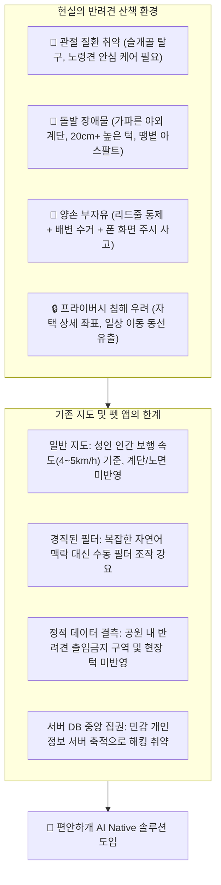

> [!IMPORTANT]
> **5대 핵심 해결 영역**
> 1. **자연어 산책 의도 정밀 구조화**: *"초코랑 30분 정도 폭신한 길로 걸을래"* ➔ LangGraph ReAct Agent가 Pydantic V2 Strict Schema로 변환 ([`US-A1`](docs/03_편안하개_Agile_User_Stories.md)).
> 2. **체급·연령별 적응형 시간-거리 환산**: 소형(2.8), 중형(3.6), 대형(4.2), 노령견(2.2 km/h) 보행 속도 모델 기반 목표 시간 $\pm 15\%$ 수렴 순환 루프 생성 ([`US-A3`](docs/03_편안하개_Agile_User_Stories.md)).
> 3. **다요소 과학 라우팅 & 종합 채점**: OSM 계단 완전 배제 + 15도 미만 무장애 완만경사 + 기상·노면 연동 지면온도 추정 및 고온 노면 회피 ➔ 100점 만점 최적 코스 도출 ([`US-B1~B3`](docs/03_편안하개_Agile_User_Stories.md)).
> 4. **초절전 다크 포켓 & 핸즈프리 음성 안내**: True Black OLED 화면과 주머니 속 30m 전 음성 코칭으로 두 손과 시선의 완전한 자유 보장 ([`US-C1~C2`](docs/03_편안하개_Agile_User_Stories.md)).
> 5. **프라이버시 바이 디자인(Local-First)**: 자택 좌표 및 상세 GPS 트랙은 모바일 기기 `AsyncStorage` 전용 보관, 커뮤니티 공유 시 출발/도착지 200m 공간 지터링 마스킹 ([`US-E1`](docs/03_편안하개_Agile_User_Stories.md), [`US-G2`](docs/03_편안하개_Agile_User_Stories.md), [`US-23`](docs/implementation_plan/frontend_phase2_stories_implementation_plan.md)).

---

## 💡 3. 4대 핵심 엔지니어링 전략 (Engineering Strategy)

```
+--------------------------------------------------------------------------------------------------+
|                                 편안하개 4대 핵심 엔지니어링 전략                                  |
+--------------------------------------------------------------------------------------------------+
  [전략 1] C++ GIS 바닥 코딩 ❌  ➔  AI Agent 외부 도구 제어 & Routing API Adapter 연동 ⭕
  [전략 2] 화면 주시 보행 위험 ❌  ➔  React Native Expo 시선 해방(Eyes-Free) 음성 안내 & 다크 포켓 ⭕
  [전략 3] 소셜 로그인 & 서버 DB ❌ ➔  간편 로컬 저장(Local-First) & 200m 공간 마스킹 보호 ⭕
  [전략 4] 과도한 스트리밍 인프라 ❌ ➔  예측 가능한 Stateless REST API & TDD 100% 가드레일 ⭕
```

* **1. AI Agent 도구 오케스트레이션**: 무거운 지리 알고리즘을 바닥부터 구현하지 않고, LangGraph ReAct Agent가 ORS/OSRM 라우팅 어댑터, DEM 고도 래스터, 지면온도 추정 모델을 표준 도구(`@tool`)로 지휘합니다.
* **2. 시선 해방(Eyes-Free) & 두 손의 자유**: 한 손에 리드줄을 쥐고 화면을 보는 위험을 없애기 위해, 백그라운드 GPS 추적과 `expo-speech` TTS 실시간 음성 브리핑(회전 30m 전 안내, 40m 이탈 경고)을 제공합니다.
* **3. 프라이버시 최우선 Local-First 아키텍처**: 반려견 프로필, 실보행 GPS 트랙, 자택 좌표는 기기 내부 `AsyncStorage`에만 보관하며, 클라우드(Supabase)는 200m 공간 마스킹된 공개 커뮤니티 코스만 최소한으로 취합합니다.
* **4. 무중단 무선 배포 (EAS Build 1회 + EAS Update OTA)**: 번거로운 스토어 재심사나 APK 재설치 없이, `expo-updates` 무선 무점검 OTA를 통해 핫픽스와 UI 개선 사항을 실시간 반영합니다.

---

## 🏗️ 4. 시스템 아키텍처 (System Architecture)

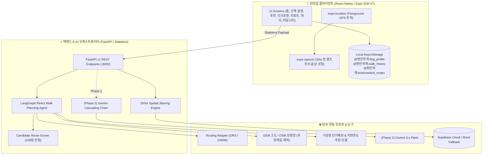

---

### 5.1 📸 실제 구동 화면 스크린샷 갤러리 (Key Screenshots Gallery)

편안하개 모바일 애플리케이션의 핵심 사용자 여정(User Journey)과 최신 실제 구동 화면 모음입니다. (고화질 원본: [`docs/screenshots/`](docs/screenshots/))

#### 🌟 1. 메인 홈 & 실시간 지면열 리포트 & 코스 탐색
| 01. 메인 홈 화면 | 02. 오늘의 산책 날씨 리포트 | 03. 맞춤 산책 조건 설정 | 04. 추천 산책 코스 프리뷰 |
| :---: | :---: | :---: | :---: |
| 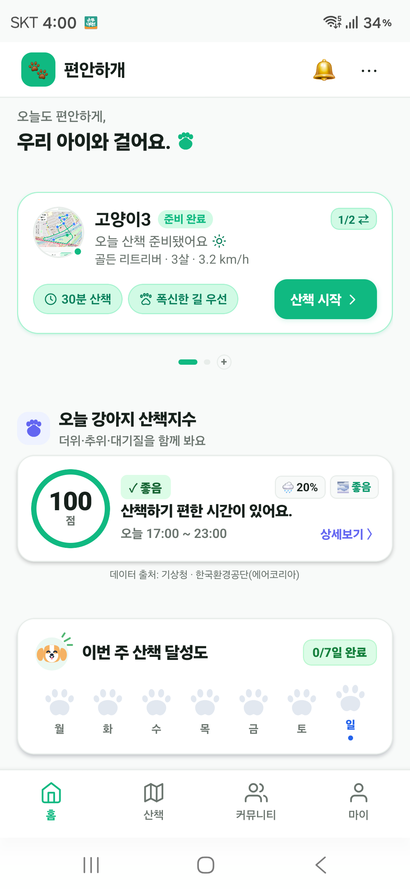 | 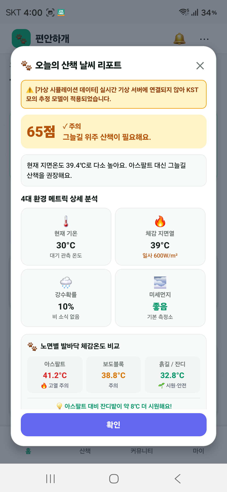 | 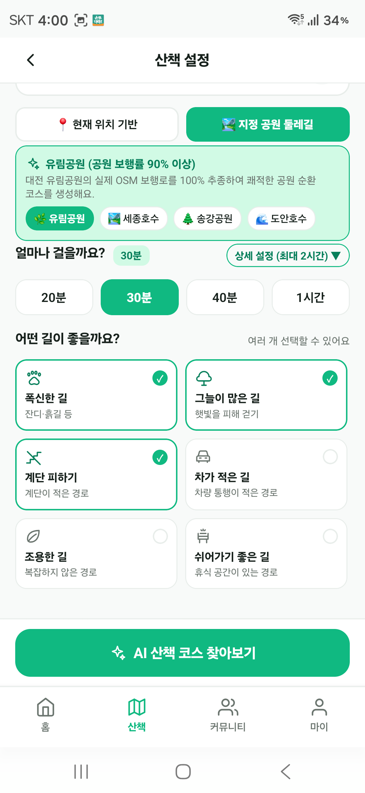 | 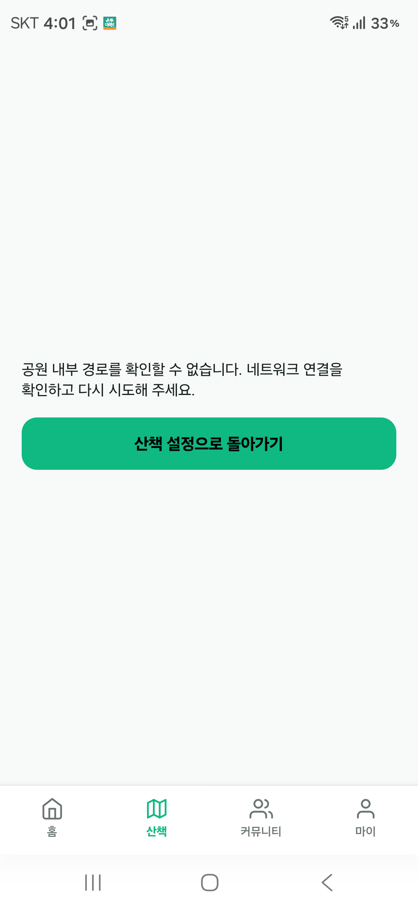 |
| **반려견 맞춤 대시보드**<br>• 초코(골든 리트리버) 준비 카드<br>• **산책지수 100점** 골든타임 위젯<br>• 7일 산책 달성도 게이지 | **정밀 날씨 분석 모달**<br>• 4대 환경 메트릭 (기온/지면열/강수/미세먼지)<br>• **노면별 발바닥 체감온도 비교**<br>• 기상청·에어코리아 공식 출처 | **산책 조건 다중 선택**<br>• 목표 시간 슬라이더 (15~120분)<br>• 6대 선호 보행길 원터치 칩<br>• 대전·세종 5대 공원 거점 연계 | **실시간 AI 코스 요약**<br>• 실제 OSM 도로망 경로 라인<br>• 웨이포인트 핀 및 구간 분석<br>• 완만길/폭신한 길 비율 요약 |

#### 🌟 2. 4단계 온보딩 위저드 플로우
| 01-1. 서비스 약관 동의 | 01-2. 반려견 프로필 등록 | 01-3. 위치 권한 안내 | 01-4. 온보딩 완료 축하 |
| :---: | :---: | :---: | :---: |
| 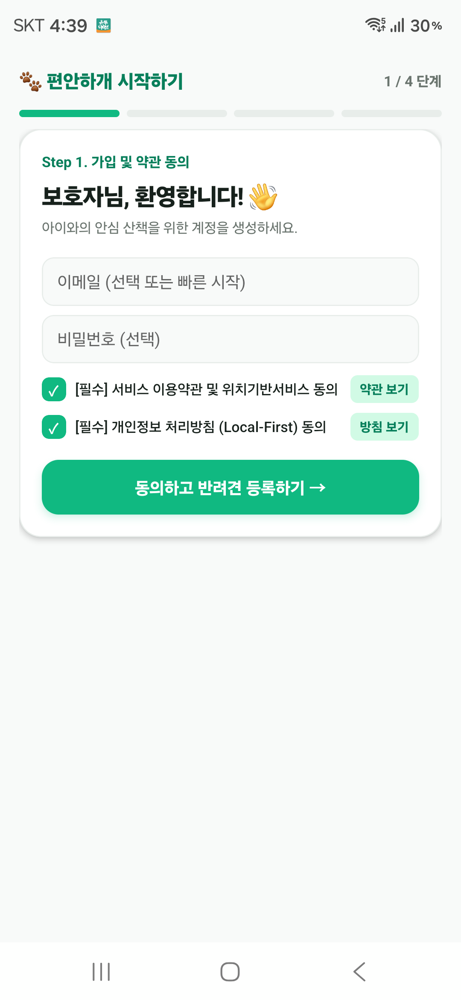 | 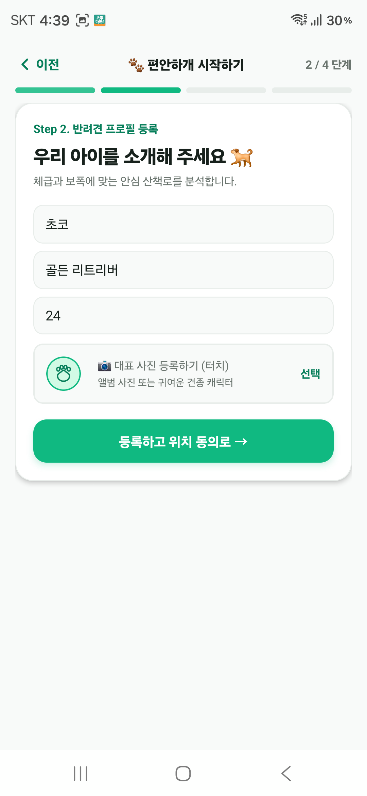 | 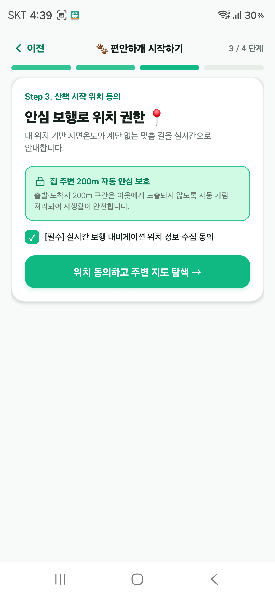 | 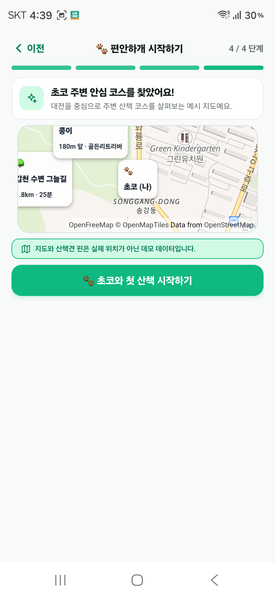 |
| **투명한 이용 약관**<br>• 필수 이용약관 & 개인정보 동의<br>• Local-First 프라이버시 원칙 | **강아지 프로필 등록**<br>• 이름, 견종, 생년월일, 체중<br>• 관절 케어 필요 수준 설정 | **위치 정보 권한 동의**<br>• 산책 시작 안내용 한정 수집<br>• 200m 마스킹 원칙 사전 고지 | **산책 준비 완료**<br>• 프로필 세팅 완료 축하<br>• 원터치 메인 홈 화면 진입 |

#### 🌟 3. 마이 프로필 & 안심 커뮤니티 피드
| 08-1. 반려견 프로필 관리 | 08-2. 3대 테마 선택기 | 08-3. 완주 산책 활동 리포트 | 08-4. 설정 및 데이터 관리 | 09. 커뮤니티 안심 피드 |
| :---: | :---: | :---: | :---: | :---: |
| 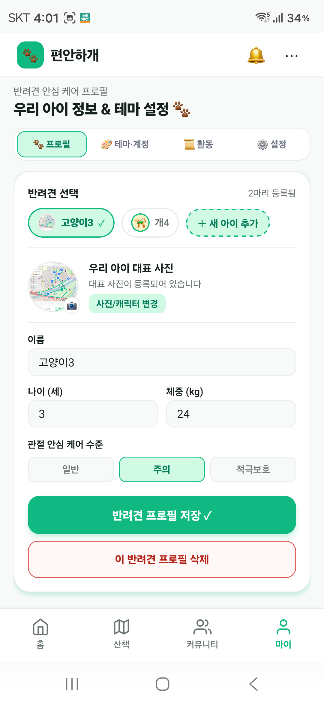 | 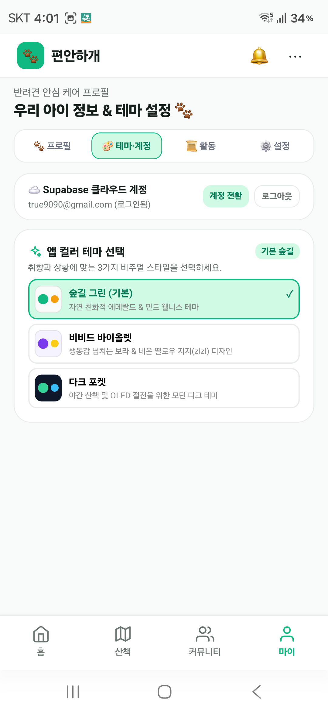 | 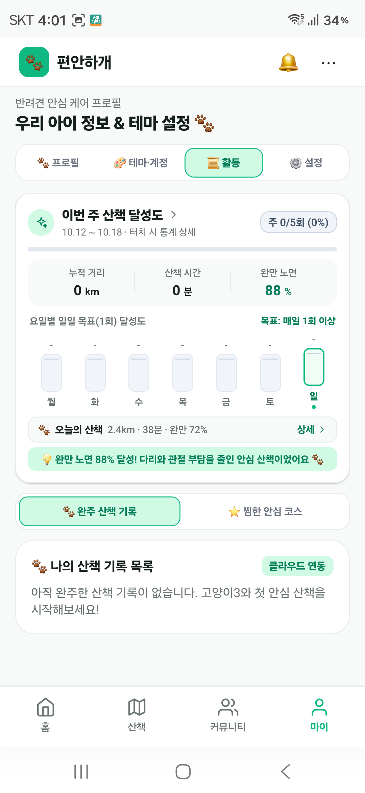 | 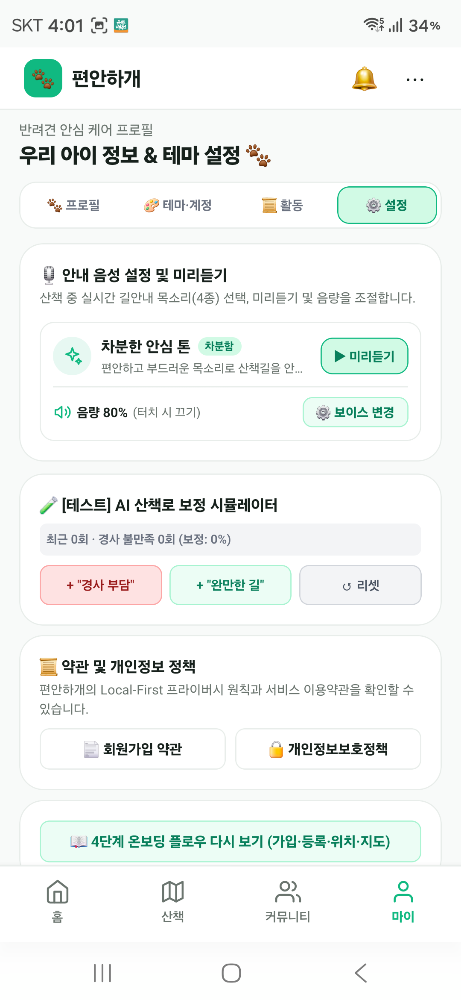 | 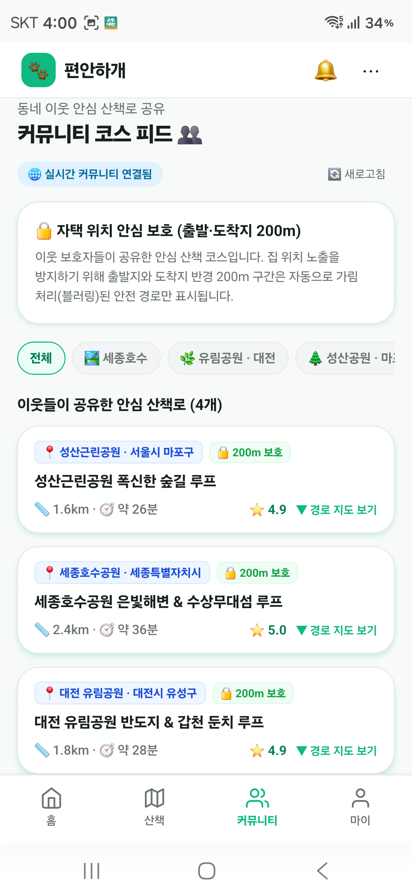 |
| **강아지 맞춤 케어**<br>• 나이/체중/성별 관리<br>• 다견 가정을 위한 전환 | **야외 시인성 테마**<br>• 숲길 / 비비드 / 다크 테마<br>• 눈부심 방지 고대비 토큰 | **보행 통계 & 상세 지도**<br>• GPS 경로·배변 지도 뷰어<br>• 찜한 코스 원터치 재산책 | **프라이버시 & 무결성**<br>• AI 음성 안내 설정<br>• CSV/JSON 내보내기 & 초기화 | **200m 공간 마스킹**<br>• 복합 기간 필터(7/30일/전체)<br>• 안심 코스 찜하기(즐겨찾기) |

---

### 5.2 🗺️ 6대 핵심 시나리오 화면 명세 및 사용자 여정

편안하개는 사전 계획부터 보행, 완주, 커뮤니티 보강까지 끊김 없는 사용자 여정을 제공합니다. (인터랙티브 웹 갤러리: [`mockup/index.html`](mockup/index.html))


| 시나리오 화면 | 화면 명칭 | 연계 스토리 | 핵심 기능 및 UX 특징 |
|:---:|---|:---:|---|
| **01** | **맞춤형 산책 플래너**<br/>([`01_walk_planner.jpg`](mockup/01_walk_planner.jpg)) | `US-A1`<br>`US-A2`<br>`US-A3` | • 반려견 활성 프로필 카드 ('초코', 관절 안심 케어 집중)<br>• 자연어 질의 입력창 (*"초코랑 30분 정도 폭신한 길로 걸을래"* 또는 음성 입력)<br>• 20~60분 시간 칩 및 6대 선호 노면 다중 선택(흙길, 잔디길, 그늘길, 계단 피하기 등) |
| **02** | **안심 순환 경로 프리뷰**<br/>([`02_route_preview.jpg`](mockup/02_route_preview.jpg)) | `US-B1~B3`<br>`US-C1`<br>`US-29` | • 실제 OSM 지도 위 노면/경사도별 색상 분기 Polyline (🌿 완만/그늘, 🟤 일반 보도, ⚠️ 주의 구간)<br>• 요약 카드: 총 1.4km, 예상 30분, 폭신한 길 비율 **88%** 표시<br>• 나만의 안심 코스 찜하기(즐겨찾기) 버튼 연동 |
| **03** | **초절전 다크 포켓 모드**<br/>([`03_pocket_mode.jpg`](mockup/03_pocket_mode.jpg)) | `US-C2`<br>`US-E1` | • Screen Wake Lock & OLED True Black (`#000000`) 배터리 극소화<br>• 주머니 오터치 방지 '밀어서 잠금 해제(Slide to Unlock)' 엄지 제스처<br>• 실시간 HUD(시간, 거리, 속도) 및 백그라운드 30m 전 TTS 음성 브리핑 연동 |
| **04** | **공원안내판 비전 인스펙터**<br/>([`04_vision_inspection.jpg`](mockup/04_vision_inspection.jpg)) | `US-D1`<br>`US-D2` | • 공원 입구 오프라인 종합안내도 촬영 ➔ Gemini Flash 구조화 파싱<br>• 비포장 흙길 산책로 녹색 식별, 반려견 출입 금지 구역 붉은색 차단<br>• 금지구역 라우팅 격리 및 흙길 우선 경유 대안 순환로 즉시 수립 |
| **05** | **완주 체크인 & 안심 리포트**<br/>([`05_walk_report.jpg`](mockup/05_walk_report.jpg)) | `US-E2`<br>`US-E3` | • 4대 핵심 보행 통계 4분할 그리드 (거리, 시간, 속도, 완만 노면 달성률)<br>• 3초 원터치 체감 피드백(별점) 수집 ➔ 다음 산책 무상태 경사도 보정 반영<br>• 나만의 안심 코스 즐겨찾기(`@편안하개:bookmarked_routes`) 로컬 저장 |
| **06** | **커뮤니티 안심 공유 피드**<br/>([`06_community_enrichment.jpg`](mockup/06_community_enrichment.jpg)) | `US-G2` | • 출발지/도착지 **반경 200m 공간 지터링 및 절단**으로 자택 위치 완벽 은폐<br>• 검증된 동네 산책로 코스 공유 및 실시간 서버 / 오프라인 듀얼 모드 지원 |

---

## 👥 6. 5인 팀 R&R, 프로젝트 마일스톤 및 개발 현황 (Team Roles, Milestones & Status)

### 6.1 5인 전담 R&R 및 협업 체계

편안하개 프로젝트는 5인 전담 R&R과 **18개 핵심 애자일 사용자 스토리 (총 62 Story Points / 298 Hours, Phase 2 확장 포함)** 체계로 운영됩니다. (상세 명세: [`02_편안하개_Team_building.md`](docs/02_편안하개_Team_building.md), [`03_편안하개_Agile_User_Stories.md`](docs/03_편안하개_Agile_User_Stories.md))

| 번호 | 역할 명칭 (포지션) | 담당 팀원 | 핵심 R&R 및 주요 산출물 | 연계 사용자 스토리 |
|:---:|---|:---:|---|:---:|
| **1번** | **팀장 / 프로젝트 총괄·AI 설계**<br/>(PM & AI Agent Lead) | **조현정** | • 전체 프로젝트 리딩, LangGraph ReAct 오케스트레이션<br>• 자연어 의도 파싱 스키마 설계 및 Candidate Route Scorer 튜닝 | `US-A1`, `US-A3`, `US-B3`, `US-E3`<br>*(Phase 2: US-D2)* |
| **2번** | **데이터 / 지도·공간데이터·AI 분석**<br/>(AI & Spatial Data Engineer) | **전황진** | • OSM 보행망·무장애길 정제, DEM 15도 미만 경사도 분석<br>• 기상청 지면온도 추정 모델 및 고온 노면 회피 파이프라인 | `US-B1`, `US-B2`, `US-F1`, `US-G1`, `US-G2`<br>*(Phase 2: US-D1, US-D2)* |
| **3번** | **서버 / 서버·맞춤 경로 계산**<br/>(Backend & Spatial Routing Lead) | **노희선** | • FastAPI 무상태 REST API 개발, ORS/OSRM 라우팅 어댑터<br>• 무장애길 및 지면온도 비용 함수 구현, 200m 공간 지터링 알고리즘 | `US-B1~B3`, `US-F1`, `US-G1`, `US-G2`<br>*(Phase 2: US-D2)* |
| **4번** | **앱 / 모바일 앱·GPS·음성 안내**<br/>(Frontend & Mobile App Lead) | **김승현** | • React Native Expo 모바일 앱 구축, 시선 해방 TTS 음성 안내<br>• Local-First 스토리지, 즐겨찾기(US-29), 온보딩(US-21), 위치동의(US-23) | `US-A2`, `US-C1`, `US-C2`, `US-E1~E3`, `US-H1`<br>*(Phase 2: US-29, 23, 21)* |
| **5번** | **UI / 화면 구현·품질 검증**<br/>(UI/UX Designer & Experience Lead) | **김정님** | • 핵심 시나리오 UI/UX 화면 개발, 고대비 시인성 토큰 적용<br>• 웰니스 카피라이팅 가드레일 준수, EAS 배포 및 CBT 총괄 | `US-A2`, `US-A3`, `US-C1`, `US-E2`, `US-F1`, `US-G1~G2`, `US-H1` |

#### 📋 팀원별 세부 역할 및 책임 범위 ([`02_편안하개_Team_building.md`](docs/02_편안하개_Team_building.md) 기준)

| 번호 | 담당자 | 공식 역할 & 포지션 | 쉽게 설명하면 (제안 MVP 역할) | 담당 범위 및 핵심 책임 | 배정 공수 | 관련 에픽 및 담당 스토리 |
|:---:|:---:|---|---|---|:---:|---|
| **1번** | **조현정 (팀장)** | **프로젝트 총괄·AI 기능 설계**<br/>(PM & AI Agent Lead) | **무엇을 만들지 정하고 AI와 전체 기능을 연결**<br/>(PM·AI 서비스 통합) | • LangGraph 기반 Walk Planning Agent 설계 및 오케스트레이션<br>• Pydantic V2 Strict Input Schema 및 상태 머신 수립<br>• 클라이언트 로컬 맥락(반려견 조건, 피드백) 기반 무상태(Stateless) 프롬프트 오케스트레이션<br>• 체급별 표준 보행 속도 모델 및 목표 시간 수렴도($\pm 15\%$) 튜닝<br>• 산책 생성 기준 이원화(`origin_mode`: 현위치 vs 5대 공원 거점 90%+ 가중치) 기획<br>• Candidate Route Scorer 다요소(무장애길+지면온도) 랭킹 수치 알고리즘 및 추천 사유 브리핑 | **55 h**<br/>(18.5%) | Epic A (`US-A1`, `US-A3`)<br>Epic B (`US-B3`)<br>Epic E (`US-E3`)<br>*(Phase 2: `US-D2`)* |
| **2번** | **전황진 (데이터)** | **지도·공간데이터·AI 분석**<br/>(AI & Spatial Data Engineer) | **어떤 길이 흙길·계단·경사인지 데이터로 정리**<br/>(GIS·공공데이터·공간분석) | • DEM 고도 래스터 적재 및 15도 미만 무장애 보행로 고도 분석<br>• 기상청 단기예보 격자 변환 및 실시간 수집 클라이언트(`kma_weather_client`) 구축<br>• 대전 3대 공원(유림/송강/도안) & 세종 2대 공원(세종호수/세종중앙) 정밀 보행망 정제<br>• 전국 공영주차장 API 및 커뮤니티 200m 공간 블러링(Spatial Jittering) 파이프라인<br>• *(Phase 2: Gemini 멀티모달 비전 AI 현장 위험 턱/계단 분석 및 공원 종합안내판 판독)* | **53 h**<br/>(17.8%) | Epic B (`US-B1`, `US-B2`)<br>Epic F (`US-F1`)<br>Epic G (`US-G1`, `US-G2`)<br>*(Phase 2: `US-D1`, `US-D2`)* |
| **3번** | **노희선 (서버)** | **서버·맞춤 경로 계산**<br/>(Backend & Spatial Routing Lead) | **반려견에게 적합한 산책길을 실제로 계산**<br/>(백엔드·맞춤경로 알고리즘) | • FastAPI 백엔드 코어 구축 및 Stateless REST API 엔드포인트 구현<br>• OpenRouteService / OSRM 라우팅 API Adapter 연동 및 대전·세종 5대 공원 정밀 라우팅<br>• 무장애길(OSM 계단 배제 + 경사 15도 미만 제어) 하드 제약 라우팅 및 위험 우회(`/reroute`)<br>• 기상·노면 연동 지면온도 기반 비용 함수 및 고온 노면 회피 라우팅 API<br>• Supabase Auth 간편 이메일 가입/로그인 및 커뮤니티 공개 코스 REST API<br>• 백엔드 Pytest TDD 단위 테스트 100% 통과 달성 | **74 h**<br/>(24.8%) | Epic B (`US-B1`, `US-B2`, `US-B3`)<br>Epic F (`US-F1`)<br>Epic G (`US-G1`, `US-G2`)<br>*(Phase 2: `US-D2`)* |
| **4번** | **김승현 (앱)** | **모바일 앱·GPS·음성 안내**<br/>(Frontend & Mobile App Lead) | **스마트폰에서 경로를 보고 실제 산책할 수 있게 구현**<br/>(모바일·GPS·산책 안내) | • React Native (Expo SDK 57) 모바일 앱 코어 아키텍처 구축<br>• Android Foreground Service + `expo-speech` 기반 시선 해방 핸즈프리 음성 안내 엔진 개발<br>• AI 보이스 프로필 4종 & 스마트 돌발 짖음 감지 자동 음소거/복구 (`ambientNoiseMonitor.ts`)<br>• 4단계 온보딩 플로우(가입/약관 $\to$ 반려견 $\to$ 위치동의 $\to$ 주변탐색 지도) 개발<br>• `react-native-maps` / OpenFreeMap 기반 구간별 색상 분기 Polyline 렌더링<br>• `AsyncStorage` 로컬 스토리지 모듈(반려견 프로필, 궤적, JSON 백업/복원, 북마크 보관함)<br>• EAS Build 1회 APK 패키징 & EAS Update (`expo-updates`) 무선 무점검 OTA 파이프라인<br>• 프론트엔드 Vitest 단위 테스트 100% 통과 달성 | **78 h**<br/>(26.2%) | Epic A (`US-A2`)<br>Epic C (`US-C1`, `US-C2`)<br>Epic E (`US-E1`, `US-E2`, `US-E3`)<br>Epic H (`US-H1`)<br>*(Phase 2: `US-D2`, `US-18`, `21`, `23`, `29`)* |
| **5번** | **김정님 (UI)** | **화면 구현·통합 테스트**<br/>(UI/UX Designer & Product Experience Lead) | **앱 화면을 완성하고 전체 기능이 제대로 연결되는지 확인**<br/>(UI 구현·통합·QA) | • 전문 디자이너: 편안하개 디자인 시스템 구축 (Color Tokens, Typography, Iconography)<br>• 핵심 시나리오 고화질 UI 화면 완성 (플래너, 프리뷰, 다크 포켓, 리포트, 커뮤니티)<br>• 다크 포켓 내 56px 대형 긴급 원터치 음소거 버튼 및 4단계 온보딩 UI/UX 구현<br>• 산책 완주 인포그래픽 요약 카드 & 보행 체감 피드백 UI 디자인<br>• 앱 전역 긍정적 웰니스 카피라이팅 가이드라인 수립 (질병 용어 100% 배제)<br>• 최소 5인 실사용자 필드 테스트(CBT) 사용성 평가(Usability Testing), 전체 기능 통합 검증 및 UI/UX 튜닝 총괄 | **38 h**<br/>(12.7%) | Epic A (`US-A2`, `US-A3`)<br>Epic C (`US-C1`)<br>Epic E (`US-E2`)<br>Epic F (`US-F1`)<br>Epic G (`US-G1`, `US-G2`)<br>Epic H (`US-H1`) |

---

### 6.2 팀원별 담당 사용자 스토리 요약
> 상세 요구사항 및 인수 조건(DoD): [`docs/03_편안하개_Agile_User_Stories.md`](docs/03_편안하개_Agile_User_Stories.md)

<table>
  <thead>
    <tr>
      <th align="center">담당 팀원 (역할)</th>
      <th align="center">스토리 ID</th>
      <th align="left">에픽 (Epic)</th>
      <th align="left">사용자 스토리 명칭</th>
      <th align="center">포인트</th>
      <th align="left">담당 역할 내 구현 및 책임 요약</th>
    </tr>
  </thead>
  <tbody>
    <tr>
      <td rowspan="5" align="center"><strong>1번 조현정</strong><br/>(팀장 / AI 설계)</td>
      <td align="center"><code>US-A1</code></td>
      <td>Epic A (조건 입력 & 개인화)</td>
      <td>대화형 자연어 산책 요청 및 조건 구조화</td>
      <td align="center">5 pt</td>
      <td>자연어 발화에서 목표 시간·계단 회피·경사·그늘 선호도를 추출하고 로컬 반려견 프로필과 결합해 Pydantic 스키마(<code>WalkIntent</code>)로 구조화</td>
    </tr>
    <tr>
      <td align="center"><code>US-A3</code></td>
      <td>Epic A (조건 입력 & 개인화)</td>
      <td>목표 산책 시간/거리 기반 환산 (속도/슬라이더)</td>
      <td align="center">3 pt</td>
      <td>체급·연령별 표준 보행 속도 모델(소형 2.8, 중형 3.6, 대형 4.2, 노령견 2.2 km/h) 적용 및 목표 시간 ±15% 수렴 튜닝</td>
    </tr>
    <tr>
      <td align="center"><code>US-B3</code></td>
      <td>Epic B (무장애·지면온도 라우팅)</td>
      <td>Routing API Adapter 연동 및 후보 경로 다요소 스코어링</td>
      <td align="center">8 pt</td>
      <td>후보 경로들의 무장애길 지표(계단 0, 경사 &lt;15°), 지면온도 안전도, 거리 적합도를 100점 만점으로 종합 채점 및 추천 사유 브리핑 생성</td>
    </tr>
    <tr>
      <td align="center"><code>US-E3</code></td>
      <td>Epic E (산책 기록 & Memory)</td>
      <td>로컬 누적 피드백 기반 무상태(Stateless) AI 추천 보정</td>
      <td align="center">3 pt</td>
      <td>클라이언트가 전달한 최근 산책 체감 피드백 요약을 무상태로 주입받아 다음 산책 추천 시 허용 경사도 등 에이전트 가중치 동적 보정</td>
    </tr>
    <tr>
      <td align="center"><code>US-D2</code></td>
      <td>Phase 2 (동적 장애물 우회)</td>
      <td>현장 위험 구간 우회 및 동적 재탐색</td>
      <td align="center">5 pt</td>
      <td>산책 중 위험 구간 감지 및 동적 우회 경로 재산출에 따른 AI 안내 브리핑 설계</td>
    </tr>
    <tr>
      <td rowspan="6" align="center"><strong>2번 전황진</strong><br/>(데이터 / 공간·AI)</td>
      <td align="center"><code>US-B1</code></td>
      <td>Epic B (무장애·지면온도 라우팅)</td>
      <td>지도·지자체 데이터 기반 무장애길(경사 15도 미만·무계단) 안심 경로 도출</td>
      <td align="center">8 pt</td>
      <td>대전·세종 5대 공원 OSM 보행망 및 공공 무장애길 정제, DEM 고도 래스터 기반 15도 미만 완만 경사 보행로 데이터 분석</td>
    </tr>
    <tr>
      <td align="center"><code>US-B2</code></td>
      <td>Epic B (무장애·지면온도 라우팅)</td>
      <td>기상·노면 연동 지면온도 기반 안심 경로 도출 (열 위험 회피)</td>
      <td align="center">5 pt</td>
      <td>기상청 단기예보(기온·일사량)와 링크별 노면 재질(아스팔트 vs 흙/잔디/탄성포장)을 결합한 경험적 지면온도 추정 모델 구축</td>
    </tr>
    <tr>
      <td align="center"><code>US-F1</code></td>
      <td>Epic F (기상 연동 열 위험 관리)</td>
      <td>기상청 단기예보 연동 시간대별 열 위험 지수 안내</td>
      <td align="center">3 pt</td>
      <td>기상청 격자 변환(<code>kma_grid_converter</code>) 및 실시간 수집 클라이언트(<code>kma_weather_client</code>) 구축, 시간대별 지면열 위험 지수·골든타임 산출</td>
    </tr>
    <tr>
      <td align="center"><code>US-G1</code></td>
      <td>Epic G (거점 연계 & 커뮤니티)</td>
      <td>출발 거점 연계 공영주차장(P&amp;R) 코스 탐색</td>
      <td align="center">2 pt</td>
      <td>전국 공영주차장 공공데이터 POI 정제 및 주차장 출입구 좌표를 산책 출발·도착 웨이포인트로 자동 매핑</td>
    </tr>
    <tr>
      <td align="center"><code>US-G2</code></td>
      <td>Epic G (거점 연계 & 커뮤니티)</td>
      <td>간편 이메일 가입 및 코스 공유 (출발지 200m 마스킹)</td>
      <td align="center">4 pt</td>
      <td>커뮤니티 코스 공유 시 자택 위치 노출 방지를 위해 출발·도착지 반경 200m 구간 좌표를 자동 절단·블러링하는 공간 지터링 파이프라인 구현</td>
    </tr>
    <tr>
      <td align="center"><code>US-D1</code><br/><code>US-D2</code></td>
      <td>Phase 2 (비전 AI & 동적 우회)</td>
      <td>Vision AI 현장 턱·계단 시각 분석 및 위험 구간 동적 우회</td>
      <td align="center">10 pt</td>
      <td>Gemini 순차 폴백 체인 기반 현장 높은 턱·계단 시각 판독 및 공원 종합안내판 반려견 출입금지 구역 JSON 파싱</td>
    </tr>
    <tr>
      <td rowspan="7" align="center"><strong>3번 노희선</strong><br/>(서버 / 맞춤 경로)</td>
      <td align="center"><code>US-B1</code></td>
      <td>Epic B (무장애·지면온도 라우팅)</td>
      <td>지도·지자체 데이터 기반 무장애길(경사 15도 미만·무계단) 안심 경로 도출</td>
      <td align="center">8 pt</td>
      <td>계단(<code>highway=steps</code>) 하드 제약 배제 및 15도 미만 완만 경사 가중치가 적용된 서버 라우팅 엔진 및 무장애 메타데이터 스키마 구현</td>
    </tr>
    <tr>
      <td align="center"><code>US-B2</code></td>
      <td>Epic B (무장애·지면온도 라우팅)</td>
      <td>기상·노면 연동 지면온도 기반 안심 경로 도출 (열 위험 회피)</td>
      <td align="center">5 pt</td>
      <td>추정 지면온도 35℃ 초과 고온 구간에 동적 페널티 가중치를 부여하여 저온 안전 노면을 우선 탐색하는 라우팅 비용 함수 구현</td>
    </tr>
    <tr>
      <td align="center"><code>US-B3</code></td>
      <td>Epic B (무장애·지면온도 라우팅)</td>
      <td>Routing API Adapter 연동 및 후보 경로 다요소 스코어링</td>
      <td align="center">8 pt</td>
      <td>OpenRouteService / OSRM 라우팅 어댑터 연동으로 실제 도로망 순환 후보 경로 2~3개를 1.5초 내 수집 및 최적 경로 GeoJSON·스텝 반환</td>
    </tr>
    <tr>
      <td align="center"><code>US-F1</code></td>
      <td>Epic F (기상 연동 열 위험 관리)</td>
      <td>기상청 단기예보 연동 시간대별 열 위험 지수 안내</td>
      <td align="center">3 pt</td>
      <td>1.1km 격자 단위 10분 TTL 메모리 캐시 및 타임아웃 캡이 적용된 실시간 열 위험 지수 조회 REST API(<code>GET /api/v1/weather/heat-risk</code>) 구현</td>
    </tr>
    <tr>
      <td align="center"><code>US-G1</code></td>
      <td>Epic G (거점 연계 & 커뮤니티)</td>
      <td>출발 거점 연계 공영주차장(P&amp;R) 코스 탐색</td>
      <td align="center">2 pt</td>
      <td>반경 내 공영주차장 탐색 API(<code>GET /api/v1/parking/nearby</code>) 및 주차장 출입구 스냅 기반 순환 코스 생성 엔드포인트 구현</td>
    </tr>
    <tr>
      <td align="center"><code>US-G2</code></td>
      <td>Epic G (거점 연계 & 커뮤니티)</td>
      <td>간편 이메일 가입 및 코스 공유 (출발지 200m 마스킹)</td>
      <td align="center">4 pt</td>
      <td>Supabase Auth 간편 이메일 가입/로그인 연동 및 200m 공간 마스킹이 적용된 공개 코스 공유·피드 조회 REST API 구현</td>
    </tr>
    <tr>
      <td align="center"><code>US-D2</code></td>
      <td>Phase 2 (동적 장애물 우회)</td>
      <td>현장 위험 구간 우회 및 동적 재탐색</td>
      <td align="center">5 pt</td>
      <td>위험 지점 좌표를 임시 차단 링크로 등록하고 3초 이내에 안전 우회로를 재산출하는 <code>/api/v1/walk/reroute</code> 엔드포인트 구현</td>
    </tr>
    <tr>
      <td rowspan="8" align="center"><strong>4번 김승현</strong><br/>(앱 / GPS·음성 안내)</td>
      <td align="center"><code>US-A2</code></td>
      <td>Epic A (조건 입력 & 개인화)</td>
      <td>반려견 프로필 로컬 등록 및 JSON 백업/복원</td>
      <td align="center">3 pt</td>
      <td>반려견 프로필을 서버 DB 전송 없이 기기 <code>AsyncStorage</code>에만 영속 저장하고 로컬 JSON 파일 내보내기/가져오기 백업 모듈 구현</td>
    </tr>
    <tr>
      <td align="center"><code>US-C1</code></td>
      <td>Epic C (모바일 UI & 핸즈프리 안내)</td>
      <td>React Native Maps 기반 구간별 색상 분기 경로 시각화</td>
      <td align="center">5 pt</td>
      <td><code>react-native-maps</code> / OpenFreeMap 지도 위에 구간 속성별 분기 색상(완만/그늘 초록, 일반 파랑, 주의 주황) Polyline 및 마커 렌더링</td>
    </tr>
    <tr>
      <td align="center"><code>US-C2</code></td>
      <td>Epic C (모바일 UI & 핸즈프리 안내)</td>
      <td>시선 해방(Eyes-Free) 백그라운드 핸즈프리 음성 길 안내</td>
      <td align="center">5 pt</td>
      <td>Android Foreground Service + <code>expo-speech</code> 기반 주머니 속 30m 전 회전 음성 안내, 40m 이탈 알림, AI 보이스 4종 및 73dB 짖음 감지 자동 음소거</td>
    </tr>
    <tr>
      <td align="center"><code>US-E1</code></td>
      <td>Epic E (산책 기록 & Memory)</td>
      <td>백그라운드 GPS 위치 추적 및 실산책 경로 로컬 저장</td>
      <td align="center">5 pt</td>
      <td>백그라운드 실보행 GPS 궤적을 수집해 로컬(<code>@편안하개:walk_history</code>)에 영구 저장하고 완주 상세 화면에서 계획 경로와 오버레이 시각화</td>
    </tr>
    <tr>
      <td align="center"><code>US-E2</code></td>
      <td>Epic E (산책 기록 & Memory)</td>
      <td>산책 종료 후 보행 체감 피드백 수집 및 로컬 통계</td>
      <td align="center">3 pt</td>
      <td>산책 완료 시 보행 지표 통계 산출 및 사용자 체감 피드백·별점을 로컬 산책 이력 메타데이터에 즉시 바인딩</td>
    </tr>
    <tr>
      <td align="center"><code>US-E3</code></td>
      <td>Epic E (산책 기록 & Memory)</td>
      <td>로컬 누적 피드백 기반 무상태(Stateless) AI 추천 보정</td>
      <td align="center">3 pt</td>
      <td>로컬에 누적된 최근 3회 산책 피드백 요약을 산책 계획 요청 페이로드(<code>feedbackContext.ts</code>)에 담아 서버로 무상태 전달</td>
    </tr>
    <tr>
      <td align="center"><code>US-H1</code></td>
      <td>Epic H (무중단 배포 & 실사용 검증)</td>
      <td>EAS Build 1회 배포, EAS Update 무선 OTA 및 5인 CBT</td>
      <td align="center">5 pt</td>
      <td>EAS Build 기반 테스터용 Android APK 1회 패키징 배포 및 <code>expo-updates</code> 무선 무점검 OTA 실시간 핫픽스 파이프라인 구축</td>
    </tr>
    <tr>
      <td align="center"><code>US-D2</code>, <code>18</code>,<br/><code>21</code>, <code>23</code>, <code>29</code></td>
      <td>Phase 2 (모바일 확장 백로그)</td>
      <td>위험 우회 안내, 원터치 배변 마킹, 온보딩, 위치동의, 즐겨찾기 보관함</td>
      <td align="center">14 pt</td>
      <td>위험 우회 안내 전환(<code>US-D2</code>), 한 손 원터치 배변 마킹 FAB(<code>US-18</code>), 4단계 온보딩 위저드(<code>US-21</code>), 위치동의 투명 고지(<code>US-23</code>), 코스 북마크 로컬 보관함(<code>US-29</code>) 구현</td>
    </tr>
    <tr>
      <td rowspan="8" align="center"><strong>5번 김정님</strong><br/>(UI / 화면·통합 테스트)</td>
      <td align="center"><code>US-A2</code></td>
      <td>Epic A (조건 입력 & 개인화)</td>
      <td>반려견 프로필 로컬 등록 및 JSON 백업/복원</td>
      <td align="center">3 pt</td>
      <td>질병 용어를 100% 배제하고 '관절 안심 케어 수준', '폭신한 길 위주' 등 긍정적 웰니스 카피라이팅이 적용된 프로필 등록·관리 UI 구현</td>
    </tr>
    <tr>
      <td align="center"><code>US-A3</code></td>
      <td>Epic A (조건 입력 & 개인화)</td>
      <td>목표 산책 시간/거리 기반 환산 (속도/슬라이더)</td>
      <td align="center">3 pt</td>
      <td>15분 단위 세분화 산책 시간 슬라이더(<code>WalkDurationSlider.tsx</code>), 자유 산책 모드 및 체급별 예상 거리 자동 환산 플래너 화면 구현</td>
    </tr>
    <tr>
      <td align="center"><code>US-C1</code></td>
      <td>Epic C (모바일 UI & 핸즈프리 안내)</td>
      <td>React Native Maps 기반 구간별 색상 분기 경로 시각화</td>
      <td align="center">5 pt</td>
      <td>고대비 야외 시인성 컬러 토큰 적용 및 하단 코스 요약 카드(접기/펼치기 Split View)·회전 스텝 리스트 뷰(<code>CourseRecommendationView.tsx</code>) 구현</td>
    </tr>
    <tr>
      <td align="center"><code>US-E2</code></td>
      <td>Epic E (산책 기록 & Memory)</td>
      <td>산책 종료 후 보행 체감 피드백 수집 및 로컬 통계</td>
      <td align="center">3 pt</td>
      <td>산책 완주 인포그래픽 요약 카드(거리, 시간, 완만 구간 비율) 및 3초 원터치 간편 피드백 모달(<code>QuickFeedbackModal.tsx</code>) UI 디자인·구현</td>
    </tr>
    <tr>
      <td align="center"><code>US-F1</code></td>
      <td>Epic F (기상 연동 열 위험 관리)</td>
      <td>기상청 단기예보 연동 시간대별 열 위험 지수 안내</td>
      <td align="center">3 pt</td>
      <td>메인 홈 시간대별 열 위험 지수·골든타임 위젯(<code>GoldenTimeWidget.tsx</code>) 및 노면별 발바닥 체감온도 비교 날씨 리포트 모달 UI 구현</td>
    </tr>
    <tr>
      <td align="center"><code>US-G1</code></td>
      <td>Epic G (거점 연계 & 커뮤니티)</td>
      <td>출발 거점 연계 공영주차장(P&amp;R) 코스 탐색</td>
      <td align="center">2 pt</td>
      <td>플래너 화면 내 주차장 연계(P&amp;R) 탐색 토글 및 코스 요약 카드 내 주차장 명칭·기본 정보 표시 UI 구현</td>
    </tr>
    <tr>
      <td align="center"><code>US-G2</code></td>
      <td>Epic G (거점 연계 & 커뮤니티)</td>
      <td>간편 이메일 가입 및 코스 공유 (출발지 200m 마스킹)</td>
      <td align="center">4 pt</td>
      <td>간편 가입 화면 및 200m 안심 마스킹 뱃지가 적용된 이웃 공유 코스 탐색 커뮤니티 피드 화면 구현</td>
    </tr>
    <tr>
      <td align="center"><code>US-H1</code></td>
      <td>Epic H (무중단 배포 & 실사용 검증)</td>
      <td>EAS Build 1회 배포, EAS Update 무선 OTA 및 5인 CBT</td>
      <td align="center">5 pt</td>
      <td>최소 5인 이상 실사용자 필드 산책 테스트(CBT) 사용성 평가(Usability Testing) 수행, 핸즈프리 음성·계단 회피 체감 설문 수집 및 통합 QA 총괄</td>
    </tr>
  </tbody>
</table>

---

### 6.3 프로젝트 주요 마일스톤 (수행계획서 정합)
> 상세 타임라인 명세: [`docs/05_편안하개_프로젝트_수행계획서_일정.md`](docs/05_편안하개_프로젝트_수행계획서_일정.md)

| 마일스톤 단계 | 일정 | 주요 목표 및 산출물 | 책임 |
|---|:---:|---|:---:|
| **프로젝트 킥오프** | **10월 12일 (월)** | • 5인 팀원별 전담 업무 착수 및 스프린트 1 가동<br>• 기획/아키텍처/TDD 환경 기반 코어 개발 돌입 | 5인 전원 |
| **개발 마감 (Code Freeze)** | **10월 30일 (금)** | • 전 기능 구현 완료 (AI, GIS, 서버, 앱, UI)<br>• EAS Build 테스터용 APK 1회 패키징 완료 | 5인 전원 |
| **집중 테스트와 보완 (Test & Refine)** | **10월 31일 (토) ~ 11월 7일 (토)** | • 최소 5인 실사용자 필드 산책 현장 테스트(CBT)<br>• 주머니 속 핸즈프리 음성 안내 및 계단 회피 체감 검증<br>• EAS Update (`expo-updates`) 무선 OTA 실시간 핫픽스 및 보완<br>• 피드백 수집 기반 가중치 미세 튜닝 및 완성도 극대화 | Lead: 김정님(UI/QA)<br>& 5인 전원 |
| **최종 제출 마감 (Final Submission)** | **11월 8일 (일)** | • 프로젝트 최종 산출물 및 GitHub 코드베이스 제출<br>• 최종 발표 PPT 및 데모 시연 영상 제출 | Lead: 조현정(팀장)<br>& 5인 전원 |

---

### 6.4 📊 ~~현재 프로젝트 개발 및 구현 현황~~ (2026-10-21 기록)

본 프로젝트는 핵심 사용자 여정 및 Phase 2 프론트엔드 단독 완결형 스토리를 100% 완료하고 엄격한 품질 가드레일을 통과한 안정화 상태입니다.

#### 1) 종합 품질 검증 지표
| 구분 | 검증 항목 | 달성 지표 | 상태 | 세부 내용 |
| :--- | :--- | :---: | :---: | :--- |
| **Backend** | Pytest TDD 스위트 | **796 passed / 5 skipped** | `PASS` | 801개 수집, LangGraph ReAct, KMA 실시간 예보, 지면열 캐시, 5대 공원 라우팅, 200m 마스킹 검증 |
| **Frontend** | Vitest 단위 테스트 | **406 / 406** | `PASS` | 70개 테스트 파일 전원 통과 (소음감지, 음성설정, 4단계 온보딩, 북마크, 배변마킹, 골든타임, 커뮤니티/마이페이지) |
| **Frontend** | TypeScript 컴파일 검사 | **0 Errors** | `PASS` | `tsc --noEmit` 완벽 무결성 통과 (Strict Mode) |
| **Code Quality** | SonarLint 단일 파일 줄수 | **100% 준수** | `PASS` | 모든 신규/수정 파일 250줄 이하 가드레일 엄수 (`App.tsx` 249줄) |
| **UX & Copy** | 전문 용어 순화 가드레일 | **100% 완료** | `PASS` | 스토리 번호(`US-xx`) 및 개발자 용어 전면 배제, 웰니스 어휘 적용 |
| **CI/CD** | GitHub Actions Pipeline | **Auto-Merge** | `PASS` | `backend-test` (796 passed, 5 skipped) + `mobile-app-ci` (406) 통과 시 자동 머지 파이프라인 |

#### 2) 최근 완성된 주요 기능 구현 내용
1. **대전 3대 공원 & 세종 2대 공원 5대 파일럿 실증 거점 연동**:
   - 대전(유림공원, 송강근린공원, 도안호수공원) 및 세종(세종호수공원, 세종중앙공원) 실제 OSM 정밀 보행망 탑재.
   - 공원 선택 시 공원 내부 산책 비율 **90% 이상** 집중 가중치 코스 우선 생성.
2. **산책 경로 생성 기준 이원화 (`origin_mode`)**:
   - `current_location`(사용자 현위치 주변 순환)과 `pilot_park`(지정한 공원 중심/내부 산책) 두 가지 경로 탐색 모드 지원.
3. **기상청 단기예보 실시간 연동 (KMA Weather Client & Grid Converter)**:
   - 위경도-기상청 격자(X, Y) 실시간 좌표 변환 및 기온, 하늘상태, 강수확률 연동.
   - 경험적 지면열 수지식 기반 지면온도 추정 및 시간대별 산책 골든타임 알림 (1시간 클라이언트 캐싱).
4. **기상청 지면열 & 에어코리아 대기질 실시간 연동 성능 최적화 (US-F1, US-B2)**:
   - 백엔드 1.1km 격자 단위 10분 TTL 메모리 캐시 구축으로 반복 요청 0.001초 응답 보장.
   - Open-Meteo 일사량 429 감지 및 2.0초 타임아웃 캡, 에어코리아 대기질 2.5초 타임아웃 캡 적용.
   - 프론트엔드 네트워크 타임아웃 15초 현실화 및 백엔드 사전 웜업(`warmupBackendServer`), 정직한 실시간 지수 분석 로딩 상태(···) 적용으로 가상 데이터 전환 오인 방지.
5. **AI 음성 가이드 보이스 프로필 4종 & 스마트 돌발 짖음 감지 자동 음소거/복구**:
   - 4대 맞춤형 AI 보이스 프로필(`calm_female`, `bright_female`, `calm_male`, `friendly_male`) 및 독립 볼륨 슬라이더 제공.
   - 73dB 이상 돌발 소음/짖음 감지 시 즉시 음성 안내 일시 차단(Ducking) 후 3초 뒤 자동 복구 (Auto-Resume).
   - 산책 중 긴급 상황 시 한 손으로 터치 가능한 다크 포켓 내 56px 대형 긴급 원터치 음소거 버튼 구축.
6. **팀장 컨펌 4단계 온보딩 플로우 & 회원가입 약관/개인정보 처리방침**:
   - 1단계(가입 & 필수 약관 동의) → 2단계(반려견 프로필 등록) → 3단계(산책 시작 시점 위치 동의) → 4단계(현위치 기반 주변 인기 코스/산책견 탐색 지도 진입)로 사용자 이탈 방지.
7. **산책 시간 15분 단위 세분화 & 무제한 자유 산책 모드**:
   - 15~120분+ 슬라이더 및 직접 분 입력 지원, 목표 시간 도달 후에도 누적 기록이 유지되는 '자유 산책 모드' 탑재.
8. **한 손 원터치 배변 마킹 FAB (US-18)**:
   - 산책 중 한 손 Thumb Zone 52px 원터치 플로팅 버튼(💩 대변 / 💧 소변), 햅틱 진동(60ms), 완주 리포트 타임라인 표출.
9. **나만의 안심 코스 즐겨찾기(Bookmark) 보관함 (US-29)**:
   - 마음에 든 코스를 로컬 `@편안하개:bookmarked_routes`에 원터치 저장, 서버 재호출 없이 0.1초 만에 즉시 재산책.
10. **OpenFreeMap + MapLibre 고정밀 벡터 배경 지도 구현 계획 수립**:
    - 구글 맵 종속성 및 API 키 유출 위험을 원천 차단하고 100% 무료 오픈소스 GPU 가속 벡터 지도 도입 계획 확립.
11. **산책 완료 후 내보내기 기능의 사용자 접근성 개선 (Issue #128)**:
    - 산책 완료 후 누적된 보행 지표를 동물병원 수의사 제출용(CSV 엑셀) 및 기기 이전/개인 소장용(JSON 백업)으로 손쉽게 내보낼 수 있는 접이식 아코디언 컴포넌트 탑재.
12. **산책 기록 상세 지도 모달 및 실제 GPS 이동 경로·배변 마킹 오버레이 (Issue #129, US-G2)**:
    - 과거 완주 기록의 상세 지도 보기 터치 시 MapLibre 기반 고해상도 벡터 지도 위에 실제 보행 GPS 경로(LineString)와 출발(🚩)·도착(🏁) 핀, 산책 중 기록된 배변(대변 💩 / 소변 💧) 위치를 시간대별로 정확히 시각화.
13. **마이페이지 활동 탭 UI 통일 및 기간별 보행 지표 통계 요약 (Issue #130)**:
    - 마이페이지 산책 기록 카드를 커뮤니티 피드와 일치하는 풍부하고 일관된 카드 레이아웃(완주 인증 뱃지, 안심 마스킹 뱃지, 4대 보행 지표 칩, 별점 만족도, 피드백 태그)으로 전면 통일.
    - 기간 필터(`최근 7일` / `최근 30일` / `전체`) 선택에 따른 산책 횟수, 총 거리, 총 시간, 완만 노면율, 총 배변 수 집계 통계 요약 위젯 제공.
14. **커뮤니티 화면 복합 기간 필터링 및 안심 코스 찜(북마크) 보관함 양방향 복원**:
    - 커뮤니티 화면 목록에 기존 랜드마크 필터와 결합된 기간 필터(`최근 7일` / `최근 30일` / `전체 기간`) 복합(AND) 필터링 도입.
    - 각 피드 카드 및 모달 내 찜하기(북마크) 버튼을 복원 배치하여 오프라인에서도 마이페이지 "⭐ 찜한 안심 코스" 보관함과 즉각 연동 및 원터치 산책 시작 지원.
15. **다견 가정 맞춤형 강아지 프로필 관리 및 직관적 추가 플로우 (Issue #127, US-A2)**:
    - 상단 등록된 다견 선택 칩 바(`[🐾 초코] [🐾 콩이 ✓] [+ 새 강아지 추가]`), 강아지별 대표 사진 및 맞춤 체중/나이/관절 케어 레벨 독립 관리 모달 지원.

### 6.5 2026-10-23 저장소 코드 기준 현황 보완

아래 내용은 기존 구현 현황과 테스트 기록을 삭제하지 않고, 저장소에서 확인되는 화면·서비스·API 연결을 덧붙인 갱신이다. 기능 코드의 존재는 모든 인수 조건의 통과나 실기기·운영 환경 검증을 의미하지 않는다.

| 영역 | 저장소에서 확인되는 구현 | 주요 코드 위치 |
|---|---|---|
| 앱 화면 | 홈, 산책/코스 탐색, 다크 포켓 산책 진행, 완주 리포트, 커뮤니티, 마이페이지 | `frontend/src/screens/`, `frontend/App.tsx` |
| 개인화·저장 | 다견 프로필, 온보딩·동의, 로컬 산책 이력, 피드백·통계, JSON 백업, 코스 북마크 | `frontend/src/services/`, `frontend/src/components/profile/` |
| 산책 진행·안전 | 백그라운드 GPS, TTS 안내, 음성 설정·소음 감지, 배변/소변 마킹, 지도 보기, 위험 제보·우회·돌아가기 | `frontend/src/screens/DarkPocketScreen.tsx`, `frontend/src/services/locationService.ts`, `frontend/src/services/hazardApi.ts` |
| 경로·외부 정보 | 자연어/음성 조건 입력, 현 위치/지정 공원 경로 계획, 지면온도·기상, 공영주차장 검색 | `backend/agent/`, `backend/services/`, `backend/main.py` |
| 커뮤니티 | 코스 피드·공유, 인증 연계, 공유 위치 마스킹 | `frontend/src/services/communityApi.ts`, `backend/agent/spatial_masking.py`, `backend/main.py` |

백엔드 라우트 코드에서 산책 계획(`/api/v1/walk/plan`), 경로 재탐색(`/api/v1/walk/reroute`), 현장 안전(`/api/v1/surface/inspect`, `/api/v1/hazards`, `/api/v1/walk/forward-safety`), 커뮤니티(`/api/v1/community/feed`, `/api/v1/community/share`), 기상(`/api/v1/weather/heat-risk`), 주차장(`/api/v1/parking/nearby`) 엔드포인트를 확인했다.

#### 검증 범위 및 변경 이력

- 화면·서비스·백엔드 라우트의 구현 연결을 소스 코드로 확인했다. 이번 갱신에서 전체 Vitest/Pytest를 실행하지 않았으므로 기존 테스트 통과 수는 이전 기록으로 유지한다.
- `cd frontend && npm run check`의 TypeScript 검사(`tsc --noEmit`)는 통과했다.
- 기존 문서에는 MVP 15개와 README 일부의 18개 핵심 스토리 등 서로 다른 집계가 남아 있다. 원래 내용을 유지하며 숫자를 임의로 통일하지 않았고, 범위별 집계 및 완료 판정은 정합성 확인 대상으로 남겼다. 상세 매핑은 [`docs/03_편안하개_Agile_User_Stories.md`](docs/03_편안하개_Agile_User_Stories.md)의 5절을 참조한다.
- 변경 이력: 2026-10-23자 보완 절을 추가했으며, 기존 README 내용의 삭제·축약·대체는 없고 삭제된 항목도 없다.

### 6.6 2026-10-25 최신 코드 현황

2026-10-25 저장소 코드에서 확인한 업데이트입니다. 아래는 코드 정적 확인 결과이며, 새로 테스트하거나 운영 서버에 배포해 확인한 결과는 아닙니다.

| 영역 | 현재 코드에서 확인한 내용 |
|---|---|
| 산책 코스 재생성 | `regenerate_nonce`를 산책 계획 요청에 전달합니다. 공원 모드에서는 1번 코스를 유지하고 2·3번은 이전 대안과의 경로 겹침이 50% 미만인 새 후보를 우선하며, 후보가 부족하면 반대 방향 등을 보충합니다. 일반 경로의 재생성은 별도 처리이므로 공원 모드와 동일한 다양성을 보장한다고 단정할 수 없습니다. |
| 코스 길이·시간 | 목표 시간과 속도로 목표 거리를 계산하고, 카드의 거리는 0.1km 단위, 시간은 분 단위로 표시합니다. 표기값이 같거나 비슷해도 내부 수치는 다를 수 있습니다. 재생성 대안이 반드시 목표 대비 ±10~20%가 된다는 보장은 코드상 확인되지 않았습니다. |
| 순환 안내 | 지정 공원 코스의 순환 진입점·한 바퀴 길이·바퀴 수를 추정해 추천 화면과 산책 안내에 반영하는 코드가 추가되었습니다. |
| 현장 안전 | 위험 제보, 전방 안전 확인, 경로 우회 API가 포함되어 있습니다. |
| 검증 범위 | 이번 문서 갱신에서는 테스트를 실행하지 않았습니다. 기존 테스트 수 표기는 과거 실행 기록이며 현 HEAD 통과를 의미하지 않습니다. |

최근 관련 변경은 `d66661c`(순환 구간·바퀴 안내)와 `fdbe678`(2·3번 대안 코스 재생성)입니다.

---

## 🧪 7. TDD 테스트 스위트 및 품질 가드레일 (Test-Driven Development)

~~본 프로젝트는 TDD/ATDD를 기반으로 구축되었으며, 모든 인수 조건과 DoD를 테스트 코드로 100% 사전 검증합니다.~~ 아래 테스트 수와 PASS 표시는 과거 실행 결과로 보존합니다. 현재 코드 현황은 §6.6의 정적 검토를 참고하세요. (테스트 가이드: [`backend/test_case/README.md`](backend/test_case/README.md))

### 7.1 테스트 스위트 구성 및 실행 결과

```bash
# 전체 백엔드 TDD 테스트 스위트 실행
python -m pytest
# 또는: cd backend && pytest test_case/ -v
```

```text
============================= test session starts =============================
collected 801 items
==================== 796 passed, 5 skipped in 122.71s ====================
```

```bash
# 모바일 프론트엔드 Vitest 단위 테스트 실행 (70개 파일, 406개 통과)
cd frontend && npm test
```

### 7.2 엄격한 품질 가드레일 (Enforced Guardrails)
1. **웰니스 카피라이팅 (Zero Medical Slang)**: 앱 UI, DTO, 테스트 코드 전역에서 임상적 공포 유발 단어를 배제하고, '관절 안심 케어', '폭신한 길' 등 순화된 웰니스 단어만을 사용하도록 자동 검사합니다.
2. **사용자 친화적 용어 통일**: 스토리 번호(`US-xx`)나 엔지니어링 용어(JSON, DB, API 등)를 사용자 화면에서 완전히 배제합니다.
3. **Gemini 3.x 순차 체인 (Cascading Chain)**: `3.5-flash-lite` ➔ `3.1-flash-lite` ➔ `3.6-flash` 순으로 자동 폴백되도록 강제합니다.
4. **프라이버시 무결성**: 자택 좌표 서버 전송 0건 및 커뮤니티 공유 시 출발/도착지 200m 공간 지터링 마스킹을 테스트로 보증합니다.
5. **SonarLint 단일 파일 줄수 제한**: 모든 프론트엔드 소스 파일은 단일 파일 250줄 이하 가드레일을 100% 준수합니다.

---

## 📂 8. 프로젝트 디렉터리 구조 및 공식 산출물 문서 (Directory Structure & Docs)

### 8.1 📚 docs/ 기획 및 공식 엔지니어링 산출물 문서 목록

| 문서 파일 | 주요 내용 및 목적 | 관련 영역 |
| :--- | :--- | :--- |
| [`docs/01_편안하개_인프라_구축_및_환경설정_가이드.md`](docs/01_편안하개_인프라_구축_및_환경설정_가이드.md) | 전체 4대 인프라 레이어 구조, 개발 환경 세팅, 빌드 및 실행 가이드 | 인프라 / 환경 |
| [`docs/02_편안하개_Team_building.md`](docs/02_편안하개_Team_building.md) | 5인 팀 R&R, 역할별 핵심 산출물 및 4대 핵심 기술 엔지니어링 전략 | 팀 빌딩 / 아키텍처 |
| [`docs/03_편안하개_Agile_User_Stories.md`](docs/03_편안하개_Agile_User_Stories.md) | 8대 에픽(A~H), 18개 애자일 사용자 스토리 명세서 및 인수 조건(DoD) | 백로그 / 기능 명세 |
| [`docs/04_ai_problem_definition.md`](docs/04_ai_problem_definition.md) | AI 문제 정의서 (아키텍처, 5대 핵심 문제, 성공 지표 및 평가 기준) | AI 문제 정의 |
| [`docs/05_편안하개_프로젝트_수행계획서_일정.md`](docs/05_편안하개_프로젝트_수행계획서_일정.md) | 프로젝트 전체 일정, 주차별 R&R, 간트 차트 및 4단계 마일스톤 수행계획 | 마일스톤 / 일정 |
| [`docs/06_편안하개_Project_Proposal.md`](docs/06_편안하개_Project_Proposal.md) | 편안하개 프로젝트 제안서 및 핵심 솔루션 개요 | 프로젝트 제안 |
| ~~[`docs/07_편한하개_API_list.md`](docs/07_편한하개_API_list.md)~~ [`docs/07_편안하개_API_list.md`](docs/07_편안하개_API_list.md) | 전체 REST API 및 Supabase 엔드포인트 규격, 실데이터 명세서 | API 규격서 |
| [`docs/README.md`](docs/README.md) | 현재 기준 문서와 과거 기획·보고 자료의 구분 | 문서 안내 |
| [`docs/reports/2026-10-25_현재_코드_기준_상태.md`](docs/reports/2026-10-25_현재_코드_기준_상태.md) | 현재 코드에서 확인한 기능·라우트·검증 범위 | 현재 상태 |
| [`docs/08_OpenFreeMap_MapLibre_배경지도_구현계획서.md`](docs/08_OpenFreeMap_MapLibre_배경지도_구현계획서.md) | OpenFreeMap + MapLibre 고정밀 벡터 배경 지도 도입 계획서 | 지도 엔진 계획 |
| [`docs/reports/10월13일_작업결과보고서.md`](docs/reports/10월13일_작업결과보고서.md) | 10월 13일 핵심 엔지니어링 및 기능 구현 결과보고서 | 진척 결과보고서 |
| [`docs/reports/구현현황보고서.md`](docs/reports/구현현황보고서.md) | 편안하개 실데이터 기반 스프린트 진척 및 종합 현황 분석 보고서 | 진척 현황분석 |
| [`docs/implementation_plan/조현정_향후_구현계획.md`](docs/implementation_plan/조현정_향후_구현계획.md) | 1번 조현정(팀장 / PM & AI Agent Lead) 향후 주차별 구현 계획서 | PM / AI 코어 |
| [`docs/implementation_plan/전황진_향후_구현계획.md`](docs/implementation_plan/전황진_향후_구현계획.md) | 2번 전황진(데이터 / AI & Spatial Data Engineer) 향후 주차별 구현 계획서 | GIS / 공간데이터 |
| [`docs/implementation_plan/노희선_향후_구현계획.md`](docs/implementation_plan/노희선_향후_구현계획.md) | 3번 노희선(서버 / Backend & Spatial Routing Lead) 향후 주차별 구현 계획서 | 서버 / REST API |
| [`docs/implementation_plan/김승현_향후_구현계획.md`](docs/implementation_plan/김승현_향후_구현계획.md) | 4번 김승현(앱 / Frontend & Mobile App Lead) 향후 주차별 구현 계획서 | 모바일 / EAS 배포 |
| [`docs/implementation_plan/김정님_향후_구현계획.md`](docs/implementation_plan/김정님_향후_구현계획.md) | 5번 김정님(UI / UI/UX & Experience Lead) 향후 주차별 구현 계획서 | UI/UX / 5인 CBT |
| [`docs/screenshots/README.md`](docs/screenshots/README.md) | 주요 모바일 구동 화면 스크린샷 9종 갤러리 및 상세 설명 | 화면 갤러리 |

---

### 8.2 전체 프로젝트 디렉터리 트리

```text
pet_walk_t01/
├── README.md                                  # [본 문서] 프로젝트 통합 개요 및 실행 가이드
├── pytest.ini                                 # 루트 단위 테스트 통합 설정
├── docs/                                      # 프로젝트 기획, 스크린샷 및 공식 산출물 문서
│   ├── 01_편안하개_인프라_구축_및_환경설정_가이드.md # 전체 4대 인프라 레이어 및 환경 설정 가이드
│   ├── 02_편안하개_Team_building.md            # 5인 팀 R&R 및 4대 기술 엔지니어링 전략
│   ├── 03_편안하개_Agile_User_Stories.md       # 8대 에픽(A~H), 18개 사용자 스토리 및 DoD 명세서
│   ├── 04_ai_problem_definition.md            # AI 문제 정의서 (아키텍처, 5대 문제, 성공 지표)
│   ├── 05_편안하개_프로젝트_수행계획서_일정.md # 프로젝트 수행 기간, 간트 차트 및 마일스톤
│   ├── 06_편안하개_Project_Proposal.md         # 프로젝트 제안서
│   ├── ~~07_편한하개_API_list.md~~ 07_편안하개_API_list.md # 전체 REST API 규격서 및 구현 현황
│   ├── 08_OpenFreeMap_MapLibre_배경지도_구현계획서.md # OpenFreeMap+MapLibre 벡터 지도 계획
│   ├── reports/                               # 📊 프로젝트 공식 현황 및 작업 결과 보고서
│   │   ├── 10월13일_작업결과보고서.md            # 10월 13일 핵심 구현 작업 결과보고서
│   │   └── 구현현황보고서.md                   # 스프린트 진척 및 종합 구현 현황 분석
│   ├── implementation_plan/                   # 멤버별 향후 상세 구현 계획서 (주차별/단계별)
│   │   ├── 조현정_향후_구현계획.md                # 1번 조현정 (팀장 / PM & AI 코어)
│   │   ├── 전황진_향후_구현계획.md                # 2번 전황진 (데이터 / GIS & 열환경)
│   │   ├── 노희선_향후_구현계획.md                # 3번 노희선 (서버 / REST API & 라우팅)
│   │   ├── 김승현_향후_구현계획.md                # 4번 김승현 (앱 / 모바일 & EAS 배포)
│   │   ├── 김정님_향후_구현계획.md                # 5번 김정님 (UI / UX 디자인 & 5인 CBT)
│   │   └── old/                               # 기구축 완료 및 아카이빙된 기존 계획서
│   └── screenshots/                           # 📸 주요 구동 화면 고화질 스크린샷 (01~09)
├── backend/                                   # ⚡ [Supabase & 백엔드] FastAPI REST API & AI Agent
│   ├── README.md                              # 백엔드 아키텍처 및 로컬 실행/테스트 가이드
│   ├── main.py                                # FastAPI 메인 애플리케이션 엔트리포인트 (v1 REST API)
│   ├── requirements.txt                       # Python 백엔드 및 AI 에이전트 의존성 명세서
│   ├── pytest.ini                             # 백엔드 단위 테스트 설정
│   ├── .env.example                           # Supabase 및 외부 API 환경 변수 템플릿
│   ├── sql/                                   # Supabase PostgreSQL DDL 테이블 및 인덱스 정의
│   │   └── supabase_schema.sql                # 커뮤니티 코스 & 위험 제보 PostGIS 스키마
│   ├── agent/                                 # 🤖 LangGraph ReAct Walk Planning Agent 코어
│   │   ├── walk_planning_agent.py             # 의도 파싱, 제약 보정, 후보 경로 생성 및 브리핑
│   │   ├── loop_route_planner.py              # OSRM 순환 루프 1.5초 캐시 생성기
│   │   ├── pilot_park_routes.py               # 대전·세종 5대 공원 실증 보행망 정밀 라우팅
│   │   ├── surface_slope_evaluator.py         # 무장애 노면 및 DEM 경사도 3색 평가기
│   │   ├── building_geometry.py               # 건물 관통 방지 검증 모듈
│   │   ├── spatial_masking.py                 # 200m 교차로 스냅 마스킹 모듈
│   │   ├── supabase_repository.py             # Supabase 클라우드 저장소 (Dual-Mode)
│   │   └── hazard_service.py                  # 위험 제보 및 동적 우회 서비스
│   ├── services/                              # ☀️ 기상청 및 공공 데이터 클라이언트 서비스
│   │   ├── kma_grid_converter.py              # 위경도 <-> 기상청 격자(X, Y) 양방향 변환기
│   │   └── kma_weather_client.py              # 기상청 단기예보 실시간 수집 및 캐시 클라이언트
│   ├── fixtures/                              # 테스트용 서울시 건물 외곽선 GeoJSON
│   └── test_case/                             # 🧪 TDD 종합 테스트 스위트 (796개 통과, 5개 건너뜀)
├── frontend/                                  # 📱 [Expo 모바일 앱 & 웹] React Native / Expo SDK 57
│   ├── README.md                              # 프론트엔드 모바일 아키텍처 및 실행 가이드
│   ├── App.tsx                                # 메인 애플리케이션 (Screen 01~05 통합 라우팅)
│   ├── app.json                               # Expo 앱 매니페스트 및 설정
│   ├── eas.json                               # EAS Build (APK) & EAS Update (무선 OTA) 설정
│   ├── package.json                           # React Native, Expo, Vitest 의존성
│   └── src/                                   # components, screens, services, theme, hooks, types
└── .github/workflows/                         # GitHub Actions CI 파이프라인
    └── ci.yml                                 # pytest(796 통과, 5 건너뜀) + mobile vitest(406) & tsc 자동 머지
```

---

## 🚀 9. 시작하기 및 실행 방법 (Getting Started)

### 9.1 환경 요구사항
* **Python**: 3.11 이상 (권장: 3.11 ~ 3.14)
* **Node.js**: 20.x 이상 (권장: 20.x ~ 24.x)
* **npm**: 10.x 이상
* **pytest**: 8.x 이상

---

### 9.2 백엔드 가동 및 API 테스트 (Backend & Supabase)

```bash
# 1. 백엔드 폴더 이동
cd backend

# 2. 파이썬 가상환경 생성 및 활성화
python -m venv .venv
# Windows PowerShell: .venv\Scripts\activate
# macOS / Linux: source .venv/bin/activate

# 3. 필수 패키지 설치
pip install -r requirements.txt

# 4. 백엔드 서버 가동
uvicorn main:app --host 0.0.0.0 --port 8000 --reload

# 5. 브라우저에서 Swagger UI 접속하여 실시간 API 테스트
# URL: http://localhost:8000/docs

# 6. 백엔드 단위 테스트 실행
pytest test_case/ -v
```

---

### 9.3 프론트엔드 모바일 앱/웹 가동

```bash
# 1. 프론트엔드 폴더 이동
cd frontend

# 2. npm 패키지 설치
npm install

# 3. 웹 브라우저 데모 실행 (접속: http://localhost:8081)
npm run web

# 4. 스마트폰 Expo Go 실행
npx expo start

# 5. 프로덕션 정적/바이트코드 번들 내보내기 (Web & Android)
npm run export:web
npm run export:android

# 6. 독립 실행형 Android APK 클라우드 빌드 (EAS Build)
npm run build:apk
# (빌드 상태 확인: npx eas-cli build:view)

# 7. 무선 무점검 실시간 핫픽스 배포 (EAS Update OTA)
npm run ota:update
```

---

### 9.4 의존성 설치 및 TDD/단위 테스트 실행

```bash
# 백엔드 Pytest 전수 검증 (801개 수집, 796개 통과, 5개 건너뜀)
# 방법 1) 루트에서 바로 실행 (pytest.ini 기반 backend/test_case 자동 탐색)
python -m pytest

# 방법 2) backend 폴더로 이동 후 실행
cd backend && pytest test_case/ -v

# 프론트엔드 Vitest 단위 테스트 (70개 파일, 406개 통과)
cd frontend && npm test

# 프론트엔드 TypeScript 무결성 검증 (0 Errors)
cd frontend && npm run check
```

---

### 9.5 주요 개발 현황 보고서 및 설계 문서
- 🐾 [10월 19일 GitHub Issues 진행 작업 현황 (Member 4)](docs/member4/2026-10-19_github_issues_todo.md)
- 🐾 [10월 14일 김승현(앱 리드) 개발 현황 보고서](docs/reports/10월14일_김승현_구현현황보고서.md)
- 🐾 [10월 13일 개발 결과 보고서](docs/reports/10월13일_작업결과보고서.md)
- 🐾 [김승현 향후 구현 계획서 (v2.4 개정판)](docs/implementation_plan/김승현_향후_구현계획.md)
- 📸 [주요 화면 스크린샷 갤러리](docs/screenshots/README.md)

---

### 9.6 인터랙티브 목업 갤러리 확인

프로젝트의 6대 핵심 시나리오 화면을 브라우저에서 바로 확인할 수 있습니다:
```bash
# Windows PowerShell
Start-Process mockup/index.html

# macOS
open mockup/index.html
```

---

## 📜 10. 라이선스 및 저작권 (License)

본 프로젝트는 **MIT License**에 따라 자유롭게 사용 및 수정할 수 있습니다. 자세한 내용은 라이선스 문서를 참조하십시오.
