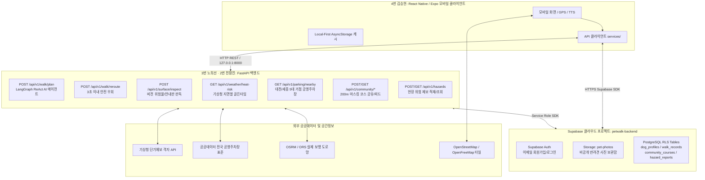

# 🐾 [편안하개 - PetWalk] 전체 API 정의 및 구현 현황 목록 (API Specification & Status)

> **문서 번호**: docs/07_편한하개_API_list.md  
> **최종 갱신 일자**: 2026년 10월 14일  
> **문서 버전**: v1.3 (대전·세종 5대 공원 실증 보행망, origin_mode 이원화, KMA 실시간 예보 연동 및 255/141 테스트 통과 반영판)  
> **기준 코드베이스**:
> - 백엔드 엔트리포인트: [`backend/main.py`](/backend/main.py)
> - 백엔드 서비스: [`backend/services/kma_weather_client.py`](/backend/services/kma_weather_client.py), [`backend/services/kma_grid_converter.py`](/backend/services/kma_grid_converter.py)
> - 백엔드 에이전트: [`backend/agent/pilot_park_routes.py`](/backend/agent/pilot_park_routes.py), [`backend/agent/walk_planning_agent.py`](/backend/agent/walk_planning_agent.py)
> - Supabase 스키마: [`backend/sql/supabase_schema.sql`](/backend/sql/supabase_schema.sql), [`backend/sql/supabase_auth_schema.sql`](/backend/sql/supabase_auth_schema.sql)
> - 프론트엔드 서비스: [`frontend/src/services/`](/frontend/src/services/) (`api.ts`, `weatherApi.ts`, `parkingApi.ts`, `communityApi.ts`, `supabaseService.ts`, `ambientNoiseMonitor.ts`, `pilotParks.ts`)

---

## 📌 1. 서비스 아키텍처 및 통신 개요

편안하개(PetWalk)는 **Local-First 모바일 클라이언트(React Native / Expo SDK 57)**, **FastAPI 기반 AI 산책로 오케스트레이션 코어 백엔드**, **Supabase 클라우드 PostgreSQL/Auth/Storage**, 그리고 **공공데이터포털(기상청 지면열, 전국 공영주차장, OpenStreetMap 타일, OSRM 도로망)**이 유기적으로 연동되는 하이브리드 아키텍처를 채택하고 있습니다.



### 🌐 기본 엔드포인트 URL
| 대상 시스템 | 기본 접속 주소 (Live / 개발) | 설명 |
|---|---|---|
| **FastAPI Core 서버** | `http://127.0.0.1:8000` (환경변수: `EXPO_PUBLIC_API_URL`) | Windows 환경 IPv6 지연 방지를 위해 `localhost` 대신 `127.0.0.1` 기본값 적용 (PR #28) |
| **Supabase 클라우드** | `https://<project-id>.supabase.co` (환경변수: `EXPO_PUBLIC_SUPABASE_URL`) | 팀 공용 Supabase `petwalk-backend`, 앱은 Publishable Anon 키만 사용 (PR #24, #42) |
| **OSM / OpenFreeMap 타일** | `https://tile.openstreetmap.org/{z}/{x}/{y}.png` | 실제 OpenStreetMap 래스터 타일 (차기: OpenFreeMap 벡터 타일 확장) |

---

## 📋 2. API 총괄 현황 요약표

| 번호 | Method | 엔드포인트 | 서비스 분류 | 관련 스토리 | 구현 현황 | 백엔드 담당 | 프론트 담당 |
|:---:|:---:|---|---|:---:|:---:|:---:|:---:|
| **1** | `GET` | `/` | 시스템 상태 | 공통 | ✅ 구현 완료 | 3번 노희선 | 4번 김승현 |
| **2** | `GET` | `/health` | 헬스체크 & DB 상태 | PR #24 | ✅ 구현 완료 | 3번 노희선 | 4번 김승현 |
| **3** | `POST` | `/api/v1/walk/plan` | AI 산책로 생성 (이원화 모드 지원) | US-A1, US-A3, US-B1~B3, US-E3 | ✅ 구현 완료 | 3번 노희선, 2번 전황진 | 4번 김승현 |
| **4** | `POST` | `/api/v1/walk/reroute` | 실시간 장애 우회 재탐색 | US-D2 | ✅ 구현 완료 | 3번 노희선, 2번 전황진 | 4번 김승현 |
| **5** | `POST` | `/api/v1/surface/inspect` | 비전 위험물/안내판 판독 | US-D1 | 🟡 연동 완료 (Mock 폴백) | 2번 전황진, 3번 노희선 | 4번 김승현 |
| **6** | `POST` | `/api/v1/hazards` | 공공 위험 제보 등록 | US-D2 AC3 | ✅ 구현 완료 | 3번 노희선 | 4번 김승현 |
| **7** | `GET` | `/api/v1/hazards` | 반경 내 활성 위험 제보 조회 | US-D2 | ✅ 구현 완료 | 3번 노희선 | 4번 김승현 |
| **8** | `POST` | `/api/v1/community/share` | 200m 마스킹 코스 공유 | US-G2 | ✅ 구현 완료 | 2번 전황진, 3번 노희선 | 4번 김승현 |
| **9** | `GET` | `/api/v1/community/feed` | 공개 안심 코스 피드 조회 | US-G2 | ✅ 구현 완료 | 3번 노희선 | 4번 김승현 |
| **10** | `GET` | `/api/v1/weather/heat-risk` | 기상청 지면열 골든타임 | US-F1, US-B1 | ✅ 구현 완료 | 3번 노희선, 4번 김승현 | 4번 김승현 |
| **11** | `GET` | `/api/v1/parking/nearby` | 공영주차장 P&R 공간 검색 | US-G1 | ✅ 구현 완료 | 3번 노희선, 4번 김승현 | 4번 김승현 |
| **12** | `POST` | `/auth/v1/signup` (Supabase) | 이메일 회원가입 | US-G2, US-21 | ✅ 구현 완료 | 3번 노희선 (DB/설정) | 4번 김승현 |
| **13** | `POST` | `/auth/v1/token` (Supabase) | 이메일 로그인 & 세션 발급 | US-G2 | ✅ 구현 완료 | 3번 노희선 (DB/설정) | 4번 김승현 |
| **14** | `POST` | `/storage/v1/object/pet-photos/*` | 반려견 사진 비공개 업로드 | US-G2 | ✅ 구현 완료 | 3번 노희선 (Storage RLS) | 4번 김승현 |
| **15** | `POST/GET`| `/api/v1/dogs/me` | 내 반려견 프로필 관리 | US-G2, US-A2 | ⏳ 서버 작성 중 (DB/클라이언트 완료) | 3번 노희선 | 4번 김승현 |
| **16** | `POST/GET`| `/api/v1/walks` & `/walks/me` | 산책 완주 기록 & 내 목록 | US-G2, Phase 5 | ⏳ 서버 작성 중 (DB/클라이언트 완료) | 3번 노희선 | 4번 김승현 |

---

## 🔍 3. 도메인별 상세 API 명세

### 3.1. 시스템 관리 및 헬스체크

#### 1) `GET /health` - 서버 및 DB 연결 상태 확인
- **설명**: FastAPI 서버의 생존 여부 및 공용 Supabase PostgreSQL 연결 상태를 점검합니다.
- **담당자**: 3번 노희선 (백엔드)
- **요청 파라미터**: 없음
- **응답 DTO (200 OK)**:
```json
{
  "status": "ok",
  "mode": "live",
  "supabase_connected": true
}
```

---

### 3.2. AI 산책로 계획 및 내비게이션 엔진 (Walk Planning)

#### 2) `POST /api/v1/walk/plan` - AI 반려견 맞춤 안심 산책 경로 생성
- **관련 스토리**: [US-A1] 자연어 파싱, [US-A3] 산책 시간, [US-B1~B3] 경사/노면/그늘, [US-E3] 누적 피드백 보정
- **담당자**: 3번 노희선 (OSRM 병렬/캐시), 2번 전황진 (DEM 경사도/5대 공원 보행망), 4번 김승현 (클라이언트/폴백)
- **요청 Body (JSON)**:
```json
{
  "dog_id": "dog_choco",
  "dog_name": "초코",
  "speed_kmh": 2.8,
  "joint_care_level": 1,
  "target_duration_minutes": 30,
  "avoid_stairs": true,
  "prefer_shade": true,
  "prefer_cushion": true,
  "request_text": "30분 동안 폭신한 길 위주로 걷고 싶어요",
  "origin_lat": 36.3628,
  "origin_lon": 127.3592,
  "origin_mode": "pilot_park",
  "park_id": "yurim",
  "recent_feedback": {
    "recent_walk_count": 3,
    "slope_dissatisfaction_count": 1,
    "shade_preference_count": 2,
    "recommended_max_slope_offset": -2.0
  }
}
```
> **참고**: `origin_mode`는 `current_location`(사용자 현위치 기준 순환)과 `pilot_park`(지정 공원 중심 산책, 공원 내부 90% 이상 가중치 반영)를 지원합니다.
- **응답 DTO (200 OK)**:
```json
{
  "courses": [
    {
      "id": "candidate-loop-01",
      "name": "성산근린공원 폭신한 숲길 루프",
      "distanceKm": "1.8 km",
      "estimatedMinutes": 32,
      "softRatio": "85%",
      "shadeLevel": "많음",
      "stairsCount": "0회",
      "maxSlopePercent": 5.4,
      "shadePercent": 75,
      "softSurfacePercent": 85,
      "reason": "AI 맞춤 점수 94점: 관절 안심 완만 숲길"
    }
  ],
  "geojson": {
    "type": "FeatureCollection",
    "features": [
      {
        "type": "Feature",
        "properties": { "safetyLevel": "safe", "color": "#10B981", "slopePercent": 3.2 },
        "geometry": { "type": "LineString", "coordinates": [[126.978, 37.566], [126.979, 37.567]] }
      }
    ]
  },
  "step_pins": [
    {
      "id": "candidate-loop-01_step_1",
      "kind": "turn",
      "position": [126.9785, 37.5668],
      "instruction": "우측 흙길 산책로로 진입하세요"
    }
  ],
  "course_plans": {
    "candidate-loop-01": { "route": { "...": "..." }, "stepPins": [] }
  },
  "briefing": "초코를 위해 계단을 배제하고 경사도 5% 미만의 폭신한 흙길 루프 코스를 추천합니다.",
  "score": 94.0,
  "is_live_server": true
}
```
- **오프라인 폴백 동작**: 네트워크 단절 시 `courseAdaptivePlanner.ts`가 가동되어 0.1초 이내 로컬 적응형 3종 코스 반환.

#### 3) `POST /api/v1/walk/reroute` - 현장 위험 감지 시 안전 우회 재탐색
- **관련 스토리**: [US-D2] 돌발 위험 감지 시 3초 이내 동적 우회
- **담당자**: 3번 노희선 (백엔드), 2번 전황진 (비용 가중치 산출)
- **요청 Body (JSON)**:
```json
{
  "current_lat": 37.5670,
  "current_lon": 126.9790,
  "destination_lat": 37.5665,
  "destination_lon": 126.9780,
  "hazard_lat": 37.5675,
  "hazard_lon": 126.9795,
  "hazard_type": "broken_glass",
  "severity": "danger",
  "confidence": 0.85
}
```
- **응답 DTO (200 OK)**:
```json
{
  "action": "REROUTED",
  "geojson": {
    "type": "LineString",
    "coordinates": [[126.9790, 37.5670], [126.9785, 37.5668], [126.9780, 37.5665]]
  },
  "detour_distance_m": 120.0,
  "detour_duration_min": 2,
  "reason": "유리 파편 위험 지점(반경 50m)을 피해 안전한 우회로를 안내합니다."
}
```

---

### 3.3. 현장 위험물 비전 판독 및 공공 제보 (Vision & Hazards)

#### 4) `POST /api/v1/surface/inspect` - 사진 기반 위험물/안내판 AI 비전 판독
- **관련 스토리**: [US-D1] 현장 사진 판독
- **담당자**: 2번 전황진 (Gemini 비전 체인), 3번 노희선 (파일 업로드 엔드포인트)
- **요청**: `multipart/form-data`
  - `image`: UploadFile (최대 8MB)
  - `inspect_type`: Form ("hazard" 또는 "park_board")
- **응답 DTO (200 OK)**:
```json
{
  "detected_type": "broken_glass",
  "severity": "danger",
  "confidence": 0.92,
  "description": "산책로 우측 바닥에 깨진 유리병 파편이 산재해 있습니다.",
  "is_live_vision": false
}
```

#### 5) `POST /api/v1/hazards` - 현장 위험 제보 등록
- **관련 스토리**: [US-D2 AC3] 공공 위험 제보
- **담당자**: 3번 노희선 (Supabase hazard_reports 테이블 연동)
- **요청 Body (JSON)**:
```json
{
  "user_id": "usr_9981",
  "lat": 37.5675,
  "lon": 126.9795,
  "hazard_type": "broken_glass",
  "severity": "danger",
  "description": "유리 파편 조심하세요",
  "photo_url": "https://.../pet-photos/.../hazard.jpg"
}
```
- **응답 DTO (201 Created)**:
```json
{
  "status": "reported",
  "report": {
    "report_id": "hz_1728812345_1",
    "is_active": true,
    "created_at": "2026-10-13T10:30:00Z"
  },
  "is_supabase": true
}
```

#### 6) `GET /api/v1/hazards` - 반경 내 활성 위험 제보 조회
- **파라미터**: `lat` (float), `lon` (float), `radius_m` (기본값: 500m)
- **응답 DTO (200 OK)**:
```json
{
  "count": 1,
  "radius_m": 500.0,
  "reports": [
    {
      "report_id": "hz_1728812345_1",
      "hazard_type": "broken_glass",
      "severity": "danger",
      "lat": 37.5675,
      "lon": 126.9795,
      "distance_m": 85.0
    }
  ],
  "is_supabase": true
}
```

---

### 3.4. 커뮤니티 코스 공유 및 피드 (Community Courses)

#### 7) `POST /api/v1/community/share` - 200m 마스킹 코스 공유
- **관련 스토리**: [US-G2] 개인정보 안심 200m 공간 절단 및 교차로 스냅 마스킹
- **담당자**: 2번 전황진 (200m 마스킹 알고리즘), 3번 노희선 (Supabase DB 적재)
- **요청 Body (JSON)**:
```json
{
  "course_title": "성산근린공원 폭신한 숲길 루프",
  "raw_coordinates": [[127.036, 37.543], [127.038, 37.544], [127.040, 37.545], [127.039, 37.543]],
  "satisfaction_rating": 5.0,
  "comment": "발바닥이 전혀 아프지 않아요"
}
```
- **응답 DTO (200 OK)**:
```json
{
  "status": "shared",
  "feed": {
    "course_id": "feed_3",
    "title": "성산근린공원 폭신한 숲길 루프",
    "masked_polyline": [[127.038, 37.544], [127.040, 37.545]],
    "distance_m": 1400.0,
    "duration_min": 22,
    "rating": 5.0,
    "is_origin_masked": true
  },
  "is_supabase": true,
  "intersection_snapped": true
}
```

#### 8) `GET /api/v1/community/feed` - 공개 안심 코스 피드 조회
- **담당자**: 3번 노희선 (백엔드), 4번 김승현 (`communityApi.ts`)
- **응답 DTO (200 OK)**:
```json
{
  "feeds": [
    {
      "course_id": "feed_1",
      "title": "성산근린공원 폭신한 숲길 루프",
      "masked_polyline": [[127.038, 37.544], [127.040, 37.545], [127.039, 37.543]],
      "distance_m": 1600.0,
      "duration_min": 26,
      "rating": 4.9,
      "is_origin_masked": true
    }
  ],
  "is_supabase": true
}
```

---

### 3.5. 기상청 단기예보 지면열 위험도 및 공영주차장 P&R (Real Data)

#### 9) `GET /api/v1/weather/heat-risk` - 실시간 기상청 지면열 & 골든타임 조회
- **관련 스토리**: [US-F1] 지면열 실시간 판별, [US-B1] 기상청 단기예보 연계
- **담당자**: 3번 노희선 (백엔드 서비스), 4번 김승현 (`weatherApi.ts` 클라이언트 & 1시간 캐시)
- **요청 쿼리**: `lat` (위도), `lon` (경도)
- **응답 DTO (200 OK)**:
```json
{
  "status": "success",
  "current": {
    "hour": 15,
    "air_temp_celsius": 28.5,
    "estimated_surface_temp": 42.0,
    "risk_level": "CAUTION",
    "is_golden_time": false
  },
  "golden_time_window": "18:00 ~ 21:00",
  "hourly_forecast": [
    { "hour": 18, "estimated_surface_temp": 33.2, "is_golden_time": true, "risk_level": "SAFE" }
  ],
  "notice": "본 지수는 기상청 예보 모델 기반 추정치입니다.",
  "coordinates": { "lat": 36.3628, "lon": 127.3592 }
}
```

#### 10) `GET /api/v1/parking/nearby` - 대전/세종 파일럿 거점 공영주차장 P&R 검색
- **관련 스토리**: [US-G1] 자차 이동 견주 출발 거점 공영주차장 연계 (유림공원, 송강근린공원, 도안호수공원, 세종호수공원 11개소)
- **담당자**: 3번 노희선 (백엔드 서비스), 4번 김승현 (`parkingApi.ts` 및 정밀 좌표 스냅)
- **요청 쿼리**: `lat` (위도), `lon` (경도), `radius_m` (기본값: 1500m)
- **응답 DTO (200 OK)**:
```json
{
  "status": "success",
  "total_count": 3,
  "search_radius_m": 1500.0,
  "query_center": { "lat": 36.3628, "lon": 127.3592 },
  "parking_lots": [
    {
      "parking_id": "pkg_yurim_01",
      "name": "유림공원 부설 공영주차장",
      "entrance_lat": 36.3628,
      "entrance_lon": 127.3592,
      "distance_m": 0.0,
      "fee_type": "free",
      "park_zone": "유림공원",
      "is_public": true
    }
  ]
}
```

---

### 3.6. Supabase 클라우드 Auth & 데이터베이스 & Storage (US-G2)

#### 11) `POST /auth/v1/signup` - Supabase Auth 이메일 회원가입
- **설명**: CBT 기간 동안 Confirm email을 OFF하여 이메일 링크 인증 없이 즉시 가입 완료 처리됩니다.
- **담당자**: 3번 노희선 (Supabase Auth 환경설정), 4번 김승현 (`LandingAuthModal.tsx`, `supabaseService.ts`)
- **요청 Body (JSON)**:
```json
{
  "email": "user@example.com",
  "password": "password123"
}
```
- **응답**: `{ "user": { "id": "uuid", "email": "user@example.com" }, "session": { "access_token": "jwt..." } }`

#### 12) `POST /storage/v1/object/pet-photos/{user_id}/{filename}` - 반려견 사진 업로드
- **버킷**: `pet-photos` (비공개 버킷)
- **보안 정책(RLS)**: 본인 폴더(`pet-photos/<user_id>/...`)만 읽기/쓰기/삭제 가능
- **담당자**: 3번 노희선 (Storage RLS), 4번 김승현 (`supabaseService.uploadPetPhoto`)

#### 13) `POST /rest/v1/dog_profiles` - 반려견 프로필 저장 (DB)
- **테이블**: `public.dog_profiles`
- **컬럼**: `id`, `user_id`, `name`, `breed`, `age_years`, `weight_kg`, `joint_care_level`, `speed_kmh`, `photo_path`, `is_primary`
- **담당자**: 3번 노희선 (스키마 v2), 4번 김승현 (`DogProfileEditCard.tsx`, `supabaseService.saveDogProfile`)

#### 14) `POST /rest/v1/walk_records` & `PATCH ...` - 산책 기록 적재 및 후기 공개(`is_public`) 토글
- **테이블**: `public.walk_records`
- **컬럼**: `id`, `user_id`, `dog_id`, `started_at`, `ended_at`, `distance_m`, `duration_min`, `route_coords`, `note`, `rating`, `is_public`
- **후기 공개 제어**:
  - `is_public = false` (기본값): 본인만 조회 가능한 비공개 기록 (RLS: `auth.uid() = user_id`)
  - `is_public = true` (후기 공유 클릭 시): 전체 커뮤니티에 공개 후기로 노출 (RLS: `is_public = true`)
- **담당자**: 3번 노희선 (스키마 v2), 4번 김승현 (`MyWalkHistoryView.tsx`, `supabaseService.toggleWalkRecordPublic`)

---

## 👥 4. 팀원별 R&R 및 API 구현 협업 매트릭스

| 팀원 | 역할 (Role) | API 관련 주관 업무 및 책임 범위 | 협업 인터페이스 |
|---|---|---|---|
| **1번 조현정** | **기획 / PM** | - 사용자 스토리(US-A1 ~ US-G2) 요구사항 및 Acceptance Criteria(DoD) 정의<br/>- 자연어 산책 의도 추출 AI 프롬프트 및 `WalkIntent` DTO 규격 설계 | 2번 데이터, 3번 서버로 DTO 전달 |
| **2번 전황진** | **데이터 / GIS** | - 실제 도로망 기반 3개 코스 후보 생성 엔진 및 OSRM 질의 래퍼<br/>- DEM 고도/경사도 산출 및 3색 안심 등급 Polyline 분할<br/>- 200m 마스킹 & 교차로 스냅 알고리즘 (`apply_spatial_masking_to_course`)<br/>- 비전 검사 엔진 연계 (`/api/v1/surface/inspect`) | 3번 서버에 모듈 제공, 4번 앱에 GeoJSON 전달 |
| **3번 노희선** | **백엔드 / 서버 Lead** | - FastAPI REST 엔드포인트 전체 호스팅 및 라우팅 총괄<br/>- OSRM 3개 후보 병렬 질의, 10분 인메모리 캐싱 및 서킷 브레이커 구축 (PR #28)<br/>- Supabase 프로젝트 환경 구축, SQL 스키마 배포 및 RLS 보안 정책 적용 (PR #24, #42)<br/>- 공공 기상청/주차장 엔드포인트 서비스 및 토큰 인증 API 구축 | 4번 앱에 REST API 제공 및 스펙 협의 |
| **4번 김승현** | **앱 / Frontend Lead** | - React Native (Expo) 모바일 및 Expo Web 단일 코드베이스 앱 구축<br/>- 프론트엔드 API 클라이언트(`api.ts`, `weatherApi.ts`, `parkingApi.ts`, `communityApi.ts`, `supabaseService.ts`) 개발<br/>- 네트워크 단절 및 서버 미가동 시 0.1초 무중단 Local-First 폴백 보장<br/>- 마이페이지 산책 기록 목록(`MyWalkHistoryView.tsx`), 후기 공유 토글(`is_public`), 랜딩 가입 모달(`LandingAuthModal.tsx`) 개발 | 3번 서버 API 연동, 5번 UI 컴포넌트 실체화 |
| **5번 김정님** | **UI/UX 디자인** | - 안심 산책 3색 Polyline(#10B981, #F59E0B, #EF4444) 디자인 토큰(`tokens.ts`) 정의<br/>- 돌발 상황 퀵 음소거 플로팅 바 및 다크 포켓 HUD 인터페이스 디자인<br/>- 온보딩 4단계 플로우 및 마이페이지 산책 기록 카드 UI 설계 | 4번 앱에 디자인 시스템 가이드 제공 |

---

## 📌 5. 향후 추가 예정 API 로드맵 (Next Steps)

1. **서버 사이드 토큰 검증 엔드포인트 추가 (이번 주 노희선 예정)**:
   - `POST /api/v1/dogs/me`: 클라이언트 Supabase JWT 토큰 검증 후 대표 반려견 등록
   - `GET /api/v1/dogs/me`: 내 반려견 프로필 조회
   - `POST /api/v1/walks`: 산책 완주 기록 서버 영속 적재
   - `GET /api/v1/walks/me`: 내 산책 기록 목록 조회
2. **실시간 주변 산책견 위치 브로드캐스팅 (US-G2 고도화)**:
   - 200m 마스킹된 인근 산책견 실시간 위치 표출 API (WebSocket 또는 Supabase Realtime).
