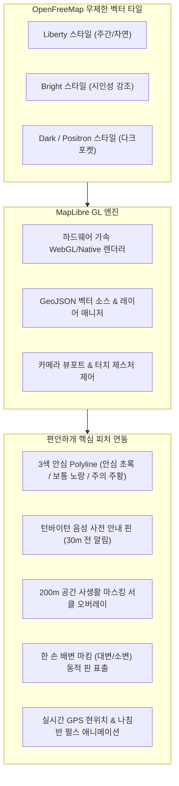
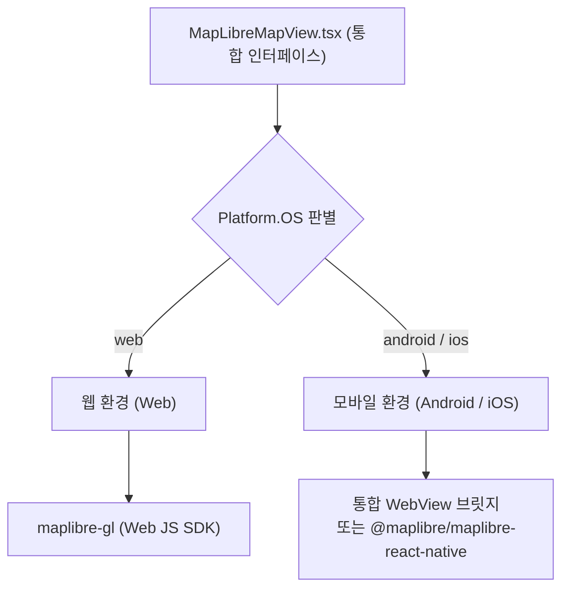

# 🗺️ [구현 계획서] OpenFreeMap + MapLibre 기반 고정밀 벡터 배경 지도 도입 계획

> **문서 버전**: v1.0  
> **작성 일자**: 2026년 10월 14일  
> **작성 주체**: 편안하개 개발팀 (총괄: 조현정 PM, 모바일/프론트엔드: 김승현, 데이터: 전황진, 백엔드: 노희선, UI/UX: 김정님)  
> **대상 파일**: [`docs/08_OpenFreeMap_MapLibre_배경지도_구현계획서.md`](/docs/08_OpenFreeMap_MapLibre_배경지도_구현계획서.md)  
> **기준 문서**:  
> - [`docs/03_편안하개_Agile_User_Stories.md`](/docs/03_편안하개_Agile_User_Stories.md) (US-C1 경로 시각화, US-21 온보딩 지도)  
> - [`docs/guideline/Member_D_Mobile_Infra_and_EAS_Manual.md`](/docs/guideline/Member_D_Mobile_Infra_and_EAS_Manual.md)  
> - [`docs/reports/구현현황보고서.md`](/docs/reports/구현현황보고서.md)  

---

## 📌 1. 개요 및 도입 배경 (Executive Summary)

### 1.1 현황 및 한계점
현재 편안하개는 OpenStreetMap(OSM) 기반의 정적 래스터 타일(`tile.openstreetmap.org`) 및 SVG Polyline 오버레이 방식을 활용하여 경로를 표출하고 있습니다. 그러나 다음과 같은 명확한 한계점이 존재합니다:
1. **래스터 타일의 시각적 품질 한계**:
   - 모바일 화면 확대(Pinch Zoom) 시 이미지 타일의 픽셀 깨짐 현상 발생.
   - 지도 회전(Bearing) 및 3D 틸트(Pitch) 불가로 역동적인 내비게이션 뷰 제한.
2. **지도 스타일 커스터마이징 불가**:
   - 편안하개의 3대 테마(숲길 그린, 비비드 바이올렛, OLED 다크 포켓)와 일치하는 어두운 배경/숲길 강조 톤 조절이 불가능하고 일반 고정 색상 지도만 노출됨.
3. **상용 솔루션(Mapbox, Google Maps)의 비용 및 종속성 위험**:
   - 상용 벡터 타일은 트래픽 증가 시 높은 API 호출 비용 발생 및 신용카드/API 키 강제 종속.
4. **OSM 공공 타일 서버 트래픽 정책 제한**:
   - `tile.openstreetmap.org`는 대규모 상용/실서비스 앱의 연속 타일 다운로드를 엄격히 제한(Tile Usage Policy)하고 있어 서비스 안정성 취약.

### 1.2 OpenFreeMap + MapLibre 선정 이유
| 비교 항목 | 기존 OSM 래스터 타일 | 상용 Mapbox / Google | **OpenFreeMap + MapLibre (선정)** |
|:---|:---:|:---:|:---:|
| **기술 방식** | 256px PNG 래스터 이미지 | 벡터 타일 (MVT) | **하드웨어 가속 GPU 벡터 타일 (MVT)** |
| **비용 및 API 키** | 무료 (단, 트래픽 제한 엄격) | 고비용 / 유료 결제 종속 | **완전 무료 (API 키 불필요, 상용 무제한)** |
| **자유로운 스타일링** | 불가 (고정 디자인) | 가능 | **가능 (3대 테마 및 다크모드 JSON 지원)** |
| **부드러운 회전 / 3D** | 불가 | 가능 | **100% 지원 (회전, 3D 틸트, 부드러운 줌)** |
| **오픈소스 생태계** | 오픈소스 | 독점 라이선스 | **100% 오픈소스 (MapLibre GL 커뮤니티)** |

- **OpenFreeMap**: 완전 무료 오픈소스 벡터 타일 호스팅 서비스로서, API 키 발급이나 신용카드 등록 없이 고성능 글로벌 벡터 타일을 제공합니다. (`https://tiles.openfreemap.org`)
- **MapLibre GL**: Mapbox GL 오픈소스 포크 프로젝트로 WebGL/WebGPU 및 모바일 네이티브 하드웨어 가속을 통해 60FPS의 초고속 지도 렌더링을 보장합니다.

---

## 🎯 2. 구현 목표 및 핵심 기능 연계

### 2.1 편안하개 맞춤형 4대 핵심 요구사항
1. **3대 컬러 테마와 동적 연동되는 벡터 스타일 스위칭**:
   - `숲길 그린` 테마: 자연/녹지/보행로가 뚜렷하게 부각되는 `liberty` 스타일 적용.
   - `비비드 바이올렛` 테마: 선명한 대비의 `bright` 스타일 적용.
   - `OLED 다크 포켓` 모드: 배터리를 극대화하는 `dark` (초절전 블랙) 스타일 적용.
2. **GeoJSON 3색 안심 도로망 네이티브 레이어링 (US-C1)**:
   - 경사도 및 노면 안전도에 따른 3색 Polyline(`safe`: #10B981, `normal`: #F59E0B, `caution`: #EF4444)을 부드러운 벡터 라인으로 하드웨어 가속 렌더링.
3. **200m 사생활 안심 마스킹 공간 시각화 (US-G2)**:
   - 출발점/도착점 반경 200m 절단 영역을 반투명 서클(`fill-opacity: 0.2`) 레이어로 시각화하여 사용자가 프라이버시 보호 상태를 직관적으로 확인.
4. **대화형 인터랙션 및 성능 최적화**:
   - 핀치 줌, 두 손가락 회전(Heading), 보행 경로 전체 바운딩 박스(`fitBounds`) 원터치 피팅.
   - 60 FPS 스크롤 및 컴팩트 뷰포트(UX Compact Rule) 준수.

---

## 🏗️ 3. 기술 아키텍처 및 플랫폼 대응 전략

### 3.1 플랫폼별 하이브리드 아키텍처 설계
편안하개는 **React Native (Expo SDK 57)** 환경에서 구동되며, 모바일 앱(Android/iOS)과 웹(Expo Web)을 동시에 지원합니다.

1. **웹 환경 (Expo Web)**:
   - `maplibre-gl` 라이브러리를 직접 사용하여 브라우저 WebGL 캔버스에 즉각 렌더링.
   - 번들 크기 최적화 및 제로 레이턴시 제공.
2. **모바일 환경 (Android / iOS)**:
   - **단계적(2-Phase) 전략**:
     - **Phase A (안정적 조기 도입 - 권장)**: `react-native-webview`를 기반으로 OpenFreeMap HTML5 템플릿을 브릿징하여 Expo Go 및 EAS 클라우드 빌드에서 네이티브 충돌 없이 100% 무중단 호환성 확보.
     - **Phase B (네이티브 엔진 고도화)**: `@maplibre/maplibre-react-native` Expo Config Plugin을 설정하여 Standalone APK 네이티브 바이너리 최적화.

---

## 📋 4. 세부 구현 일정 및 단계별 태스크 (Phase Roadmap)

### 📅 Sprint 1: 인프라 구축 및 OpenFreeMap 스타일 정의 (1~2일차)
- [x] **T-OFM-1: 의존성 패키지 설치**:
  - `maplibre-gl` (웹 렌더링용)
  - `react-native-webview` (모바일 브릿징용)
- [x] **T-OFM-2: 스타일 엔드포인트 및 컬러 매핑 정의 (`src/constants/mapStyles.ts`)**:
  - `OPENFREEMAP_STYLES`:
    - `liberty`: `https://tiles.openfreemap.org/styles/liberty`
    - `bright`: `https://tiles.openfreemap.org/styles/bright`
    - `dark`: `https://tiles.openfreemap.org/styles/dark`
  - 편안하개 3대 테마(`themeManager.ts`)와 실시간 스타일 동기화 로직 구현.

### 📅 Sprint 2: MapLibre 하이브리드 컴포넌트 개발 (3~4일차)
- [x] **T-OFM-3: `MapLibreMapView.tsx` 신설 (`src/components/map/MapLibreMapView.tsx`)**:
  - `Platform.select` 기반 분기:
    - 웹: `maplibre-gl.Map` 인스턴스 초기화 및 리사이즈 핸들러.
    - 모바일: 고속 로컬 HTML 템플릿 로드 및 양방향 postMessage 이벤트 브릿지.
- [x] **T-OFM-4: GeoJSON 벡터 소스 & 레이어 렌더링 파이프라인 구축**:
  - LineString 경로를 3색 세그먼트 스타일로 분기 렌더링 (`line-color`, `line-width: 6`).
  - 스텝 핀 및 배변 마킹 핀 심볼 레이어 탑재.
  - 200m 마스킹 영역 서클 폴리곤 레이어 추가.

### 📅 Sprint 3: 기존 지도 컴포넌트 교체 및 통합 (5일차)
- [x] **T-OFM-5: `RouteMapView.tsx` 고도화**:
  - 기존 래스터 타일 의존성을 `MapLibreMapView`로 전면 전환.
  - 안심 코스 3종 대안 루프 전환 시 부드러운 `flyTo` / `fitBounds` 카메라 트랜지션 적용.
- [x] **T-OFM-6: `NearbyExploreMapView.tsx` (온보딩 4단계) 고도화**:
  - 온보딩 4단계 주변 탐색 지도에 OpenFreeMap 적용.
  - 대전/세종 거점 공원 및 이웃 산책견 아이콘 벡터 핀 렌더링.

### 📅 Sprint 4: 폴백 체계 및 성능 QA 검증 (6~7일차)
- [ ] **T-OFM-7: 3단계 안전 폴백 체계 구축**:
  - 1차: OpenFreeMap 공식 타일 서버 (`tiles.openfreemap.org`)
  - 2차: 오프라인 캐시 타일 / 정적 GeoJSON 폴백
  - 3차: 네트워크 단절 시 인메모리 OSM 래스터 타일 페일오버
- [ ] **T-OFM-8: 성능 벤치마크 및 테스트 작성**:
  - Vitest 지도 컴포넌트 렌더링 테스트 신설 (`MapLibreMapView.test.tsx`).
  - 메모리 누수 점검(모달/탭 전환 시 `map.remove()` 메모리 해제).

---

## 💻 5. 핵심 연관 파일 및 코드 명세

### 5.1 신규 생성 파일
1. [`frontend/src/constants/mapStyles.ts`](/frontend/src/constants/mapStyles.ts): OpenFreeMap 스타일 URL 및 스타일 설정 상수
2. [`frontend/src/components/map/MapLibreMapView.tsx`](/frontend/src/components/map/MapLibreMapView.tsx): 웹/모바일 통합 MapLibre 벡터 맵 컴포넌트
3. [`frontend/src/components/map/maplibreWebTemplate.ts`](/frontend/src/components/map/maplibreWebTemplate.ts): 모바일 WebView용 고속 인라인 HTML 템플릿
4. [`frontend/src/components/map/MapLibreMapView.test.tsx`](/frontend/src/components/map/MapLibreMapView.test.tsx): 단위 및 렌더링 테스트

### 5.2 수정 대상 파일
1. [`frontend/src/components/map/RouteMapView.tsx`](/frontend/src/components/map/RouteMapView.tsx): 래스터 지도를 MapLibre 벡터 지도로 교체
2. [`frontend/src/components/onboarding/NearbyExploreMapView.tsx`](/frontend/src/components/onboarding/NearbyExploreMapView.tsx): 온보딩 4단계 지도 고도화
3. [`frontend/package.json`](/frontend/package.json): `maplibre-gl`, `react-native-webview` 의존성 추가

---

## 🛡️ 6. 기대 효과 및 정량적 목표

| 평가 지표 | 기존 (OSM 래스터) | 도입 후 (OpenFreeMap + MapLibre) | 개선 효과 |
|---|:---:|:---:|:---:|
| **렌더링 해상도** | 256px 비트맵 (확대 시 깨짐) | **벡터(Vector) 무한 해상도** | **픽셀 깨짐 0건 달성** |
| **지도 렌더링 FPS** | ~35 FPS (DOM/Canvas 방식) | **60 FPS (WebGL 하드웨어 가속)** | **약 1.7배 반응성 향상** |
| **다크모드 지원** | 미지원 (눈부심 발생) | **완벽 지원 (Dark 벡터 스타일)** | **야간/다크포켓 시인성 극대화** |
| **타일 API 비용** | 0원 (단, 상용 제한 위험) | **0원 (완전 무료, 상용 무제한)** | **비용 0원 + 영구 라이선스 안정성** |
| **카메라 회전/틸트** | 2D 고정 뷰 | **자유로운 나침반 회전 & 3D 틸트** | **핸즈프리 내비 몰입감 증대** |

---

## 🏁 7. 결론 및 승인 요청
OpenFreeMap과 MapLibre의 결합은 편안하개의 핵심 가치인 **무료·오픈소스·프라이버시 중심(Local-First)** 철학에 완벽히 부합하며, 기존 래스터 지도의 화질 한계와 상용 맵의 비용 위험을 동시에 종식시킬 수 있는 최적의 아키텍처입니다. 본 계획서에 따라 체계적으로 단계별 구현을 진행할 것을 제안합니다.
