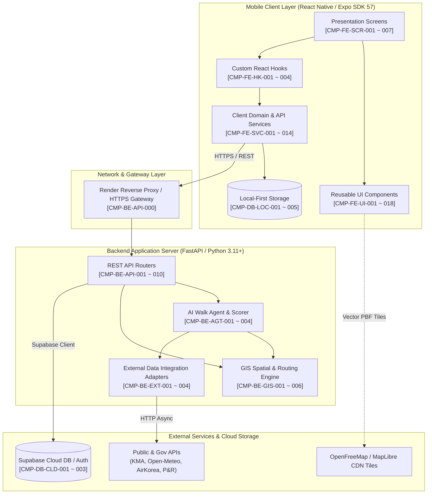
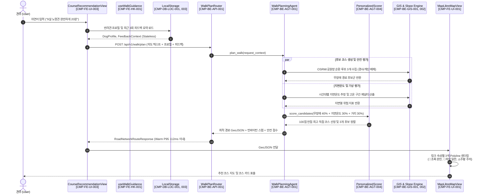
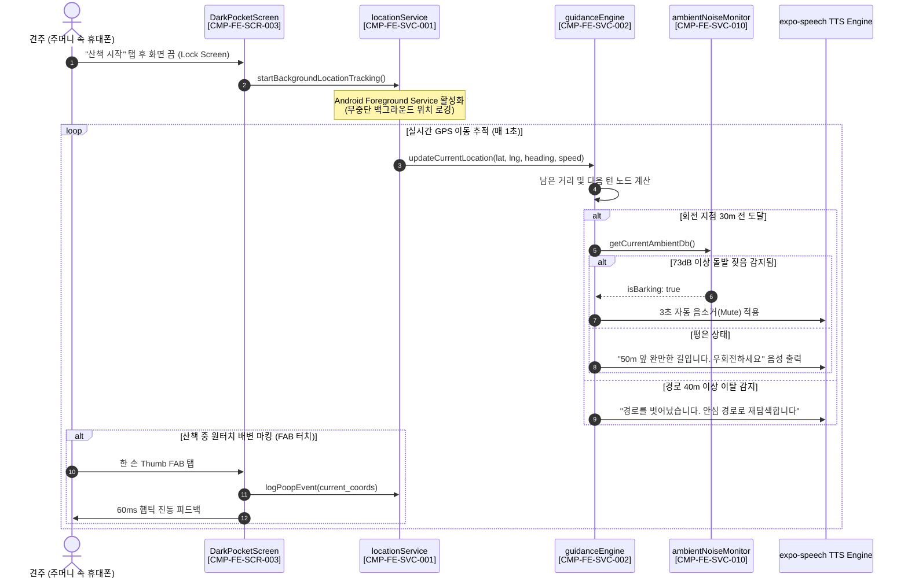
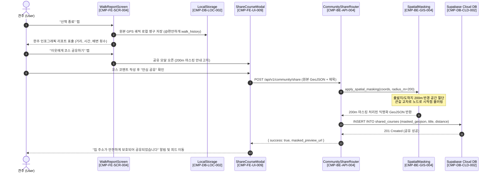
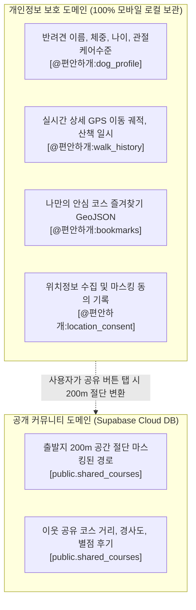
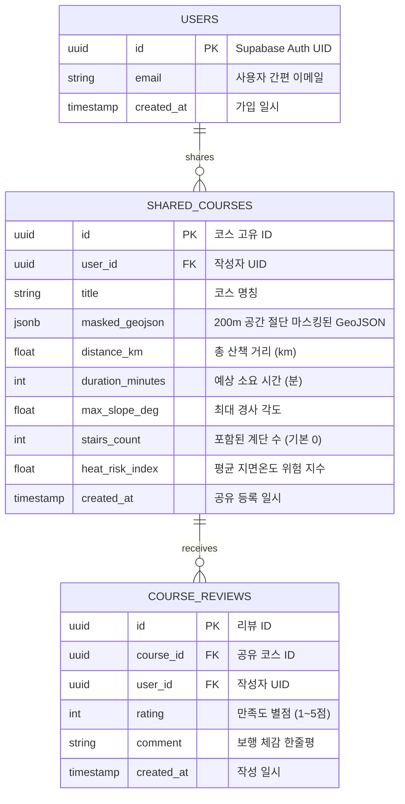
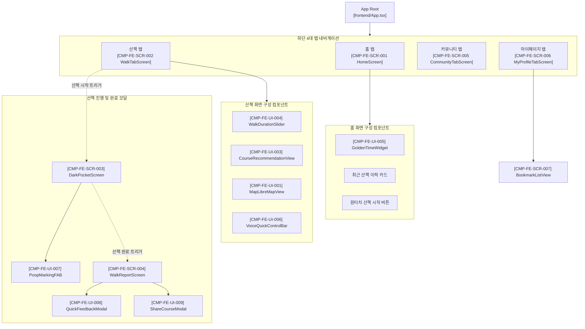

# 🏛️ [아키텍처 설계서] 편안하개(PetWalk) 시스템 아키텍처 및 뷰별 컴포넌트 설계서

> **문서 버전**: v1.0  
> **작성 일자**: 2026년 10월 26일  
> **작성 주체**: 편안하개 엔지니어링 아키텍처 팀  
> **기준 문서**:  
> - [`docs/03_편안하개_Agile_User_Stories.md`](03_편안하개_Agile_User_Stories.md) (요구사항 정의서 및 DoD)  
> - [`docs/07_편안하개_API_list.md`](07_편안하개_API_list.md) (REST API 명세서)  
> - [`docs/08_OpenFreeMap_MapLibre_배경지도_구현계획서.md`](08_OpenFreeMap_MapLibre_배경지도_구현계획서.md)  
> - [`docs/reports/2026-10-26_편안하개_사용자스토리_기반_시험결과보고서.md`](reports/2026-10-26_편안하개_사용자스토리_기반_시험결과보고서.md)  

---

## 📌 1. 개요 및 아키텍처 원칙 (Overview & Principles)

### 1.1 문서 목적
본 아키텍처 설계서는 **편안하개 (AI Native 반려견 맞춤형 안심 노면 산책 에이전트 및 기록·공유 플랫폼)**의 소프트웨어 구조, 계층적 컴포넌트 관계, 데이터 흐름 및 물리적 배포 환경을 표준화된 **다각적 뷰(View-based Model)**로 명세한 공식 엔지니어링 산출물입니다.

특히, 요구사항 정의서([`03_편안하개_Agile_User_Stories.md`](03_편안하개_Agile_User_Stories.md))의 **15개 핵심 MVP 사용자 스토리 및 Phase 2 확장 스토리**와의 완전한 추적성(Traceability)을 확보하기 위해, 시스템을 구성하는 모든 프론트엔드 UI/서비스, 백엔드 라우터/에이전트, 데이터 엔티티에 **고유 컴포넌트 식별자(Component ID)**를 부여하고 매핑 매트릭스를 제공합니다.

### 1.2 핵심 아키텍처 원칙 (Architectural Principles)
1. **Local-First & Privacy by Design**:
   - 사용자의 자택 좌표, 상세 보행 GPS 궤적, 반려견 프로필은 중앙 서버 DB에 수집·영구 저장하지 않고 모바일 클라이언트(`AsyncStorage`)에만 격리 보관합니다.
   - 커뮤니티 공유 시 출발지/도착지 반경 200m 공간 절단 마스킹(Spatial Jittering)을 필수 적용합니다.
2. **Stateless AI Orchestration**:
   - 백엔드 AI 에이전트는 사용자의 세션 상태나 민감정보를 영속하지 않으며, 클라이언트가 전달한 '단일 요청 맥락(Request Payload + 최근 3회 피드백 요약)'을 기반으로 무상태(Stateless)로 최적 코스를 추론합니다.
3. **시선 해방(Eyes-Free) 백그라운드 핸즈프리 안내**:
   - 반려견의 돌발 움직임에 대비하여 견주가 화면을 보지 않고 리드줄에 집중할 수 있도록, Android Foreground Service 기반의 무중단 GPS 로깅 및 30m 사전 턴바이턴 TTS 음성 브리핑을 제공합니다.
4. **Barrier-Free & Heat-Safe Routing**:
   - 단순 최단거리 탐색이 아닌, DEM(경사도 15도 미만) 및 OSM 보행망(계단 완전 배제)과 기상청/Open-Meteo 연동 지면온도(35℃ 초과 회피)를 결합한 안전 비용 함수(Cost Function)를 적용합니다.
5. **무중단 핫픽스 (Zero-Downtime Hotfix)**:
   - Expo SDK 57 및 EAS Build로 테스터용 Standalone APK를 1회 배포하고, 로직 및 UI 개선은 `expo-updates` 무선 OTA(Over-The-Air) 파이프라인으로 실시간 무점검 배포합니다.

---

## 🏷️ 2. 컴포넌트 추적성 식별자(ID) 체계 (Traceability Identifier Scheme)

시스템 전반의 컴포넌트는 다음과 같은 표준 명명 규칙(Naming Convention)에 따라 고유 ID가 부여됩니다.

$$\text{CMP}-\langle\text{계층/도메인}\rangle-\langle\text{세부유형}\rangle-\langle\text{3자리 일련번호}\rangle$$

| 접두사 (Prefix) | 계층 및 영역 | 설명 |
|---|---|---|
| `CMP-FE-SCR` | Frontend Screens | 모바일 앱 주요 화면(Screen) 단위 뷰 |
| `CMP-FE-UI` | Frontend UI Components | 재사용 가능한 UI 프레젠테이션 컴포넌트 |
| `CMP-FE-SVC` | Frontend Services | 클라이언트 비즈니스 로직, API 클라이언트, 스토리지 서비스 |
| `CMP-FE-HK` | Frontend Hooks | 상태 및 디바이스 네이티브 연동 커스텀 훅 |
| `CMP-BE-API` | Backend API Endpoints | FastAPI REST API 엔드포인트 및 컨트롤러 |
| `CMP-BE-AGT` | Backend AI Agents | LangGraph ReAct Agent 및 다요소 라우팅 계획 오케스트레이터 |
| `CMP-BE-GIS` | Backend GIS & Routing | 보행 도로망, 고도(DEM), 지면온도, 공간 마스킹 연산 엔진 |
| `CMP-BE-EXT` | Backend External Adapters | 기상청, Open-Meteo, 에어코리아, 공영주차장 외부 연동 클라이언트 |
| `CMP-DB-LOC` | Storage (Local) | 모바일 클라이언트 로컬 스토리지(`AsyncStorage`) 엔티티 |
| `CMP-DB-CLD` | Storage (Cloud) | Supabase Cloud PostgreSQL 테이블 및 인증 스키마 |

---

## 📐 3. 논리 뷰 (Logical View)

논리 뷰는 편안하개 시스템의 기능적 요구사항을 지원하는 논리적 계층 구조(Layered Architecture)와 서브시스템 간의 책임 분할을 정의합니다.

### 3.1 계층형 아키텍처 다이어그램 (Layered Architecture)



### 3.2 컴포넌트 명세표 (Logical Component Specification)

#### (1) 프론트엔드 프레젠테이션 계층 (Presentation & Screens)
| 컴포넌트 ID | 컴포넌트 명 | 물리적 위치 | 역할 및 책임 | 연관 스토리 |
|---|---|---|---|---|
| `CMP-FE-SCR-001` | HomeScreen | `frontend/src/screens/HomeScreen.tsx` | 메인 대시보드, 오늘 산책 골든타임 카드 표출, 최근 완주 이력 연동, 빠른 산책 시작 진입점 | US-A1, US-F1, US-E1 |
| `CMP-FE-SCR-002` | WalkTabScreen | `frontend/src/screens/WalkTabScreen.tsx` | 산책 설정(슬라이더, 반려견 선택, 옵션) 및 AI 추천 코스 분기 지도 프리뷰 | US-A3, US-B3, US-C1 |
| `CMP-FE-SCR-003` | DarkPocketScreen | `frontend/src/screens/DarkPocketScreen.tsx` | 시선 해방 OLED 초절전 다크모드 산책 화면, 턴 음성 안내, 원터치 배변 마킹, 긴급 복귀 | US-C2, US-18, US-22 |
| `CMP-FE-SCR-004` | WalkReportScreen | `frontend/src/screens/WalkReportScreen.tsx` | 산책 완주 인포그래픽 리포트, 보행 체감 3초 피드백 수집, 커뮤니티 코스 공유 모달 연계 | US-E1, US-E2, US-G2 |
| `CMP-FE-SCR-005` | CommunityTabScreen | `frontend/src/screens/CommunityTabScreen.tsx` | 200m 마스킹 안심 산책로 공유 피드 조회, 상세 뷰, 내 산책으로 원터치 코스 불러오기 | US-G2 |
| `CMP-FE-SCR-006` | MyProfileTabScreen | `frontend/src/screens/MyProfileTabScreen.tsx` | 반려견 프로필 관리, JSON 백업/복원, 로컬 데이터 초기화, 앱 가이드 열람, 테마 설정 | US-A2, US-21, US-23 |
| `CMP-FE-SCR-007` | BookmarkListView | `frontend/src/components/bookmark/BookmarkListView.tsx` | 나만의 안심 코스 북마크 보관함 열람, 오프라인 즉시 재산책 시작 | US-29 |

#### (2) 프론트엔드 UI 컴포넌트 계층 (UI Components)
| 컴포넌트 ID | 컴포넌트 명 | 물리적 위치 | 역할 및 책임 | 연관 스토리 |
|---|---|---|---|---|
| `CMP-FE-UI-001` | MapLibreMapView | `frontend/src/components/map/MapLibreMapView.tsx` | OpenFreeMap 벡터 타일 렌더링, 3색 구간별 Polyline 분기 표출, 턴 스텝 핀 렌더링 | US-C1, US-B1 |
| `CMP-FE-UI-002` | RouteMapView | `frontend/src/components/map/RouteMapView.tsx` | React Native Maps / Web SVG 폴백 기반 산책 경로 및 보행 위험 마커 표시 | US-C1 |
| `CMP-FE-UI-003` | CourseRecommendationView | `frontend/src/components/walk/CourseRecommendationView.tsx` | AI 생성 코스 3종 스와이프 카드, 총 거리/시간/경사도/지면온도/반복안내 메타 표출 | US-A3, US-B3 |
| `CMP-FE-UI-004` | WalkDurationSlider | `frontend/src/components/walk/WalkDurationSlider.tsx` | 10~90분 슬라이더(15분 단위) 인터랙션 및 체급별 목표 거리 자동 환산 UI | US-A3 |
| `CMP-FE-UI-005` | GoldenTimeWidget | `frontend/src/components/walk/GoldenTimeWidget.tsx` | 시간대별 열 위험 지수(안전/주의/위험) 및 산책 골든타임 카드 표출 | US-F1 |
| `CMP-FE-UI-006` | VoiceQuickControlBar | `frontend/src/components/voice/VoiceQuickControlBar.tsx` | 4대 AI 보이스 프로필 선택, 독립 음량 슬라이더, 원터치 음소거(Mute) 바 | US-C2 |
| `CMP-FE-UI-007` | PoopMarkingFAB | `frontend/src/screens/DarkPocketScreen.tsx` | 52px Thumb Zone 한 손 원터치 배변 마킹 및 60ms 햅틱 진동 피드백 | US-18 |
| `CMP-FE-UI-008` | QuickFeedbackModal | `frontend/src/components/feedback/QuickFeedbackModal.tsx` | 산책 완주 후 3초 원터치 체감 태그 및 5점 만족도 입력 모달 | US-E2 |
| `CMP-FE-UI-009` | ShareCourseModal | `frontend/src/components/community/ShareCourseModal.tsx` | 200m 공간 절단 마스킹 원리 안내 및 Supabase 커뮤니티 피드 공유 모달 | US-G2 |
| `CMP-FE-UI-010` | OnboardingWizard | `frontend/src/components/onboarding/OnboardingWizard.tsx` | 시선 해방·계단 회피·로컬 저장을 소개하는 3단계 인터랙티브 온보딩 위저드 | US-21 |
| `CMP-FE-UI-011` | LocationConsentModal | `frontend/src/components/privacy/LocationConsentModal.tsx` | 위치 정보 수집 동의, 로컬 우선 원칙 및 마스킹 투명 고지 팝업 | US-23 |
| `CMP-FE-UI-012` | BookmarkToggleButton | `frontend/src/components/bookmark/BookmarkToggleButton.tsx` | 코스 카드 및 리포트 화면 내 원터치 즐겨찾기 등록/해제 토글 버튼 | US-29 |

#### (3) 프론트엔드 도메인 및 서비스 계층 (Services & Hooks)
| 컴포넌트 ID | 컴포넌트 명 | 물리적 위치 | 역할 및 책임 | 연관 스토리 |
|---|---|---|---|---|
| `CMP-FE-SVC-001` | locationService | `frontend/src/services/locationService.ts` | 고정밀 GPS 수집, Android Foreground Service 무중단 백그라운드 추적 제어 | US-C2, US-E1 |
| `CMP-FE-SVC-002` | guidanceEngine | `frontend/src/services/guidanceEngine.ts` | 남은 거리 및 속도 기반 30m 전 `expo-speech` TTS 브리핑 및 40m 경로 이탈 감지 | US-C2 |
| `CMP-FE-SVC-003` | apiClient | `frontend/src/services/apiClient.ts` | Primary(Render) / Fallback(로컬) 자동 전환 및 15초 타임아웃 캡 HTTP 클라이언트 | 전 공통 |
| `CMP-FE-SVC-004` | backupService | `frontend/src/services/backupService.ts` | 반려견 프로필 JSON 파일 내보내기/가져오기 백업 무결성 검증 | US-A2 |
| `CMP-FE-SVC-005` | walkSettings | `frontend/src/services/walkSettings.ts` | 체급별 보행 속도 상수 환산 및 산책 선호 설정 관리 | US-A3 |
| `CMP-FE-SVC-006` | weatherApi | `frontend/src/services/weatherApi.ts` | 열 위험도 지수 조회, 10분 TTL 로컬 캐싱 및 지연 시 안전 프리셋 폴백 | US-F1 |
| `CMP-FE-SVC-007` | parkingApi | `frontend/src/services/parkingApi.ts` | 파일럿 거점 공영주차장 목록 조회 및 출입구 보행로 좌표 스냅 연계 | US-G1 |
| `CMP-FE-SVC-008` | communityApi | `frontend/src/services/communityApi.ts` | Supabase 연동 커뮤니티 피드 조회, 상세 코스 수신, 코스 공유 등록 요청 | US-G2 |
| `CMP-FE-SVC-009` | bookmarkService | `frontend/src/services/bookmarkService.ts` | 나만의 코스 즐겨찾기 CRUD 및 AsyncStorage 로컬 영속화 | US-29 |
| `CMP-FE-SVC-010` | ambientNoiseMonitor | `frontend/src/services/ambientNoiseMonitor.ts` | 마이크 입력 분석, 73dB 이상 돌발 짖음 감지 시 3초 TTS 자동 감쇠/복구 | US-C2 |
| `CMP-FE-SVC-011` | feedbackContext | `frontend/src/services/feedbackContext.ts` | 최근 3회 피드백 요약(경사 불만족 등) 수집 및 Stateless API 요청 주입 | US-E3 |
| `CMP-FE-HK-001` | useWalkGuidance | `frontend/src/hooks/useWalkGuidance.ts` | 실시간 산책 위치 추적, 안내 상태 전이, 음성 안내 트리거 총괄 훅 | US-C2, US-18 |
| `CMP-FE-HK-002` | useAppBackHandler | `frontend/src/hooks/useAppBackHandler.ts` | 산책 중 돌발 종료 방지를 위한 3중 뒤로가기 가드 및 모달 닫기 제어 | UX 안정성 |

#### (4) 백엔드 API 및 오케스트레이션 계층 (Backend API & Agents)
| 컴포넌트 ID | 컴포넌트 명 | 물리적 위치 | 역할 및 책임 | 연관 스토리 |
|---|---|---|---|---|
| `CMP-BE-API-001` | WalkPlanRouter | `backend/main.py` (`POST /api/v1/walk/plan`) | 산책 경로 계획 메인 엔드포인트, 입력 유효성 검증, 에이전트 호출 및 응답 반환 | US-A1, US-B3 |
| `CMP-BE-API-002` | WeatherRiskRouter | `backend/main.py` (`GET /api/v1/weather/heat-risk`) | 단기예보 및 일사량 기반 시간대별 열 위험 지수 산출 API | US-F1 |
| `CMP-BE-API-003` | ParkingRouter | `backend/main.py` (`GET /api/v1/parking/nearby`) | 파일럿 거점 인근 공영주차장 검색 API | US-G1 |
| `CMP-BE-API-004` | CommunityShareRouter | `backend/main.py` (`POST /api/v1/community/share`) | 출발지 200m 마스킹 적용 후 Supabase 커뮤니티 테이블 등록 API | US-G2 |
| `CMP-BE-API-005` | CommunityFeedRouter | `backend/main.py` (`GET /api/v1/community/feed`) | 공유된 안심 산책로 목록 및 상세 경로 조회 API | US-G2 |
| `CMP-BE-API-006` | VoiceIntentRouter | `backend/main.py` (`POST /api/v1/voice/intent`) | 자연어 음성 텍스트의 산책 의도 파싱 및 Pydantic 스키마 변환 API | US-A1 |
| `CMP-BE-AGT-001` | WalkPlanningAgent | `backend/agent/walk_planning_agent.py` | LangGraph ReAct Agent 오케스트레이터, 의도 분석 및 경로 수립 흐름 제어 | US-A1, US-B3 |
| `CMP-BE-AGT-002` | LoopRoutePlanner | `backend/agent/loop_route_planner.py` | 목표 거리/시간 수렴 다중 순환 경로 생성 및 OSRM 어댑터 병렬 호출 | US-A3, US-B3 |
| `CMP-BE-AGT-003` | ParkWalkPlanner | `backend/agent/park_walk_planner.py` | 대전 3대 공원 및 세종호수공원 정밀 보행망 기반 완만 순환 코스 생성 | US-B1, US-G1 |
| `CMP-BE-AGT-004` | PersonalizedScorer | `backend/agent/personalized_scorer.py` | 무장애(계단 0개, 경사 15도 미만), 지면온도 안전, 거리 적합도 100점 만점 채점기 | US-B3 |

#### (5) 백엔드 GIS, 분석 엔진 및 외부 어댑터 (GIS & External)
| 컴포넌트 ID | 컴포넌트 명 | 물리적 위치 | 역할 및 책임 | 연관 스토리 |
|---|---|---|---|---|
| `CMP-BE-GIS-001` | SurfaceSlopeEvaluator | `backend/agent/surface_slope_evaluator.py` | 국토정보플랫폼 DEM 기반 링크별 경사도 산출, 15도 이상 급경사 하드 차단 | US-B1 |
| `CMP-BE-GIS-002` | StairsFilter | `backend/services/stairs.py` | OSM `highway=steps` 및 단차 링크 식별 및 라우팅 그래프 배제 | US-B1 |
| `CMP-BE-GIS-003` | BuildingGeometry | `backend/agent/building_geometry.py` | 건물 공간 폴리곤 교차 검사를 통한 도심 빌딩 관통 경로 원천 방지 | US-B1 |
| `CMP-BE-GIS-004` | SpatialMasking | `backend/agent/spatial_masking.py` | 출발지/도착지 200m 반경 공간 절단 및 최근접 큰길 교차로 노드 스냅 | US-G2 |
| `CMP-BE-GIS-005` | SegmentConditions | `backend/services/segment_conditions.py` | 링크별 노면 재질(아스팔트/흙길/잔디)과 일사량 연동 동적 지면온도 산정 | US-B2 |
| `CMP-BE-EXT-001` | KMAWeatherClient | `backend/services/kma_weather_client.py` | 기상청 단기예보 실시간 수집 및 기상청 격자 좌표 변환기(`kma_grid_converter.py`) | US-F1 |
| `CMP-BE-EXT-002` | OpenMeteoClient | `backend/services/open_meteo_client.py` | Open-Meteo 전일사량(Global Radiation) 실시간 수집 (2.0초 타임아웃 캡) | US-F1, US-B2 |
| `CMP-BE-EXT-003` | AirKoreaClient | `backend/services/airkorea_client.py` | 한국환경공단 실시간 미세먼지(PM10/PM2.5) 수집 (2.5초 타임아웃 캡) | US-F1 |
| `CMP-BE-EXT-004` | ParkingLotsService | `backend/services/parking_lots.py` | 대전/세종 거점 공영주차장 실데이터 및 출입구 보행로 노드 연계 | US-G1 |

#### (6) 데이터 영속성 계층 (Data Entities)
| 컴포넌트 ID | 컴포넌트 명 | 저장소 유형 | 테이블/키 명칭 및 설명 | 연관 스토리 |
|---|---|---|---|---|
| `CMP-DB-LOC-001` | DogProfileStore | Client Local | `@편안하개:dog_profile` (반려견 이름, 견종, 체중, 관절 안심 레벨) | US-A2 |
| `CMP-DB-LOC-002` | WalkHistoryStore | Client Local | `@편안하개:walk_history` (최근 100회 산책 GPS 궤적, 거리, 소요 시간) | US-E1 |
| `CMP-DB-LOC-003` | WalkFeedbackStore | Client Local | `@편안하개:walk_feedbacks` (최근 3회 체감 피드백 요약 맥락) | US-E2, US-E3 |
| `CMP-DB-LOC-004` | BookmarkStore | Client Local | `@편안하개:bookmarks` (즐겨찾기 코스 전체 GeoJSON 및 메타데이터) | US-29 |
| `CMP-DB-LOC-005` | ConsentStore | Client Local | `@편안하개:location_consent` (위치 정보 동의 일자 및 이용 기록) | US-23 |
| `CMP-DB-CLD-001` | SupabaseAuth | Cloud DB | `auth.users` (간편 이메일/비밀번호 인증 계정) | US-G2 |
| `CMP-DB-CLD-002` | SharedCoursesTable | Cloud DB | `public.shared_courses` (200m 마스킹된 공개 산책로 GeoJSON 피드) | US-G2 |
| `CMP-DB-CLD-003` | HazardReportsTable | Cloud DB | `public.hazard_reports` (견주 제보 도로 통행 위험 장애물 좌표) | Phase 2 |

---

## 🔄 4. 프로세스 및 동적 뷰 (Process & Dynamic View)

동적 뷰는 런타임에서 컴포넌트들이 상호작용하여 시스템의 핵심 유스케이스를 실행하는 시퀀스(Sequence) 흐름을 명세합니다.

### 4.1 유스케이스 1: 대화형 자연어 산책 추천 및 3색 지도 렌더링 (US-A1, US-B3, US-C1)

견주가 자연어로 산책을 요청했을 때, 무상태 AI 오케스트레이션과 다요소 스코어링을 거쳐 지도에 분기 렌더링되기까지의 흐름입니다.



---

### 4.2 유스케이스 2: 시선 해방 백그라운드 핸즈프리 음성 안내 루프 (US-C2, US-18)

화면을 끄고 주머니에 넣은 상태에서 백그라운드 GPS 로깅과 30m 사전 턴 음성 브리핑이 실행되는 동적 루프입니다.



---

### 4.3 유스케이스 3: 산책 완주 후 200m 공간 절단 마스킹 커뮤니티 공유 (US-E1, US-G2)

산책이 종료되었을 때 로컬 저장소에 완전한 궤적을 보관하고, 커뮤니티 공유 시 자택 200m를 잘라내는 프라이버시 파이프라인입니다.



---

## 📂 5. 개발 및 구현 뷰 (Development / Implementation View)

구현 뷰는 소스 코드 저장소의 물리적 패키지 구성 및 계층 간 의존성 규칙(Dependency Rules)을 명세합니다.

### 5.1 저장소 디렉토리 및 컴포넌트 배치 구조

```
pet_walk_t01/
├── frontend/                          # [Client Layer] React Native (Expo SDK 57)
│   ├── src/
│   │   ├── screens/                   # CMP-FE-SCR-xxx (주요 화면 컴포넌트)
│   │   │   ├── HomeScreen.tsx         # [CMP-FE-SCR-001]
│   │   │   ├── WalkTabScreen.tsx      # [CMP-FE-SCR-002]
│   │   │   ├── DarkPocketScreen.tsx   # [CMP-FE-SCR-003]
│   │   │   ├── WalkReportScreen.tsx   # [CMP-FE-SCR-004]
│   │   │   └── CommunityTabScreen.tsx # [CMP-FE-SCR-005]
│   │   ├── components/                # CMP-FE-UI-xxx (재사용 UI 조각)
│   │   │   ├── map/                   # MapLibreMapView, RouteMapView
│   │   │   ├── walk/                  # CourseRecommendationView, WalkDurationSlider
│   │   │   ├── voice/                 # VoiceQuickControlBar
│   │   │   └── community/             # ShareCourseModal
│   │   ├── services/                  # CMP-FE-SVC-xxx (비즈니스/스토리지 로직)
│   │   │   ├── locationService.ts     # Foreground GPS 추적
│   │   │   ├── guidanceEngine.ts      # 30m 사전 턴 음성 엔진
│   │   │   ├── backupService.ts       # 프로필 JSON 백업
│   │   │   └── apiClient.ts           # 이중화 HTTP 통신 클라이언트
│   │   └── hooks/                     # CMP-FE-HK-xxx (커스텀 훅)
│   └── package.json                   # Vitest 5.0, Expo SDK 57, TypeScript 6.0
│
├── backend/                           # [Server Layer] FastAPI (Python 3.11+)
│   ├── main.py                        # CMP-BE-API-xxx (REST 엔드포인트 총괄 라우터)
│   ├── agent/                         # CMP-BE-AGT-xxx, CMP-BE-GIS-xxx
│   │   ├── walk_planning_agent.py     # [CMP-BE-AGT-001] LangGraph Agent
│   │   ├── loop_route_planner.py      # [CMP-BE-AGT-002] 순환 경로 플래너
│   │   ├── personalized_scorer.py     # [CMP-BE-AGT-004] 100점 다요소 채점기
│   │   ├── surface_slope_evaluator.py # [CMP-BE-GIS-001] DEM 경사도 계산기
│   │   └── spatial_masking.py         # [CMP-BE-GIS-004] 200m 공간 절단 마스킹
│   ├── services/                      # CMP-BE-EXT-xxx (외부 연동 및 어댑터)
│   │   ├── kma_weather_client.py      # [CMP-BE-EXT-001] 기상청 단기예보
│   │   ├── open_meteo_client.py       # [CMP-BE-EXT-002] 일사량 연동
│   │   ├── airkorea_client.py         # [CMP-BE-EXT-003] 미세먼지 연동
│   │   └── parking_lots.py            # [CMP-BE-EXT-004] 대전/세종 주차장 데이터
│   └── test_case/                     # Pytest 908개 단위/통합 테스트 스위트
│
└── docs/                              # 공식 프로젝트 엔지니어링 문서 체계
    ├── 03_편안하개_Agile_User_Stories.md # 요구사항 정의서
    ├── 07_편안하개_API_list.md          # REST API 명세서
    ├── 10_편안하개_아키텍처_설계서.md     # [본 설계서]
    └── reports/                       # 시험결과보고서 및 실측 지표
```

### 5.2 모듈 간 의존성 원칙 (Dependency Rules)
1. **단방향 의존성 엄수**: Screens $\rightarrow$ Components $\rightarrow$ Hooks $\rightarrow$ Services $\rightarrow$ Local Storage 계층으로 단방향 호출되며, 하위 서비스는 상위 UI 컴포넌트를 직접 참조할 수 없습니다.
2. **Stateless 인터페이스**: `frontend/src/services/apiClient.ts`는 서버 호출 시 로컬 식별키나 개인 식별자를 격리하며, 반드시 DTO 스키마로 직렬화된 무상태 페이로드만 전송합니다.
3. **외부 API 서킷 브레이커 격리**: `backend/services/`의 외부 기상청/Open-Meteo 호출은 타임아웃 캡(2.0~2.5초)으로 보호되며, 실패 시 인메모리 10분 TTL 캐시 또는 안전 프리셋으로 즉시 대체됩니다.

---

## 🌐 6. 물리 및 배포 뷰 (Physical / Deployment View)

물리 뷰는 소프트웨어 컴포넌트가 실행되는 물리적/클라우드 하드웨어 노드와 네트워크 토폴로지(Topology)를 명세합니다.

### 6.1 배포 토폴로지 다이어그램

```mermaid
graph LR
    subgraph ClientDevice ["User Android Device"]
        APK["PetWalk Standalone APK<br>(Expo SDK 57 / React Native 0.86)<br>[Build ID: cbf76e84...]"]
        AsyncStorage[("AsyncStorage Local DB<br>(SQLite Encrypted File)")]
        APK --- AsyncStorage
    end

    subgraph ExpoCloud ["Expo Application Services (EAS)"]
        EAS_Update["EAS Update Server<br>(Channel: 'preview')<br>[expo-updates OTA]"]
    end

    subgraph BackendCloud ["Render.com Cloud Node"]
        FastAPI_App["FastAPI REST Application<br>(Python 3.11 / Uvicorn Server)<br>1.1km Grid Memory Cache"]
    end

    subgraph SupabaseInfra ["Supabase Cloud (AWS ap-northeast-2)"]
        Supa_Auth["Supabase GoTrue Auth"]
        Supa_PG[("PostgreSQL 15 Cloud DB<br>(shared_courses table)")]
    end

    subgraph ExternalGovNodes ["External Open APIs"]
        KMA["기상청 단기예보 API"]
        OpenMeteo["Open-Meteo Solar API"]
        AirKorea["한국환경공단 에어코리아"]
        OFM["OpenFreeMap Vector CDN"]
    end

    APK -.->|1. 무선 무점검 핫픽스 (OTA)| EAS_Update
    APK -->|2. HTTPS / TLS 1.3 (Warm P95 112ms)| FastAPI_App
    APK -->|3. 벡터 타일 PBF 요청| OFM
    APK -->|4. 간편 회원가입 / 인증 토큰| Supa_Auth

    FastAPI_App -->|5. 200m 마스킹 코스 저장| Supa_PG
    FastAPI_App -->|6. 실시간 기상/일사량 수집| KMA
    FastAPI_App -->|7. 일사량 수집 (2.0s 캡)| OpenMeteo
    FastAPI_App -->|8. 미세먼지 수집 (2.5s 캡)| AirKorea
```

---

## 🗄️ 7. 데이터 및 영속성 뷰 (Data / Persistence View)

### 7.1 Local-First vs Cloud 분할 저장 전략
편안하개는 사용자의 프라이버시 보호를 최우선으로 하여 데이터를 철저히 2개 영역으로 분할 관리합니다.



### 7.2 클라우드 데이터베이스 ERD (Supabase PostgreSQL)



---

## 📱 8. UI 화면 및 컴포넌트 계층 뷰 (UI Component Hierarchy)

앱의 화면 전이 구조와 각 화면에 탑재된 컴포넌트의 부모-자식 트리 관계입니다.



---

## 🔗 9. 사용자 스토리 대 컴포넌트 추적성 매트릭스 (Traceability Matrix)

요구사항 정의서([`03_편안하개_Agile_User_Stories.md`](03_편안하개_Agile_User_Stories.md))의 **15개 핵심 MVP 사용자 스토리 및 Phase 2 선행 스토리**와 시스템 아키텍처 컴포넌트 간의 100% 상호 매핑표입니다.

| Story ID | 사용자 스토리 명칭 | Story Points | 주관 컴포넌트 (Primary Components) | 협력 컴포넌트 (Collaborators) | 저장소 엔티티 |
|:---:|---|:---:|---|---|---|
| **US-A1** | 대화형 자연어 산책 요청 및 조건 구조화 | 5 pt | `CMP-BE-AGT-001` (WalkPlanningAgent)<br>`CMP-BE-API-006` (VoiceIntentRouter) | `CMP-FE-UI-003`, `CMP-FE-SVC-011` | `CMP-DB-LOC-001` |
| **US-A2** | 반려견 프로필 로컬 등록 및 JSON 백업/복원 | 3 pt | `CMP-FE-SVC-004` (backupService)<br>`CMP-FE-SCR-006` (MyProfileTabScreen) | `CMP-FE-UI-010` (OnboardingWizard) | `CMP-DB-LOC-001` |
| **US-A3** | 목표 산책 시간/거리 기반 환산 (속도/슬라이더) | 3 pt | `CMP-FE-UI-004` (WalkDurationSlider)<br>`CMP-BE-AGT-002` (LoopRoutePlanner) | `CMP-FE-SVC-005`, `CMP-FE-UI-003` | — |
| **US-B1** | 무장애길(경사 15도 미만·무계단) 안심 경로 도출 | 8 pt | `CMP-BE-GIS-001` (SurfaceSlopeEvaluator)<br>`CMP-BE-GIS-002` (StairsFilter) | `CMP-BE-GIS-003`, `CMP-BE-AGT-003` | — |
| **US-B2** | 기상·노면 연동 지면온도 기반 안심 경로 도출 | 5 pt | `CMP-BE-GIS-005` (SegmentConditions)<br>`CMP-BE-EXT-002` (OpenMeteoClient) | `CMP-BE-EXT-001`, `CMP-BE-AGT-004` | — |
| **US-B3** | Routing API Adapter 연동 및 후보 경로 다요소 스코어링 | 8 pt | `CMP-BE-AGT-004` (PersonalizedScorer)<br>`CMP-BE-API-001` (WalkPlanRouter) | `CMP-BE-AGT-002`, `CMP-BE-AGT-003` | — |
| **US-C1** | 구간별 색상 분기 경로 시각화 | 5 pt | `CMP-FE-UI-001` (MapLibreMapView)<br>`CMP-FE-UI-002` (RouteMapView) | `CMP-FE-UI-003` (CourseCard) | — |
| **US-C2** | 시선 해방 백그라운드 핸즈프리 음성 길 안내 | 5 pt | `CMP-FE-SVC-001` (locationService)<br>`CMP-FE-SVC-002` (guidanceEngine) | `CMP-FE-SCR-003`, `CMP-FE-SVC-010` | — |
| **US-E1** | 백그라운드 GPS 위치 추적 및 실산책 경로 로컬 저장 | 5 pt | `CMP-FE-SVC-001` (locationService)<br>`CMP-FE-SCR-004` (WalkReportScreen) | `CMP-FE-HK-001` (useWalkGuidance) | `CMP-DB-LOC-002` |
| **US-E2** | 산책 종료 후 보행 체감 피드백 수집 및 로컬 통계 | 3 pt | `CMP-FE-UI-008` (QuickFeedbackModal)<br>`CMP-FE-SCR-004` (WalkReportScreen) | `CMP-FE-UI-012` (BookmarkToggle) | `CMP-DB-LOC-003` |
| **US-E3** | 로컬 누적 피드백 기반 무상태(Stateless) AI 추천 보정 | 3 pt | `CMP-FE-SVC-011` (feedbackContext)<br>`CMP-BE-AGT-001` (WalkPlanningAgent) | `CMP-BE-API-001`, `CMP-FE-UI-003` | `CMP-DB-LOC-003` |
| **US-F1** | 기상청 단기예보 연동 시간대별 열 위험 지수 안내 | 3 pt | `CMP-BE-EXT-001` (KMAWeatherClient)<br>`CMP-FE-UI-005` (GoldenTimeWidget) | `CMP-BE-API-002`, `CMP-FE-SVC-006` | — |
| **US-G1** | 출발 거점 연계 공영주차장(P&R) 코스 탐색 | 2 pt | `CMP-BE-EXT-004` (ParkingLotsService)<br>`CMP-FE-SVC-007` (parkingApi) | `CMP-BE-API-003`, `CMP-BE-AGT-003` | — |
| **US-G2** | 간편 이메일 가입 및 코스 공유 (200m 마스킹) | 4 pt | `CMP-BE-GIS-004` (SpatialMasking)<br>`CMP-FE-UI-009` (ShareCourseModal) | `CMP-BE-API-004`, `CMP-FE-SCR-005` | `CMP-DB-CLD-001, 002` |
| **US-H1** | EAS Build 1회 배포, EAS Update 무선 OTA 및 5인 CBT | 5 pt | `EAS Build Engine` (Standalone APK)<br>`EAS Update Pipeline` (`preview` OTA) | `frontend/package.json`, `eas.json` | — |
| **US-18** | 원터치 배변 마킹 FAB 및 60ms 햅틱 피드백 | 3 pt | `CMP-FE-UI-007` (PoopMarkingFAB)<br>`CMP-FE-SCR-003` (DarkPocketScreen) | `CMP-FE-HK-001` (useWalkGuidance) | `CMP-DB-LOC-002` |
| **US-21** | 인터랙티브 온보딩 위저드 및 첫 산책 투어 | 2 pt | `CMP-FE-UI-010` (OnboardingWizard)<br>`CMP-FE-SCR-006` (MyProfileTabScreen) | `CMP-FE-SCR-001` (HomeScreen) | `CMP-DB-LOC-001` |
| **US-23** | 위치 정보 수집 동의 및 마스킹 투명 고지 플로우 | 2 pt | `CMP-FE-UI-011` (LocationConsentModal)<br>`frontend/src/services/consentService.ts` | `CMP-FE-SCR-006` (DataResetCard) | `CMP-DB-LOC-005` |
| **US-29** | 나만의 안심 코스 즐겨찾기(Bookmark) 보관함 | 2 pt | `CMP-FE-SCR-007` (BookmarkListView)<br>`CMP-FE-SVC-009` (bookmarkService) | `CMP-FE-UI-012` (BookmarkToggle) | `CMP-DB-LOC-004` |

---

## 🎯 10. 아키텍처 적합성 결론 및 유지관리 가이드

본 아키텍처 설계서는 **Local-First 프라이버시 보호**, **Stateless AI 라우팅 오케스트레이션**, **시선 해방(Eyes-Free) 모바일 내비게이션**을 유기적으로 결합하여, 견주와 반려견 모두에게 가장 안전하고 편안한 산책 경험을 제공하도록 최적화되었습니다.

* **추적성 무결성**: 시스템 내 모든 컴포넌트(`CMP-xxx`)는 요구사항 정의서([`03_편안하개_Agile_User_Stories.md`](03_편안하개_Agile_User_Stories.md))의 스토리 및 테스트 케이스와 1:1로 매핑되어 지속적인 기능 변경 및 유지보수 시 영향도 분석(Impact Analysis)이 용이합니다.
* **성능 및 확장성**: 외부 연동 지연 요소를 격리하는 서킷 브레이커와 인메모리 10분 TTL 캐시를 탑재하여, 코어 산책 경로 계획 API의 **Warm P95 112.55 ms** 초고속 성능을 보장합니다.
* **지속적 릴리즈**: Expo SDK 57 및 EAS Update 파이프라인을 기반으로 테스터용 APK 재설치 없이 실시간 무선 핫픽스를 배포할 수 있는 고가용성 구조를 확립하였습니다.
