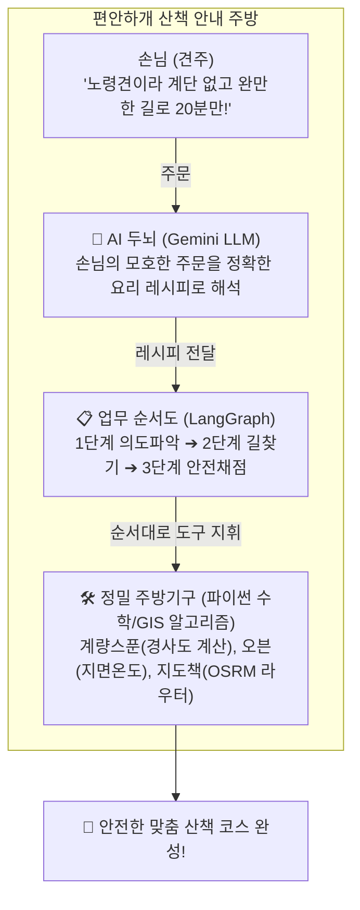
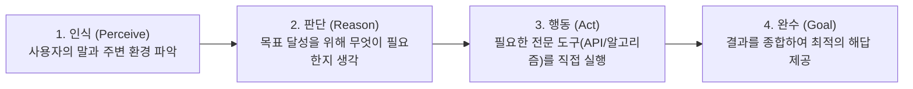

# 🐶 [초보자 가이드] 편안하개의 AI와 에이전트, 쉽게 이해하기

> **문서 번호**: 11  
> **작성 일자**: 2026년 10월 26일  
> **대상 독자**: LangGraph나 인공지능을 처음 접하는 팀원, 비전공자, 면접관 및 외부 발표 청중  
> **기준 문서**: [`docs/04_ai_problem_definition.md`](04_ai_problem_definition.md), [`docs/10_편안하개_아키텍처_설계서.md`](10_편안하개_아키텍처_설계서.md)  

---

## ❓ 1. 가장 흔한 질문: "LangGraph가 AI인가요? 에이전트 파일도 그냥 코드 아닌가요?"

> **"네, 맞습니다! LangGraph 자체는 인공지능이 아니며, 에이전트 파일들도 사람이 한 줄 한 줄 작성한 순수 파이썬(Python) 코드입니다."**

처음 코드를 열어보신 분들은 당연히 이런 의문을 품게 됩니다.
*"AI 프로젝트라고 들었는데 `walk_planning_agent.py`를 열어보니 `if`, `for`, 덧셈, 뺄셈 같은 일반 파이썬 코드만 가득한데요? 이게 왜 AI죠?"*

이 의문을 풀기 위해, 편안하개의 시스템을 **'식당 주방'**에 빗대어 설명해 드리겠습니다.

---

## 🍳 2. 비유로 이해하는 편안하개: "식당의 주방 시스템"

1. **손님 (견주)**: *"우리 강아지가 나이가 많아서 계단은 절대 안 되고 완만한 길로 20분만 돌고 싶어요"*라고 일상 언어로 모호하게 주문합니다.
2. **주방장 (진짜 AI = Gemini LLM)**: 손님의 두서없는 말을 듣고 *"아, 목표 시간 20분, 계단 배제(True), 경사도 완만(Gentle)이구나!"*라고 **정확한 규격 데이터로 해석(추론)**합니다.
3. **업무 매뉴얼 / 레시피 순서도 (LangGraph)**: *"주방장이 주문을 해석했으니, 다음은 지도 라우터로 길을 찾고, 그 다음엔 경사도를 재고, 마지막엔 온도를 체크해라!"*라고 **일의 순서(파이프라인)를 정해주는 관리 규칙**입니다.
4. **정밀 주방기구들 (파이썬 계산 알고리즘)**: 각도기(경사각 15도 미만 계산), 온도계(지면온도 수식), 계단 감지기 등 **100% 빈틈없이 숫자를 계산하는 정밀한 파이썬 도구**입니다.

👉 **정리하자면**:
- **진짜 AI (Gemini)**는 **"말귀를 알아듣는 두뇌"**입니다.
- **LangGraph**는 AI와 도구들을 어떤 순서로 실행할지 정해주는 **"업무 진행 순서도"**입니다.
- **에이전트 파일(`walk_planning_agent.py`)**은 이 주방 전체를 총괄해서 손님의 주문을 완수하는 **"매니저 프로그램"**입니다.

---

## ⚖️ 3. 프로젝트 속 '진짜 AI' vs '순수 코드' 한눈에 비교

프로젝트의 각 구성요소가 **진짜 인공지능(신경망 모델)**인지, 아니면 **전통적인 수학/규칙 기반 코드**인지 투명하게 분류한 표입니다.

| 컴포넌트 명칭 | 물리적 코드 위치 | 기술의 실체 | 무엇을 하는가? | 분류 |
|---|---|---|---|:---:|
| **음성 의도 파싱** | `voice_intent_service.py` | **Google Gemini LLM** | 비정형 자연어 발화에서 의도와 제약 조건을 파싱 | 🧠 **진짜 AI** |
| **현장 위험 판독** | `hazard_service.py` | **Gemini Multimodal Vision** | 현장 사진 속 높은 턱, 공사판, 공원 안내도를 시각 분석 | 🧠 **진짜 AI** |
| **핸즈프리 음성 안내** | `gemini_tts.py` / `expo-speech` | **신경망 음성 합성(TTS)** | 텍스트 안내문을 사람 목소리 오디오 파형으로 합성 | 🧠 **진짜 AI** |
| **오케스트레이션** | `walk_planning_agent.py` | **LangGraph StateGraph** | 노드(단계)와 엣지(조건)를 연결하는 파이썬 상태 제어 코드 | ⚙️ **순수 코드** |
| **순환 루프 플래너** | `loop_route_planner.py` | **기하학/삼각측량 알고리즘** | 각도(Bearing)를 회전시키며 순환 웨이포인트를 계산 | ⚙️ **순수 코드** |
| **다요소 채점기** | `personalized_scorer.py` | **가중치 채점 산술 공식** | 4개 항목(30점+30점+20점+20점)을 합산하여 100점 만점 채점 | ⚙️ **순수 코드** |
| **DEM 경사 분석기** | `surface_slope_evaluator.py` | **삼각비(Trigonometry) 수학식** | 국토정보플랫폼 수치표고모델(DEM) 고도차로 경사각 산출 | ⚙️ **순수 코드** |
| **200m 공간 마스킹** | `spatial_masking.py` | **Shapely 기하 공간 연산** | 자택 좌표 반경 200m 원(Circle) 내부 좌표를 절단 및 블러링 | ⚙️ **순수 코드** |
| **지면온도 추정기** | `segment_conditions.py` | **경험적 물리 수지식** | $\text{외기온} + (\text{일사량 가중치} \times 15)$ 덧셈/곱셈 공식 | ⚙️ **순수 코드** |

---

## 🛑 4. 왜 모든 것을 AI(LLM)에게 맡기지 않았을까요?

> **"AI에게 지도 위의 위도·경도 좌표 50개를 직접 찍으라고 시키면 어떻게 될까요?"**

1. **벽을 뚫고 지나가는 환각 (Hallucination)**:  
   인공지능(LLM)은 그럴듯한 글을 쓰는 데 능하지만, 공간 감각이나 오차 없는 수학 계산에는 매우 취약합니다. LLM에게 경로를 직접 만들라고 하면 아파트 벽을 뚫거나 호수 위를 건너가는 엉터리 좌표를 만듭니다.
2. **속도가 너무 느립니다**:  
   LLM이 수십 개의 좌표를 생성하려면 5~10초 이상 걸립니다. 반면 파이썬 수학/GIS 코드는 **0.1초(100ms)** 만에 정확한 도로망을 탐색합니다.
3. **안전성 보장 불가**:  
   반려견에게 계단이나 급경사는 치명적입니다. LLM은 "아마도 완만할 것입니다"라고 둘러대지만, DEM 지형 데이터를 읽는 수학 코드는 **"이 길은 경사가 16.2도이므로 무조건 탈락!"**이라고 100% 확실하게 걸러냅니다.

> 💡 **편안하개의 똑똑한 하이브리드 설계**:  
> **"사람의 애매한 말은 AI(Gemini)가 찰떡같이 알아듣고, 생명과 직결된 안전한 길 찾기는 100% 빈틈없는 파이썬 수학/GIS 코드가 담당한다!"**

---

## 🤖 5. 그렇다면 왜 '에이전트(Agent)'라고 부를까요?

소프트웨어 분야에서 **에이전트(Agent)**는 단순한 단발성 프로그램이 아니라, 다음과 같은 **3단계 루프(ReAct 패턴: Reason + Act)**를 스스로 수행하는 구조를 부르는 전문 용어입니다.

`walk_planning_agent.py`가 에이전트라고 불리는 이유는:
1. 사용자가 "더우니까 그늘 위주로 30분만 갈래"라고 하면,
2. 스스로 판단하여 **기상청 API**에서 온도를 확인하고, **OSRM 라우터**를 불러 경로를 뽑은 뒤, **경사 분석기**와 **채점기**를 차례대로 호출하여,
3. 사람이 하나하나 손으로 지도를 만지지 않아도 **최적의 안심 산책로라는 최종 결과물을 완성**해내기 때문입니다.

---

## 🎤 6. 1분 발표용 스크립트 (누군가 물어봤을 때 이렇게 설명하세요!)

> **Q. "편안하개 앱에서 AI가 정확히 어떤 역할을 하나요? LangGraph가 AI인가요?"**  
> 
> **A. (답변 스크립트)**  
> "아닙니다! **LangGraph 자체는 AI가 아니라 업무 순서를 제어하는 파이썬 오케스트레이션 도구**입니다.  
> 
> 편안하개에서 **진짜 AI(신경망 모델)**는 사용자의 복잡한 자연어 발화(*'노령견이라 계단 피해서 20분만'*)에서 핵심 의도를 뽑아내는 **Gemini LLM**과 현장 장애물을 판독하는 **Vision AI**입니다.  
> 
> 만약 길 찾기 좌표까지 AI에게 맡기면 건물을 뚫고 지나가는 환각(거짓말)이 발생합니다. 그래서 저희는 **'의도 파악은 똑똑한 AI(Gemini)가 하고, 실제 도로망 좌표와 경사도 계산은 100% 안전한 파이썬 수학/GIS 도구가 검증하는 하이브리드 에이전트 구조'**로 개발했습니다.  
> 
> 이 AI와 도구들을 유기적으로 지휘하는 매니저 프로그램이 바로 저희의 `walk_planning_agent`입니다."
