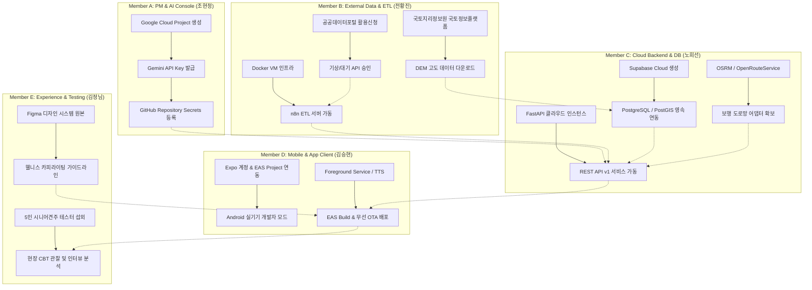

# 🐾 편안하개 (PetWalk) 인간 주도 외장 활동 및 인프라 운영 종합 매뉴얼 (README)

## 1. 개요 및 목적
**편안하개 (AI Native 반려견 맞춤형 안심 노면 산책 에이전트 및 기록·공유 플랫폼)** 프로젝트는 AI Pair Programming 및 자율 에이전트 도구를 통해 높은 개발 생산성과 코드 무결성을 달성하고 있습니다. 그러나 **AI 도구가 대신 수행할 수 없는 5인 인간 팀원 고유의 외장 활동(External & Manual Activities)**이 반드시 수반됩니다.

외부 클라우드 서비스 계정 발급, 유료/무료 API 키 발급 및 보안 할당량 설정, 공공데이터포털 인가 신청, 국토정보플랫폼 DEM 수급, 모바일 앱 마켓 및 EAS 빌드 서명 관리, 디자인 시스템 Figma 원본 에셋 구축, 5인 대면 CBT(사용성 테스트) 진행 등은 **팀원의 직접적인 수작업 및 인프라 설정**을 통해서만 완결될 수 있습니다.

본 `docs/guideline/` 디렉토리는 5인 팀원 각자의 역할과 책임(R&R)에 따른 외장 인프라 구축, 서비스 가입, 인증키 보안 보관, 수동 운영 및 정기 점검 매뉴얼을 프로젝트 최신 현황에 맞추어 집대성한 표준 가이드라인입니다.

---

## 2. 역할별 외장 활동 및 인프라 매뉴얼 인덱스

| 담당 팀원 | 역할 & 전문 영역 | 핵심 외장 활동 (AI 해결 불가 영역) | 상세 매뉴얼 링크 |
| :--- | :--- | :--- | :--- |
| **Member A** (1번 조현정) | **PM & AI Agent Lead** (프로젝트 총괄·AI 기능 설계) | • Google Cloud Project 생성 및 Gemini API Key 발급 • 모델 가용 체인(3.5 Flash-Lite ➔ 3.1 Flash-Lite ➔ 3.6 Flash) 할당량/비용 모니터링 • GitHub Repository 설정, Actions 시크릿 관리, 주간 릴리즈 게이트 주관 | [Member_A_PM_Manual_and_Infra_Guide.md](file:///d:/코디세이/pet_walk_t01/docs/guideline/Member_A_PM_Manual_and_Infra_Guide.md) |
| **Member B** (2번 전황진) | **AI & Spatial Data Engineer** (지도·공간데이터·AI 분석) | • 공공데이터포털(data.go.kr) 기상청 단기예보 & 대기오염 API 활용 신청 및 승인 • 국토지리정보원 DEM 수치표고모델 래스터 데이터 수급 및 15도 미만 무장애 가공 • n8n Self-hosted ETL 인프라(Docker) 세팅 & 200m 교차로 스냅 공간 지터링 감사 | [Member_B_Data_Infra_and_External_API_Manual.md](file:///d:/코디세이/pet_walk_t01/docs/guideline/Member_B_Data_Infra_and_External_API_Manual.md) |
| **Member C** (3번 노희선) | **Backend & Spatial Routing Lead** (서버·맞춤 경로 계산) | • Supabase 프로젝트 프로비저닝 (PostGIS 활성화 및 PostgreSQL 영속 연동) • OpenRouteService(ORS) / OSRM 보행 도로망 어댑터 토큰 및 1.5초 캐시 최적화 • FastAPI 백엔드 배포(Render/Fly.io), SSL 인증서 및 CORS 정책 수동 주입 | [Member_C_Backend_Infra_and_Cloud_Manual.md](file:///d:/코디세이/pet_walk_t01/docs/guideline/Member_C_Backend_Infra_and_Cloud_Manual.md) |
| **Member D** (4번 김승현) | **Frontend & Mobile App Lead** (모바일 앱·GPS·음성 안내) | • Expo 계정 생성, Expo CLI 연동 및 EAS Organization 세팅 • Android Foreground Service 무중단 GPS & expo-speech 백그라운드 TTS 연동 • Android 실기기 개발자 모드 세팅, EAS Build(APK) 생성 및 EAS Update(무선 OTA) | [Member_D_Mobile_Infra_and_EAS_Manual.md](file:///d:/코디세이/pet_walk_t01/docs/guideline/Member_D_Mobile_Infra_and_EAS_Manual.md) |
| **Member E** (5번 김정님) | **UI/UX Designer & Experience Lead** (화면 구현·통합 테스트) | • Figma 팀 워크스페이스 세팅 및 편안하개 디자인 토큰(에메랄드/3색 Polyline) 배포 • 앱 전역 질병 용어 100% 배제 긍정적 웰니스 카피라이팅 가이드라인 수립 • 5인 대면 CBT(Closed Beta Test) 테스터 섭외, 관찰 설문지 배포 및 심층 인터뷰 주관 | [Member_E_Design_System_and_CBT_Manual.md](file:///d:/코디세이/pet_walk_t01/docs/guideline/Member_E_Design_System_and_CBT_Manual.md) |

---

## 3. 전체 인프라 연동 의존성 맵 (Cross-Dependency Map)

---

## 4. 환경 변수 및 보안 키 보관 표준 가이드라인

1. **절대 금기 사항 (Security Rules)**
   - 소스코드 저장소(Git)에 `.env` 파일, API 키 문자열, 인증서 파일(`.jks`, `.keystore`)을 커밋하는 행위 절대 금지.
   - 모든 로컬 개발 환경은 프로젝트 루트의 `.env.example` 및 `frontend/.env.example`을 복사하여 `.env`를 수동 구성함.
2. **시크릿 키 공유 및 관리 프로토콜**
   - 개발용 API Key는 1Password / Bitwarden 또는 암호화된 보안 채널을 통해서만 1회성 전달.
   - 프로덕션 배포 시에는 GitHub Secrets 및 호스팅 플랫폼(Supabase, Render, EAS)의 대시보드 Secret Environment Variables로 직접 주입.
3. **API 비용 및 할당량 보호 (Rate Limiting)**
   - Gemini API 및 외부 유료 API는 일일 지출 한도(Daily Budget Alert: $5/day)를 설정하여 오과금 사전 차단.
4. **Local-First 프라이버시 보호 원칙**
   - 견주의 자택 위치, 반려견 프로필, 실시간 보행 GPS 상세 궤적은 서버 DB에 저장하지 않으며 모바일 클라이언트(`AsyncStorage`)에만 영구 보관.
   - 커뮤니티 공개 코스는 출발지/도착지 200m 공간 마스킹 및 교차로 스냅을 거친 후에만 서버로 전송.

---

## 5. 수동 운영 활동 주간 체크리스트 (Weekly Ops Rhythm)

- [ ] **매주 월요일 10:00 (Member A & C)**: Google Cloud 및 Supabase 자원 사용량, 청구 금액 모니터링.
- [ ] **매주 화요일 14:00 (Member B)**: 공공데이터포털 API 변경 공지 확인 및 n8n 파이프라인 정상 가동(로그) 확인.
- [ ] **매주 수요일 16:00 (Member E & D)**: 신규 UI 디자인 에셋 동기화 회의 및 React Native 렌더링 검수.
- [ ] **매주 목요일 15:00 (Member C & D)**: 백엔드 REST API 계약 정합성 및 Live/Mock 듀얼 모드 통신 점검.
- [ ] **매주 금요일 17:00 (전원)**: 금주 릴리즈 대상 APK 빌드(Member D), 팀 내부 Dogfooding 산책 테스트 수행.
