# \[편안하개 - PetWalk\] 백엔드 경로 생성 결함 분석 및 근본 개선 계획서

-   **문서 식별자**: `docs/backend_improvement_plan_1015.md`
-   **개정일**: 2026-10-15
-   **개정 목적**: 반복되는 경로 이탈 문제의 원인 추적, 안전한 경로 생성
    아키텍처 수립, 단계별 구현 및 검증 기준 명확화
-   **대상 시스템**: FastAPI 백엔드, LangGraph 기반 산책 경로 플래너,
    보행망 라우팅 엔진
-   **주요 재현 사례**: `error/1015-course1.png` --- 대전 송강근린공원
    지정 모드에서 공원 외부 도로 이탈 및 목표 시간 초과

> **핵심 결정:** 좌표열과 프롬프트를 반복 수정하는 방식에서 벗어나, 실제
> 공간 데이터와 보행 네트워크에 기반해 경로를 생성하고, 독립적인 검증을
> 통과한 경로만 API로 반환한다. AI는 사용자 의도 해석과 경로 설명에
> 활용하되, 경계 준수·연결성·거리 및 시간 검증의 최종 권한을 갖지
> 않는다.

------------------------------------------------------------------------

## 1. 개요 및 문제 정의

모바일 앱의 산책 설정 화면(`WalkSettingsView`)에서 **지정 공원 둘레길**,
**대전 송강근린공원**, **목표 시간 40분**을 선택했을 때, 생성된 코스가
실제 공원 부지를 벗어나 남측 일반 도로 및 시가지(송강초등학교, 송강성당
주변 등)까지 이어지는 현상이 보고되었다.

보고된 결과는 약 3.2km, 약 60분이며, 사용자 목표인 40분을 크게 초과한다.
기존 개선 이후에도 문제가 지속된다면, 좌표 데이터 자체의 오류뿐 아니라
실제 요청이 어떤 경로 생성 분기를 거쳤는지, 경계 검증이 실행됐는지, 검증
실패 결과가 차단됐는지를 먼저 확인해야 한다.

현재 구조에서 특히 확인해야 할 위험은 다음과 같다.

1.  `pilot_park_routes.py`의 정적 좌표열이 공원 전용 경로로 잘못
    등록되었을 가능성
2.  `park_polygons_pilot.json`의 경계 형상이 실제 공원 영역과 다를
    가능성
3.  경로 생성기가 공원 경계를 제약조건으로 사용하지 않고, 생성 후
    검사에만 의존할 가능성
4.  정적 코스·OSRM/ORS·AI 플래너·폴백 경로 사이의 선택 순서가 명확하지
    않을 가능성
5.  경계 검증 실패나 라우팅 타임아웃 후에도 대체 경로가 성공 응답으로
    전달될 가능성
6.  거리 및 예상 시간의 산정 방식이 서로 다르거나, 최종 좌표열과
    메타데이터가 일치하지 않을 가능성

본 계획은 특정 공원의 핫픽스를 포함하되, 장기적으로 전국의 임의 공원과
현위치 기반 요청에 같은 안전 규칙을 적용할 수 있도록 개선하는 것을
목표로 한다.

------------------------------------------------------------------------

## 2. 관찰된 증상과 확인이 필요한 사실

### 2.1 보고된 재현 사례

-   설정: 송강근린공원, 목표 시간 40분, 폭신한 길 및 그늘 선호
-   생성 결과: "대전 송강근린공원 솔밭 숲길·잔디광장 완만루프"
-   표시된 거리/시간: 약 3.2km / 약 60분
-   문제: 공원 내부 산책로뿐 아니라 공원 남측의 일반 도로와 시가지까지
    경로가 이어짐

### 2.2 현재는 코드·로그로 재확인해야 하는 항목

아래 항목은 기존 계획서에서 제시한 원인 가설이며, 실행 중인 코드와 실제
요청 로그를 확인하기 전에는 모두 확정된 사실로 취급하지 않는다.

-   실제 실행 환경에서 `SONGGANG_PARK_OSM_COORDS`가 사용됐는지
-   해당 요청에서 정적 코스, OSRM/ORS, LangGraph 에이전트 중 어떤 분기가
    선택됐는지
-   요청의 `origin_mode`, 공원 ID, 좌표, 목표 시간이 어떤 값으로
    전달됐는지
-   `is_route_inside_park_boundary`가 호출됐는지, 어떤 Polygon으로
    검사했는지, 반환값과 예외가 무엇이었는지
-   검사 대상이 전체 최종 좌표열이었는지, 중간 경로 또는 일부 점만
    검사했는지
-   검증 실패 후 다른 코스나 `_plan_rectangle_fallback`으로 전환됐는지
-   반환된 좌표열, 거리, 예상 시간이 동일한 경로 버전에서 계산됐는지
-   앱이 현재 백엔드 배포 버전과 기대한 API 서버를 실제로 호출하고
    있는지

**원칙:** 근거가 없는 원인 단정이나 좌표 범위만을 이용한 임시 판정을
금지한다. 관찰 결과, 로그로 확인한 사실, 아직 검증하지 않은 가설을
분리해 기록한다.

------------------------------------------------------------------------

## 3. 근본 원인 가설

### 원인 가설 A --- 정적 좌표열에 잘못된 경로가 등록됨

-   후보 위치: `backend/agent/pilot_park_routes.py`
-   기존 계획서에서는 `SONGGANG_PARK_OSM_COORDS`에 공원 외부 좌표가
    포함되었을 가능성을 제기했다.
-   확인 방법:
    1.  실제 실행 시 선택된 코스 ID와 좌표열을 로그로 남긴다.
    2.  원본 정적 좌표열과 최종 반환 좌표열을 비교한다.
    3.  각 좌표 및 선분을 검증된 공원 Polygon과 비교한다.
-   조치: 잘못된 데이터는 제거하거나 수정하되, 정적 코스가 일반 경로
    생성 엔진을 대체하지 않도록 한다.

### 원인 가설 B --- 공원 Polygon이 실제 경계와 다름

-   후보 위치: `backend/fixtures/park_polygons_pilot.json`
-   기존 계획서에서는 송강근린공원의 Polygon이 실제 경계보다 넓은 가상
    버퍼일 가능성을 제기했다.
-   확인 방법:
    1.  Polygon의 출처, 갱신일, 좌표계, 좌표 순서를 확인한다.
    2.  지도상 경계와 GeoJSON 형상을 시각적으로 비교한다.
    3.  유효성 검사로 self-intersection, 빈 형상, 잘못된 링 등을
        검사한다.
    4.  경계 데이터가 없거나 신뢰할 수 없는 경우 해당 공원 모드를 정상
        경로로 처리하지 않는다.
-   조치: 확인 가능한 공공 데이터 또는 검증된 지도 데이터를 사용하고,
    데이터 출처와 품질 상태를 기록한다.

### 원인 가설 C --- 경계 검사가 생성 과정의 제약조건이 아님

OSRM이나 일반 보행 라우터는 공원 Polygon을 자동으로 이해하거나 공원
내부만 경로로 선택한다고 보장할 수 없다. 공원 경계가 사후 검사에만
사용되면, 경로 생성기가 외부 도로를 선택한 뒤 검증 단계에서 이를
발견하는 구조가 된다.

-   조치: 공원 내부 보행 네트워크를 구성할 때부터 경계 조건을 적용한다.
-   추가 조치: 생성 후 독립적인 검증을 수행한다. 어느 한 단계만으로
    안전성을 보장하지 않는다.

### 원인 가설 D --- 폴백 경로가 유효성 검증을 우회함

-   후보 위치: `backend/agent/loop_route_planner.py` 및 관련 폴백 로직
-   OSRM/ORS 타임아웃 또는 네트워크 단절 시 직사각형·직선·임의
    웨이포인트 경로를 반환하는 경우, 실제 보행로와 일치하지 않을 수
    있다.
-   조치: 모든 후보 경로와 폴백 결과에 동일한 최종 검증을 적용한다. 실제
    보행망을 따르지 않는 기하학적 폴백을 사용자에게 정상 산책 코스로
    반환하지 않는다.

### 원인 가설 E --- 목표 시간·거리 메타데이터 불일치

-   경로 좌표열과 별도로 거리/시간을 추정하거나, 이전 후보의
    메타데이터를 재사용하면 지도상 경로와 표시 정보가 달라질 수 있다.
-   조치: 최종 확정된 좌표열에서 거리와 예상 시간을 다시 계산하고, API
    응답의 모든 필드가 같은 최종 경로를 가리키도록 한다.

------------------------------------------------------------------------

## 4. 목표 아키텍처 및 설계 원칙

### 4.1 처리 파이프라인

``` mermaid
flowchart TD
    A["요청 수신 및 입력 검증"] --> B["공원 경계·보행망 데이터 확보"]
    B --> C["공간 데이터 품질 및 출발점 연결성 검사"]
    C --> D["경계 제약을 적용한 보행 그래프 구성"]
    D --> E["목표 시간·거리 기반 루프 후보 탐색"]
    E --> F["독립적인 최종 경로 검증"]
    F -->|통과| G["최종 좌표열 기준 거리·시간 재계산"]
    G --> H["경로 및 검증 메타데이터 반환"]
    F -->|실패| I["다른 후보 재탐색 또는 명확한 실패 응답"]
    I --> F
```

### 4.2 필수 원칙

1.  **유효 경로 우선:** 사용자의 선호를 최적화하기 전에 경계·연결성·보행
    가능성 등 필수 조건을 만족해야 한다.
2.  **생성 단계와 검증 단계 분리:** 경로 생성기가 자체적으로
    "안전하다"고 선언한 결과를 그대로 신뢰하지 않는다.
3.  **모든 경로에 같은 검증 적용:** 정적 코스, 동적 라우팅, AI가 제안한
    후보, 재탐색 후보에 동일한 최종 검증기를 적용한다.
4.  **실패를 성공으로 위장하지 않음:** 유효한 경로가 없으면 실패 상태와
    이유를 반환한다.
5.  **데이터 품질을 명시:** 공원 경계나 보행망이 없거나 불완전하면
    추정된 영역을 실제 경계처럼 취급하지 않는다.
6.  **AI 역할 제한:** LangGraph/LLM은 사용자 요청 해석, 선호 정리, 후보
    설명에 활용한다. 좌표 생성·수정 결과가 검증을 우회해 반환되지 않도록
    한다.
7.  **관측 가능성 확보:** 각 요청에 추적 ID를 부여하고 선택된 경로 소스,
    검증 결과, 실패 원인을 구조화 로그로 남긴다.

------------------------------------------------------------------------

## 5. 단계별 구현 계획

### Phase 0 --- 재현 및 실행 경로 추적 (최우선)

**목표:** 추가 알고리즘을 만들기 전에 실제 결함이 발생하는 코드 경로를
확정한다.

#### 작업

1.  `/api/v1/walk/plan` 요청부터 응답까지 `request_id` 또는 `trace_id`를
    전달한다.
2.  다음 정보를 구조화 로그로 기록한다.
    -   `origin_mode`, 공원 ID, 출발 좌표, 목표 시간, 선호 조건
    -   실제 선택된 경로 소스: 정적 코스 / OSRM / ORS / 그래프 엔진 /
        폴백
    -   후보 경로 ID, 좌표 수, 계산 거리, 예상 시간
    -   경계 데이터 ID/버전, 형상 유효성, 경계 검사 결과
    -   검증 실패 코드, 재시도 횟수, 최종 응답 상태
3.  다음 모듈의 실제 호출 관계와 분기 순서를 확인한다.
    -   `backend/main.py`
    -   `backend/agent/pilot_park_routes.py`
    -   `backend/agent/loop_route_planner.py`
    -   `backend/agent/walk_planning_agent.py` (실제 프로젝트에 존재하는
        경우)
    -   `is_route_inside_park_boundary` 및 `_plan_rectangle_fallback`
        정의/호출 위치
4.  모바일 앱이 기대한 백엔드 URL과 배포 버전을 호출하는지 확인한다.
5.  송강근린공원 40분 사례를 고정 회귀 테스트로 만든다.

#### 완료 기준

-   재현 요청이 어떤 분기를 거쳤는지 로그만으로 확인할 수 있다.
-   검증 함수의 호출 여부, 입력 형상, 반환값, 최종 응답 결정이 추적
    가능하다.
-   현재 원인 가설별로 `확인됨 / 기각됨 / 추가 증거 필요`를 기록한다.

### Phase 1 --- 안전 차단 및 파일럿 핫픽스

**목표:** 잘못된 경로가 앱에 정상 결과로 노출되는 것을 먼저 막는다.

#### 작업

1.  송강근린공원의 정적 좌표열에 실제 외부 도로 구간이 포함되었는지
    확인하고, 확인된 오류만 수정한다.
2.  `park_polygons_pilot.json`의 송강 Polygon을 신뢰 가능한 경계
    데이터와 대조한다. 데이터 출처와 좌표계가 확인되지 않으면 경계를
    확정된 실제 경계로 간주하지 않는다.
3.  경계 검사 함수가 모든 최종 좌표열과 모든 선분을 대상으로 실행되도록
    한다.
4.  검증 실패 시 정적 코스나 폴백 경로를 검증 없이 반환하는 분기를
    제거한다.
5.  `_plan_rectangle_fallback` 등 기하학적 임의 경로가 실제 보행
    네트워크 경로인 것처럼 반환되지 않게 한다.
6.  최종 좌표열이 확정된 뒤 거리와 예상 시간을 재계산한다.
7.  오류 응답에 앱이 처리할 수 있는 안정적인 오류 코드와 사용자 안내
    문구를 포함한다.

#### 공간 검증 구현 지침

-   GeoJSON 좌표는 `[경도, 위도]` 순서인지 확인한다.
-   거리 단위의 버퍼가 필요하면 적절한 투영 좌표계로 변환한 뒤 미터
    단위로 계산한다. 경위도 좌표에 `0.00015` 같은 값을 적용해 고정된
    미터 거리라고 가정하지 않는다.
-   `Polygon.contains(LineString)`만을 유일한 판정으로 사용하지 않는다.
    경계선 접촉 허용 정책을 명시하고, 전체 선분의 허용 영역 이탈 길이
    또는 교차 여부를 검사한다.
-   경계 허용 오차는 편의를 위해 임의로 넓히지 않는다. 공원 경계와
    보행로 데이터의 위치 오차를 고려해 명시적으로 설정하고 테스트한다.
-   MultiPolygon, 구멍(hole), 잘못된 형상, 빈 형상, 좌표 누락을
    처리한다.
-   공원 경계 데이터가 없거나 유효하지 않으면
    `BOUNDARY_DATA_UNAVAILABLE` 등 명시적 실패 상태로 처리한다.

#### 완료 기준

-   송강근린공원 회귀 사례가 검증 실패로 올바르게 차단되거나, 검증된
    내부 경로로 대체된다.
-   모든 폴백 경로도 최종 검증을 거친다.
-   실패한 경로의 좌표열이 성공 응답으로 반환되지 않는다.

### Phase 2 --- 결정론적 경로 검증 및 시간·거리 일관성

**목표:** 어떤 경로 생성기가 후보를 만들더라도 같은 규칙으로 판정한다.

#### 최종 검증 항목

1.  좌표 형식, 좌표계, 유한한 숫자 여부, 좌표 수 및 범위
2.  공원 모드에서 전체 경로가 허용된 공원 영역을 벗어나는지 여부
3.  경로가 실제 보행망 간선을 따르는지 여부
4.  출발·도착점과 보행망의 연결 여부
5.  순환 코스가 요구된 경우 출발점으로 복귀하는지 여부
6.  중복점, 급격한 점프, 비정상적으로 긴 단일 선분 등 좌표열 이상
7.  최종 좌표열로 재계산한 거리와 라우터가 보고한 거리의 허용 오차
8.  목표 시간과 예상 시간의 허용 범위
9.  금지 도로, 접근 제한, 보행 금지 구간 등 확인 가능한 제약 위반 여부

#### 거리·시간 정책

-   산책 시간은 거리만으로 단정하지 않고, 설정된 보행 속도와 경로 특성을
    이용해 계산한다.
-   반려견 수, 휴식, 경사도 등의 영향은 실제 모델에 반영되어 있는
    경우에만 계산에 포함한다.
-   40분 요청의 허용 거리 범위는 초기 테스트 기준으로 약 1.5\~2.2km를
    사용할 수 있으나, 이를 모든 사용자와 조건에 적용되는 보편적 사실로
    취급하지 않는다. 설정된 보행 속도 및 제품 정책에 따라 조정한다.
-   목표 시간을 만족하는 유효 경로가 없으면 경로를 임의로 늘리거나 외부
    도로로 우회시키지 않는다. 가장 가까운 유효 대안을 제시하거나 목표
    조건 완화 여부를 사용자에게 요청한다.

### Phase 3 --- 공원 내부 보행 그래프 기반 라우팅

**목표:** 경계 이탈을 사후 차단하는 데 그치지 않고, 생성 과정에서부터
경계 밖 경로를 후보에서 제외한다.

#### 데이터 수집

-   공원 경계 Polygon/MultiPolygon과 OSM 보행로 데이터를 별도 데이터로
    취급한다.
-   Overpass API는 데이터 수집 경로 중 하나로 사용한다. API 응답이
    있다고 해서 경계와 보행망의 완전성·정확성이 보장되는 것은 아니다.
-   외부 API는 타임아웃, 속도 제한, 응답 누락, 오래된 데이터에 대비한다.
-   전국 도시공원 표준데이터를 활용할 경우, 실제 제공 필드가 경계 형상을
    포함하는지 확인한다. 점 좌표만 제공되는 데이터로 정확한 경계를
    추정하지 않는다.
-   규모와 갱신 주기에 따라 PostGIS에 공원 형상과 메타데이터를 저장하고
    버전을 관리한다.

#### 그래프 구축 및 탐색

1.  보행로 선형 데이터를 노드와 간선으로 변환한다.
2.  실제 공원 영역과 정책상 허용된 경계 여유를 기준으로 간선을 검사한다.
3.  공원 경계 밖으로 나가는 간선은 공원 내부 전용 그래프에서 제외한다.
    경계 교차 간선은 단순히 중간 점만 검사하지 말고 선분 전체를
    검사한다.
4.  연결 컴포넌트와 진입점(entrance) 연결성을 계산한다.
5.  연결된 보행망에서 출발점과 목표 길이에 맞는 순환 후보를 탐색한다.
6.  그래프가 끊겨 있거나 루프가 성립하지 않으면 실패를 반환한다.
    존재하지 않는 순환로를 기하학적으로 합성하지 않는다.
7.  생성된 경로를 독립적인 Phase 2 검증기에 전달한다.

**알고리즘 주의사항:** Eulerian/Hamiltonian cycle은 모든 공원 그래프에서
존재하지 않는다. 이를 기본 보장으로 가정하지 말고, 연결된 보행망에서
목표 길이와 복귀 조건을 만족하는 순환 경로를 탐색하는 문제로 정의한다.

### Phase 4 --- 현위치 기반 공원 유인 경로

**목표:** 현재 위치에서 접근·공원 내부 순환·복귀 경로를 명확히 분리한다.

1.  현위치 좌표의 유효성을 확인한다.
2.  현위치를 실제 보행망에 스냅할 수 있는지, 스냅 거리와 접근 가능성을
    검사한다.
3.  주변 공원과 공원 진입점을 검색한다.
4.  현위치 → 진입점 접근 경로를 보행망으로 계산한다.
5.  공원 내부 순환은 공원 내부 전용 그래프에서 별도로 계산한다.
6.  진입점 → 현위치 복귀 경로를 계산한다.
7.  전체 경로를 연결한 뒤 외부 접근 구간과 공원 내부 구간을 구분해
    검증한다.
8.  공원 내부 순환이 불가능하거나 데이터 신뢰도가 부족하면 그 사실을
    표시하고, 공원 내부 코스인 것처럼 응답하지 않는다.

주변 공원 검색 반경(예: 800m)은 초기 정책값으로만 취급한다. 실제 이동
거리, 진입점 연결성, 목표 시간, 사용자의 접근성 설정을 함께 고려한다.

### Phase 5 --- 전국 확장 및 운영 안정화

-   전국 도시공원 경계와 보행망 데이터를 수집·갱신하는 파이프라인을
    마련한다.
-   데이터 출처, 갱신 시각, 형상 유효성, 신뢰도 및 커버리지를 기록한다.
-   Overpass API 장애 시 캐시 또는 로컬 공간 DB를 활용하되, 오래된
    데이터 사용 여부를 기록한다.
-   데이터가 부족한 지역은 지원 불가 또는 제한된 결과로 응답한다. 전국
    100% 커버리지를 근거 없이 약속하지 않는다.
-   실제 보행 가능성, 보행로 태그, 접근 제한, 횡단부 등 데이터로 확인
    가능한 항목을 활용한다. `highway` 태그만으로 도로 안전성을 완벽하게
    판단하지 않는다.
-   "폭신한 길", "그늘이 많은 길"과 같이 데이터만으로 확인하기 어려운
    선호는 검증된 속성 데이터가 있을 때만 점수화하고, 데이터가 없으면
    추정임을 표시한다.

------------------------------------------------------------------------

## 6. API 계약 및 오류 처리

경로 생성 API는 성공 여부와 검증 상태를 명시적으로 구분해야 한다.

### 성공 응답에 포함할 권장 필드

-   `route_id`: 확정된 경로 식별자
-   `coordinates`: 최종 검증을 통과한 좌표열
-   `distance_m`: 최종 좌표열 기준 거리
-   `estimated_duration_min`: 정책에 따라 산정한 예상 시간
-   `origin_mode`: 요청 모드
-   `route_source`: 정적 데이터, 그래프 라우터 등 실제 경로 소스
-   `validation.status`: `passed`
-   `validation.checks`: 실행한 검증 항목과 결과
-   `data_version`: 공원 경계 및 보행망 데이터 버전(가능한 경우)

### 권장 실패 코드

  -------------------------------------------------------------------------------
  코드                            의미                    처리
  ------------------------------- ----------------------- -----------------------
  `BOUNDARY_DATA_UNAVAILABLE`     신뢰할 공원 경계가 없음 공원 내부 코스 성공
                                                          응답 금지

  `WALK_NETWORK_UNAVAILABLE`      보행망 데이터 없음      실제 경로가 없는 임의
                                                          좌표열 반환 금지

  `NO_VALID_LOOP`                 조건을 만족하는 순환    시간·거리 조정 또는
                                  경로가 없음             다른 공원 제안

  `ROUTE_VALIDATION_FAILED`       최종 경로 검증 실패     후보 폐기 후 제한된
                                                          재탐색

  `ROUTING_PROVIDER_TIMEOUT`      외부 라우팅 서비스      안전한 캐시 후보를
                                  타임아웃                검증하거나 명시적 실패

  `ROUTE_DURATION_OUT_OF_RANGE`   예상 시간이 허용 범위를 후보 재선정 또는 사용자
                                  벗어남                  안내
  -------------------------------------------------------------------------------

실제 API의 기존 응답 스키마와 앱의 오류 처리 방식에 맞춰 필드와 코드를
확정한다. 클라이언트 호환성을 깨는 변경은 버전 관리 또는 점진적
마이그레이션을 적용한다.

------------------------------------------------------------------------

## 7. 검증 및 테스트 계획

### 7.1 단위 테스트

-   Polygon/MultiPolygon 및 구멍이 있는 형상
-   경계선 접촉 및 경계 교차 선분
-   잘못된 형상, 빈 형상, 좌표 누락, 좌표 순서 오류
-   공원 내부·외부 간선 분류
-   그래프 연결 컴포넌트와 루프 탐색
-   거리·시간 재계산
-   라우터 타임아웃 및 폴백 결과 차단
-   검증 실패 시 성공 응답 생성 금지

### 7.2 통합 및 회귀 테스트

  -----------------------------------------------------------------------------
  시나리오                검증 방법               합격 기준
  ----------------------- ----------------------- -----------------------------
  송강근린공원 40분       고정 입력으로 API 호출  외부 도로 이탈 경로가 성공
                                                  결과로 반환되지 않음

  공원 경계 밖 좌표 포함  테스트용 잘못된 후보    `ROUTE_VALIDATION_FAILED`로
                          주입                    폐기

  공원 Polygon 누락/손상  경계 데이터 제거 또는   명시적 실패, 가상 경계로
                          손상                    대체하지 않음

  보행망 단절             연결되지 않은 그래프    존재하지 않는 루프를 생성하지
                          제공                    않음

  라우터 타임아웃         외부 호출 모킹          임의 직사각형 경로가 반환되지
                                                  않음

  목표 시간 초과          긴 후보 경로 주입       거리·시간을 재계산하고 정책에
                                                  따라 거부/대안 제시

  현위치가 보행망에서 멂  스냅 거리 초과 입력     임의로 가까운 도로에 연결하지
                                                  않고 실패/확인 요청

  미등록 공원             경계·보행망 검색 수행   데이터가 확보된 경우만 생성,
                                                  그 외는 명시적 실패

  최종 좌표와 메타데이터  서로 다른 후보의 거리   최종 좌표열 기준으로 다시
  불일치                  필드 주입               계산

  앱-백엔드 배포 불일치   빌드/버전 정보 확인     실제 호출 서버 및 버전 확인
                                                  가능
  -----------------------------------------------------------------------------

### 7.3 합격 기준

-   경계 위반 또는 보행망을 따르지 않는 후보가 성공 응답으로 반환되는
    건수: **0건**
-   실패 경로를 임의의 직사각형·직선으로 대체하는 건수: **0건**
-   모든 성공 응답에 필수 최종 검증 결과 존재
-   거리와 예상 시간은 최종 확정된 좌표열 기준으로 계산
-   `pytest backend/test_case/` 및 프로젝트의 전체 관련 테스트 통과
-   기존 테스트 명칭(`test_origin_mode.py`, `test_pilot_park_routes.py`
    등)은 실제 저장소에 존재하는지 확인 후 적용
-   전국 경로 성공률 목표는 대표 지역별 데이터 품질 및 표본 테스트
    결과를 확보한 뒤 별도로 설정한다. 근거 없는 98% 성공률을 초기 합격
    기준으로 확정하지 않는다.

------------------------------------------------------------------------

## 8. 관측성 및 운영 정책

각 요청에서 아래 이벤트를 구조화 로그로 기록한다.

-   `request_id`, API 버전, 배포 버전
-   요청 모드, 공원 ID, 목표 시간 및 선호 조건
-   선택한 라우팅 전략과 경로 소스
-   공간 데이터 버전 및 데이터 조회 결과
-   후보별 거리·시간·경계 검사·연결성 검사 결과
-   폴백 실행 여부와 실행 사유
-   최종 성공/실패 코드 및 처리 시간

로그에는 인증 토큰, 비밀키, 불필요한 개인정보를 기록하지 않는다. 좌표
로그의 보관 기간과 접근 권한을 정한다.

------------------------------------------------------------------------

## 9. 추진 순서 및 우선순위

### P0 --- 실제 원인 확정과 위험 차단

1.  실패 요청의 입력, 선택된 경로 분기, 최종 좌표열을 로그로 확인
2.  실제 배포 버전과 모바일 앱의 API URL 확인
3.  경계 검증 호출 여부와 입력 Polygon 확인
4.  모든 성공 응답에 최종 검증 게이트 적용
5.  검증되지 않은 기하학적 폴백 경로 제거
6.  송강근린공원 사례를 회귀 테스트로 고정

### P1 --- 결정론적 검증 및 파일럿 안정화

1.  좌표계·형상 유효성·전체 선분 검사 보강
2.  거리·시간 메타데이터 재계산
3.  송강근린공원 경계와 보행로 데이터 검증
4.  단위 테스트 및 실패 시나리오 테스트 추가

### P2 --- 그래프 기반 공원 라우팅

1.  공원 Polygon과 OSM 보행로를 정합
2.  경계 제약 보행 그래프 생성
3.  연결성 및 루프 후보 탐색
4.  독립 검증기 통과 결과만 반환

### P3 --- 현위치 모드 및 전국 확장

1.  접근·내부 순환·복귀 구간 분리
2.  전국 도시공원 공간 데이터 및 캐시 구축
3.  데이터 품질 모니터링과 갱신 정책
4.  지역·공원 유형별 통합 테스트와 운영 지표 수립

------------------------------------------------------------------------

## 10. 구현 완료 정의 (Definition of Done)

다음 조건을 모두 만족해야 경로 생성 개선을 완료한 것으로 간주한다.

-   [ ] 실제 실패 사례의 경로 생성 분기와 근본 원인이 로그 및 코드로
    확인되었다.
-   [ ] 정적 코스, 동적 라우팅, AI 제안 후보, 폴백에 동일한 최종
    검증기가 적용된다.
-   [ ] 경계 데이터가 없거나 신뢰할 수 없을 때 가상 버퍼로 조용히
    대체하지 않는다.
-   [ ] 공원 모드에서 경계 위반 후보는 성공 응답으로 반환되지 않는다.
-   [ ] 실제 보행망을 따르지 않는 직선/직사각형 폴백이 제거되거나 비경로
    안내로 격리되었다.
-   [ ] 거리와 예상 시간은 최종 확정된 좌표열에서 계산된다.
-   [ ] 라우팅 실패와 검증 실패가 API 및 앱에서 구분 가능하다.
-   [ ] 송강근린공원 회귀 테스트와 관련 단위·통합 테스트가 통과한다.
-   [ ] 미등록 공원, 데이터 누락, 타임아웃, 보행망 단절 상황에서
    안전하게 실패한다.
-   [ ] 운영 로그로 요청부터 최종 응답까지 경로 선택과 검증 결과를
    추적할 수 있다.

------------------------------------------------------------------------

## 11. 최종 권고

근본 해결은 **공원 좌표를 더 추가하거나 AI 프롬프트를 계속 수정하는 것이
아니다.** 우선 실제 요청의 실행 경로를 추적해 검증 게이트가 우회되는
지점을 찾고, 검증되지 않은 경로가 반환되지 않도록 차단해야 한다. 이후
실제 공원 경계와 보행망으로 제약조건 기반 그래프를 구성하고, 목표 시간에
맞는 순환 후보를 탐색한다.

핵심 구조는 다음과 같다.

**공간 데이터 품질 확인 → 경계 제약 보행 그래프 → 후보 경로 탐색 →
독립적인 최종 검증 → 최종 좌표 기준 거리·시간 산정 → API 반환**

LangGraph/LLM은 사용자 요청과 선호를 해석하고 결과를 설명하는 데
활용하되, 경계 준수와 경로 유효성은 결정론적 코드가 최종 판정한다.
유효한 경로를 만들 수 없을 때는 잘못된 코스를 반환하지 않고, 실패 이유와
가능한 대안을 명확하게 제공한다.

------------------------------------------------------------------------

## 12. 2026-10-15 구현 기록

지정 공원 경로 이탈에 대한 안전 차단, 실제 OSM 경계·보행망 기반 파일럿
라우팅, 모든 API 후보의 독립 검증, 앱의 미검증 폴백 차단을 반영했다.
원인 확인 근거, 공원별 데이터 출처, 검증 정책, 회귀 테스트와 남은 범위는
[지정 공원 경로 이탈 수정 결과](park_boundary_fix_1015.md)에 기록한다.

송강·유림은 출처가 확인된 경계와 보행망을 사용한다. 세종·도안은 신뢰할
경계를 확보하기 전까지 `BOUNDARY_DATA_UNAVAILABLE`로 처리한다.
전국 공원 데이터 구축과 현위치 접근·복귀 라우팅은 후속 범위이며, 이 기록은
전체 로드맵의 모든 Phase가 완료됐다는 의미가 아니다.
