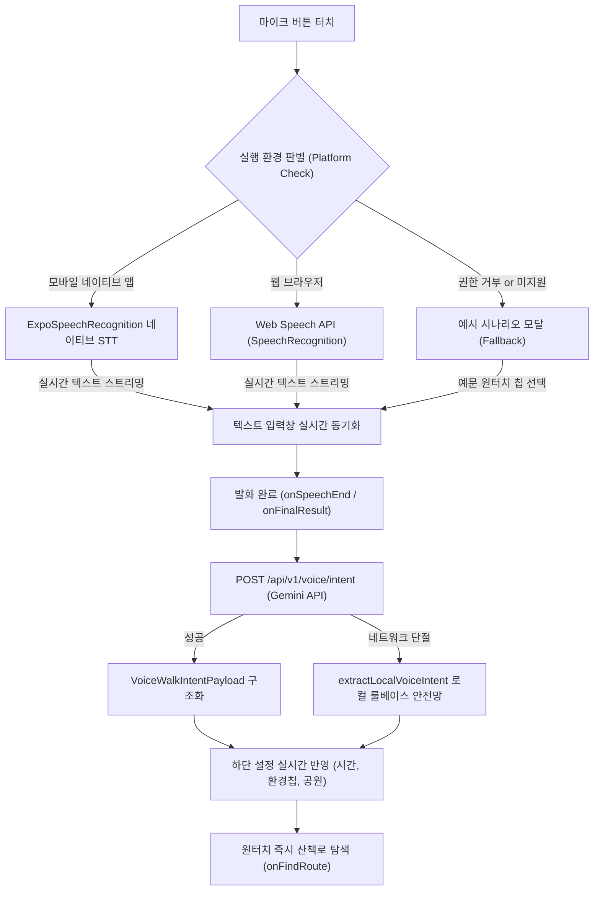

# [편안하개 - PetWalk] 모바일 네이티브 마이크 STT 연동 기술 구현 계획서
> **문서 ID**: IP-VOICE-STT-002  
> **작성일자**: 2026-10-17  
> **상태**: 승인 대기 (Draft / Proposed)  
> **대상 플랫폼**: Android / iOS (React Native & Expo Development Build)  
> **관련 문서**: [gemini_api_적용_계획.md](/pet_walk_t01/docs/implementation_plan/gemini_api_적용_계획.md), [03_편안하개_Agile_User_Stories.md](/pet_walk_t01/docs/03_편안하개_Agile_User_Stories.md)

---

## 1. 개요 및 배경 (Background & Objective)

### 1.1 현황 및 문제점
- **웹 표준 API 한계**: 현재 음성 입력 모듈(`WalkVoiceInputSection.tsx`)은 브라우저 표준인 `window.SpeechRecognition`에 의존하고 있습니다.
- **모바일 런타임 동작 부재**: 안드로이드/iOS 스마트폰 앱 환경(React Native 런타임)에서는 `window.SpeechRecognition` 객체가 존재하지 않아 `isSpeechSupported = false`로 평가되며, 마이크 버튼 터치 시 실제 마이크 녹음 대신 **예시 시나리오 모달**로 폴백되는 구조입니다.
- **사용자 경험(UX) 기대치 불일치**: 견주가 산책 중 손을 자유롭게 쓰지 못하는 야외 상황에서 "마이크 버튼을 눌렀을 때 내 목소리를 바로 듣고 산책로를 찾아주는" 본래의 모바일 네이티브 보이스 인터랙션이 요구됩니다.

### 1.2 구현 목표
1. **네이티브 마이크 하드웨어 연동**: 스마트폰 마이크 센서 및 OS 음성 인식기(Android Google Speech Services, iOS SFSpeechRecognizer)를 직접 연동.
2. **무비용 & 제로 레이턴시**: 온디바이스/OS 기본 STT 엔진을 활용하여 유료 클라우드 STT API 비용 없이 실시간 스트리밍 텍스트 변환.
3. **Gemini API 파이프라인 무중단 결합**: 음성 인식 텍스트 완료 즉시 `POST /api/v1/voice/intent`를 호출하여 시간/노면/공원 조건을 하단 설정에 자동 반영하고 AI 경로 생성 오케스트레이션 실행.
4. **하이브리드 크로스 플랫폼 폴백 안전망**:
   - `Native STT (스마트폰 앱)` ➔ `Web Speech (웹 브라우저)` ➔ `대화형 예시 시나리오 모달 (마이크 거부/오프라인)` 3단계 안전망 유지.

---

## 2. 모바일 STT 라이브러리 기술 비교 및 선정

| 평가 항목 | 후보 A: `expo-speech-recognition` | 후보 B: `@react-native-voice/voice` | 후보 C: `react-native-whisper` (온디바이스) | 후보 D: 서버 오디오 업로드 (Cloud STT) |
| :--- | :--- | :--- | :--- | :--- |
| **Expo 호환성** | **최우수 (Expo Config Plugin 공식 지원)** | 우수 (오래된 생태계, 플러그인 필요) | 보통 (Native C++ 라이브러리 바인딩) | 우수 (순수 네트워크 전송) |
| **설치 용량** | **경량 (< 1MB)** | 경량 (< 2MB) | 대용량 (Whisper 모델 40MB~150MB) | 초경량 (오디오 녹음만) |
| **인식 속도** | **실시간 스트리밍 (0.1초 미만)** | 실시간 스트리밍 (0.1초 미만) | 기기 성능 의존 (0.5~2초) | 네트워크 왕복 지연 (1~3초) |
| **운영 비용** | **0원 (OS 내장 엔진 사용)** | 0원 (OS 내장 엔진 사용) | 0원 (온디바이스) | 유료 (API 호출당 과금) |
| **한국어 지원** | **완벽 (Android/iOS 공식 언어팩)** | 완벽 (Android/iOS 공식 언어팩) | 한국어 지원 (tiny 모델 시 오타율 다소 높음) | 완벽 |
| **오프라인 동작** | 기기 오프라인 언어팩 설치 시 가능 | 기기 오프라인 언어팩 설치 시 가능 | **100% 오프라인 완전 지원** | 오프라인 불가 |

### 최종 선정: `expo-speech-recognition` (1순위 권장)
- **선정 이유**: 현재 프로젝트는 Expo SDK 52 기반 구조입니다. `expo-speech-recognition`은 최신 Expo Config Plugin 표준을 완벽히 지원하며, `app.json`의 플러그인 설정만으로 Android 권한 매니페스트와 iOS 권한 plist를 자동으로 주입할 수 있어 유지보수성이 가장 뛰어납니다. (대체안: `@react-native-voice/voice`)

---

## 3. OS별 필수 권한 및 매니페스트 구성

### 3.1 Android 매니페스트 설정 (`app.json` Config Plugin)
Android 11(API 30) 이상에서는 타 앱의 서비스(Google 음성인식기)와 통신하기 위해 `queries` 태그가 필수적입니다.
```json
{
  "expo": {
    "plugins": [
      [
        "expo-speech-recognition",
        {
          "microphonePermission": "편안하개 산책로 설정을 위해 음성을 인식하려면 마이크 접근 권한이 필요합니다.",
          "speechRecognitionPermission": "산책 시간과 원하는 장소를 음성으로 설정할 수 있도록 음성 인식을 허용해주세요."
        }
      ]
    ],
    "android": {
      "permissions": [
        "android.permission.RECORD_AUDIO",
        "android.permission.INTERNET",
        "android.permission.ACCESS_NETWORK_STATE"
      ],
      "package": "com.petwalk.t01"
    }
  }
}
```

### 3.2 iOS 매니페스트 설정 (`Info.plist` 키)
- `NSMicrophoneUsageDescription`: "산책 시간 및 원하는 코스를 음성으로 말씀하시려면 마이크 접근을 허용해주세요."
- `NSSpeechRecognitionUsageDescription`: "말씀하신 음성을 텍스트로 변환하여 맞춤 산책로를 추천하기 위해 음성 인식 권한이 필요합니다."

---

## 4. 빌드 및 배포 파이프라인 (EAS Build / Dev Client)

스마트폰 하드웨어 마이크와 네이티브 브릿지 코드를 포함하므로, 샌드박스 환경인 기본 Expo Go 앱에서는 실행할 수 없습니다. **Expo Dev Client**를 통한 네이티브 빌드가 필요합니다.

### 4.1 개발 클라이언트 생성 명령어
```bash
# 1. 패키지 설치
npx expo install expo-speech-recognition

# 2. 로컬 Android 네이티브 프리빌드 및 디버그 APK 실행
npx expo run:android

# 또는 EAS 클라우드 빌드 (권장)
npx eas build --profile development --platform android
```

---

## 5. 프론트엔드 하이브리드 아키텍처 설계

### 5.1 아키텍처 다이어그램 (Mermaid)


### 5.2 통합 음성 서비스 계층 (`frontend/src/services/nativeSpeechService.ts`)
```typescript
import { Platform } from 'react-native';
import { ExpoSpeechRecognitionModule, useSpeechRecognitionEvent } from 'expo-speech-recognition';

export interface SpeechRecognitionCallbacks {
  onStart?: () => void;
  onPartialResult?: (transcript: string) => void;
  onFinalResult?: (transcript: string) => void;
  onError?: (error: any) => void;
  onEnd?: () => void;
}

export class NativeSpeechService {
  public static async isAvailable(): Promise<boolean> {
    if (Platform.OS === 'web') {
      return typeof window !== 'undefined' && 
        (('SpeechRecognition' in window) || ('webkitSpeechRecognition' in window));
    }
    return await ExpoSpeechRecognitionModule.isRecognitionAvailable();
  }

  public static async requestPermissions(): Promise<boolean> {
    if (Platform.OS === 'web') return true;
    const res = await ExpoSpeechRecognitionModule.requestPermissionsAsync();
    return res.status === 'granted';
  }

  public static async startListening(callbacks: SpeechRecognitionCallbacks): Promise<void> {
    const hasPermission = await this.requestPermissions();
    if (!hasPermission) {
      callbacks.onError?.('PERMISSION_DENIED');
      return;
    }

    ExpoSpeechRecognitionModule.start({
      lang: 'ko-KR',
      interimResults: true,
      maxAlternatives: 1,
      continuous: false,
    });
  }

  public static stopListening(): void {
    ExpoSpeechRecognitionModule.stop();
  }
}
```

---

## 6. 단계별 구현 마일스톤 및 로드맵

### Phase 1: 네이티브 패키지 설치 및 권한 바인딩 (1주차)
- [ ] `expo-speech-recognition` 패키지 설치 및 `app.json` Config Plugin 설정
- [ ] Android `RECORD_AUDIO` 런타임 권한 요청 플로우 구현
- [ ] iOS `Info.plist` 권한 설명 문구 적용
- [ ] EAS Development Client Android APK 빌드 및 실기기 설치 검증

### Phase 2: UI/UX 인터랙션 고도화 (2주차)
- [ ] 마이크 버튼 상태별 애니메이션 (Listening: 펄스/음파 웨이브 애니메이션)
- [ ] 마이크 입력 중 실시간 음성-텍스트(STT) 스트리밍 노출
- [ ] 배경 소음(VAD) 감지 및 발화 중단 시 자동 분석 트리거
- [ ] 권한 거부 시 "설정에서 마이크 권한을 허용해주세요" 안내 모달 연동

### Phase 3: Gemini 오케스트레이션 및 E2E 종합 테스트 (3주차)
- [ ] 음성 발화 종료 즉시 Gemini 3.5 Flash-Lite 호출 파이프라인 검증
- [ ] 산책 조건 하단 설정(시간 슬라이더, 6대 환경 칩, 4대 공원) 100% 동기화 검증
- [ ] 지하철/엘리베이터 등 오프라인 환경에서 로컬 룰베이스 즉시 폴백 테스트
- [ ] Vitest 및 실기기 E2E 산책로 생성 시나리오 통과 확인

---

## 7. 기대 효과 및 비즈니스 가치
1. **야외 핸즈프리(Hands-Free) 경험 완성**: 견주가 한 손에 리드줄을 쥐고 있는 상태에서 원터치 마이크 발화만으로 원하는 조건의 산책로를 즉시 탐색 가능.
2. **반려견 웰니스 맞춤형 케어 실현**: "어제 다리를 삐끗했으니 계단 없이 평탄한 길로 20분만"과 같은 복합 자연어를 완벽히 해석하여 관절 질환 예방 코스 제공.
3. **인프라 비용 0원 유지**: 단말기 내장 음성인식 엔진을 사용하여 상용 Cloud STT(Google Speech / AWS Transcribe) API 호출 비용을 완전히 절감.
