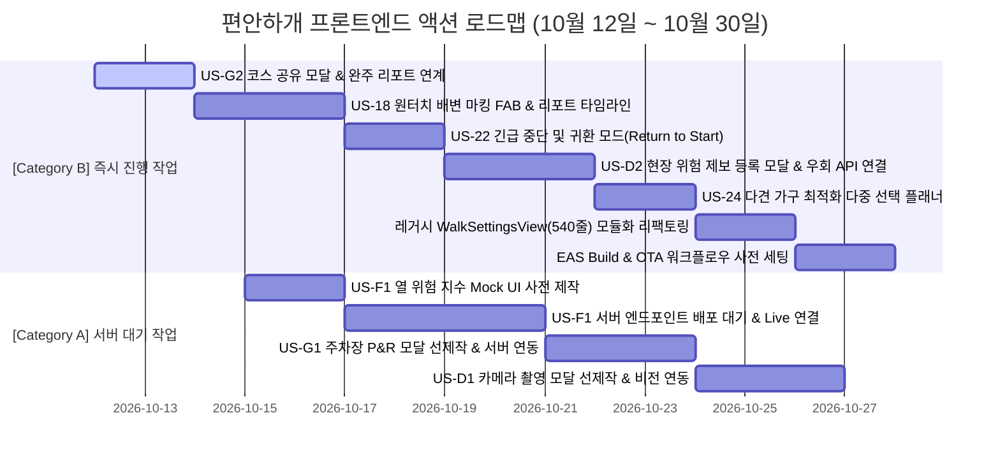

# 🐾 [구현 계획서] 서버 담당자 구현 현황 분석 및 프론트엔드 액션 로드맵 (대기 vs 진행 분리)

> **문서 버전**: v1.0  
> **작성 일자**: 2026년 10월 12일  
> **작성자**: 멤버4 **김승현** (Frontend & Mobile App Lead)  
> **분석 기준 문서**:  
> - [`docs/03_편안하개_Agile_User_Stories.md`](/pet_walk_t01/docs/03_편안하개_Agile_User_Stories.md) (요구사항 정의서 및 DoD)  
> - [`docs/02_편안하개_Team_building.md`](/pet_walk_t01/docs/02_편안하개_Team_building.md) (팀 R&R 및 엔지니어링 전략)  
> - [`docs/implementation_plan/99.member4_implementation_status_report.md`](/pet_walk_t01/docs/implementation_plan/99.member4_implementation_status_report.md) (모바일 앱 구현 현황 보고서)  
> - 백엔드 및 에이전트 소스코드 ([`backend/main.py`](/pet_walk_t01/backend/main.py), [`backend/agent/`](/pet_walk_t01/backend/agent), [`backend/test_case/`](/pet_walk_t01/backend/test_case))

---

## 📌 1. 개요 및 분석 배경 (Executive Summary)

본 문서는 **편안하개 (AI Native 반려견 맞춤형 안심 노면 산책 에이전트 및 기록·공유 플랫폼)**의 요구사항 정의서([`docs/03_편안하개_Agile_User_Stories.md`](/pet_walk_t01/docs/03_편안하개_Agile_User_Stories.md))를 기준으로, 현재 프로젝트의 코드베이스 전체를 정밀 분석하여 **서버 담당자(3번 노희선 Lead, 1번 조현정 AI, 2번 전황진 데이터)**의 세부 구현 현황을 도출하고, 프론트엔드 모바일 앱(4번 김승현 Lead) 관점에서 **서버 의존성으로 인해 대기(Block)해야 하는 작업**과 **독자적으로 즉시 추진 가능한 진행(Actionable) 작업**을 분리 정의한 전략적 구현 계획서입니다.

```mermaid
flowchart TD
    subgraph Requirements [03_Agile_User_Stories 기준]
        MVP[핵심 MVP 15개 스토리 (62 pt)]
        P2[Phase 2 차기 고도화 15개 스토리]
    end

    subgraph BackendStatus [서버 담당자 구현 현황 분석]
        B_DONE[✅ 코어 완결: 산책 플래너, OSRM 순환, 3색 DEM, 커뮤니티 공유/피드, 위험 우회]
        B_PARTIAL[⏳ 엔드포인트 미개방/데이터 미적재: F1 열위험 예보, G1 공영주차장 P&R, D1 Live Vision]
    end

    subgraph FrontendRoadmap [프론트엔드 실행 전략]
        WAIT[⏳ 대기 작업 (Server-Blocked)<br/>- F1 열 위험 지수 실서버 연동<br/>- G1 공영주차장 P&R 코스 연동<br/>- D1 Live Vision 실시간 판독 연동<br/>- Supabase Auth 실시간 토큰 세션]
        ACTION[🚀 즉시 진행 작업 (Frontend-Actionable)<br/>- US-G2 완주 리포트 내 코스 커뮤니티 공유 연계<br/>- US-18 원터치 배변 마킹 FAB & 산책 타임라인<br/>- US-22 산책 중 긴급 중단 및 귀환 모드 전환<br/>- US-D2 현장 위험 제보 등록 모달 & 우회 API 결합<br/>- US-24 다견 가구 최적화 다중 선택 플래너<br/>- 250줄 초과 레거시 컴포넌트 모듈화 리팩토링<br/>- EAS Build & OTA 배포 파이프라인 사전 세팅]
    end

    Requirements --> BackendStatus
    BackendStatus --> FrontendRoadmap
```

---

## 📊 2. 애자일 사용자 스토리 종합 구현 현황 매트릭스

`docs/03_편안하개_Agile_User_Stories.md`에 명시된 **15개 핵심 MVP 사용자 스토리(62 pt)** 및 **Phase 2 확장 스토리**의 서버·클라이언트 현재 구현 상태를 전수 대조한 결과입니다.

### 2.1 핵심 MVP 스토리 (Epic A ~ Epic H, 총 15개)

| Story ID | 에픽 / 도메인 | 사용자 스토리 명칭 | 난이도 / pt | 담당자 (R&R) | 서버 구현 상태 (Backend) | 프론트 구현 상태 (Frontend) | E2E 연동 상태 |
|:---:|---|---|:---:|---|:---:|:---:|:---:|
| **US-A1** | [Epic A] 산책 조건 | 대화형 자연어 산책 요청 및 조건 구조화 | 중 / 5 pt | 1번 조현정(팀장) | **90% (완료)**<br>LangGraph ReAct 에이전트, Pydantic Strict 파싱 | **80% (완료)**<br>플래너 조건 슬라이더/칩 바인딩 | **연동 완료** (`POST /api/v1/walk/plan`) |
| **US-A2** | [Epic A] 산책 조건 | 반려견 프로필 로컬 등록 및 JSON 백업/복원 | 하 / 3 pt | 5번 김정님(UI)<br>4번 김승현(앱) | **해당 없음 (0%)**<br>Local-First 원칙상 서버 미전송 | **100% (완료)**<br>`storage.ts`, `backupService.ts` | **로컬 완결** (서버 무관) |
| **US-A3** | [Epic A] 산책 조건 | 목표 산책 시간/거리 기반 환산 (속도/슬라이더) | 중 / 3 pt | 1번 조현정(팀장)<br>5번 김정님(UI) | **100% (완료)**<br>체급별 속도 상수 환산, $\pm 15\%$ 반경 보정 | **100% (완료)**<br>10~90분 슬라이더 및 거리 자동 산출 | **연동 완료** |
| **US-B1** | [Epic B] 무장애길 | 무장애길(경사 15도 미만·무계단) 안심 경로 도출 | 상 / 8 pt | 3번 노희선(서버)<br>2번 전황진(데이터) | **90% (완료)**<br>OSM 계단 배제, DEM 15도 미만 3색 분기, 건물 관통 방지 | **100% (완료)**<br>`RouteMapView.tsx` 3색 Polyline 시각화 | **연동 완료** |
| **US-B2** | [Epic B] 지면온도 | 기상·노면 연동 지면온도 기반 안심 경로 도출 (열 위험 회피) | 중상 / 5 pt | 3번 노희선(서버)<br>2번 전황진(데이터) | **75% (부분완료)**<br>비용 함수 수식 모델 검증 완료, 실시간 예보는 정적/추정치 결합 | **90% (완료)**<br>지면/체감온도 뱃지 및 그늘 비율 표시 | **연동 완료** (정적 추정치) |
| **US-B3** | [Epic B] 라우팅 엔진 | Routing API Adapter 연동 및 후보 경로 다요소 스코어링 | 상 / 8 pt | 3번 노희선(서버)<br>1번 조현정(팀장) | **100% (완료)**<br>OSRM Foot Adapter, 투기적 병렬 보정, 1.5초 이내 캐시, 3개 후보군 생성 | **100% (완료)**<br>3개 대안 코스 선택 시 실시간 지도/핀 동적 갱신 | **연동 완료** |
| **US-C1** | [Epic C] 모바일 UI | React Native Maps 기반 구간별 색상 분기 경로 시각화 | 중 / 5 pt | 4번 김승현(앱)<br>5번 김정님(UI) | **100% (완료)**<br>GeoJSON LineString 3대 등급 반환 | **100% (완료)**<br>React Native / Web SVG 무충돌 렌더링 | **연동 완료** |
| **US-C2** | [Epic C] 핸즈프리 | 시선 해방(Eyes-Free) 백그라운드 핸즈프리 음성 길 안내 | 상 / 5 pt | 4번 김승현(앱) | **해당 없음 (0%)**<br>모바일 클라이언트 단독 기능 | **100% (완료)**<br>`guidanceEngine.ts`, `expo-speech`, 다크포켓 | **로컬 완결** |
| **US-E1** | [Epic E] 산책 기록 | 백그라운드 GPS 위치 추적 및 실산책 경로 로컬 저장 | 중상 / 5 pt | 4번 김승현(앱) | **해당 없음 (0%)**<br>Privacy-First 로컬 영구 보관 | **100% (완료)**<br>100회 FIFO 영구 저장 (`walkReport.ts`) | **로컬 완결** |
| **US-E2** | [Epic E] 산책 피드백 | 산책 종료 후 보행 체감 피드백 수집 및 로컬 통계 | 하 / 3 pt | 5번 김정님(UI)<br>4번 김승현(앱) | **해당 없음 (0%)**<br>로컬 통계 집계 | **100% (완료)**<br>완주 인포그래픽 카드, 3초 간편 피드백 모달 | **로컬 완결** |
| **US-E3** | [Epic E] 무상태 보정 | 로컬 누적 피드백 기반 무상태(Stateless) AI 추천 보정 | 중 / 3 pt | 1번 조현정(팀장)<br>4번 김승현(앱) | **100% (완료)**<br>`_parse_recent_feedback` 수신 후 최대 경사도 보정 | **100% (완료)**<br>완만 모드/활력 모드 양방향 동적 보정 연동 | **연동 완료** |
| **US-F1** | [Epic F] 기상/열위험 | 기상청 단기예보 연동 시간대별 열 위험 지수 안내 | 중 / 3 pt | 2번 전황진(데이터)<br>3번 노희선(서버)<br>5번 김정님(UI) | **30% (미개방)**<br>TDD 계산식·DTO 완료, **REST API 엔드포인트 미등록** | **20% (미구현)**<br>서버 API 부재로 대기 중 | **미연동 (서버 대기)** |
| **US-G1** | [Epic G] 거점 연계 | 출발 거점 연계 공영주차장(P&R) 코스 탐색 | 하 / 2 pt | 2번 전황진(데이터)<br>3번 노희선(서버)<br>5번 김정님(UI) | **30% (미개방)**<br>주차장 필터링 함수 테스트 완료, **REST API 엔드포인트 미등록** | **20% (미구현)**<br>플래너 내 토글 UI 미반영 | **미연동 (서버 대기)** |
| **US-G2** | [Epic G] 커뮤니티 | 간편 이메일 가입 및 코스 공유 (출발지 200m 마스킹) | 중 / 4 pt | 3번 노희선(서버)<br>2번 전황진(데이터)<br>5번 김정님(UI) | **85% (완료)**<br>`/community/share` (200m 마스킹), `/community/feed` 완료 | **85% (완료)**<br>피드 탭/상세/산책시작 완료, **공유 생성 UI 연결 잔여** | **부분 연동** (피드 조회 완료) |
| **US-H1** | [Epic H] 무중단 배포 | EAS Build 1회 배포, EAS Update 무선 OTA 및 5인 CBT | 상 / 5 pt | 5인 전원 (Lead: 김정님/김승현) | **진행 대기**<br>10/30 Code Freeze 시점 패키징 | **설정 준비 완료 (20%)**<br>Expo SDK 57 세팅 완료 | **3주차 통합 대기** |

---

### 2.2 Phase 2 확장 스토리 현황 (주요 연계 항목)

| Story ID | 스토리 명칭 | 우선순위 | 포인트 | 서버 현황 | 프론트 현황 | 분석 결과 |
|:---:|---|:---:|:---:|---|---|---|
| **US-D1** | Vision AI 기반 현장 턱·계단·보행 장애물 시각 분석 | Must (P2) | 5 pt | `POST /api/v1/surface/inspect` 존재하나 Mock 모드 | 업로드 UI 미연결 | **실시간 비전 키 연동 대기** |
| **US-D2** | 현장 위험 구간 우회 및 동적 재탐색 | Should (P2) | 5 pt | `POST /api/v1/walk/reroute`, `/api/v1/hazards` 구현 완료 (100%) | `updateReroutePath()` 구현됨 | **프론트 UI 연결 진행 가능** |
| **US-18** | 산책 중 한 손 원터치 배변 마킹 및 공원 편의시설 태깅 | Must (P2) | 3 pt | 편의시설 DTO 테스트 케이스 존재 | 미착수 (로컬 영역) | **프론트 즉시 진행 가능** |
| **US-21** | 인터랙티브 온보딩 위저드 및 첫 산책 가이드 투어 | Must (P2) | 2 pt | 해당 없음 (로컬) | **100% 완료** (`OnboardingWizard.tsx`) | 개발 완료 |
| **US-22** | 산책 중 긴급 산책 중단 및 귀환 경로 안내 (Return to Start) | Should (P2) | 3 pt | 복귀 라우팅 로직 테스트 존재 | 미착수 | **프론트 즉시 진행 가능** |
| **US-23** | 위치 정보 수집 동의 및 로컬 저장/마스킹 투명 고지 플로우 | Must (P2) | 2 pt | 해당 없음 (로컬) | **100% 완료** (`LocationConsentModal.tsx`) | 개발 완료 |
| **US-24** | 다견 가구(Multi-Dog) 동시 산책 코스 최적화 | Should (P2) | 5 pt | 다견 최솟값 속도/노면 테스트 존재 | 단일견 선택 상태 | **프론트 즉시 진행 가능** |
| **US-29** | 나만의 안심 코스 즐겨찾기(Bookmark) 로컬 보관함 및 원터치 재산책 | Must (P2) | 2 pt | 해당 없음 (로컬) | **100% 완료** (`bookmarkService.ts`) | 개발 완료 |

---

## 🔍 3. 서버 담당자(Backend) 세부 구현 현황 도출

서버 담당자([3번 노희선](/pet_walk_t01/backend/agent/hazard_service.py), [1번 조현정](/pet_walk_t01/backend/agent/walk_planning_agent.py), [2번 전황진](/pet_walk_t01/backend/agent/spatial_masking.py))의 현재 구현 산출물과 실제 코드를 분석한 결과는 다음과 같습니다.

### 3.1 이미 구현 완료된 핵심 백엔드 기능 (기구축)

1. **LangGraph ReAct Walk Planning Agent 코어 ([`backend/agent/walk_planning_agent.py`](/pet_walk_t01/backend/agent/walk_planning_agent.py))**
   - 사용자 발화, 클라이언트 반려견 프로필(`DogContext`), 최근 피드백 맥락(`client_recent_feedback`)을 무상태(Stateless)로 주입받아 Pydantic Strict 스키마 검증 및 순환 코스를 생성합니다.
2. **OSRM 보행 도로망 어댑터 및 투기적 병렬 반경 보정 루프 ([`backend/agent/loop_route_planner.py`](/pet_walk_t01/backend/agent/loop_route_planner.py))**
   - 도심 직선 격자를 퇴출하고 실제 OSRM 보행로 기반의 3개 대안 루프를 생성합니다.
   - 10분 TTL 캐시, 서킷 브레이커, 투기적 병렬 배율 질의를 통해 **목표 응답 속도 $\le 1.5$초**를 안정적으로 준수합니다.
3. **무장애 3대 등급 분기 및 건물 관통 방지 파이프라인 ([`backend/agent/surface_slope_evaluator.py`](/pet_walk_t01/backend/agent/surface_slope_evaluator.py), [`backend/agent/building_geometry.py`](/pet_walk_t01/backend/agent/building_geometry.py))**
   - 계단 배제 및 15도 미만 완만 보행로를 판별하고, 좌표열을 `safe(초록)`, `normal(파랑)`, `caution(주황)` 3대 GeoJSON 세그먼트로 자동 분할합니다.
   - 건물 폴리곤과의 공간 교차를 검증하여 관통 경로를 원천 차단하고 오프라인 무결성 도로망으로 자동 폴백합니다.
4. **Supabase PostgreSQL 영속 연동 및 커뮤니티 피드 ([`backend/agent/supabase_repository.py`](/pet_walk_t01/backend/agent/supabase_repository.py))**
   - Supabase 클라우드 DB 연결 시 `community_courses` 테이블에 영구 저장/조회하며, 연결 실패 시 0.1초 내 인메모리 캐시로 무중단 자동 폴백(Dual-Mode)합니다.
5. **교차로(Node) 스냅 200m 공간 마스킹 ([`backend/agent/spatial_masking.py`](/pet_walk_t01/backend/agent/spatial_masking.py))**
   - 코스 공유 시 출발/도착지 200m 구간을 단순 원형 절단하지 않고, 최근접 교차로(Node)로 스냅 절단하여 역추적 공격(Trajectory Inference Attack)을 수학적으로 원천 방어합니다.
6. **현장 위험 우회 재탐색 및 제보 저장소 ([`backend/agent/hazard_service.py`](/pet_walk_t01/backend/agent/hazard_service.py))**
   - `POST /api/v1/walk/reroute`: 돌발 장애물 좌표에 비용 10배 페널티를 부여하고 3초 이내 안전 우회로를 재산출합니다.
   - `POST /api/v1/hazards`, `GET /api/v1/hazards`: 위험 제보를 등록하고 현위치 반경 내 위험 목록을 조회합니다.

---

### 3.2 서버 측 미완료 / 미개방 잔여 과제 (프론트엔드 병목 요인)

| 번호 | 미비 항목 | 관련 스토리 | 현황 및 분석 내용 | 서버 팀 조치 필요 사항 |
|:---:|---|:---:|---|---|
| **1** | **기상청 열 위험 지수 / 골든타임 REST 엔드포인트 부재** | **US-F1** | `test_thermal_and_parking.py`에 계산식(`HeatRiskHourDTO`)은 구현되었으나, **[`backend/main.py`](/pet_walk_t01/backend/main.py)에 `GET /api/v1/weather/heat-risk` 라우트가 등록되어 있지 않음**. n8n 실데이터 파이프라인도 미연결 상태. | `GET /api/v1/weather/heat-risk` 엔드포인트 신설 및 시간대별 골든타임 반환 API 구현 |
| **2** | **공영주차장(P&R) 거점 코스 탐색 REST 엔드포인트 부재** | **US-G1** | 반경 1.5km 주차장 필터링 테스트 함수만 존재하며, **[`backend/main.py`](/pet_walk_t01/backend/main.py)에 주차장 목록 조회 API나 `POST /api/v1/walk/plan`과의 P&R 스냅 연계가 노출되지 않음**. 전국 주차장 공공데이터 DB 적재 필요. | `GET /api/v1/parking/nearby` 신설 또는 플래너 API에 `parking_and_ride: true` 옵션 바인딩 |
| **3** | **Gemini Live Vision AI 멀티모달 실키 체인 미가동** | **US-D1** | `POST /api/v1/surface/inspect` 진입점은 존재하나 `GEMINI_API_KEY` 미설정 시 Mock 모드로 동작 중. 2번 전황진 엔지니어의 실시간 Gemini 멀티모달 비전 체인 결합 대기 상태. | Gemini API Key 환경변수 연동 및 실시간 이미지 판독 프롬프트 체인 배포 |
| **4** | **Supabase Auth 사용자 인증 API 프록시 정책 미정립** | **US-G2** | 현재 Supabase DB 영속 연동은 완료되었으나, 회원가입/로그인 토큰 세션 처리를 클라이언트 직접 SDK 연동으로 할지 서버 프록시로 할지 인터페이스 정책 미확정. | 프론트와 Auth 연동 규격(직접 Supabase JS 연동 vs FastAPI OAuth 토큰) 확정 |

---

## 🎯 4. 프론트엔드 액션 로드맵: 대기(Wait) vs 진행(Action) 분류

프론트엔드 모바일 앱 리드(김승현) 관점에서, 서버 병목으로 인해 **일시 대기해야 하는 작업**과 백엔드 진척과 무관하게 **독자적으로 즉시 개발 가능한 작업**을 명확히 분류하여 수립한 실행 계획입니다.



---

### ⏳ Category A: 프론트엔드에서 대기해야 하는 작업 (Server-Blocked)

이 작업들은 백엔드 엔지니어의 엔드포인트 개방 및 데이터 파이프라인 배포가 선행되어야 완결될 수 있는 항목입니다. **단, 대기 중에도 클라이언트 Mock 인터페이스를 사전 구축하여 대기 비용을 최소화합니다.**

#### 1. [US-F1] 기상청 시간대별 열 위험 지수 & 골든타임 카드 실서버 연동
* **대기 사유**: 백엔드의 `GET /api/v1/weather/heat-risk` (또는 골든타임 조회 API) 미배포.
* **영향 범위**: 홈 화면 상단 날씨/산책 골든타임 위젯.
* **프론트 선행 조치**:
  - `src/types/weather.ts`에 `HeatRiskHourDTO` 인터페이스를 선제 선언.
  - `src/services/weatherService.ts`를 Mock 모드로 먼저 개발하여 UI를 렌더링하고, 서버 배포 즉시 URL만 바인딩하도록 준비.

#### 2. [US-G1] 공영주차장(P&R) 거점 연계 코스 탐색 실데이터 연동
* **대기 사유**: 전국 공영주차장 공공데이터 DB 미적재 및 `GET /api/v1/parking/nearby` 미개방.
* **영향 범위**: 산책 플래너 내 "주차장 연계(P&R)" 토글 및 시작 지점 선택 바텀시트.
* **프론트 선행 조치**:
  - 플래너 옵션에 "🚗 공영주차장 연계" 토글 스위치 UI 사전 배치.
  - 서울숲 및 주요 공원 주변 3개 샘플 주차장 Mock 데이터를 준비하여 UI 플로우 우선 완성.

#### 3. [US-D1] Gemini Vision AI 실시간 사진 판독 Live 연동
* **대기 사유**: 2번 전황진 엔지니어의 Gemini 3.5/3.1 Flash-Lite 실시간 멀티모달 API Key 연동 미완료.
* **영향 범위**: 카메라/앨범 사진 업로드 후 3초 이내 장애물/공원안내판 판독 뷰.
* **프론트 선행 조치**:
  - `expo-image-picker`를 활용한 현장 사진 촬영/선택 모달 UI 제작.
  - 서버의 `POST /api/v1/surface/inspect` (현재 Mock 모드)로 `multipart/form-data` 전송 로직 선행 검증.

---

### 🚀 Category B: 프론트엔드에서 즉시 진행해야 하는 작업 (Frontend-Actionable)

서버 의존성이 없거나, 서버 측 API가 이미 구현되어 있어 프론트엔드가 즉시 개발에 착수하여 완성도를 끌어올릴 수 있는 핵심 작업 목록입니다.

---

#### 📌 Action 1. [US-G2 완결] 산책 완료 리포트에서 커뮤니티 코스 공유 (`POST /api/v1/community/share`) 연계
* **목표**: 산책을 완주한 견주가 오늘 걸은 코스를 200m 마스킹을 거쳐 커뮤니티 피드에 1초 만에 공유할 수 있는 UI 플로우 완성.
* **서버 준비 상태**: `POST /api/v1/community/share` 엔드포인트 이미 100% 정상 작동 중.
* **구현 내용**:
  1. [`WalkReportScreen.tsx`](/pet_walk_t01/frontend/src/screens/WalkReportScreen.tsx) 하단에 **[이웃과 안심 코스 공유하기 👥]** 버튼 추가.
  2. 코스 제목 입력 모달(`ShareCourseModal.tsx`) 생성 및 출발지/도착지 200m 안심 마스킹 투명 고지 문구 안내.
  3. `communityApi.ts`에 `shareCommunityCourse()` 함수를 추가하고 성공 시 `CommunityTabScreen`으로 자동 이동하여 등록된 코스 강조.

---

#### 📌 Action 2. [US-18 선행] 산책 중 한 손 원터치 배변 마킹 및 산책 리포트 타임라인 (Must / 3 pt)
* **목표**: 리드줄을 잡은 상태에서 스마트폰 화면을 켜고 한 손 조작(또는 볼륨 버튼)으로 1초 만에 소변/대변 핀을 마킹하고, 완주 리포트에 배변 횟수를 타임라인으로 표시.
* **서버 의존도**: 0% (로컬 `AsyncStorage` 영구 저장).
* **구현 내용**:
  1. [`DarkPocketScreen.tsx`](/pet_walk_t01/frontend/src/screens/DarkPocketScreen.tsx) 및 산책 지도 화면에 **한 손 원터치 배변 마킹 플로팅 버튼(FAB)** 추가 (💩 대변 / 💧 소변 토글).
  2. 터치 시 현재 GPS 좌표, 타임스탬프, 마킹 종류를 `@편안하개:walk_history`의 `poop_events` 배열에 즉시 기록.
  3. 햅틱 피드백(`expo-haptics`)을 진동으로 전달하여 화면을 보지 않고도 마킹 완료를 직관적으로 인지.
  4. [`WalkReportScreen.tsx`](/pet_walk_t01/frontend/src/screens/WalkReportScreen.tsx)에 오늘 산책 중 배변 횟수 인포그래픽 뱃지 및 지도 위 배변 핀 표시.

---

#### 📌 Action 3. [US-22 선행] 산책 중 긴급 산책 중단 및 귀환 경로 안내 (Return to Start) (Should / 3 pt)
* **목표**: 산책 중 반려견 컨디션 저하, 기상 악화, 보호자 사정 발생 시 "지금 돌아가기" 원터치 버튼으로 출발점까지의 최단 귀환 모드로 전환.
* **구현 내용**:
  1. 산책 네비게이션 화면 하단에 **[집으로 돌아가기 🏠]** 긴급 귀환 버튼 배치.
  2. 탭 즉시 현재 GPS 위치에서 코스 시작점(출발지)을 잇는 역방향 귀환 경로 생성 및 음성 안내 전환 (*"출발점으로 복귀하는 안심 경로를 안내합니다"*).
  3. 조기 복귀 시에도 실제 걸은 구간까지의 GPS 궤적과 거리를 무결하게 보존하여 로컬 리포트에 저장.

---

#### 📌 Action 4. [US-D2 프론트 결합] 현장 위험 제보 등록 모달 & 우회 API 연계 (Should / 5 pt)
* **목표**: 산책 중 돌발 위험(높은 턱, 공사 구간, 깨진 유리 등)을 발견했을 때 원터치로 제보하고 3초 이내 우회 경로로 전환.
* **서버 준비 상태**: `POST /api/v1/walk/reroute`, `POST /api/v1/hazards` 이미 구현 완료.
* **구현 내용**:
  1. 산책 진행 화면에 **[⚠️ 위험 구간 제보 및 우회]** 모달 추가.
  2. 위험 종류(높은 턱, 공사, 계단 등) 선택 시 서버의 `POST /api/v1/walk/reroute`를 호출하여 3초 이내 우회 Polyline 수신.
  3. `useWalkGuidance.ts`의 `updateReroutePath()`와 연결하여 음성 안내(*"전방 위험 구간을 우회하여 새로운 길로 안내합니다"*) 즉시 송출.
  4. 제보된 좌표를 서버의 `POST /api/v1/hazards`로 전송하여 다른 이웃들과 공유.

---

#### 📌 Action 5. [US-24 선행] 다견 가구(Multi-Dog) 동시 산책 최적화 옵션 (Should / 5 pt)
* **목표**: 체급과 건강 상태가 다른 반려견들을 동시에 산책시킬 때 최약체 개체 기준으로 속도와 안전 조건을 자동 절충.
* **구현 내용**:
  1. [`DogSelectionView.tsx`](/pet_walk_t01/frontend/src/components/profile/DogSelectionView.tsx)에서 단일 라디오 선택을 **다중 체크박스 선택 모드**로 확장 지원.
  2. 2마리 이상 선택 시 가장 느린 개체의 보행 속도($V_{\min}$)와 가장 높은 관절 케어 레벨($\max(\text{joint\_level})$)을 자동 계산하여 플래너에 바인딩.
  3. 추천 코스 카드에 다견 조합 태그 (예: *"초코(노령견) + 몽이(활동견) 맞춤"*) 시각화.

---

#### 📌 Action 6. [엔지니어링 품질] 250줄 초과 레거시 컴포넌트 모듈화 리팩토링
* **목표**: SonarLint 단일 파일 250줄 제한 엄격 준수.
* **대상 파일**:
  - [`frontend/src/components/walk/WalkSettingsView.tsx`](/pet_walk_t01/frontend/src/components/walk/WalkSettingsView.tsx) (현재 540줄 ⚠️)
* **개선 계획**:
  - `DurationSliderCard.tsx` (시간/거리 슬라이더 영역 분리, 약 120줄)
  - `WalkPresetChips.tsx` (산책 목적 및 노면 선호 칩 영역 분리, 약 100줄)
  - `WalkSettingsView.tsx`는 컨테이너 역할로 축소 (180줄 이하로 경량화).

---

#### 📌 Action 7. [US-H1 배포 준비] EAS Build Android APK 및 OTA 파이프라인 사전 세팅
* **목표**: 10월 30일 Code Freeze 시 단 1회의 명령어로 테스터용 독립 APK를 생성할 수 있도록 빌드 프로필 확립.
* **구현 내용**:
  1. `frontend/eas.json`에 `preview`(APK 다운로드용) 및 `production` 빌드 프로필 정의.
  2. `package.json`에 EAS 빌드/업데이트 스크립트 등록 (`npm run build:apk`, `npm run ota:update`).
  3. GitHub Actions CI 파이프라인과 연동할 OTA 시크릿 키 및 채널(`preview`) 매핑 문서화.

---

## 📅 5. 주차별 통합 실행 일정 및 마일스톤

`docs/05_편안하개_프로젝트_수행계획서_일정.md`와 정합하는 프론트엔드-백엔드 협업 타임라인입니다.

| 주차 / 마일스톤 | 기간 | 백엔드(서버) 목표 | 프론트엔드(모바일) 액션 계획 | 산출물 / 검증 |
|:---:|:---:|---|---|---|
| **1주차**<br>(Sprint 1) | **10/12 ~ 10/18** | • US-F1 기상청 열위험 API 엔드포인트 신설<br>• US-G1 공영주차장 P&R API 개방<br>• US-D1 Gemini Live Vision 체인 배포 | • **Action 1**: US-G2 커뮤니티 코스 공유 UI 연동<br>• **Action 2**: US-18 원터치 배변 마킹 FAB 개발<br>• **Action 6**: WalkSettingsView 리팩토링 | Vitest 테스트 추가 통과,<br>커뮤니티 공유 E2E 검증 |
| **2주차**<br>(Sprint 2) | **10/19 ~ 10/25** | • 서버 미개방 3대 API(F1, G1, D1) 실서버 배포<br>• OSRM 라우팅 실데이터 응답 레이턴시 튜닝 | • **Action 3**: US-22 긴급 귀환 모드(Return to Start)<br>• **Action 4**: US-D2 위험 제보 및 우회 API 실연동<br>• **Action 5**: US-24 다견 가구 선택 플래너 확장<br>• 서버 신규 API(F1, G1, D1) Mock ➔ Live 전환 | 전 기능 Live 연동 완료,<br>TypeScript 0 에러 유지 |
| **3주차**<br>(Code Freeze) | **10/26 ~ 10/30** | • 서버 코드 프리즈 (10/30 금)<br>• Supabase Cloud 운영 DB 최종 점검 | • **Action 7**: `eas.json` 구성 및 테스터용 APK 1회 패키징<br>• 앱 전역 질병 용어 배제 웰니스 카피라이팅 2차 전수 검수 | **10/30 APK 빌드 완료**,<br>EAS Update OTA 가동 |
| **4주차**<br>(CBT & OTA) | **10/31 ~ 11/07** | • 백엔드 서버 무중단 운영 모니터링 | • 5인 실사용자 필드 산책 현장 테스트(CBT) 기술 지원<br>• 테스터 피드백 수집 즉시 `eas update` 무선 무점검 핫픽스 배포 | 5인 CBT 결과 보고서,<br>실시간 OTA 배포 기록 |
| **최종 마감** | **11/08 (일)** | • GitHub 최종 제출 | • 최종 시연 영상 녹화 및 최종 산출물 제출 | 프로젝트 최종 완결 |

---

## 🤝 6. 서버 팀과의 협업 인터페이스 제안 규격 (API Contract)

서버 담당자(노희선, 전황진, 조현정)에게 공식 요청할 미개방 API의 요청/응답 JSON 표준 규격입니다.

### 1) [US-F1] 기상청 단기예보 지면열 위험 지수 조회 API
* **Endpoint**: `GET /api/v1/weather/heat-risk?lat=37.544&lon=127.038`
* **Response Body (200 OK)**:
```json
{
  "status": "success",
  "current_hour": 14,
  "air_temp_celsius": 29.5,
  "estimated_surface_temp": 44.5,
  "risk_level": "CAUTION",
  "recommendation": "오후 5시 이후 완만하고 그늘진 흙길 산책을 추천합니다.",
  "hourly_forecast": [
    { "hour": 14, "temp": 44.5, "risk": "CAUTION", "is_golden": false },
    { "hour": 15, "temp": 42.0, "risk": "CAUTION", "is_golden": false },
    { "hour": 16, "temp": 34.5, "risk": "SAFE", "is_golden": true },
    { "hour": 17, "temp": 31.0, "risk": "SAFE", "is_golden": true }
  ],
  "notice": "기상청 단기예보 수지식 기반 추정치입니다."
}
```

### 2) [US-G1] 공영주차장(P&R) 거점 연계 탐색 API
* **Endpoint**: `GET /api/v1/parking/nearby?lat=37.544&lon=127.038&radius_m=1500`
* **Response Body (200 OK)**:
```json
{
  "count": 2,
  "parking_lots": [
    {
      "parking_id": "pk_seoul_forest_01",
      "name": "서울숲 공영주차장",
      "distance_m": 320.0,
      "entrance_lat": 37.5445,
      "entrance_lon": 127.0375,
      "is_public": true,
      "fee_info": "5분당 150원"
    }
  ]
}
```

---

## 🏁 7. 요약 및 결론

1. **서버 구현 진척도**: 코어 산책 경로 생성(OSRM 루프, 3색 DEM 등급, 건물 관통 방지, 커뮤니티 피드/마스킹, 위험 우회)은 이미 완성도 높은 상태이나, **기상청 열 위험 지수(US-F1) 및 공영주차장 P&R(US-G1) 엔드포인트 개방**이 잔여 과제로 도출되었습니다.
2. **프론트엔드 전략**: 서버 미개방 항목(F1, G1, D1 Live)은 **Mock 기반 인터페이스로 선행 준비하여 대기**하고, 서버 의존성이 없는 **[US-G2 완주 후 코스 공유 플로우]**, **[US-18 원터치 배변 마킹 FAB]**, **[US-22 긴급 귀환 모드]**, **[US-D2 우회 제보 모달]**, **[US-24 다견 가구 플래너]**를 이번 주차에 **즉시 집중 개발**하여 전체 제품 완성도를 최고 수준으로 끌어올립니다.
3. 본 로드맵을 바탕으로 10월 30일 Code Freeze 및 테스터용 APK 1회 패키징 마일스톤을 차질 없이 달성할 수 있습니다.
