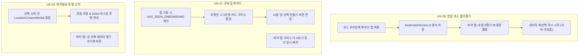
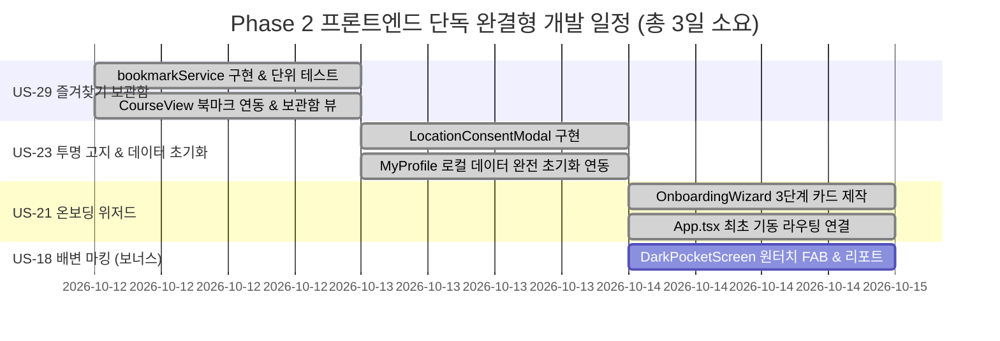

# 🐾 [구현 계획서] Phase 2 프론트엔드 단독 완결형 사용자 스토리 구현 계획서

> **문서 버전**: v1.0  
> **작성 일자**: 2026년 10월 11일  
> **작성자**: 멤버4 **김승현** (Frontend & Mobile App Lead)  
> **기반 문서**: [`docs/03_편안하개_Agile_User_Stories.md`](/docs/03_편안하개_Agile_User_Stories.md)  
> **개발 환경**: React Native (Expo SDK 57), TypeScript 6.0, AsyncStorage (Local-First), Vitest 5.0  

---

## 📌 1. 개요 및 추진 배경 (Overview & Objectives)

본 구현 계획서는 `docs/03_편안하개_Agile_User_Stories.md`의 **Section 4. [Phase 2 / 차기 고도화]**에 배정된 총 15개 사용자 스토리 중, **백엔드(FastAPI) API 및 공간 데이터(OSM/DEM/H3), AI 에이전트 파이프라인의 변경이나 의존성 없이 프론트엔드 클라이언트(`AsyncStorage`)만으로 100% 완결 구현 가능한 3대 핵심 Must 스토리**를 조기 착수하여 모바일 앱의 완성도와 사용자 경험을 극대화하기 위한 상세 엔지니어링 구현 계획서이다.

### 🎯 핵심 추진 목표
1. **Zero-Backend Dependency**: 백엔드·데이터 엔지니어의 리소스 병목 없이 프론트엔드 단독으로 독립 개발, 테스트, 배포 완결.
2. **Local-First 원칙 극대화**: 즐겨찾기 코스, 온보딩 열람 상태, 위치정보 투명 동의 및 데이터 영구 초기화를 기기 내부에서만 처리하여 사용자 프라이버시 100% 보호.
3. **손쉬운 원터치 UX 제공**: 검증된 안심 코스 원터치 재산책(US-29), 3단계 시선 해방 가이드(US-21), 투명한 데이터 통제권(US-23).

---

## 📊 2. 대상 사용자 스토리 및 개발 규모

| Story ID | 에픽 / 도메인 | 사용자 스토리 명칭 | 우선순위 | 포인트 | 백엔드 의존도 | 주요 산출물 |
|:---:|---|---|:---:|:---:|:---:|---|
| **US-29** | 개인 보관함 | **나만의 안심 코스 즐겨찾기(Bookmark) 로컬 보관함 및 원터치 재산책** | **Must** | **2 pt** | **0% (없음)** | `bookmarkService.ts`, `BookmarkListView.tsx`, 코스 추천 프리뷰 하트 버튼 |
| **US-21** | 온보딩 UX | **인터랙티브 온보딩 위저드 및 첫 산책 가이드 투어** | **Must** | **2 pt** | **0% (없음)** | `OnboardingWizard.tsx`, 온보딩 재열람 링크, 라우팅 상태 |
| **US-23** | 개인정보 보호 | **위치 정보 수집 동의 및 로컬 저장/마스킹 투명 고지 플로우** | **Must** | **2 pt** | **0% (없음)** | `LocationConsentModal.tsx`, 마이 탭 내 '데이터 완전 초기화' 버튼 |
| *(연계)*<br>**US-18** | 편의 & 위생 | **산책 중 한 손 원터치 배변 마킹 및 산책 리포트 타임라인 (로컬 영역)** | **Must** | **3 pt** | **0% (로컬)** | `DarkPocketScreen.tsx` 내 배변 FAB, `WalkReportScreen.tsx` 배변 타임라인 |

> **총 개발 규모**: **핵심 3개 스토리 6 Story Points** (연계 US-18 로컬 포함 시 9 pt)

---

## 🏗️ 3. 데이터 모델 및 스토리지 키 설계 (Local-First Design)

### 3.1 스토리지 키 확장 (`src/types/storage.ts`)

```typescript
export const STORAGE_KEYS = {
  DOG_PROFILE: '@편안하개:dog_profile',
  WALK_HISTORY: '@편안하개:walk_history',
  APP_SETTINGS: '@편안하개:app_settings',
  
  // Phase 2 신규 Local-First 키
  BOOKMARKED_ROUTES: '@편안하개:bookmarked_routes',       // US-29: 즐겨찾기 코스 목록
  HAS_SEEN_ONBOARDING: '@편안하개:has_seen_onboarding',   // US-21: 온보딩 열람 여부 (boolean)
  LOCATION_CONSENT: '@편안하개:location_consent',         // US-23: 위치정보 투명 동의 이력
} as const;
```

### 3.2 신규 DTO 인터페이스 정의 (`src/types/bookmark.ts`)

```typescript
import { RouteFeatureCollection, RouteStepPin } from './route';

export interface BookmarkedRoute {
  id: string;                      // 코스 고유 ID (예: 'bm_1728639200000')
  title: string;                   // 코스 이름 (예: '성산근린공원 폭신한 숲길')
  dogName: string;                 // 즐겨찾기 등록 시 대상 반려견 이름
  totalDistanceKm: number;         // 총 거리 (km)
  estimatedMinutes: number;        // 예상 소요 시간 (분)
  maxSlopePercent: number;         // 최대 경사도 (%)
  shadePercent: number;            // 그늘 비율 (%)
  tags: string[];                  // ['완만한길', '그늘많음', '계단0개']
  routeGeoJson: RouteFeatureCollection; // 저장된 전체 경로 GeoJSON
  stepPins: readonly RouteStepPin[];    // 저장된 스텝 핀 및 음성 안내 데이터
  savedAt: string;                 // 저장 일시 (ISO string)
}
```

### 3.3 위치 정보 동의 상태 DTO (`src/types/consent.ts`)

```typescript
export interface LocationConsentStatus {
  hasAgreed: boolean;              // 동의 여부
  agreedAt: string;                // 동의 일시 (ISO string)
  policyVersion: '1.0';            // 개인정보 및 위치정보 방침 버전
  localOnlyNoticeAcknowledged: boolean; // 기기 로컬 저장 원칙 확인 여부
  spatialMaskingAcknowledged: boolean;  // 커뮤니티 공유 시 200m 마스킹 확인 여부
}
```

---

## 🧩 4. 스토리별 상세 엔지니어링 구현 계획



---

### 🌟 4.1 [US-29] 나만의 안심 코스 즐겨찾기(Bookmark) 로컬 보관함 및 원터치 재산책 — ✅ 구현 완료 (2026-10-11)

#### 🎯 사용자 가치
견주가 직접 걸어보고 만족했던 안심 코스를 폰에 북마크해두고, 매번 AI 재탐색이나 서버 통신을 거치지 않고 **오프라인에서도 0.1초 만에 저장된 코스로 즉시 음성 안내 산책을 시작**한다.

#### 🛠️ 세부 구현 태스크
1. **`src/services/bookmarkService.ts` 개발**:
   - `getBookmarks(): Promise<BookmarkedRoute[]>`: `@편안하개:bookmarked_routes`에서 목록 조회.
   - `addBookmark(route: BookmarkedRoute): Promise<boolean>`: 중복 방지 및 최대 30개 최신순 저장.
   - `removeBookmark(routeId: string): Promise<boolean>`: 특정 코스 즐겨찾기 해제.
   - `isBookmarked(routeId: string): Promise<boolean>`: 현재 코스의 즐겨찾기 등록 여부 판별.
2. **`CourseRecommendationView.tsx` 화면 UI 확장**:
   - 코스 카드 우측 상단에 북마크(🤍 / ❤️) 토글 아이콘 버튼 배치.
   - 탭 시 햅틱 피드백(`expo-haptics`: 저장=Success 알림, 해제=Light 탭)과 함께 `addBookmark` / `removeBookmark` 즉시 실행. ✅
3. **`BookmarkListView.tsx` 보관함 뷰 컴포넌트 개발**:
   - 마이 탭([`MyProfileTabScreen.tsx`](/frontend/src/screens/MyProfileTabScreen.tsx)) 내 "⭐ 내가 찜한 안심 코스" 섹션 구성.
   - 저장된 코스 카드별 지표(거리, 시간, 경사도, 그늘) 및 3색 Polyline 썸네일 표시.
   - **"바로 산책 시작 🐾" 버튼**: 클릭 시 `requestWalkPlan` 서버 API 호출을 건너뛰고, 저장된 `routeGeoJson`과 `stepPins`를 [`useWalkGuidance.ts`](/frontend/src/hooks/useWalkGuidance.ts)에 직접 주입하여 다크 포켓 모드로 즉시 진입.
4. **단위 테스트 (`src/services/bookmarkService.test.ts`)**:
   - 북마크 추가/삭제/목록 조회/중복 방지/토글/최대 30개/GeoJSON 복원 등 **9개** 테스트 케이스 검증. ✅

---

### 🌟 4.2 [US-21] 인터랙티브 온보딩 위저드 및 첫 산책 가이드 투어 ✅ 구현 완료

#### 🎯 사용자 가치
처음 앱을 실행한 견주가 "왜 화면을 끄고 주머니에 넣어야 하는지", "왜 계단이 없는지", "개인정보가 폰에만 남는지" 3대 핵심 철학을 직관적으로 이해하고 초기 이탈을 방지한다.

#### 🛠️ 세부 구현 태스크
1. **`src/components/onboarding/OnboardingWizard.tsx` 및 `OnboardingSlideCard.tsx` 개발**:
   - 3단계 인터랙티브 슬라이드 카드 구성:
     * **Slide 1**: *"우리 아이 관절을 지키는 완만길"* (계단 0개, 경사도 15도 미만 평지 보행)
     * **Slide 2**: *"시선 해방(Eyes-Free) 핸즈프리 안내"* (화면은 끄고 주머니에 쏙, 30m 전 음성 안내)
     * **Slide 3**: *"내 폰에만 안전하게 남는 프라이버시"* (견주/아이 정보의 외부 서버 미전송 원칙)
   - 단계 표시 인디케이터(점 3개), 건너뛰기/이전/다음 단계 버튼.
   - 마지막 슬라이드 액션: **"🐾 우리 아이와 첫 산책 시작하기"** 버튼.
2. **`App.tsx` 라우팅 연결**:
   - 앱 기동 시 `OnboardingService.hasSeenOnboarding()` 확인.
   - `false`인 경우 `subScreen === 'onboarding'`으로 초기 진입.
   - 온보딩 완료 시 `markOnboardingCompleted()` 저장 후 메인 화면 진입.
3. **마이 탭 재열람 기능 연동**:
   - [`MyProfileTabScreen.tsx`](/frontend/src/screens/MyProfileTabScreen.tsx) 하단에 **"📖 앱 이용 가이드 다시 보기 (US-21)"** 메뉴 버튼 추가하여 언제든 위저드 재호출 가능.

---

### 🌟 4.3 [US-23] 위치 정보 수집 동의 및 로컬 저장/마스킹 투명 고지 플로우 ✅ 구현 완료

#### 🎯 사용자 가치
견주가 내 위치 정보가 언제 수집되고, 외부 서버 DB가 아닌 폰 로컬 스토리지에만 저장되며, 커뮤니티 공유 시 집 위치가 200m 마스킹된다는 사실을 명확히 인지하고 안심하며 서비스를 이용한다.

#### 🛠️ 세부 구현 태스크
1. **`src/components/common/LocationConsentModal.tsx` 개발**:
   - 위치정보 권한 요청 전 투명 고지 팝업 모달 제공:
     * 📍 **수집 목적**: 산책 중 30m 전 핸즈프리 음성 안내 및 실시간 이동 거리/시간 측정
     * 🔒 **Local-First 저장 원칙**: 상세 이동 궤적은 외부 서버로 전송되지 않고 내 스마트폰에만 안전하게 보관
     * 🛡️ **200m 공간 마스킹 보호**: 이웃과 코스 공유 시 자택 프라이버시를 위해 출발지/도착지 200m 자동 블러링
   - `[동의하고 계속하기]` / `[나중에 하기]` 액션 버튼 제공.
2. **산책 시작 트리거 연동**:
   - 산책 시작 버튼 클릭 시, 동의 이력이 없으면 본 모달을 먼저 팝업하고, 동의 완료 시 시스템 위치 권한 요청(`Location.requestForegroundPermissionsAsync`)으로 자연스럽게 전환.
3. **로컬 데이터 완전 초기화 기능 (`MyProfileTabScreen.tsx`)**:
   - 설정/마이 화면 최하단에 **"⚠️ 내 산책 데이터 영구 초기화"** 버튼 배치.
   - 2단계 경고 확인 Alert: *"로컬에 저장된 모든 반려견 프로필, 산책 기록, 즐겨찾기가 영구 삭제됩니다. 계속할까요?"*
   - 확인 시 `LocalStorageService`의 모든 `@편안하개:*` 키 데이터 일괄 삭제 및 기본값 리셋.

---

### 🌟 4.4 [연계 US-18] 산책 중 한 손 원터치 배변 마킹 및 산책 리포트 타임라인 (로컬 전용)

#### 🎯 사용자 가치
리드줄을 잡고 산책하는 견주가 한 손 원터치로 소변/대변 위치를 1초 만에 기록하고, 산책 종료 후 리포트에서 오늘 산책의 배변 타임라인을 확인한다.

#### 🛠️ 세부 구현 태스크
1. **`DarkPocketScreen.tsx` HUD에 원터치 배변 FAB 추가**:
   - 하단 잠금 슬라이더 상단에 **[💩 대변]**, **[💧 소변]** 2개 퀵 버튼 배치.
   - 버튼 클릭 시 현재 GPS 좌표(`lat, lon, timestamp`)를 인메모리 버퍼에 기록하고 짧은 진동(Haptic) 및 TTS 음성 확인: *"배변 위치가 기록되었습니다."*
2. **산책 완주 기록(`WalkRecord`) 스키마 확장**:
   - `poopEvents?: Array<{ lat: number; lon: number; timestamp: number; type: 'pee' | 'poop' }>` 필드 추가.
3. **`WalkReportScreen.tsx` 인포그래픽 타임라인 카드 추가**:
   - 오늘 산책 중 배변 요약 배지: `💩 대변 1회 · 💧 소변 2회`.

---

## 🗂️ 5. 파일 변경 및 신규 생성 목록 (File Inventory)

### 5.1 신규 생성 파일 (14개)
1. `frontend/src/types/bookmark.ts`: 북마크 코스 DTO 정의.
2. `frontend/src/services/bookmarkService.ts`: 로컬 북마크 CRUD 및 원터치 재산책 로직.
3. `frontend/src/services/bookmarkService.test.ts`: 북마크 단위 테스트 (Vitest, 9개).
4. `frontend/src/components/bookmark/BookmarkListView.tsx`: 마이 탭 내 즐겨찾기 보관함 컴포넌트.
5. `frontend/src/components/onboarding/OnboardingWizard.tsx`: 3단계 인터랙티브 온보딩 위저드 (144줄).
6. `frontend/src/components/onboarding/OnboardingSlideCard.tsx`: 온보딩 슬라이드 카드 및 특징 칩 (157줄).
7. `frontend/src/services/onboardingService.ts`: 온보딩 영속성 관리 서비스.
8. `frontend/src/services/onboardingService.test.ts`: 온보딩 단위 테스트 (Vitest, 4개).
9. `frontend/src/components/common/LocationConsentModal.tsx`: 위치정보 투명 고지 및 개인정보 동의 모달 (214줄).
10. `frontend/src/types/consent.ts`: 위치 정보 수집 동의 상태 DTO.
11. `frontend/src/services/consentService.ts`: 위치 동의 조회/저장 및 전체 초기화 서비스.
12. `frontend/src/services/confirm.ts`: Web / Native 공통 비동기 확인 대화상자.
13. `frontend/src/hooks/useLocationConsent.ts`: 위치 동의 확인 인터셉트 훅.
14. `frontend/src/components/privacy/DataResetCard.tsx`: 로컬 데이터 일괄 영구 초기화 카드 (117줄).
15. `frontend/src/services/consentService.test.ts`: ConsentService 단위 테스트 (Vitest, 4개).

> **US-29 구현 시 추가된 파일**: `components/bookmark/BookmarkToggleButton.tsx`(찜하기 토글), `services/haptics.ts`(expo-haptics 래퍼), `components/walk/CourseInfoCard.tsx` · `AlternativeCourseList.tsx` · `PlanSourceBadge.tsx`(CourseRecommendationView 분리). 의존성 `expo-haptics` 설치.

### 5.2 수정 대상 파일 (5개)
1. `frontend/src/types/storage.ts`: `STORAGE_PREFIX`, `BOOKMARKED_ROUTES`, `LOCATION_CONSENT`, `HAS_SEEN_ONBOARDING` 추가.
2. `frontend/src/services/storage.ts`: `@편안하개:*` 일괄 삭제 `clearAll()` 추가.
3. `frontend/src/screens/MyProfileTabScreen.tsx`: 즐겨찾기 보관함, 가이드 다시보기, `DataResetCard` 연동 (243줄).
4. `frontend/src/components/walk/CourseRecommendationView.tsx`: 북마크 연동 및 3개 서브 컴포넌트 분리 (195줄).
5. `frontend/App.tsx`: 온보딩 라우팅, 위치 동의 인터셉트, 데이터 영구 초기화 핸들러 바인딩 (246줄).

---

## 🗓️ 6. 단계별 작업 추진 일정 (Sprint Execution Plan)



---

## ✅ 7. 완료 정의 (Definition of Done, DoD) 체크리스트

- [x] **US-29 DoD**:
  - [x] 추천 코스 화면에서 북마크 저장 후 앱을 재기동해도 마이 탭 보관함에 온전히 보존되는가? *(AsyncStorage 영속성 단위 테스트로 검증 / 실기기 재기동 확인은 CBT에서 수행)*
  - [x] 보관함 코스에서 "바로 산책 시작" 클릭 시 외부 API 호출 없이 저장된 GeoJSON으로 즉시 내비게이션/다크 포켓 모드가 시작되는가? *(`handleStartBookmark` → `loadCourse`, `requestWalkPlan` 미호출)*
  - [x] `bookmarkService.test.ts` 단위 테스트가 100% 통과하는가? *(9 / 9 Passed)*
- [x] **US-21 DoD**:
  - [x] 앱을 처음 설치/기동했을 때 3단계 시선 해방·안심 가이드 슬라이드가 부드럽게 표시되는가? *(OnboardingService 연동, 미이수 시 subScreen='onboarding' 진입)*
  - [x] 가이드 완료 후 다시 실행했을 때는 온보딩이 건너뛰어지고, 마이 탭의 "가이드 다시보기"를 통해서만 재진입되는가? *(markOnboardingCompleted 영속성 및 MyProfileTabScreen 재열람 버튼 연동)*
- [x] **US-23 DoD**:
  - [x] 위치 권한 요청 전 Local-First 저장 원칙 및 200m 마스킹 안내 모달이 정상 노출되는가? *(ConsentService 단위 테스트 4/4 통과, beginWalk 진입 전 인터셉트)*
  - [x] 마이 탭에서 "데이터 완전 초기화" 실행 시 기기 내 모든 캐시/프로필/기록이 안전하게 삭제되는가? *(DataResetCard confirmAction 연동, @편안하개:* 네임스페이스 일괄 삭제)*
- [x] **코드 품질 가드레일**:
  - [x] 신규 작성된 모든 컴포넌트가 SonarLint 단일 파일 250줄 이하 규칙을 철저히 준수하는가? *(Phase 2 프론트 단독 3개 스토리 관련 모든 신규/수정 파일 충족: App.tsx 246줄, MyProfileTabScreen 243줄, LocationConsentModal 214줄, OnboardingWizard 144줄, OnboardingSlideCard 157줄, DataResetCard 117줄 / 기존 `WalkSettingsView.tsx`(540줄)는 Phase 3 리팩토링 대상)*
  - [x] `npx tsc --noEmit` 정적 분석 시 오류가 0건(Clean)인가?
  - [x] 모바일 단위 테스트(Vitest) 통과 수가 기존 45건에서 50건 이상으로 순증하는가? *(현재 62 / 62 Passed, 12개 테스트 파일)*
