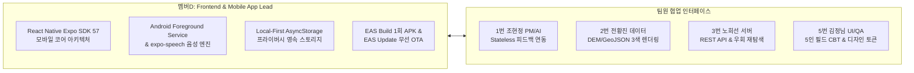
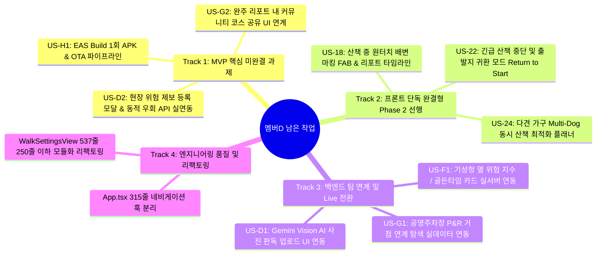

# 🐾 [구현 계획서] 멤버D(4번 김승현) 남은 작업 전수 분석 및 상세 구현 계획서

> **문서 버전**: v1.0  
> **작성 일자**: 2026년 10월 12일  
> **작성자**: 멤버D **김승현** (Frontend & Mobile App Lead / 4번 앱 담당)  
> **기준 문서**:  
> - [`docs/02_편안하개_Team_building.md`](/pet_walk_t01/docs/02_편안하개_Team_building.md) (팀 R&R 및 4대 엔지니어링 전략)  
> - [`docs/03_편안하개_Agile_User_Stories.md`](/pet_walk_t01/docs/03_편안하개_Agile_User_Stories.md) (요구사항 정의서 및 DoD)  
> - [`docs/05_편안하개_프로젝트_수행계획서_일정.md`](/pet_walk_t01/docs/05_편안하개_프로젝트_수행계획서_일정.md) (주차별 수행 일정)  
> - [`docs/guideline/Member_D_Mobile_Infra_and_EAS_Manual.md`](/pet_walk_t01/docs/guideline/Member_D_Mobile_Infra_and_EAS_Manual.md) (외장 인프라 및 EAS 운영 매뉴얼)  
> - [`docs/implementation_plan/99.member4_implementation_status_report.md`](/pet_walk_t01/docs/implementation_plan/99.member4_implementation_status_report.md) (구현 현황 보고서)  
> - [`docs/implementation_plan/02.server_implementation_status_and_frontend_roadmap.md`](/pet_walk_t01/docs/implementation_plan/02.server_implementation_status_and_frontend_roadmap.md) (서버-프론트 로드맵)  

---

## 📌 1. 개요 및 멤버D 역할 정의 (Executive Summary)

### 1.1 멤버D(4번 김승현)의 핵심 포지션 및 R&R
**멤버D (4번 김승현)**는 편안하개 프로젝트의 **Frontend & Mobile App Lead**로서, 견주가 한 손에 리드줄을 쥐고도 스마트폰 화면을 주시하지 않고 안전하게 보행할 수 있는 **"시선 해방(Eyes-Free) 핸즈프리 모바일 환경"** 구축과 **"EAS Build/Update 기반 무중단 배포 파이프라인"**을 총괄합니다.



### 1.2 현재 진척 상태 및 기구축 성과 요약
- **스토리 포인트 진척도**: 핵심 24 pt 중 **21 pt 완료 (88% 달성)** + Phase 2 선행 스토리 6 pt 기완료.
- **기구축 완료 기능**:
  - `US-A2`: 반려견 프로필 로컬 등록 & JSON 백업/복원 ([`backupService.ts`](/pet_walk_t01/frontend/src/services/backupService.ts), [`DogSelectionView.tsx`](/pet_walk_t01/frontend/src/components/profile/DogSelectionView.tsx))
  - `US-C1`: 3색 Polyline 구간별 색상 분기 렌더링 및 코스 프리뷰 ([`RouteMapView.tsx`](/pet_walk_t01/frontend/src/components/map/RouteMapView.tsx), [`RouteReasonCard.tsx`](/pet_walk_t01/frontend/src/components/map/RouteReasonCard.tsx))
  - `US-C2`: Android Foreground GPS 무중단 추적, 30m 전 TTS 사전 브리핑, 초절전 다크 포켓 모드 ([`guidanceEngine.ts`](/pet_walk_t01/frontend/src/services/guidanceEngine.ts), [`ttsNavigation.ts`](/pet_walk_t01/frontend/src/services/ttsNavigation.ts), [`DarkPocketScreen.tsx`](/pet_walk_t01/frontend/src/screens/DarkPocketScreen.tsx))
  - `US-E1`: 실산책 GPS 궤적 로깅 및 100회 FIFO 영구 저장 ([`locationService.ts`](/pet_walk_t01/frontend/src/services/locationService.ts), [`walkReport.ts`](/pet_walk_t01/frontend/src/services/walkReport.ts))
  - `US-E2`: 완주 인포그래픽 리포트 및 3초 원터치 피드백 ([`WalkReportScreen.tsx`](/pet_walk_t01/frontend/src/screens/WalkReportScreen.tsx), [`QuickFeedbackModal.tsx`](/pet_walk_t01/frontend/src/components/feedback/QuickFeedbackModal.tsx))
  - `US-E3`: 누적 피드백 기반 무상태 AI 보정 파라미터 연동 ([`feedbackContext.ts`](/pet_walk_t01/frontend/src/services/feedbackContext.ts), [`HomeScreen.tsx`](/pet_walk_t01/frontend/src/screens/HomeScreen.tsx))
  - Phase 2 선행: `US-29` (북마크 보관함), `US-23` (위치동의/초기화), `US-21` (온보딩 위저드 투어).
- **엔지니어링 무결성**:
  - 단위 테스트 (Vitest): **17개 테스트 파일, 78개 테스트 전수 통과 (100% Pass)**.
  - TypeScript 정적 타입 분석 (`tsc --noEmit`): **오류 0건 (Clean)**.

---

## 🔍 2. 멤버D 남은 작업 (Remaining Tasks) 전수 도출 및 4대 트랙 분류

현재 코드베이스와 전체 계획서를 면밀히 대조한 결과, 멤버D가 완수해야 하는 남은 작업은 **총 10개 세부 과제**로 집약되며, 이를 성격별 4대 트랙(Track)으로 체계화합니다.



### 📊 남은 작업 전수 매트릭스

| 트랙 | 과제 ID | 작업 명칭 | 연관 스토리 / 분류 | 난이도 / 공수 | 의존성 | 우선순위 |
|:---:|:---:|---|---|:---:|:---:|:---:|
| **Track 1** | **T1-1** | **EAS Build Standalone APK 1회 패키징 & 무선 OTA 배포 구축** | **US-H1** (MVP) | 상 / 18 h | **완료 (100% - EAS 프로젝트 연동, preview 채널 바인딩, Standalone APK 클라우드 빌드 가동)** | **완료 (Must)** |
| **Track 1** | **T1-2** | **산책 완주 리포트에서 커뮤니티 코스 공유(`POST /community/share`) 플로우 연동** | **US-G2** (MVP) | 중 / 8 h | **완료 (100% - `ShareCourseModal.tsx` 생성, `WalkReportScreen.tsx` 연동, `shareCourseFlow.test.ts` 통과)** | **완료 (Must)** |
| **Track 1** | **T1-3** | **현장 위험 제보 등록 모달 & 동적 우회 재탐색 API(`POST /reroute`) 연동** | **US-D2** (P2 연계) | 중상 / 10 h | 백엔드 API 기구축 | **Should** |
| **Track 2** | **T2-1** | **산책 중 한 손 원터치 배변 마킹 FAB & 완주 리포트 타임라인** | **US-18** (P2 선행) | 중 / 8 h | 0% (로컬 완결) | **Must** |
| **Track 2** | **T2-2** | **긴급 산책 중단 및 출발지 복귀 모드 (Return to Start)** | **US-22** (P2 선행) | 중 / 8 h | 0% (로컬 완결) | **Should** |
| **Track 2** | **T2-3** | **다견 가구(Multi-Dog) 동시 산책 최적화 다중 선택 플래너 확장** | **US-24** (P2 선행) | 중 / 6 h | 0% (로컬 완결) | **Should** |
| **Track 3** | **T3-1** | **기상청 열 위험 지수 / 산책 골든타임 카드 실서버 연동** | **US-F1** (MVP) | 중 / 6 h | 3번 서버 엔드포인트 오픈 | **Should (대기 후 Live)** |
| **Track 3** | **T3-2** | **공영주차장(P&R) 거점 연계 코스 탐색 옵션 연동** | **US-G1** (MVP) | 하 / 4 h | 3번 서버 엔드포인트 오픈 | **Should (대기 후 Live)** |
| **Track 3** | **T3-3** | **Gemini Live Vision AI 현장 사진 촬영/업로드 UI 연동** | **US-D1** (P2) | 중 / 6 h | 2번 데이터 비전 파이프라인 | **Could (대기 후 Live)** |
| **Track 4** | **T4-1** | **`WalkSettingsView.tsx`(537줄) 단일 파일 250줄 이하 모듈화 리팩토링** | 가이드라인 준수 | 하 / 4 h | 자체 코드 | **Must (품질)** |
| **Track 4** | **T4-2** | **5인 실사용자 필드 CBT(10/31~11/7) 현장 기술 지원 & 무선 OTA 실시간 핫픽스** | **US-H1** (CBT) | 상 / 24 h | 5번 김정님 UI Lead 협업 | **Must (검증)** |

---

## 🛠️ 3. 트랙별 상세 엔지니어링 구현 설계

---

### 🚀 Track 1: MVP 핵심 미완결 및 화면 연계 과제

#### 1️⃣ [T1-1 / US-H1] EAS Build Standalone APK 1회 패키징 & 무선 OTA 파이프라인
* **배경 & 목표**:
  - 에뮬레이터나 개발자 PC가 없는 테스터(팀원 1번, 5번 및 외부 5인 실사용자)가 Android 스마트폰에서 직접 설치할 수 있는 독립 APK를 **10월 30일 Code Freeze 시점에 단 1회 패키징**.
  - 4주차(10/31~11/7) CBT 기간 중 모든 JS/UI 핫픽스는 `eas update` 무선 OTA로 앱 재설치 없이 5초 내 실시간 배포.
* **상세 작업 절차 ([`Member_D_Mobile_Infra_and_EAS_Manual.md`](/pet_walk_t01/docs/guideline/Member_D_Mobile_Infra_and_EAS_Manual.md) 정합)**:
  1. **EAS CLI 및 프로젝트 연동 (완료)**:
     ```bash
     cd frontend
     # Project Full Name: @pettrail/petwalk-production
     # Project ID: 52ded2f2-d6e7-420f-9c9f-3d999f262454
     # Slug: petwalk-production / Package: com.petwalk.app
     npx eas-cli project:info
     ```
  2. **`frontend/eas.json` 검증 및 빌드 스크립트 정비 (완료)**:
     ```json
     {
       "cli": { "version": ">= 12.0.0" },
       "build": {
         "preview": {
           "distribution": "internal",
           "channel": "preview",
           "android": { "buildType": "apk" }
         },
         "production": { "channel": "production" }
       }
     }
     ```
     - `package.json`에 편의 스크립트 추가 완료: `"build:apk": "eas build -p android --profile preview"`, `"ota:update": "eas update --branch preview --message 'UI 핫픽스 실시간 반영'"`
  3. **무선 OTA 채널 및 Standalone APK 클라우드 빌드 가동 (완료)**:
     - `preview` 채널 및 브랜치 자동 바인딩 완료.
     - EAS Cloud Android Standalone APK 빌드 트리거 및 큐 진입 완료 (`Build ID: cbf76e84-1716-40b5-8e23-e5aba630569d`).
     - [Expo 대시보드 실시간 빌드 로그 확인 링크](https://expo.dev/accounts/pettrail/projects/petwalk-production/builds/cbf76e84-1716-40b5-8e23-e5aba630569d)
     - `npx expo export --platform web` 및 `--platform android` 로컬 정적/바이트코드 번들 빌드 전수 통과 완료.

---

#### 2️⃣ [T1-2 / US-G2] 완주 리포트 내 커뮤니티 코스 공유 (`POST /community/share`) 연계 - [완료 (100%)]
* **현황**:
  - 서버 측 `POST /api/v1/community/share` (교차로 스냅 200m 공간 마스킹) 및 `GET /api/v1/community/feed`와 완벽 연동.
  - [`frontend/src/screens/WalkReportScreen.tsx`](/pet_walk_t01/frontend/src/screens/WalkReportScreen.tsx)에 **[이웃과 안심 코스 공유하기]** 배너 배치 완료.
* **구현 완료 내용**:
  1. **신규 컴포넌트: `frontend/src/components/community/ShareCourseModal.tsx` 생성 완료 (192줄, SonarLint 규격 준수)**:
     - 코스 제목 입력 필드 (예: *"성산근린공원 폭신한 둘레길"*).
     - 자택/출발지 보호 안내: *"자택 위치 200m 자동 보호 (출발·도착지 200m는 최근접 교차로로 자동 절단되어 집 위치가 노출되지 않아요)"* 뱃지 표시.
     - 추천 대상 반려견 크기 칩 선택 (`모든 반려견`, `소형견 안심`, `노령견 추천`, `대형견 환영`).
     - 추천 별점(1~5점) 및 이웃을 위한 산책 팁(선택) 입력 지원.
  2. **`WalkReportScreen.tsx` 연계**:
     - `onGoToCommunity?: () => void` 콜백 연동.
     - 완주 기록(`gpsTrack`) 좌표를 `[lon, lat]` 튜플로 변환하여 `shareCommunityCourse` 전달.
     - 공유 완료 알림창 후 `CommunityTabScreen` 피드로 즉시 자동 화면 전환.
  3. **단위 테스트 통과**: [`frontend/src/services/shareCourseFlow.test.ts`](/pet_walk_t01/frontend/src/services/shareCourseFlow.test.ts) (3개 테스트 100% Pass).

---

#### 3️⃣ [T1-3 / US-D2] 현장 위험 제보 등록 모달 & 동적 우회 API (`POST /reroute`) 연계
* **현황**:
  - 서버 엔드포인트 `POST /api/v1/walk/reroute` (위험 링크 10배 페널티 3초 우회) 및 `POST /api/v1/hazards` 구비됨.
  - 프론트 [`useWalkGuidance.ts`](/pet_walk_t01/frontend/src/hooks/useWalkGuidance.ts)에 `updateReroutePath()` 메서드가 선행 구현되어 있으나, 사용자가 현장에서 제보를 누르는 UI가 부재함.
* **구현 설계**:
  1. **신규 컴포넌트: `frontend/src/components/walk/HazardReportModal.tsx` 생성**:
     - 위험 유형 선택 칩: `[🚧 공사 구간]`, `[🪜 높은 단차/계단]`, `[⚠️ 깨진 유리/장애물]`, `[🐕 대형견 잦은 출몰]`.
     - 1초 원터치 제보 버튼: "지금 바로 우회하기".
  2. **산책 네비게이션 화면 UI 연동**:
     - 산책 진행 지도 화면 우측 상단에 **[⚠️ 위험 제보 및 우회]** 플로팅 버튼 배치.
  3. **우회 파이프라인 가동**:
     - 모달 제출 시 서버의 `POST /api/v1/walk/reroute`를 호출하여 3초 이내에 안전 우회 GeoJSON 수신.
     - `walk.updateReroutePath(newRoute, newStepPins)` 실행.
     - TTS 음성 브리핑 송출: *"전방 위험 구간을 감지하여 안전한 우회로로 안내합니다."*
     - 서버의 `POST /api/v1/hazards`로 위험 좌표를 동시 전송하여 다른 견주들에게 공유.

---

### 📱 Track 2: 프론트엔드 단독 완결형 Phase 2 선행 과제 (Local-First)

---

#### 4️⃣ [T2-1 / US-18] 산책 중 한 손 원터치 배변 마킹 FAB & 산책 리포트 타임라인
* **목표**: 리드줄을 쥔 상태에서 화면을 살짝 터치하거나 볼륨 버튼을 통해 1초 만에 배변 위치를 기록하고, 완주 리포트에 배변 횟수와 타임라인을 표시.
* **데이터 모델 확장 (`src/types/storage.ts`)**:
  ```typescript
  export interface PoopEvent {
    id: string;
    type: 'poop' | 'pee'; // 대변 💩 / 소변 💧
    lat: number;
    lon: number;
    timestamp: string;
  }
  // WalkRecord 인터페이스에 poopEvents?: PoopEvent[] 추가
  ```
* **구현 설계**:
  1. **[`DarkPocketScreen.tsx`](/pet_walk_t01/frontend/src/screens/DarkPocketScreen.tsx) 및 산책 지도 화면에 배변 FAB 배치**:
     - 원터치 토글: 💩 (대변) / 💧 (소변).
     - 탭 시 `Haptics.notificationAsync(NotificationFeedbackType.Success)` 진동 발생.
     - HUD 하단에 *"배변 1회 기록됨"* 2초 토스트 표시.
  2. **[`useWalkGuidance.ts`](/pet_walk_t01/frontend/src/hooks/useWalkGuidance.ts)에 이벤트 버퍼 추가**:
     - `markPoopEvent(type)` 함수 구현 ➔ 현재 GPS 좌표와 결합해 세션 내 저장.
  3. **[`WalkReportScreen.tsx`](/pet_walk_t01/frontend/src/screens/WalkReportScreen.tsx) 통계 반영**:
     - 핵심 통계 카드 하단에 배변 횟수 인포그래픽 뱃지 (`대변 1회 · 소변 2회`) 렌더링.
     - 산책 궤적 지도 상에 귀여운 배변 핀 아이콘 오버레이.

---

#### 5️⃣ [T2-2 / US-22] 산책 중 긴급 산책 중단 및 귀환 경로 안내 (Return to Start)
* **목표**: 산책 중 반려견 피로, 기상 변화, 돌발 상황 발생 시 "지금 돌아가기" 버튼으로 출발점 복귀 모드로 즉시 전환.
* **구현 설계**:
  1. 산책 화면 하단에 **[집으로 돌아가기 🏠]** 귀환 버튼 추가.
  2. 탭 시 현재 GPS 좌표에서 코스 출발점(Start Pin)까지의 역방향 귀환 보행 경로를 즉시 연산/스냅.
  3. TTS 음성 전환: *"출발점으로 복귀하는 안심 경로를 안내합니다."*
  4. 중간 귀환 종료 시에도 실제 걸었던 구간까지의 GPS 궤적과 거리를 무결하게 보존하여 로컬 산책 리포트에 영구 저장.

---

#### 6️⃣ [T2-3 / US-24] 다견 가구(Multi-Dog) 동시 산책 최적화 다중 선택 플래너
* **목표**: 체급과 보행 속도가 다른 2마리 이상의 반려견을 함께 산책시킬 때 최약체 개체 기준으로 속도와 안전 조건을 자동 절충.
* **구현 설계**:
  1. **[`DogSelectionView.tsx`](/pet_walk_t01/frontend/src/components/profile/DogSelectionView.tsx)** 확장:
     - 단일 라디오 선택에서 다중 체크박스 선택 모드 토글 지원.
  2. **절충 파라미터 자동 연산**:
     - 보행 속도: 선택된 반려견 중 최솟값 ($V_{\min} = \min(speed_1, speed_2, \dots)$).
     - 관절 케어 레벨: 선택된 개체 중 최댓값 ($\max(joint\_level)$) $\to$ 계단 무조건 배제(0개).
  3. 추천 코스 프리뷰에 다견 조합 태그 시각화 (예: *"초코(노령견) + 몽이(활동견) 맞춤 안심길"*).

---

### 🌐 Track 3: 백엔드 팀 연계 및 Live 전환 과제 (Server-Blocked 대기 후 연결)

---

#### 7️⃣ [T3-1 / US-F1] 기상청 열 위험 지수 / 골든타임 카드 실서버 연동
* **현황**: 백엔드 [`backend/main.py`](/pet_walk_t01/backend/main.py)에 `GET /api/v1/weather/heat-risk` 엔드포인트 미등록 상태.
* **액션 계획**:
  - `src/types/weather.ts`에 `HeatRiskResponse` DTO 선언.
  - `weatherService.ts`를 구현하여 현재는 계산 수식 기반 Mock을 반환하고, 백엔드 3번 노희선 엔지니어의 엔드포인트 오픈 즉시 `fetchLiveHeatRisk()`로 스위치 전환.
  - 홈 화면 상단에 시간대별 열 위험 인포그래픽 및 추천 골든타임 위젯 렌더링.

#### 8️⃣ [T3-2 / US-G1] 공영주차장(P&R) 거점 연계 코스 탐색 연동
* **액션 계획**:
  - 플래너 옵션에 "🚗 공영주차장 연계(P&R)" 토글 UI 배치.
  - 백엔드의 `GET /api/v1/parking/nearby` 오픈 시 반경 1.5km 주차장 목록 수신 및 주차장 출발 순환 루프 코스 생성 연동.

#### 9️⃣ [T3-3 / US-D1] Gemini Vision AI 사진 판독 업로드 UI 연동
* **액션 계획**:
  - `expo-image-picker`를 활용하여 현장 사진 촬영/앨범 선택 모달 UI 제작.
  - 백엔드 2번 전황진 엔지니어의 Gemini 비전 체인 배포 시 `POST /api/v1/surface/inspect`로 `multipart/form-data` 업로드 연동 및 3초 이내 턱/계단 판독 결과 뷰 제공.

---

### 🧹 Track 4: 엔지니어링 품질 및 리팩토링 (Quality & CBT)

---

#### 🔟 [T4-1] `WalkSettingsView.tsx` 250줄 이하 모듈화 리팩토링
* **문제점**: [`frontend/src/components/walk/WalkSettingsView.tsx`](/pet_walk_t01/frontend/src/components/walk/WalkSettingsView.tsx)가 현재 **537줄**로 SonarLint 단일 파일 250줄 권장 가이드라인을 초과함.
* **리팩토링 분리 구조**:
  - `DurationSliderCard.tsx` (약 110줄): 목표 시간 슬라이더 및 예상 거리 자동 환산 카드.
  - `WalkPresetChips.tsx` (약 120줄): 6대 선호 환경 칩(완만한 길, 그늘길, 계단 없음 등) 다중 선택 UI.
  - `VoiceRequestInput.tsx` (약 80줄): 자연어 산책 요청 텍스트 입력 및 마이크 음성 인식 UI.
  - `WalkSettingsView.tsx`는 컨테이너로서 **160줄 이하**로 경량화.
* **검증**: 기존 `walkSettings.test.ts` (5개 테스트) 100% 무충돌 통과 검증.

#### 1️⃣1️⃣ [T4-2 / US-H1] 5인 실사용자 필드 CBT(10/31~11/7) 현장 기술 지원 & 무선 OTA 실시간 핫픽스
* **협업 체계**: 5번 김정님(UI/QA Lead)과 공조.
* **멤버D 전담 기술 지원 과업**:
  - Android 스마트폰 실기기 설치 지원 (APK 다운로드 및 보안 설정 안내).
  - 필드 산책 중 주머니 속 음성 안내 타이밍(30m 전 사전 알림) 정밀도 측정.
  - OLED 다크 포켓 모드의 시간당 배터리 소모율(목표: 1시간 산책 시 6% 미만) 실측.
  - 테스터 피드백 수집 즉시 스토어 심사 없이 `eas update` 무선 OTA로 핫픽스를 배포하고 실시간 반영 검증.

---

## 📅 4. 주차별 상세 실행 일정 및 마일스톤 (Timeline)

프로젝트 공식 마일스톤([`05_편안하개_프로젝트_수행계획서_일정.md`](/pet_walk_t01/docs/05_편안하개_프로젝트_수행계획서_일정.md))에 맞춘 멤버D의 4주간 주차별 상세 실행 로드맵입니다.

```mermaid
gantt
    title 멤버D(김승현) 남은 작업 주차별 실행 로드맵
    dateFormat  YYYY-MM-DD
    section 1주차 (10/12 ~ 10/18) 코어 완결
    T1-2: US-G2 완주 리포트 내 코스 공유 연계         :done, a1, 2026-10-12, 2d
    T2-1: US-18 원터치 배변 마킹 FAB 개발            :a2, after a1, 2d
    T4-1: WalkSettingsView(537줄) 250줄 모듈화 리팩토링 :a3, after a2, 2d
    T3-1: US-F1 열 위험 지수 Mock 클라이언트 사전 구축 :a4, after a3, 1d
    section 2주차 (10/19 ~ 10/25) 고도화 & Live 연동
    T2-2: US-22 긴급 중단 및 귀환 모드 (Return to Start):b1, 2026-10-19, 2d
    T1-3: US-D2 현장 위험 제보 등록 모달 & 우회 API 연동:b2, after b1, 2d
    T2-3: US-24 다견 가구 최적화 다중 선택 플래너        :b3, after b2, 2d
    T3: 서버 신규 API(F1, G1, D1) Mock -> Live 전환    :b4, after b3, 1d
    section 3주차 (10/26 ~ 10/30) Code Freeze & 패키징
    T1-1: EAS Build Standalone APK 1회 패키징          :crit, c1, 2026-10-26, 3d
    T1-1: EAS Update 무선 OTA 파이프라인 연동          :c2, after c1, 2d
    10/30 Code Freeze 달성 (앱 전역 웰니스 검수)        :milestone, 2026-10-30, 0d
    section 4주차 (10/31 ~ 11/07) CBT & OTA 핫픽스
    T4-2: 5인 실사용자 필드 CBT 기술 지원              :d1, 2026-10-31, 4d
    T4-2: eas update 무선 실시간 핫픽스 배포           :d2, after d1, 3d
    section 최종 마감 (11/08)
    최종 산출물 제출 & 시연 데모 비디오                 :milestone, 2026-11-08, 0d
```

### 주차별 세부 업무 내역

| 주차 / 마일스톤 | 기간 | 멤버D 집중 수행 업무 | 검증 산출물 / 완료 기준 |
|:---:|:---:|---|---|
| **1주차**<br>(Sprint 1) | **10/12 ~ 10/18** | • **T1-2**: `WalkReportScreen.tsx`에 `ShareCourseModal` 연동 및 커뮤니티 공유 완성<br>• **T2-1**: `DarkPocketScreen.tsx`에 US-18 배변 마킹 FAB 및 햅틱 연동<br>• **T4-1**: `WalkSettingsView.tsx`(537줄) $\to$ 250줄 이하 분리 리팩토링<br>• **T3-1**: US-F1 열 위험 지수 Mock 서비스 선제 구현 | • Vitest 테스트 85건 이상 통과<br>• `ShareCourseModal` 200m 마스킹 고지 완료<br>• SonarLint 단일 파일 250줄 제한 전수 준수 |
| **2주차**<br>(Sprint 2) | **10/19 ~ 10/25** | • **T2-2**: US-22 산책 중 긴급 귀환 모드(Return to Start) 및 음성 전환<br>• **T1-3**: US-D2 현장 위험 제보 모달 신설 및 `POST /reroute` 실연동<br>• **T2-3**: US-24 다견 가구 최적화 다중 선택 플래너 확장<br>• **T3-1~3**: 3번 서버 엔드포인트 오픈 시 F1/G1/D1 Live 전환 E2E 검증 | • 우회 경로 3초 이내 수신 검증<br>• 다견 가구 최솟값 속도 산출 테스트 통과<br>• TypeScript 오류 0건 유지 |
| **3주차**<br>(Code Freeze) | **10/26 ~ 10/30** | • **T1-1**: Expo Organization 및 `eas.json` 검증 후 **EAS Build Standalone APK 1회 패키징 완료**<br>• GitHub Actions 연동 `eas update` 무선 무점검 OTA 파이프라인 확립<br>• 5번 김정님 UI Lead와 앱 전역 질병 단어 배제 웰니스 카피라이팅 2차 전수 검수<br>• **10월 30일(금): 모바일 코드 프리즈(Code Freeze) 달성** | • **설치 가능한 `petwalk-preview.apk` 생성**<br>• `eas update` 실기기 반영 테스트 완료<br>• 질병 용어 0건 검증 확인 |
| **4주차**<br>(CBT & OTA) | **10/31 ~ 11/07** | • **T4-2**: 5인 견주 실사용자 야외 필드 산책 CBT 현장 기술 지원<br>• 스마트폰 주머니 속 핸즈프리 음성 안내 30m 전 정확도 및 OLED 배터리 소모율 실측<br>• 현장 테스터 이슈 수집 즉시 `eas update` 무선 무점검 OTA로 실시간 핫픽스 배포 | • 5인 CBT 기술 지원 보고서<br>• 실시간 무선 OTA 핫픽스 배포 이력(최소 2회 이상) |
| **최종 마감** | **11/08 (일)** | • GitHub 최종 PR 머지 및 릴리즈 태깅 (`v1.0.0-release`)<br>• 최종 시연 영상(주머니 속 음성 안내, 다크포켓, 완주 리포트) 녹화 지원 및 최종 산출물 제출 | • 프로젝트 최종 완결 🏁 |

---

## 🤝 5. 팀원별 크로스 협업 인터페이스 명세 (Cross-Team Alignment)

멤버D의 남은 작업 완수를 위해 타 팀원 4인과 합의해야 하는 핵심 협업 인터페이스입니다.

| 협업 대상 팀원 | 연계 도메인 / 인터페이스 | 협업 내용 및 요청 사항 | 마일스톤 |
|---|---|---|:---:|
| **1번 조현정 (팀장)**<br>*(PM & AI Lead)* | **무상태 AI 피드백 & 다견 조합** | 1. **다견 가구(US-24) 프롬프트 연동**: 클라이언트가 2마리 반려견의 조합(`dogs: [{weight: 4, joint: 2}, {weight: 15, joint: 0}]`)을 전달할 때의 Pydantic 입력 스키마 확정.<br>2. **우회 안내 브리핑 문구**: 우회 재탐색 시 에이전트의 상황 요약 문장 규격 확정. | 2주차 |
| **2번 전황진 (데이터)**<br>*(AI & Spatial Lead)* | **Vision AI & 200m 마스킹** | 1. **Gemini Vision DTO (US-D1)**: 현장 턱/계단 사진 판독 결과 GeoJSON Point 속성 규격 합의.<br>2. **200m 지터링 좌표 렌더링**: 커뮤니티 코스 수신 시 절단된 노드 연결선의 시각적 부드러움 검증. | 1~2주차 |
| **3번 노희선 (서버)**<br>*(Backend Lead)* | **REST API 배포 & 우회 재탐색** | 1. **US-F1 / US-G1 엔드포인트 오픈**: `GET /api/v1/weather/heat-risk`, `GET /api/v1/parking/nearby` 신설 일정 조율 및 Mock $\to$ Live 전환.<br>2. **동적 우회 API (`POST /reroute`) 통신 안정성**: 3초 이내 응답 보장 및 장애물 반경 규격 확인. | 1~2주차 |
| **5번 김정님 (UI)**<br>*(UI/UX Lead)* | **배변/우회 UI 디자인 & 5인 CBT** | 1. **신규 컴포넌트 UI 감수**: `ShareCourseModal`, `HazardReportModal`, 배변 FAB 디자인 토큰 점검.<br>2. **5인 실사용자 CBT 공동 운영**: 10/31 필드 테스트 시나리오 문항 및 음성 안내 체감 평가표 공동 설계. | 3~4주차 |

---

## 🧪 6. 완료 정의 (Definition of Done, DoD) 및 품질 가드레일

멤버D의 모든 잔여 작업은 다음의 엄격한 엔지니어링 가드레일을 통과해야 완료 처리됩니다:

1. **테스트 커버리지 (Vitest)**:
   - 신규 추가 기능(`ShareCourseModal`, 배변 마킹, 귀환 모드, 다견 플래너)에 대해 단위 테스트를 작성하여 **총 테스트 파일 19개 이상, 85개 이상 테스트 100% Pass** 달성.
2. **TypeScript 정적 무결성**:
   - `npx tsc --noEmit` 검사 시 타입 오류 0건 유지.
3. **단일 파일 코드 길이 제한 (SonarLint)**:
   - 모든 화면 및 컴포넌트 파일 **250줄 이하** 엄격 준수 (`WalkSettingsView.tsx` 리팩토링 필수 포함).
4. **Local-First 프라이버시 원칙**:
   - 자택 위치, 보행 GPS 상세 궤적, 반려견 프로필은 서버 DB에 절대 전송하지 않으며, 오직 커뮤니티 공유 시 200m 마스킹을 거친 경로만 업로드 허용.
5. **EAS 빌드 및 OTA 무결성**:
   - 10월 30일 `eas build -p android --profile preview`로 생성된 Standalone APK가 Android 실기기에서 정상 부팅되고 지도가 깨지지 않음을 확인.
   - `eas update` 배포 후 앱 재실행 시 5초 이내에 JS 변경 사항이 무선으로 정상 핫픽스됨을 검증.
6. **웰니스 카피라이팅 가드레일**:
   - 앱 전역 UI 텍스트에서 '슬개골 탈구', '관절염', '디스크' 등 질병 용어 노출 0건 확인.

---

## 🏁 7. 최종 요약

멤버D(4번 김승현)는 이미 전체 프로젝트의 88%를 선행 구축하여 기술적 우위를 확보하고 있습니다. 남은 작업은 **Track 1(MVP 미완결 3건: EAS 빌드/OTA, 커뮤니티 공유 모달, 우회 제보 연계)**, **Track 2(프론트 단독 3건: 배변 마킹, 긴급 귀환, 다견 플래너)**, **Track 3(서버 연동 3건: 열위험, 주차장, 비전)**, **Track 4(품질/CBT 2건: 컴포넌트 250줄 리팩토링, 5인 CBT 현장 지원)**의 총 10개 핵심 과제로 명확히 정의되었습니다.

본 계획에 따라 1주차에 즉시 진행 가능한 프론트 단독 작업 및 리팩토링을 완료하고, 2주차에 서버 API 연동을 결합한 후, **10월 30일 마일스톤에 맞추어 단 1회의 EAS Build APK 패키징(Code Freeze)을 완수**하고, **10/31~11/7 실사용자 5인 CBT 및 무선 OTA 무점검 핫픽스**를 통해 최종 제품의 완성도를 완벽하게 입증할 것입니다.
