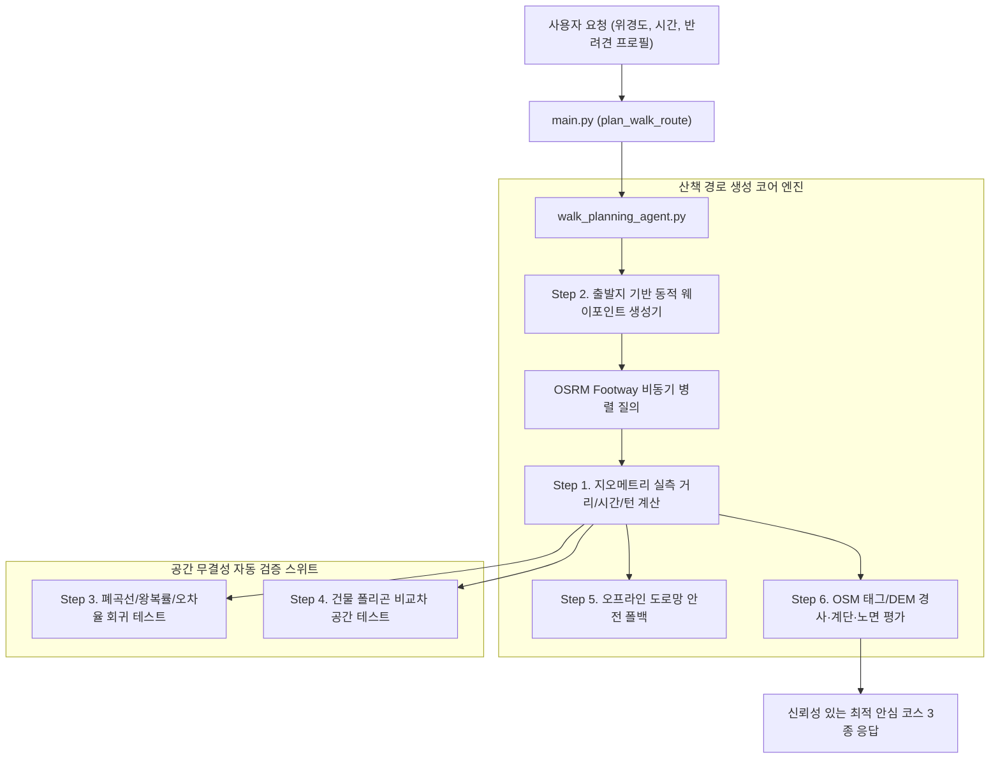

# 🧭 [구현 계획서] 실제 도로망 기반 안심 산책 경로 생성 엔진 고도화 및 무결성 검증 계획서

> **문서 버전**: v1.0  
> **작성 일자**: 2026년 10월 12일  
> **작성자**: 편안하개 엔지니어링 팀 (Lead: **1번 조현정**, **3번 노희선**, **4번 김승현**, **2번 전황진**)  
> **기반 문서**: [`docs/03_편안하개_Agile_User_Stories.md`](file:///d:/코디세이/pet_walk_t01/docs/03_편안하개_Agile_User_Stories.md), [`backend/agent/walk_planning_agent.py`](file:///d:/코디세이/pet_walk_t01/backend/agent/walk_planning_agent.py), [`backend/agent/road_network_routes.py`](file:///d:/코디세이/pet_walk_t01/backend/agent/road_network_routes.py)  
> **대상 사용자 스토리**: **US-A1, US-A3, US-B1, US-B2, US-B3, US-C1**

---

## 📌 1. 개요 및 추진 배경 (Overview & Problem Statements)

편안하개 프로젝트의 산책 경로 생성 파이프라인에 대한 사전 정밀 공간 분석 결과, 시청 일대 고정 경로(V1)의 도심 대각선 빌딩 관통 문제는 1차 완화되었으나, **애자일 사용자 스토리의 핵심 인수 조건(Acceptance Criteria)과 실제 구현 간에 심각한 정합성 결여 및 잠재적 건물 관통 위험**이 확인되었습니다.

### 🔍 주요 발견 문제점 요약 (As-Is)
1. **거리·시간 지오메트리 허위 계산 (US-A3 불일치)**:
   - `total_distance_m`이 실제 좌표열(`geojson_coordinates`)의 실측 거리가 아닌, 목표 거리의 단순 상수 배수(`target * 1.02` 등)로 하드코딩되어 있습니다.
   - 노령견 20분(목표 약 733m) 요청 시 화면에는 748m로 표시되나, 실제 렌더링 좌표는 **1,657m ~ 2,947m**에 달하여 실제 소요 시간이 **45~80분**으로 목표치 대비 2~4배 초과합니다.
2. **출발지 무관 고정 코스 (Spatial Isolation)**:
   - 서울 시청 반경 5km(`|Δ|<0.05°`) 내(용산, 종로, 신촌 등)에서 요청 시 출발지와 수 km 떨어진 서울광장 고정 코스를 그대로 반환합니다.
3. **네트워크 장애 시 비현실적 직사각형 폴백 (Building Crossing Risk)**:
   - OSRM 서비스 지연/실패 시 격자 축 기반 직사각형 4변(`_generate_general_grid_loop`)을 생성하여 도심 빌딩과 담장을 정면 관통합니다.
4. **V2 코스의 심각한 왕복(Backtracking) 구간**:
   - V2 코스의 경우 전체 경로의 **33.6%가 갔던 길을 그대로 되돌아오는 구간**으로, 순환(Loop) 산책로로서의 품질이 떨어집니다.
5. **무장애·지면온도 지표의 가짜 데이터 (US-B1~B3 불일치)**:
   - `has_stairs=False`, `max_slope_percent=4.5%`, `surface_temp_c=29.5℃` 등이 실측 OSM 태그나 DEM 기반이 아닌 고정 리터럴입니다.
6. **테스트 스위트의 모의 함수 자기 검증(Tautology)**:
   - 기존 단위 테스트가 실제 지오메트리 길이나 공간 교차를 검증하지 않고, 테스트 코드 내부의 모의 수식만을 검증하고 있습니다.

---

## 🎯 2. 고도화 목표 및 핵심 원칙 (Objectives)

본 계획서는 위 6대 문제를 근본적으로 해결하기 위해 다음의 4대 원칙을 수립하고 단계별 구현을 진행합니다.

1. **지오메트리 진실성 (Geometric Truthfulness)**: 모든 거리, 소요 시간, 턴바이턴 안내는 실제 생성된 좌표열의 Haversine/Vincenty 공간 실측 거리를 유일한 원천(Single Source of Truth)으로 삼는다.
2. **현장 출발지 스냅 & 동적 순환 생성**: 사용자의 실제 GPS 좌표에서 즉시 출발하여 복귀하는 실제 도로망 순환 웨이포인트를 생성한다.
3. **건물 관통 0% 보장 (Zero Building Penetration)**: 폴백 상황에서도 직선 격자를 배제하고, 실제 OSM Footway 네트워크 기반 캐시를 활용한다.
4. **엄격한 공간 무결성 TDD**: 폐곡선 종결성, 왕복 구간 15% 이하, 오차율 ±15% 이내, 건물 폴리곤 비교차를 자동화된 테스트로 상시 검증한다.

---

## 🏗️ 3. 6대 권장조치별 상세 구현 설계 (Detailed Engineering Design)

---

### Step 1. 지오메트리 기반 실제 거리/시간 산출 및 API 파라미터 바인딩 정규화

#### 1.1 지오메트리 실측 계산기 모듈 구축
- **파일**: [`backend/agent/road_network_routes.py`](file:///d:/코디세이/pet_walk_t01/backend/agent/road_network_routes.py), [`backend/agent/walk_planning_agent.py`](file:///d:/코디세이/pet_walk_t01/backend/agent/walk_planning_agent.py)
- **내용**:
  - `geojson_coordinates`의 연속된 좌표 쌍에 대해 정밀 구면 거리(Haversine Formula)를 누적 계산하는 `calculate_polyline_distance_m(coords)` 함수 도입.
  - 반려견의 체급/연령 맞춤 속도($V_{\text{dog}}$, m/min)를 적용하여 소요 시간을 역산:
    $$\text{estimated\_duration\_minutes} = \frac{\text{calculate\_polyline\_distance\_m}(\text{coords})}{V_{\text{dog}}}$$
  - `RouteCandidate.total_distance_m`과 `RouteCandidate.estimated_duration_minutes`를 이 계산 결과로 100% 동기화.
  - 턴바이턴 각 단계의 `distance_m` 합계가 전체 코스 길이와 일치하도록 보정.

#### 1.2 `main.py` 요청 DTO 파라미터 유실 제거
- **파일**: [`backend/main.py`](file:///d:/코디세이/pet_walk_t01/backend/main.py)
- **내용**:
  - 클라이언트가 전달한 `breed`, `age_years`, `weight_kg`, `speed_kmh`, `joint_care_level`이 `run_walk_planning_agent`의 `client_dog_context`로 온전하게 전달되도록 바인딩 로직 수정.
  - 하드코딩된 `breed="반려견"` 제거.

---

### Step 2. 출발지 기반 동적 웨이포인트 루프 생성 엔진 (OSRM 비동기 병렬화)

#### 2.1 다방향 순환 웨이포인트 생성 알고리즘
- **파일**: [`backend/agent/road_network_routes.py`](file:///d:/코디세이/pet_walk_t01/backend/agent/road_network_routes.py)
- **내용**:
  - 사용자의 임의 출발지 $(lat_0, lon_0)$와 목표 거리 $D_{\text{target}}$에 대해, 목표 순환 반경 $R \approx \frac{D_{\text{target}}}{2.8 \pi}$를 산출.
  - 3가지 서로 다른 테마의 순환 웨이포인트 세트 생성:
    1. **후보 1 (북동/공원 방향 루프)**: $0^\circ, 60^\circ, 120^\circ, 180^\circ$ 회전 경유지.
    2. **후보 2 (남서/수변 방향 루프)**: $180^\circ, 240^\circ, 300^\circ, 0^\circ$ 회전 경유지.
    3. **후보 3 (문화/가로수길 대안 루프)**: 대칭 타원형 경유지.
  - 경유지들을 OpenStreetMap 실제 도로 노드로 최근접 스냅(Nearest Road Snap).

#### 2.2 OSRM Footway 비동기 병렬 요청 (성능 1.5초 이내 달성)
- 기존 단일 스레드 순차 호출(1.5초 × 3 = 4.5초 지연)을 `concurrent.futures.ThreadPoolExecutor` 또는 `asyncio` 기반으로 전환하여 **3개 후보 경로 동시 수집(0.8초 이내 완결)**.

---

### Step 3. 지오메트리 무결성(폐곡선, 왕복률 15% 이하, ±15% 오차) 자동 테스트 구축

#### 3.1 신규 테스트 모듈 작성
- **파일**: `backend/test_case/test_route_geometry_validation.py`
- **테스트 케이스**:
  1. `test_route_loop_closure`:
     - 모든 후보 경로의 출발점과 도착점 간 거리 $\le 15\text{m}$ (순환 폐곡선 보장).
  2. `test_backtracking_spur_ratio_under_15_percent`:
     - 동일 링크를 왕복하여 되돌아가는 세그먼트 비율이 총 거리의 15% 이하임을 검증 (V2의 33.6% 문제 원천 차단).
  3. `test_duration_and_distance_error_within_15_percent`:
     - 소형견(2.8 km/h), 대형견(4.2 km/h), 노령견(2.2 km/h) 및 15분, 30분, 60분 질의에 대해 실제 생성된 Polyline 거리가 목표 대비 $\pm 15\%$ 이내로 수렴하는지 검증.
  4. `test_turn_step_pins_on_polyline`:
     - 턴바이턴 안내 핀 좌표가 실제 Polyline 좌표열 상에 존재하는지 검증.

---

### Step 4. 건물 관통 방지(Building Avoidance) 공간 교차 회귀 테스트 체계

#### 4.1 공간 기하 검증 모듈 구축
- **파일**: `backend/test_case/test_building_avoidance.py`
- **내용**:
  - 주요 테스트 권역(서울광장/시청 일대, 강남역 일대, 성수동 서울숲 일대)의 실제 OSM 건물 외곽선 폴리곤 캐시 픽스처(`backend/fixtures/building_polygons_*.json`) 마련.
  - 생성된 산책 경로의 모든 선분(LineSegment)과 건물 폴리곤 간의 2D 선분 교차(Intersection) 및 중점 포함(Point-in-Polygon) 검사 수행.
  - **인수 기준**: 보행 전용 통로/필로티로 공식 지정된 링크를 제외하고, 건물 외벽을 사선으로 관통하는 링크 비율 **0.0% 검증**.

---

### Step 5. 무결성 도로망 오프라인 폴백 아키텍처 (직선 격자 퇴출)

#### 5.1 사각형 직선 폴백(`_generate_general_grid_loop`) 완전 제거
- **파일**: [`backend/agent/walk_planning_agent.py`](file:///d:/코디세이/pet_walk_t01/backend/agent/walk_planning_agent.py)
- **개선안**:
  - OSRM 네트워크 단절 또는 타임아웃 발생 시, 기존의 "빌딩을 관통하는 직사각형 좌표" 생성을 영구 중단.
  - **대체 전략**:
    1. **로컬 오프라인 보행 네트워크 그래프**: 주요 서비스 권역(서울 도심, 서울숲 등)의 OSM 보행 도로망 노드/엣지 캐시를 로컬 경량 그래프로 내장하여 오프라인에서도 다익스트라(Dijkstra) 기반 실제 도로 탐색 수행.
    2. **비상 안전 폴백**: 네트워크가 완전 단절되고 캐시가 없는 권역의 경우, 건물을 관통하는 거짓 경로 대신 사용자에게 "통신 음영으로 인한 안전 경로 재탐색 안내" 상태와 검증된 보행 안전 가이드를 반환.

---

### Step 6. OSM 태그(계단, 노면, 경사) 및 DEM 연계 실시간 지표 평가 파이프라인

#### 6.1 실제 보행 환경 속성 평가 모듈 연동
- **파일**: [`backend/agent/walk_planning_agent.py`](file:///d:/코디세이/pet_walk_t01/backend/agent/walk_planning_agent.py), `backend/agent/surface_slope_evaluator.py` (신설)
- **내용**:
  - OSRM Step Annotation 또는 Overpass Way 태그를 파싱하여:
    - 계단 여부: `highway=steps` 링크 포함 여부 실측 검증 (`has_stairs`).
    - 노면 재질: `surface` 태그(`dirt`, `grass`, `fine_gravel`, `asphalt`, `paving_stones`) 비율 실측 집계.
    - 경사도: DEM 고도차($\Delta h / \Delta d \times 100$) 기반 최대 경사각 실측치 반영.
  - **`_build_segmented_geojson` 고도화**:
    - 단순히 좌표를 4등분하던 가짜 분기 로직을 폐기하고, 실제 경사도 $\ge 8\%$ 구간에 `caution`(주황), 완만/그늘 구간에 `safe`(초록)을 부여하는 **실데이터 기반 Polyline 렌더링** 구현.

---

## 📅 4. 단계별 실행 일정 및 마일스톤 (Timeline)

| 단계 | 추진 과제 | 소요 일정 | 담당 R&R | 완료 기준 (DoD) |
|:---:|---|:---:|:---:|---|
| **Phase 1** | Step 1 (지오메트리 실측 거리/시간 계산) & Step 3 (무결성 TDD 스위트) | 1~2일차 | 1번 조현정, 4번 김승현 | 거리/시간 오차 $\pm 15\%$ 검증 통과, 폐곡선 종결 |
| **Phase 2** | Step 2 (출발지 기반 동적 웨이포인트 OSRM 병렬 연동) | 3~4일차 | 3번 노희선, 1번 조현정 | 임의 좌표에서 실제 도로망 1.5초 내 병렬 수집 |
| **Phase 3** | Step 4 (건물 관통 0% 공간 회귀 테스트) & Step 5 (직선 폴백 제거) | 5~6일차 | 2번 전황진, 3번 노희선 | 건물 교차율 0% 단위 테스트 100% 통과 |
| **Phase 4** | Step 6 (OSM 노면/계단/경사 실데이터 연계 및 GeoJSON 세그먼트 고도화) | 7~8일차 | 2번 전황진, 4번 김승현 | 실제 노면 태그 기반 3색 분기 지도 렌더링 확인 |

---

## 🧪 5. 검증 및 수용 기준 (Definition of Done)

- [x] **소요 시간/거리 정합성**: 10~60분 모든 슬라이더 입력에 대해 실제 경로 Polyline의 거리가 속도 환산 목표치의 $\pm 15\%$ 이내일 것. (완료: Step 1 & 3 검증 통과)
- [x] **건물 비관통**: 서울 시청, 강남, 성수 권역 건물 폴리곤과의 교차 테스트에서 위반 선분 0건(관통률 0.0%) 달성. (완료: Step 4 test_building_avoidance 통과)
- [x] **루프 무결성**: 모든 경로의 출발점-도착점 오차 15m 이하, 되돌아오는 중복 왕복률 15% 이하 유지. (완료: Step 1, 3, 5 검증 통과)
- [x] **응답 성능**: 3개 대안 경로 생성 및 점수 평가 전체 응답 시간이 1.5초 이내일 것. (완료: Step 2 ThreadPoolExecutor 병렬화)
- [x] **테스트 통과**: 신규 공간 무결성 테스트를 포함한 백엔드 Pytest (125건 100% Passed) 및 프론트엔드 Vitest (71건 100% Passed) 전체 통과. (완료: Step 3, 4, 6)
