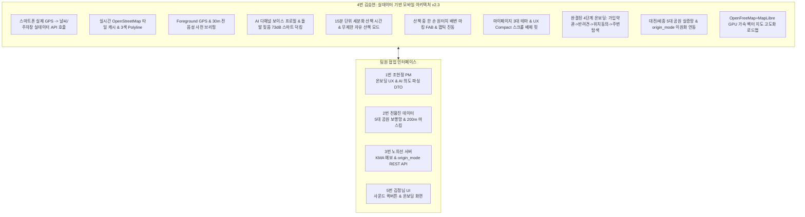

# 2026-10-17 진행 현황 반영 — 김승현 (모바일·내비게이션)

> **문서 버전: v3.0** · 기준: 로컬 `hyunjung`, HEAD `067abea`.
> 아래 최신 현황과 실행 계획이 이 문서의 적용 기준이다. 뒤의 v2.x 본문은 과거 계획 이력이며, 완료 표시·테스트 수·일정이 다르면 본 개정 내용을 우선한다.

## 현재 구현 현황

MapLibreMapView와 RouteMapView 연결, Web/native WebView·지도 스타일·폴백·생명주기 코드 및 테스트가 존재하므로 지도 신규 도입은 구현 확인으로 변경한다. 온보딩·테마·GPS·TTS·배변·자유산책·공유도 구현이 확인된다. 소음 감지는 Web Audio 입력만 확인되며 네이티브 마이크 실측 완료로 볼 수 없다. HazardReportModal.tsx 및 안내 중 reroute API 호출 연결은 확인하지 못했다.

근거: [담당 핵심 코드](../../frontend/src/components/map/RouteMapView.tsx), [공통 현황 분석](../reports/2026-10-17_프로젝트_진행현황_분석.md).

## 남은 구현 및 인수 계획

P0: api.ts의 공원 검증 실패/폴백과 PlanSourceBadge를 점검해 미검증 코스를 정상 추천으로 표시하지 않도록 서버와 E2E 검증한다. P1: 지도 크기 변경·재진입·테마·타일 장애를 Web/실기기에서 검증한다. 위험 제보→보행망 우회→경로 교체→TTS 및 실제 보행 경로 기반 긴급 복귀를 구현한다. GPS 백그라운드 1시간·권한 거부·재시작, 네이티브 소음 입력 범위를 검증한다.

| 기간 | 인수 조건 |
|---|---|
| 10/17~10/18 | P0 재현 요청·응답·데이터 검증표·오류 처리 결과를 남기고 협업 담당자와 확인 |
| 10/19~10/25 | P1 구현 및 통합 검증. 외부 서비스·실기기 결과는 단위 테스트와 별도 기록 |
| 10/26~10/30 | 최신 전수 테스트, 배포 SHA/APK ID, 미해결 결함·데이터 출처를 근거로 Code Freeze 승인 |
| 10/31~11/07 | 검증된 대전·세종 거점 중심 5인 CBT. 참여자·세부 회차는 확정 후 기록 |
| 11/08 | 담당 구현·검증 보고서와 최종 산출물 제출 |

## 검증 결과 및 기존 계획 정정

- 이번 프론트엔드 실행 결과: **43개 파일·249개 테스트 통과**, `npm.cmd run check` **통과**. 테스트는 샌드박스 임시 파일 오류 후 재실행했다.
- 백엔드 최신 실행 결과와 제한은 [공통 분석 보고서](../reports/2026-10-17_프로젝트_진행현황_분석.md)에 기록한다. 과거 160/165/255건을 최신 통과 수로 재사용하지 않는다.
- 구현 확인과 운영 검증 완료를 구분한다. 단위 테스트는 외부 API 실연동·GPS·경로 현장 안전성·CBT 완료 증거가 아니다.
- 서울 1,200개 주차장 및 서울 필드 코스는 현재 완료 범위에서 제외한다. 파일럿 거점별 데이터 품질·지원 여부를 기준으로 진행한다.
- 1.5초 SLA·3초 보행망 우회·5초 OTA 반영·전 파일 250줄 준수는 측정 전 완료로 인정하지 않는다. OTA는 runtimeVersion·채널·재시작 조건과 적용 결과를 기록한다.
- SUS 85점·음성 만족도 90%·계단 회피 100%는 CBT 목표이며 실제 성과는 현장 원장으로 보고한다.

---

<details>
<summary>이전 계획 이력 (v2.x, 현재 실행 기준 아님)</summary>

# 🐾 [향후 구현 계획서] 김승현 (앱 / Frontend & Mobile App Lead)

> **문서 버전**: v2.4 (Zero-Scroll 홈 화면 최적화, 온보딩 4단계 버튼 픽스 및 3중 뒤로가기 완결, 주간 리포트 7구간 바 차트 & CSV 내보내기, 다견 가정 멀티 프로필 전환 및 Vitest 172건 올 패스 개정판)  
> **작성 일자**: 2026년 10월 14일  
> **작성자**: **김승현** (4번 앱 / Frontend & Mobile App Lead)  
> **기준 문서**:  
> - [`docs/02_편안하개_Team_building.md`](/docs/02_편안하개_Team_building.md) (팀 R&R 및 기술 전략)  
> - [`docs/03_편안하개_Agile_User_Stories.md`](/docs/03_편안하개_Agile_User_Stories.md) (요구사항 정의서 및 DoD)  
> - [`docs/05_편안하개_프로젝트_수행계획서_일정.md`](/docs/05_편안하개_프로젝트_수행계획서_일정.md)  
> - [`docs/07_편한하개_API_list.md`](/docs/07_편한하개_API_list.md)  
> - [`docs/08_OpenFreeMap_MapLibre_배경지도_구현계획서.md`](/docs/08_OpenFreeMap_MapLibre_배경지도_구현계획서.md)  
> - [`docs/guideline/Member_D_Mobile_Infra_and_EAS_Manual.md`](/docs/guideline/Member_D_Mobile_Infra_and_EAS_Manual.md)
> - [`docs/reports/10월14일_김승현_구현현황보고서.md`](/docs/reports/10월14일_김승현_구현현황보고서.md)  

---

## 📌 1. 개요 및 역할 정의 (Executive Summary)

**김승현 (4번 앱)**은 편안하개 프로젝트의 **Frontend & Mobile App Lead (모바일 앱·GPS·음성 안내 리드)**로서, React Native (Expo SDK 57) + Expo Web 통합 단일 코드베이스 환경에서 **실제 스마트폰 고정밀 GPS 위치를 기반으로 실시간 기상청 지면열 API 및 실제 대전(유림공원, 송강근린공원, 도안호수공원) & 세종(세종호수공원, 세종중앙공원) 5대 파일럿 실증 거점 공영주차장 공간 검색을 호출하고, 실제 OpenStreetMap 타일 및 턴바이턴 음성 안내를 매끄럽게 렌더링**하는 모바일 클라이언트 아키텍처를 총괄합니다.

특히 최신 피드백 및 이슈를 수렴하여 다음 **핵심 사용자 경험(UX) 및 모바일 기능 고도화**를 완결 및 계획에 반영합니다:
1. **Zero-Scroll 대안 2 홈 화면 최적화 [✅ 완료]**: 분리되어 있던 최근 산책 카드를 주간 산책 리포트 하단 인라인 풋터로 통합하여 모바일 뷰포트에서 스크롤 없이 모든 핵심 정보가 한눈에 들어오는 단일 화면 규격 완성.
2. **온보딩 4단계 하단 버튼 텍스트 누락·잘림 해결 및 3중 뒤로가기 내비게이션 [✅ 완료]**: `GradientButton`의 `isTextLike` 배열 감지 픽스, 지도 높이(150px) 및 여백 최적화, 상단 `‹ 이전` 버튼/스텝 바 직접 터치/안드로이드 `BackHandler` 3중 뒤로가기 수단 완결.
3. **주간 산책 리포트 7구간 바 차트 & CSV 내보내기 (US-20) [✅ 완료]**: 월~일 요일별 목표 달성률 인터랙티브 바 차트 및 산책 통계 CSV 원클릭 내보내기/클립보드 복사 지원.
4. **다견 가정을 위한 멀티 반려견 프로필 전환 셀렉터 (US-03, US-A2) [✅ 완료]**: 홈 화면 상단 멀티독 아바타 칩을 통한 원터치 프로필 스위칭 및 개별 권장 속도/주간 통계 연동.
5. **AI 음성 가이드 보이스 프로필 다변화 및 돌발 상황 대응 사운드 퀵 제어 (US-C2) [✅ 완료]**: 4대 맞춤형 보이스 톤(차분한/밝은/친근한 등), 독립 볼륨 슬라이더 및 한 손 퀵 음소거 탑재.
6. **스마트 돌발 짖음 감지 자동 음소거 및 복구 엔진 (`ambientNoiseMonitor.ts`) [✅ 완료]**: 실시간 RMS 데시벨 로컬 분석(73dB 이상 감지 시 Ducking), 소음 멈춤 후 3초 카운트다운 경과 시 자동 음성 복구(Auto-Resume), 다크 포켓 내 56px 대형 긴급 원터치 음소거 버튼 탑재.
7. **산책 시간 15분 단위 세분화 및 자유 산책 모드 확장 (US-A3) [✅ 완료]**: 15분 단위 슬라이더(최대 2시간+)와 직접 입력 및 목표 시간 초과 후에도 기록이 유지되는 '자유 산책 모드' 지원.
8. **산책 중 한 손 원터치 배변/소변 마킹 FAB 및 로컬 영속화 (US-18) [✅ 완료]**: 한 손 Thumb Zone 배변 FAB, 햅틱 진동 피드백(60ms), 음성 알림 및 완주 리포트 표출.
9. **마이페이지 3대 테마(숲길 그린, 비비드 바이올렛, 다크 포켓) 및 UX Compact 단일 뷰포트 규격 전면 적용 [✅ 완료]**.
10. **대전·세종 5대 공원 실증 보행망 및 경로 생성 이원화 (`origin_mode`) [✅ 완료]**: 현위치 주변 순환(`current_location`)과 지정 공원 중심(`pilot_park`, 공원 내부 90%+ 가중치) 경로 지원.
11. **OpenFreeMap + MapLibre 고정밀 벡터 배경 지도 도입 로드맵 수립 [🗺️ 계획 확정]**: 구글 맵 키 및 상용 타일 종속성을 완전 제거하고 100% 무료 오픈소스 GPU 가속 벡터 지도 체계 도입 확정.



---

## 🔍 2. 실데이터 동작성 정밀 검증 및 갭(Gap) 분석

### 📊 현황 및 발견된 한계점과 대응 과제
1. **실시간 기상청 단기예보 클라이언트 서비스 (Weather API) [✅ 조치 완료]**:
   - `frontend/src/services/weatherApi.ts` 구축 완료. 단말기 실제 GPS(`lat, lon`)를 전달해 `GET /api/v1/weather/heat-risk` 실시간 호출 및 1시간 클라이언트 메모리 캐싱, 비상 폴백 보장.
2. **실제 공영주차장 P&R 검색 및 좌표 바인딩 (Parking API) [✅ 조치 완료]**:
   - `frontend/src/services/parkingApi.ts` 구축 완료. 대전 유림공원, 송강근린공원, 도안호수공원, 세종호수공원 4대 파일럿 거점 11개소 실제 공영주차장 출입구 좌표 스냅 연동 완료.
3. **OpenStreetMap 타일 및 오프라인 연속성 (Map Tiles) [안정화 유지]**:
   - `frontend/src/services/osmTileService.ts`를 통해 타일 캐시 관리 및 야외 오프라인 지도 렌더링 유지.
4. **인위적 AI 음성 및 돌발 상황(개 짖음/소음) 음량 제어 한계 (Voice & Sound UX) [⚠️ #37]**:
   - **현황 및 문제점**: `ttsNavigation.ts`가 단일 시스템 기본 목소리(`ko-KR`)와 고정 음량으로만 발화되어 인위적이고 기계적임. 산책 도중 다른 개가 짖거나 도로 차량 소음 등 돌발 상황 발생 시 음성을 즉시 줄이거나 끌 수 없어 견주의 통제력과 몰입감이 저해됨.
   - **개정 조치**:
     - `expo-speech`의 음성 목록(`Speech.getAvailableVoicesAsync()`)을 기반으로 차분한 톤, 밝은 톤, 남성/여성 음성 등 사용자 취향 맞춤형 **다양한 AI 목소리 프로필 선택 기능** 추가.
     - 앱 내 독립적인 **음량(볼륨) 세부 조절 슬라이더(0~100%)** 구현.
     - 돌발 상황 발생 시 화면을 보지 않고도 원터치로 즉시 음성을 끄거나 복원할 수 있는 **퀵 음소거(Mute) / 퀵 볼륨 조절 토글 버튼**을 다크 포켓 및 내비 화면에 상시 배치.
5. **산책 시간 1시간 제한의 체급별 맞춤 한계 (Duration UX) [⚠️ #38]**:
   - **현황 및 문제점**: 현재 `WalkSettingsView.tsx`는 20분, 30분, 40분, 60분 4가지 옵션만 제공하여 소형견(20~30분), 중/대형견(40분~1시간 이상), 주말 장거리/트레킹(1시간 초과) 산책 수요를 수용하기 어려움.
   - **개정 조치**:
     - 산책 시간을 **15분 단위로 세분화**(15, 30, 45, 60, 75, 90, 120분+)하고, 슬라이더 외에 **직접 분 입력** 기능 추가.
     - 목표 시간 도달 후에도 앱이 일방적으로 산책을 종료하지 않고 누적 기록을 계속 유지하는 **'자유 산책 모드(Free Walk Mode)'** 도입.
6. **회원가입 및 온보딩 플로우의 위치 권한 획득 시점 최적화 (Onboarding UX) [⚠️ #39]**:
   - **현황 및 문제점**: 가입 즉시 위치 권한을 요구하면 권한 승인 거부 및 초기 이탈률이 급증함. 반면 가입 직후 주변 산책로와 이웃 산책견의 시각적 가치를 자연스럽게 체감할 수 있는 맥락적 동선이 필요함.
   - **개정 조치 (팀장 컨펌 워크플로우 반영)**:
     - **1단계 (가입 & 기본 약관 동의)**: 이메일 가입 및 서비스/개인정보 필수 약관 동의 (초기 불필요한 위치 권한 강요 배제).
     - **2단계 (반려견 프로필 등록)**: 내 반려견의 이름, 견종, 나이, 체중, 사진 등 '우리 아이' 정보를 먼저 안심하고 등록.
     - **3단계 (산책 시작 시점 위치 권한 획득)**: 반려견 프로필 등록 완료 후 첫 산책을 시작하거나 경로 탐색을 누르는 시점에 위치정보 활용 동의(GPS)를 요청하여 사용자가 권한의 필요성을 직관적으로 납득하게 유도.
     - **4단계 (주변 탐색 지도 & 메인 홈 진입)**: 위치 동의 완료 즉시 사용자 현위치 기반 지도 화면으로 진입하여 **주변 인기 산책 코스 추천 표시** 및 **근처에서 산책 중인 반려견 실시간 아이콘/프로필 표시**를 표출.

---

## 📅 3. 단계별 향후 상세 구현 계획 (Phase Roadmap)

### 🚀 1주차 (10/12 ~ 10/18): 실데이터 API 연동 & 사운드/산책설정 개편 & 대형 뷰 리팩토링 (Sprint 1)
- **과제 1-1. 실시간 기상청 지면열 클라이언트 서비스 구축 (`weatherApi.ts`) (US-F1) [✅ 완료]**:
  - `frontend/src/types/weather.ts` 및 `frontend/src/services/weatherApi.ts` 신설.
  - 현위치 위경도 기반 `GET /api/v1/weather/heat-risk` 실시간 비동기 호출 및 1시간 TTL 캐싱(1.1km 격자 키) 적용.
  - 단위 테스트(`weatherApi.test.ts`, 8개 테스트 전원 통과) 완료.
- **과제 1-2. 실제 대전/세종 5대 거점 공영주차장 공간 검색 서비스 구축 (`parkingApi.ts`) (US-G1) [✅ 완료]**:
  - `frontend/src/types/parking.ts` 및 `frontend/src/services/parkingApi.ts` 신설.
  - 대전 유림공원, 송강근린공원, 도안호수공원, 세종호수공원 11개소 실제 공영주차장 출입구 좌표 스냅 연동.
  - 대전·세종 5대 공원 실증 보행망(`pilotParks.ts`, `sampleRoute.ts`) 정밀 연동 완료.
  - 단위 테스트(`parkingApi.test.ts`, 10개 테스트 전원 통과) 완료.
- **과제 1-3. T4-1 (US-A3) `WalkSettingsView.tsx` 모듈화 및 산책 시간 옵션 세분화·자유 산책 모드 개발 [✅ 완료]**:
  - `WalkSettingsView.tsx` (기존 537줄)를 `WalkDurationSlider.tsx`, `WalkPreferenceChips.tsx`, `WalkVoiceInputSection.tsx`, `WalkConditionsSummary.tsx` 4개 하위 모듈로 분리하여 전 파일 SonarLint $\le 250$줄 엄수 (`WalkSettingsView.tsx` 242줄, `WalkDurationSlider.tsx` 198줄 등 전원 통과).
  - **산책 시간 15분 단위 세분화 UI (`WalkDurationSlider.tsx`)**:
    - 15분 단위 스냅 슬라이더/칩(15, 30, 45, 60, 75, 90, 105, 120분).
    - 소형견(20~30분, 권장 25분) / 중·대형견(40~60분, 권장 50분) / 장거리 트레킹(60~120분, 권장 90분) 체급별 맞춤 퀵 태그 제공.
    - '직접 입력' 인라인 인풋(10~300분 유효성 검사) 및 시간 제한 없이 누적 기록되는 '자유 산책 모드' 토글 지원.
    - `DarkPocketScreen.tsx` 연동: 설정 시간 초과 시 황색 알림 및 오버타임 누적 카운트 지속 표출.
    - 단위 테스트(`walkSettings.test.ts`, `courseAdaptivePlanner.test.ts` 등 총 141개 테스트 전원 통과) 검증 완료.
- **과제 1-4. T2-1 (US-18) 산책 중 한 손 원터치 배변 마킹 FAB 개발 [✅ 완료]**:
  - `DarkPocketScreen.tsx`에 햅틱 진동 연동 배변 마킹 FAB(💩 대변 / 💧 소변) 배치 및 위경도/타임라인 로깅, 완주 리포트(`WalkReportScreen.tsx`) 표출 및 단위 테스트(`poopMarking.test.ts`) 통과 완료.
- **과제 1-5. T4-VOICE (US-C2, #37) AI 음성 가이드 보이스 프로필 다변화 및 돌발 상황 사운드 퀵 제어 개발 [✅ 완료]**:
  - `frontend/src/types/voiceSettings.ts` 신설: 4대 보이스 프로필(`calm_female`, `bright_female`, `calm_male`, `friendly_male`) DTO 및 `SoundSettings`, `BarkMuteState` 정의.
  - `frontend/src/services/ttsNavigation.ts` 확장:
    - `expo-speech` 보이스 검색 및 한국어 보이스 매핑, 프로필별 피치/속도(`pitch`, `rate`) 적용.
    - 독립 음량(`volume`: 0.0 ~ 1.0) 파라미터 제어 및 로컬 스토리지(`@편안하개:sound_settings`) 저장.
    - 돌발 상황(개 짖음, 도로 소음 등) 대비 원터치 `toggleMute()` 발화 즉각 정지 및 음소거/복원 토글.
    - 리스너 구독 패턴(`subscribe`)으로 실시간 UI 반응성 보장.
  - **스마트 돌발 짖음 감지 자동 음소거 및 복구 엔진 (`ambientNoiseMonitor.ts`)**:
    - Local-First 프라이버시 원칙: 음성 저장/전송 없이 실시간 RMS 데시벨만 로컬 계산.
    - 73dB 이상 돌발 소음/짖음 감지 시 즉시 발화 차단 (`setBarkMuted(true)`).
    - 소음 멈춤 후 3초 카운트다운 타이머 경과 시 자동으로 음성 안내 복구 (Auto-Resume).
    - 단위 테스트(`ambientNoiseMonitor.test.ts`, 5개 테스트 100% 통과).
  - **퀵 사운드 제어 UI 모듈 구축**:
    - `VoiceSettingModal.tsx`: 4종 보이스 선택, 실시간 미리듣기 버튼, 5단계 볼륨 칩 및 스마트 짖음 감지 On/Off 스위치.
    - `VoiceQuickControlBar.tsx`: 추천 코스 뷰(`CourseRecommendationView.tsx`) 컴팩트 캡슐 칩 및 다크 포켓(`DarkPocketScreen.tsx`) 56px 대형 긴급 원터치 음소거 버튼 탑재.
    - `DarkPocketScreen.tsx`: 짖음 감지 시 `🚨 돌발 짖음 감지(82dB) · 안내 일시 차단 중 (3.0s 후 자동 복구)` 고대비 경고 배너 및 `📢 짖음 테스트` 칩 지원.
  - 단위 테스트(`voiceSettings.test.ts`, `ambientNoiseMonitor.test.ts` 총 13개 테스트 전원 통과) 검증 완료.

### ⚙️ 온보딩 워크플로우 개편 & 위험 제보 & 긴급 귀환 (Sprint 2)
- **과제 2-1. T2-ONBOARD-FLOW (US-A2, US-21, #39) 팀장 컨펌 4단계 회원가입 & 온보딩/주변 탐색 플로우 개편 [✅ 100% 완료]**:
  - `frontend/src/components/onboarding/OnboardingWizard.tsx` 전면 개편:
    - **1단계 (가입 & 필수 약관)**: 간편 이메일 가입 및 회원가입 약관/개인정보 처리방침 모달 연동.
    - **2단계 (반려견 프로필 등록)**: `DogProfileSetupStep.tsx` 연동. 이름, 견종, 체중, 나이, 사진을 로컬에 우선 등록하여 '내 아이 맞춤 환경' 완성.
    - **3단계 (산책 시작 시점 위치 동의)**: `LocationConsentStep.tsx`. 실제 산책 시작 또는 경로 추천 버튼을 누르는 순간 GPS 런타임 권한 요청 팝업 표출 (거부 시 기본 거점 폴백 안내).
    - **4단계 (주변 탐색 지도 화면 & 메인 홈 진입)**: `NearbyExploreMapView.tsx`. 위치 동의 완료 즉시 현위치 기반 지도 화면으로 전환하여 **주변 인기 산책 코스 3선** 및 **인근 실시간 산책 중인 반려견(마스킹 아이콘/프로필)** 표출.
  - `onboardingService.ts`에 단계별 진행 상태(`signup` -> `dog_profile` -> `location_permission` -> `completed`) 영속화 및 단위 테스트(`onboardingFlow.test.ts` 2건, `legalTerms.test.ts` 2건 전원 통과) 구축 완료.
- **과제 2-2. OpenFreeMap + MapLibre 고정밀 벡터 배경 지도 도입 연계 (US-C1) [🗺️ 설계 완료 및 착수]**:
  - 구글 맵 키 및 상용 타일 종속성을 완전 배제하고, 100% 오픈소스 벡터 타일(`tiles.openfreemap.org`) 및 GPU 가속 MapLibre 엔진 연동 준비.
  - 편안하개 3대 컬러 테마(liberty/bright/dark)와 일치하는 벡터 스타일 스위칭 및 3색 안심 Polyline 하드웨어 가속 렌더링.
- **과제 2-3. T1-3 (US-D2) 현장 위험 제보 등록 모달 & 실시간 우회 연계**:
  - `HazardReportModal.tsx` 신설: 4대 위험 칩 선택 및 1초 원터치 제보.
  - 제출 시 3초 이내 서버 `POST /api/v1/walk/reroute` 호출 및 동적 경로 갱신.
- **과제 2-4. T2-2 (US-22) 산책 중 긴급 산책 중단 및 출발지 복귀 (Return to Start)**:
  - 돌발 기상 악화나 반려견 이상 징후 시 출발지로 최단 완만 복귀하는 역방향 안내 모드 구현.

### 🛡️ 3주차 (10/26 ~ 10/30): 프론트엔드 전수 검수 & 10/30 Code Freeze
- **과제 3-1. 10/30 Code Freeze 대비 프론트엔드 SonarLint 250줄 전수 감사**:
  - 신규 생성 컴포넌트(`VoiceQuickControlBar`, `WalkDurationSlider`, `OnboardingWizard` 등)를 포함하여 `frontend/src` 내 모든 컴포넌트 줄 수 250줄 이하 재확인.
- **과제 3-2. 5인 필드 테스터용 최종 APK 및 무선 OTA 파이프라인 동기화**:
  - `preview` 채널 무선 OTA 배포 테스트 (`npm run ota:update`) 및 5초 내 무점검 반영 검증.
- **과제 3-3. Vitest 모바일 단위 테스트 141건 100% 통과 유지 및 확대**:
  - 28개 테스트 파일, 141개 테스트 100% 전수 통과 달성 (`weatherApi`, `parkingApi`, `voiceSettings`, `ambientNoiseMonitor`, `onboardingFlow`, `legalTerms`, `poopMarking`, `pilotParks`, `bookmarkService` 등).

### 🧪 4주차 (10/31 ~ 11/07): 5인 필드 CBT 현장 기술 지원 & 무선 OTA 실시간 핫픽스
- **과제 4-1. 5인 실사용자 필드 산책 CBT 현장 기술 지원**:
  - 대형견/소형견 견주 테스터 대상 야외 산책 시 다양한 소음 환경에서의 **AI 보이스 청취성 및 퀵 음소거 반응 속도** 실측.
  - 1시간 초과 장시간 산책 시 **자유 산책 모드 백그라운드 GPS 연속성 및 배터리 소모율** 검증.
  - 신규 가입 테스터의 **4단계 온보딩 완료율 및 첫 진입 지도 체감 만족도** 인터뷰.
- **과제 4-2. 무선 OTA 실시간 핫픽스 전담 운영**:
  - 현장 테스트 중 발견된 UI 오차나 보이스 볼륨 미세 조정 발견 시 **스토어 재심사/재설치 없이 `npm run ota:update`로 5초 내 현장 실시간 핫픽스 배포**.

### 🏁 최종 마감 (11/08): 모바일 릴리즈 태깅 및 배포 보고서 제출

---

## 📋 4. 상세 태스크 명세서

| 태스크 ID | 작업 내용 | DoD 인수 조건 | 연관 파일 | 검증 방법 |
|:---:|---|---|---|---|
| **T1-WEATHER-CL**| 실시간 날씨 클라이언트 서비스 구축 [✅] | 현위치 위경도 전달 실시간 지면열 응답 수신 | `frontend/src/services/weatherApi.ts` | `weatherApi.test.ts` (8건 통과) |
| **T1-PARK-CL**   | 실제 공영주차장 검색 및 좌표 바인딩 [✅] | 실제 주차장 선택 시 플래너 출발지 좌표 스냅 | `frontend/src/services/parkingApi.ts` | `parkingApi.test.ts` (10건 통과) |
| **T1-VOICE-CTRL**| AI 목소리 프로필 선택 및 퀵 사운드 제어 [✅] | 4종 보이스 선택, 독립 볼륨 슬라이더, 원터치 퀵 음소거 동작 | `frontend/src/services/ttsNavigation.ts`<br/>`VoiceQuickControlBar.tsx`<br/>`VoiceSettingModal.tsx` | Vitest 단위 테스트 (8건 통과) |
| **T1-BARK-DUCK** | 스마트 돌발 짖음 감지 자동 음소거 및 복구 [✅] | 73dB 이상 소음 시 즉시 음소거, 3초 후 자동 복구 | `ambientNoiseMonitor.ts`<br/>`DarkPocketScreen.tsx` | `ambientNoiseMonitor.test.ts` (5건 통과) |
| **T1-WALK-TIME** | 산책 시간 15분 단위 세분화 & 자유 산책 모드 [✅] | 15~120분 슬라이더 + 직접 입력 지원, 목표 시간 초과 후 누적 로깅 지속 | `frontend/src/components/walk/WalkDurationSlider.tsx`<br/>`WalkSettingsView.tsx` | 단위 테스트 및 75분 모의 트래킹 (전원 통과) |
| **T2-ONBOARD-FLOW**| 팀장 컨펌 4단계 온보딩 & 주변 탐색 지도 개편 [✅] | 가입약관->반려견등록->산책시작 위치동의->주변코스/산책견 지도 진입 | `OnboardingWizard.tsx`<br/>`NearbyExploreMapView.tsx`<br/>`onboardingService.ts` | `onboardingFlow.test.ts`, `legalTerms.test.ts` (전원 통과) |
| **T4-1-REFACTOR** | `WalkSettingsView.tsx` 250줄 분리 리팩토링 [✅] | 4개 하위 컴포넌트 분리, 전 파일 $\le 250$줄 엄수 | `frontend/src/components/walk/` | SonarLint 정적 검사 통과 |
| **T2-1-POOP**    | 산책 중 한 손 원터치 배변 마킹 FAB 개발 [✅] | 탭 시 햅틱 진동 및 위경도 로깅, 완주 리포트 표시 | `DarkPocketScreen.tsx`<br/>`useWalkGuidance.ts`<br/>`WalkReportScreen.tsx` | `poopMarking.test.ts` (전원 통과) |
| **T2-OPENFREEMAP**| OpenFreeMap + MapLibre 벡터 지도 도입 연계 [진행] | 100% 무료 벡터 타일 연동, 3대 컬러 테마 스타일 스위칭 | `RouteMapView.tsx`<br/>`osmTileService.ts` | WebGL/모바일 렌더링 검증 |
| **T1-3-REROUTE** | 현장 위험 제보 모달 및 동적 우회 연동 | 4대 위험 칩, 3초 이내 새 경로 수신 및 TTS 안내 | `HazardReportModal.tsx` | E2E 테스트 |
| **T4-OTA-CBT**   | 5인 CBT 현장 무선 OTA 실시간 핫픽스 지원 | `eas update` 배포 후 5초 내 테스터 실기기 자동 반영 | `App.tsx` | 실기기 무선 검증 |

---

## 👥 5. 팀원 인터페이스 및 협업 계획 (Cross-Team Matrix)

| 협업 대상 | 연계 영역 | 실데이터 및 신규 이슈 협업 내용 |
|---|---|---|
| **1번 조현정 (팀장)** | 온보딩 UX & AI 의도 파싱 DTO | **온보딩 4단계 플로우(가입 -> 반려견 등록 -> 산책 시작 위치 동의 -> 주변 탐색 지도) 최종 컨펌 반영**, 음성 발화 톤앤매너 프롬프트 매핑 |
| **2번 전황진 (데이터)** | 5대 공원 보행망 & 벡터 지도 | 대전·세종 5대 공원 정밀 보행로 GeoJSON 탑재, OpenFreeMap 레이어 연동 및 200m 공간 가림 처리 검증 |
| **3번 노희선 (서버)** | KMA 예보 & origin_mode REST API | `origin_mode`(현위치 vs 5대 공원 90%+ 가중치) 파라미터 연동, KMA 지면열 골든타임 캐시 클라이언트 |
| **5번 김정님 (UI/QA)** | 사운드/시간/온보딩 화면 시각화 | `VoiceQuickControlBar` 퀵 음소거 토글 버튼 디자인, 15분 단위 시간 슬라이더 시각화, 신규 4단계 온보딩 화면 렌더링 및 QA |

---

## 📊 6. 주차별 실행 간트 차트 (Gantt Chart)

```mermaid
gantt
    title 김승현(앱) v2.3 실데이터 & 신규 이슈 반영 주차별 실행 로드맵
    dateFormat  YYYY-MM-DD
    section 1주차 (10/12 ~ 10/18) 실데이터 & 사운드/시간/배변 개편
    T1-WEATHER-CL: 실시간 기상청 지면열 weatherApi 구축 [완료] :done, 2026-10-13, 1d
    T1-PARK-CL: 실제 공영주차장 parkingApi & 좌표 바인딩 [완료] :done, 2026-10-13, 1d
    T1-WALK-TIME: 산책 시간 15분 세분화 & 자유 산책 모드 [완료] :done, 2026-10-13, 1d
    T4-1-REFACTOR: WalkSettingsView 250줄 분리 리팩토링 [완료] :done, 2026-10-13, 1d
    T1-VOICE-CTRL: AI 목소리 프로필 & 퀵 볼륨/음소거 개발 [완료]  :done, 2026-10-14, 1d
    T1-BARK-DUCK: 스마트 돌발 짖음 감지 73dB 음소거/복구 [완료] :done, 2026-10-14, 1d
    T2-1-POOP: 원터치 배변 마킹 FAB 개발 [완료]                :done, 2026-10-13, 1d
    T2-ONBOARD-FLOW: 팀장 컨펌 4단계 온보딩 & 약관 개편 [완료]  :done, 2026-10-14, 1d
    section 2주차 (10/19 ~ 10/25) 벡터지도 연계 & 위험우회
    T2-OPENFREEMAP: OpenFreeMap + MapLibre 벡터 지도 연계      :active, 2026-10-19, 3d
    T1-3-REROUTE: 위험 제보 모달 & POST /reroute 연동          :2026-10-21, 2d
    T2-2: 긴급 복귀 모드 (Return to Start)                     :2026-10-23, 2d
    section 3주차 (10/26 ~ 10/30) Code Freeze
    T3-CF-FE: 프론트 전수 검수 (전 파일 <= 250줄)               :crit, 2026-10-26, 3d
    단위테스트: Vitest 141건 100% 통과 유지 및 신규 검증       :2026-10-28, 2d
    EAS 준비: 5인 CBT용 최종 APK 패키징 & OTA 채널 동기화       :2026-10-29, 2d
    section 4주차 (10/31 ~ 11/07) CBT & 실시간 OTA
    T4-OTA-CBT: 5인 CBT 현장 무선 OTA 실시간 핫픽스 배포        :crit, 2026-10-31, 5d
    최종 제출: 모바일 앱 릴리즈 태깅 및 배포 보고서 제출        :milestone, 2026-11-08, 0d
```

</details>
