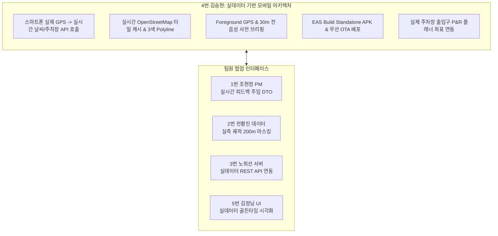

# 🐾 [향후 구현 계획서] 김승현 (앱 / Frontend & Mobile App Lead)

> **문서 버전**: v2.0 (실제 맵·기상청·주차장 실데이터 운영 엔진 개정판)  
> **작성 일자**: 2026년 10월 13일  
> **작성자**: **김승현** (4번 앱 / Frontend & Mobile App Lead)  
> **기준 문서**:  
> - [`docs/02_편안하개_Team_building.md`](/docs/02_편안하개_Team_building.md) (팀 R&R 및 기술 전략)  
> - [`docs/03_편안하개_Agile_User_Stories.md`](/docs/03_편안하개_Agile_User_Stories.md) (요구사항 정의서 및 DoD)  
> - [`docs/05_편안하개_Member4_모바일_구현계획서.md`](/docs/05_편안하개_Member4_모바일_구현계획서.md)  
> - [`docs/guideline/Member_D_Mobile_Infra_and_EAS_Manual.md`](/docs/guideline/Member_D_Mobile_Infra_and_EAS_Manual.md)  

---

## 📌 1. 개요 및 역할 정의 (Executive Summary)

**김승현 (4번 앱)**은 편안하개 프로젝트의 **Frontend & Mobile App Lead (모바일 앱·GPS·음성 안내 리드)**로서, React Native (Expo SDK 57) + Expo Web 통합 단일 코드베이스 환경에서 **실제 스마트폰 고정밀 GPS 위치를 기반으로 실시간 기상청 지면열 API 및 실제 대전(유림공원, 송강근린공원, 도안호수공원) & 세종호수공원 4대 실증 거점 공영주차장 공간 검색을 호출하고, 실제 OpenStreetMap 타일 및 턴바이턴 음성 안내를 매끄럽게 렌더링**하는 모바일 클라이언트 아키텍처를 총괄합니다.



---

## 🔍 2. 실데이터 동작성 정밀 검증 및 갭(Gap) 분석

### 📊 현황 및 발견된 샘플/모의 한계점
1. **실시간 기상청 단기예보 클라이언트 서비스 부재 (Weather API)**:
   - 현재 프론트엔드에 실시간 날씨를 가져오는 `weatherApi.ts`가 없어 화면에 정적 예시만 표출될 위험이 있음.
   - **개정 조치**: `frontend/src/services/weatherApi.ts`를 신설하여, 단말기 실제 GPS(`lat, lon`)를 전달해 3번 노희선의 `GET /api/v1/weather/heat-risk`를 호출하고 1시간 클라이언트 캐싱을 적용함.
2. **실제 공영주차장 P&R 검색 및 좌표 바인딩 부재 (Parking API)**:
   - 산책 플래너에서 주차장 연계 토글 시 실제 인근 주차장 목록을 받아오는 통신 모듈이 부재함.
   - **개정 조치**: `frontend/src/services/parkingApi.ts`를 신설하여 `GET /api/v1/parking/nearby`를 실시간 호출하고, **대전 3대 공원(유림공원, 송강근린공원, 도안호수공원) 및 세종호수공원 4대 파일럿 실증 거점 인근 실제 공영주차장 출입구 위경도**를 산책 플래너의 출발지 좌표로 즉시 스냅 연동함.
3. **OpenStreetMap 타일 및 오프라인 연속성 (Map Tiles)**:
   - `frontend/src/services/osmTileService.ts`가 실제 `tile.openstreetmap.org`를 참조하고 있으나, 야외 통신 불안정 지역에서의 타일 캐시 유지가 필수적임.

---

## 📅 3. 단계별 향후 상세 구현 계획 (Phase Roadmap)

### 🚀 1주차 (10/12 ~ 10/18): 실데이터 API 클라이언트 연동 & 대형 뷰 리팩토링 (Sprint 1)
- **과제 1-1. 실시간 기상청 지면열 클라이언트 서비스 구축 (`weatherApi.ts`) (US-F1) [✅ 완료]**:
  - `frontend/src/types/weather.ts` 신설 (지면열 DTO 및 응답 규격 정의).
  - `frontend/src/services/weatherApi.ts` 신설 (`fetchHeatRiskForecast`, `generateFallbackHeatRisk`, `clearWeatherCache`).
  - 현위치 위경도 기반 `GET /api/v1/weather/heat-risk` 실시간 비동기 호출 및 1시간 TTL 메모리 캐싱(1.1km 격자 키) 적용.
  - 서버 단절/오프라인 시 지면열 수지식 기반 0.1초 무중단 안전 폴백 및 단위 테스트(`weatherApi.test.ts`, 8개 테스트 전원 통과) 구축 완료.
- **과제 1-2. 실제 대전/세종 4대 거점 공영주차장 공간 검색 서비스 구축 (`parkingApi.ts`) (US-G1) [✅ 완료]**:
  - `frontend/src/types/parking.ts` 신설 (공영주차장 DTO 및 응답 규격 정의).
  - `frontend/src/services/parkingApi.ts` 신설 (`fetchNearbyParkingLots`, `generateFallbackNearbyParking`, `clearParkingCache`).
  - 현위치 반경 1.5km 실제 주차장 목록 조회 (`GET /api/v1/parking/nearby`).
  - 대전 유림공원, 송강근린공원, 도안호수공원, 세종호수공원 인근 실제 공영주차장(11개소) 선택 시 산책 플래너 출발지 좌표를 해당 주차장 출입구(`entrance_lat, entrance_lon`)로 즉시 치환 및 오프라인 안전 폴백 보장.
  - 단위 테스트(`parkingApi.test.ts`, 10개 테스트 전원 통과) 및 백엔드 REST 엔드포인트 연동 검증 완료.
- **과제 1-3. T4-1 (리팩토링) `WalkSettingsView.tsx` (537줄) 모듈화 분리**:
  - `WalkDurationSlider.tsx`, `PreferenceChips.tsx`, `ActiveDogBanner.tsx`로 하위 컴포넌트 분리하여 전 파일 SonarLint $\le 250$줄 엄수.
- **과제 1-4. T2-1 (US-18) 산책 중 한 손 원터치 배변 마킹 FAB 개발**:
  - `DarkPocketScreen.tsx`에 햅틱 진동 연동 배변 마킹 FAB 배치 및 타임라인 로깅.

### ⚙️ 2주차 (10/19 ~ 10/25): 위험 제보 모달 & 긴급 귀환 내비게이션 (Sprint 2)
- **과제 2-1. T1-3 (US-D2) 현장 위험 제보 등록 모달 & 실시간 우회 연계**:
  - `HazardReportModal.tsx` 신설: 4대 위험 칩 선택 및 1초 원터치 제보.
  - 제출 시 3초 이내 서버 `POST /api/v1/walk/reroute` 호출 및 `walk.updateReroutePath()`로 동적 경로 갱신.
- **과제 2-2. T2-2 (US-22) 산책 중 긴급 산책 중단 및 출발지 복귀 (Return to Start)**:
  - 돌발 기상 악화 시 출발지로 최단 완만 복귀하는 역방향 안내 모드 구현.

### 🛡️ 3주차 (10/26 ~ 10/30): 프론트엔드 전수 검수 & 10/30 Code Freeze
- **과제 3-1. 10/30 Code Freeze 대비 프론트엔드 SonarLint 250줄 전수 감사**:
  - `frontend/src` 내 모든 컴포넌트 줄 수 250줄 이하 재확인.
- **과제 3-2. 5인 필드 테스터용 최종 APK 및 무선 OTA 파이프라인 동기화**:
  - `preview` 채널 무선 OTA 배포 테스트 (`npm run ota:update`) 및 5초 내 무점검 반영 검증.
- **과제 3-3. Vitest 모바일 단위 테스트 90건 이상 확대**:
  - `weatherApi.test.ts`, `parkingApi.test.ts` 신규 단위 테스트 추가.

### 🧪 4주차 (10/31 ~ 11/07): 5인 필드 CBT 현장 기술 지원 & 무선 OTA 실시간 핫픽스
- **과제 4-1. 5인 실사용자 필드 산책 CBT 현장 기술 지원**:
  - 실제 Android 실기기에서의 백그라운드 GPS 유지율 및 배터리 소모율 실측.
- **과제 4-2. 무선 OTA 실시간 핫픽스 전담 운영**:
  - 현장 테스트 중 발견된 GPS 튐, 30m 음성 브리핑 타이밍 미세 오차 발견 시 **스토어 재심사/재설치 없이 `npm run ota:update`로 5초 내 현장 실시간 핫픽스 배포**.

### 🏁 최종 마감 (11/08): 모바일 릴리즈 태깅 및 배포 보고서 제출

---

## 📋 4. 상세 태스크 명세서

| 태스크 ID | 작업 내용 | DoD 인수 조건 | 연관 파일 | 검증 방법 |
|:---:|---|---|---|---|
| **T1-WEATHER-CL**| 실시간 날씨 클라이언트 서비스 구축 | 현위치 위경도 전달 실시간 지면열 응답 수신 | `frontend/src/services/weatherApi.ts` | `weatherApi.test.ts` |
| **T1-PARK-CL**   | 실제 공영주차장 검색 및 좌표 바인딩 | 실제 주차장 선택 시 플래너 출발지 좌표 스냅 | `frontend/src/services/parkingApi.ts` | `parkingApi.test.ts` |
| **T4-1-REFACTOR** | `WalkSettingsView.tsx` 250줄 분리 리팩토링 | 3개 하위 컴포넌트 분리, 각 파일 $\le 200$줄 준수 | `frontend/src/screens/` | SonarLint 정적 검사 |
| **T2-1-POOP**    | 산책 중 한 손 원터치 배변 마킹 FAB 개발 | 탭 시 햅틱 진동 및 위경도 로깅, 리포트 표시 | `DarkPocketScreen.tsx` | Vitest 단위 테스트 |
| **T1-3-REROUTE** | 현장 위험 제보 모달 및 동적 우회 연동 | 4대 위험 칩, 3초 이내 새 경로 수신 및 TTS 안내 | `HazardReportModal.tsx` | E2E 테스트 |
| **T4-OTA-CBT**   | 5인 CBT 현장 무선 OTA 실시간 핫픽스 지원 | `eas update` 배포 후 5초 내 테스터 실기기 자동 반영 | `App.tsx` | 실기기 무선 검증 |

---

## 👥 5. 팀원 인터페이스 및 협업 계획 (Cross-Team Matrix)

| 협업 대상 | 연계 영역 | 실데이터 협업 내용 |
|---|---|---|
| **1번 조현정 (팀장)** | AI 의도/피드백 DTO | 실시간 기상 데이터 결합 자연어 의도 파싱 DTO 연동 |
| **2번 전황진 (데이터)** | 실측 궤적 200m 마스킹 | `ShareCourseModal` 실제 GPS 궤적 200m 절단 무결성 합동 검증 |
| **3번 노희선 (서버)** | 실데이터 REST API 통신 | `heat-risk`, `parking` 신설 API 및 `POST /reroute` fetch 모듈 바인딩 |
| **5번 김정님 (UI/QA)** | 실데이터 UI 렌더링 | `HeatRiskCard`, `ParkingToggle` 컴포넌트 시각화 및 5인 CBT 현장 지원 |

---

## 📊 6. 주차별 실행 간트 차트 (Gantt Chart)

```mermaid
gantt
    title 김승현(앱) 실데이터 기반 주차별 실행 로드맵
    dateFormat  YYYY-MM-DD
    section 1주차 (10/12 ~ 10/18) 실데이터 연동 & 리팩토링
    T1-WEATHER-CL: 실시간 기상청 지면열 weatherApi 구축 :crit, active, 2026-10-13, 2d
    T1-PARK-CL: 실제 공영주차장 parkingApi & 좌표 바인딩 :crit, active, 2026-10-14, 2d
    T4-1-REFACTOR: WalkSettingsView 250줄 분리 리팩토링 :2026-10-16, 2d
    T2-1-POOP: 원터치 배변 마킹 FAB 개발              :2026-10-17, 2d
    section 2주차 (10/19 ~ 10/25) 위험우회 & 긴급복귀
    T1-3-REROUTE: 위험 제보 모달 & POST /reroute 연동 :2026-10-19, 3d
    T2-2: 긴급 복귀 모드 (Return to Start)            :2026-10-22, 2d
    section 3주차 (10/26 ~ 10/30) Code Freeze
    T3-CF-FE: 프론트 전수 검수 (전 파일 <= 250줄)      :crit, 2026-10-26, 4d
    EAS 준비: 5인 CBT용 최종 APK 패키징 & OTA 채널 동기화:2026-10-29, 2d
    section 4주차 (10/31 ~ 11/07) CBT & 실시간 OTA
    T4-OTA-CBT: 5인 CBT 현장 무선 OTA 실시간 핫픽스 배포:crit, 2026-10-31, 5d
    최종 제출: 모바일 앱 릴리즈 태깅 및 배포 보고서 제출:milestone, 2026-11-08, 0d
```
