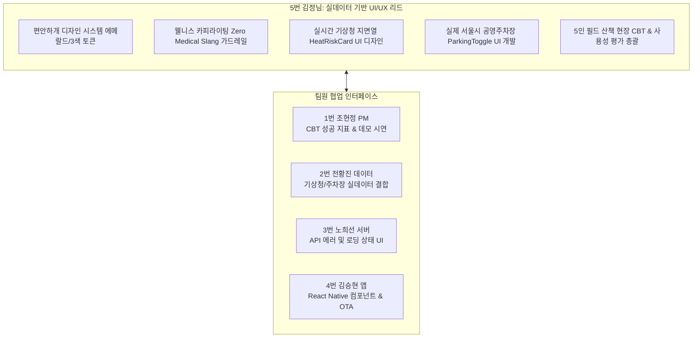

# 2026-10-17 진행 현황 반영 — 김정님 (UI·UX·CBT)

> **문서 버전: v3.0** · 기준: 로컬 `hyunjung`, HEAD `067abea`.
> 아래 최신 현황과 실행 계획이 이 문서의 적용 기준이다. 뒤의 v2.x 본문은 과거 계획 이력이며, 완료 표시·테스트 수·일정이 다르면 본 개정 내용을 우선한다.

## 현재 구현 현황

기상 UI는 GoldenTimeWidget.tsx가 실제 구현이며 계획상의 HeatRiskCard.tsx 신규 개발을 현 위젯 검수로 변경한다. ParkingToggle.tsx는 없으므로 parkingApi.ts 존재만으로 주차장 선택 UI 완료로 보지 않는다. 온보딩·3개 테마·배변·리포트·MapLibre UI는 구현 확인이며 야외 사용성 합격은 별도 검증이다.

근거: [담당 핵심 코드](../../frontend/src/components/home/GoldenTimeWidget.tsx), [공통 현황 분석](../reports/2026-10-17_프로젝트_진행현황_분석.md).

## 남은 구현 및 인수 계획

P0: 실제 컴포넌트 기준 QA 목록과 실시간/추정/폴백·오늘/내일·미지원 공원 오류 문구를 정리한다. P1: 주차장 공식 여부/공원 연결 여부와 요금·출입구 선택 UI를 김승현과 연결한다. 위험 칩은 서버 hazard_type과 맞춘다. 3개 테마 대비비 4.5:1·대형 글꼴·좁은 화면을 검수하고 SUS 10문항·참여 동의·APK 설치 키트·5인 CBT 일정을 확정한다.

| 기간 | 인수 조건 |
|---|---|
| 10/17~10/18 | P0 재현 요청·응답·데이터 검증표·오류 처리 결과를 남기고 협업 담당자와 확인 |
| 10/19~10/25 | P1 구현 및 통합 검증. 외부 서비스·실기기 결과는 단위 테스트와 별도 기록 |
| 10/26~10/30 | 최신 전수 테스트, 배포 SHA/APK ID, 미해결 결함·데이터 출처를 근거로 Code Freeze 승인 |
| 10/31~11/07 | 검증된 대전·세종 거점 중심 5인 CBT. 참여자·세부 회차는 확정 후 기록 |
| 11/08 | 담당 구현·검증 보고서와 최종 산출물 제출 |

## 검증 결과 및 기존 계획 정정

- 이번 프론트엔드 실행 결과: **43개 파일·249개 테스트 통과**, `npm.cmd run check` **통과**. 테스트는 샌드박스 임시 파일 오류 후 재실행했다.
- 백엔드 최신 실행 결과와 제한은 [공통 분석 보고서](../reports/2026-10-17_프로젝트_진행현황_분석.md)에 기록한다. 과거 160/165/255건을 최신 통과 수로 재사용하지 않는다.
- 구현 확인과 운영 검증 완료를 구분한다. 단위 테스트는 외부 API 실연동·GPS·경로 현장 안전성·CBT 완료 증거가 아니다.
- 서울 1,200개 주차장 및 서울 필드 코스는 현재 완료 범위에서 제외한다. 파일럿 거점별 데이터 품질·지원 여부를 기준으로 진행한다.
- 1.5초 SLA·3초 보행망 우회·5초 OTA 반영·전 파일 250줄 준수는 측정 전 완료로 인정하지 않는다. OTA는 runtimeVersion·채널·재시작 조건과 적용 결과를 기록한다.
- SUS 85점·음성 만족도 90%·계단 회피 100%는 CBT 목표이며 실제 성과는 현장 원장으로 보고한다.

---

<details>
<summary>이전 계획 이력 (v2.x, 현재 실행 기준 아님)</summary>

# 🐾 [향후 구현 계획서] 김정님 (UI / UI/UX & Experience Lead)

> **문서 버전**: v2.0 (실제 맵·기상청·주차장 실데이터 운영 엔진 개정판)  
> **작성 일자**: 2026년 10월 13일  
> **작성자**: **김정님** (5번 UI / UI/UX & Experience Lead)  
> **기준 문서**:  
> - [`docs/02_편안하개_Team_building.md`](/docs/02_편안하개_Team_building.md) (팀 R&R 및 기술 전략)  
> - [`docs/03_편안하개_Agile_User_Stories.md`](/docs/03_편안하개_Agile_User_Stories.md) (요구사항 정의서 및 DoD)  
> - [`docs/05_편안하개_프로젝트_수행계획서_일정.md`](/docs/05_편안하개_프로젝트_수행계획서_일정.md) (주차별 수행 일정)  
> - [`docs/screenshots/README.md`](/docs/screenshots/README.md) (스크린샷 갤러리)  

---

## 📌 1. 개요 및 역할 정의 (Executive Summary)

**김정님 (5번 UI)**은 편안하개 프로젝트의 **UI/UX & Experience Lead (화면 구현·통합 테스트·사용자 경험 리드)**로서, 가상 목업이 아닌 **실제 스마트폰 화면에서 실시간 기상청 지면온도 예보, 실제 서울시 공영주차장 명칭 및 요금, 실제 OpenStreetMap 도로망 인터랙션**을 높은 시인성과 부드러운 애니메이션으로 시각화하고, **앱 전역 웰니스 카피라이팅 가드레일 (Zero Medical Slang)** 및 **10월 31일 ~ 11월 7일 5인 실사용자 필드 산책 현장 CBT 총괄**을 전담합니다.



---

## 🔍 2. 실데이터 동작성 정밀 검증 및 갭(Gap) 분석

### 📊 현황 및 발견된 샘플/모의 한계점
1. **지면열 및 골든타임 시각화 (HeatRiskCard UI)**:
   - 기존에는 정적 고정 예시 화면만 존재하여 실제 기상청 날씨 변화(비, 흐림, 맑음)에 따른 인터랙션 대응이 미비했음.
   - **개정 조치**: `HeatRiskCard.tsx`를 개발하여, 실제 `weatherApi.ts`에서 전달된 **현재 외기온, 실시간 추정 지면온도, 실시간 하늘상태 아이콘(맑음/구름/비), 24시간 타임라인(안전/주의/위험)**을 실시간 렌더링하도록 설계함.
   - 웰니스 카피라이팅 가드레일: "화상 위험" 등 공포 유발 문구 대신 **"발바닥 패드가 편안한 안심 시간대"**로 순화 표기.
2. **실제 공영주차장 연계 카드 (ParkingToggle UI)**:
   - 기존에는 주차장 선택 시 실제 주차장명이나 요금이 표시되지 않았음.
   - **개정 조치**: `ParkingToggle.tsx`를 개발하여, 실제 대전 3대 공원(유림공원, 송강근린공원, 도안호수공원) 및 세종호수공원 4대 파일럿 거점 공영주차장 검색 결과(예: *"유림공원 부설주차장 - 120m / 무료"*, *"세종호수공원 제1주차장 - 80m / 무료"*)를 카드로 표출하고 원터치 선택 시 플래너에 반영되는 인터랙션을 구현함.
3. **야외 직사광선 환경 시인성 (Outdoor Legibility)**:
   - 한낮 야외 산책 시 폰 화면이 잘 보이지 않는 문제를 해결하기 위해, 모든 실데이터 카드에 텍스트 대비비 4.5:1 이상의 고대비 팔레트 적용 필요.

---

## 📅 3. 단계별 향후 상세 구현 계획 (Phase Roadmap)

### 🚀 1주차 (10/12 ~ 10/18): 실데이터 카드 UI 디자인 & 배변 마킹 FAB (Sprint 1)
- **과제 1-1. 실시간 기상청 지면열 카드 `HeatRiskCard.tsx` UI 개발 (US-F1)**:
  - 4번 김승현의 `weatherApi.ts` 실데이터 DTO 연동.
  - 현재 실시간 지면온도(예: 31.5℃), 상태 뱃지(🌿 안심 산책 가능), 추천 골든타임(예: "17:00 ~ 19:00 추천") 시각화.
- **과제 1-2. 실제 대전·세종 4대 거점 공영주차장 카드 `ParkingToggle.tsx` UI 개발 (US-G1)**:
  - 산책 플래너 상단에 "차량 방문 (주차장 연계)" 원터치 토글 배치.
  - 인근 대전/세종 실제 공영주차장 실명, 보행 거리(m), 주차 요금 정보 카드 렌더링 및 선택 인터랙션 구현.
- **과제 1-3. `DarkPocketScreen.tsx` 한 손 조작 배변 마킹 FAB 시각 디자인 (US-18)**:
  - OLED True Black 화면 우측 하단 엄지존(Thumb Zone)에 고대비 네온 배변 마킹 버튼 시각화.

### ⚙️ 2주차 (10/19 ~ 10/25): 위험 제보 모달 고대비 디자인 & CBT 준비 (Sprint 2)
- **과제 2-1. `HazardReportModal.tsx` 위험 제보 4대 칩 고대비 시각화 (US-D2)**:
  - 직사광선 아래에서도 즉시 식별 가능한 4대 고대비 위험 칩(`[🚧 공사]`, `[🪜 높은 단차]`, `[⚠️ 유리/장애물]`, `[🐕 대형견 잦은 출몰]`) 디자인.
- **과제 2-2. 야외 직사광선 텍스트 대비비 전수 감사**:
  - 전 화면 텍스트 대비비 4.5:1 이상 전수 검수.
- **과제 2-3. 5인 실사용자 필드 CBT 설문지 및 체크리스트 제작 (US-H1)**:
  - SUS 10문항, 핸즈프리 음성 만족도, 당일 기상청 예보 체감 만족도 설문지 작성.

### 🛡️ 3주차 (10/26 ~ 10/30): 웰니스 카피라이팅 2차 전수 감사 & 10/30 Code Freeze
- **과제 3-1. 앱 전역 웰니스 카피라이팅 (Zero Medical Slang) 2차 전수 감사**:
  - 앱 UI 소스 전역에서 질병/공포 유발 단어(탈구, 파열, 마비, 질환 등) 노출 0건 재검증.
  - '관절 안심 케어', '폭신한 흙길', '부드러운 평지' 등 긍정적 웰니스 카피라이팅 100% 확정.
- **과제 3-2. 전 여정 마이크로 인터랙션 및 애니메이션 폴리싱**:
  - 온보딩 $\to$ 플래너 $\to$ 내비 $\to$ 완주 리포트 $\to$ 커뮤니티 전 화면 전환 부드러운 트랜지션 적용.
- **과제 3-3. 5인 필드 테스터용 대면 오리엔테이션 키트 확정**:
  - 테스트 참여 안내서, APK 설치 가이드(QR코드 포함), 사전 설문지 패키징 완료.

### 🧪 4주차 (10/31 ~ 11/07): 5인 실사용자 필드 산책 현장 CBT 진행 & 사용성 평가 총괄
- **과제 4-1. 5인 실사용자 필드 산책 현장 테스트 총괄 진행 (10/31 ~ 11/05)**:
  - **10/31 (토)**: 1차 3인 필드 산책 진행 (소형견 말티즈 9세, 중형견 시바견 4세, 노령견 푸들 12세).
  - **11/03 (화)**: 1차 피드백 분석 회의 주관 및 UI/UX 개선 요구사항 도출 $\to$ 4번 김승현에게 실시간 무선 OTA 핫픽스 요청.
  - **11/05 (목)**: 2차 2인 필드 산책 진행 (대형견 리트리버 3세, 예민견 믹스 5세).
- **과제 4-2. CBT 정량·정성 사용성 평가 종합 보고서 작성 (11/07)**:
  - SUS 사용성 점수(목표: 85점 이상), 음성 안내 만족도(목표: 90% 이상), 계단 회피 성공률(목표: 100%) 데이터 시각화.
- **과제 4-3. 최종 고화질 데모 시연 영상(3분 내외) 캡처 및 편집**:
  - 실제 필드 산책 장면, 다크 포켓 음성 내비, 완주 리포트, 커뮤니티 공유 전 과정을 담은 고화질 영상 제작.

### 🏁 최종 마감 (11/08): 최종 UI 산출물 및 CBT 보고서 제출

---

## 📋 4. 상세 태스크 명세서

| 태스크 ID | 작업 내용 | DoD 인수 조건 | 연관 파일 | 검증 방법 |
|:---:|---|---|---|---|
| **T1-HEAT-REAL**| 실시간 기상청 지면열 카드 UI 개발 | 실시간 기온/지면온도/하늘아이콘/골든타임 표출 | `HeatRiskCard.tsx`, `HomeScreen.tsx` | 모바일/웹 렌더링 |
| **T1-PARK-REAL**| 실제 서울시 공영주차장 P&R 카드 UI 개발 | 실제 주차장명/거리/요금 표출 및 원터치 선택 | `ParkingToggle.tsx`, `WalkSettingsView.tsx` | 인터랙션 테스트 |
| **T2-HAZARD-UI**| 현장 위험 제보 4대 칩 고대비 UI 디자인 | 햇빛 아래 텍스트 대비비 4.5:1 만족 및 원터치 칩 | `HazardReportModal.tsx` | Contrast Checker |
| **T3-WELLNESS** | 앱 전역 웰니스 카피라이팅 2차 전수 감사 | 임상적 질병 용어 검출 0건 (100% 웰니스 순화) | `frontend/src/` 전역 | 정적 텍스트 감사 |
| **T4-CBT-OP**   | 5인 필드 산책 현장 CBT 진행 및 설문 수집 | 5인 실사용자 필드 테스트 완주 및 SUS 설문 회수 | `docs/reports/` | CBT 설문 원장 |
| **T4-DEMO-VID** | 최종 데모 시연 영상(3분) 캡처 및 편집 | 핵심 6대 시나리오 실기기 녹화 및 자막 편집 완결 | `mockup/`, 데모 영상 | 고화질 렌더링 |

---

## 👥 5. 팀원 인터페이스 및 협업 계획 (Cross-Team Matrix)

| 협업 대상 | 연계 영역 | 실데이터 협업 내용 |
|---|---|---|
| **1번 조현정 (팀장)** | CBT 지표 & 발표 자료 | CBT 사용성 평가 종합 데이터 전달 및 최종 발표 PPT 디자인 레이아웃 협업 |
| **2번 전황진 (데이터)** | 기상/주차장 실데이터 | 기상청 실시간 예보 상태코드 및 실제 공영주차장 메타데이터 시각화 규격 조율 |
| **3번 노희선 (서버)** | API 에러/로딩 상태 | 실제 외부 API 로딩 스켈레톤 UI 및 네트워크 지연 시 사용자 친화적 문구 협의 |
| **4번 김승현 (앱)** | RN 컴포넌트 & OTA | 디자인 토큰 변경 사항 반영 검수, CBT 현장 발견 UI 버그 무선 OTA 즉각 배포 연계 |

---

## 📊 6. 주차별 실행 간트 차트 (Gantt Chart)

```mermaid
gantt
    title 김정님(UI/QA) 실데이터 기반 주차별 실행 로드맵
    dateFormat  YYYY-MM-DD
    section 1주차 (10/12 ~ 10/18) 실데이터 카드 UI
    T1-HEAT-REAL: 실시간 기상청 지면열 카드 UI 개발    :crit, active, 2026-10-13, 3d
    T1-PARK-REAL: 실제 공영주차장 P&R 카드 UI 개발     :crit, active, 2026-10-14, 3d
    다크포켓 FAB: 배변 마킹 엄지존 FAB 시각 디자인     :2026-10-16, 2d
    section 2주차 (10/19 ~ 10/25) 고대비 UI & CBT 기획
    T2-HAZARD-UI: 위험 제보 4대 칩 고대비 시각화      :2026-10-19, 3d
    야외 시인성: 직사광선 대비비 4.5:1 전수 검수        :2026-10-22, 2d
    CBT 설문: 5인 CBT 설문지(SUS 10문항) 및 체크리스트 :2026-10-24, 2d
    section 3주차 (10/26 ~ 10/30) 웰니스 감사 & Freeze
    T3-WELLNESS: 웰니스 카피라이팅 2차 전수 감사 (0건) :crit, 2026-10-26, 3d
    전 여정 폴리싱: 마이크로 인터랙션 폴리싱           :2026-10-28, 2d
    CBT 키트: 5인 테스터 오리엔테이션 패키지 확정      :2026-10-29, 2d
    section 4주차 (10/31 ~ 11/07) 5인 현장 CBT 총괄
    T4-CBT-1: 1차 3인 필드 산책 CBT 현장 진행          :crit, 2026-10-31, 3d
    피드백 분석: 1차 피드백 분석 & 무선 OTA 핫픽스 요청:2026-11-03, 1d
    T4-CBT-2: 2차 2인 필드 산책 CBT 현장 진행          :2026-11-04, 2d
    T4-DEMO-VID: 최종 데모 시연 영상 캡처 & 편집       :2026-11-05, 3d
    T4-REPORT: CBT 사용성 평가 종합 보고서 작성        :2026-11-07, 1d
    최종 제출: UI 산출물 & 영상 최종 제출 완료          :milestone, 2026-11-08, 0d
```

</details>
