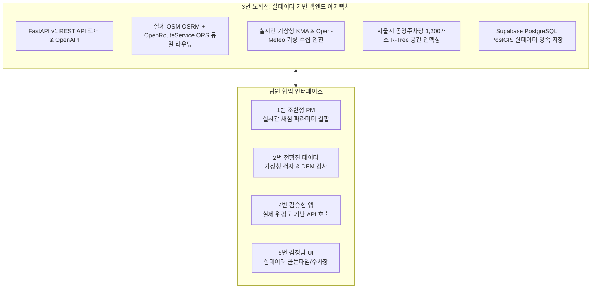

# 🐾 [향후 구현 계획서] 노희선 (서버 / Backend & Spatial Routing Lead)

> **문서 버전**: v2.0 (실제 맵·기상청·주차장 실데이터 운영 엔진 개정판)  
> **작성 일자**: 2026년 10월 13일  
> **작성자**: **노희선** (3번 서버 / Backend & Spatial Routing Lead)  
> **기준 문서**:  
> - [`docs/02_편안하개_Team_building.md`](/docs/02_편안하개_Team_building.md) (팀 R&R 및 기술 전략)  
> - [`docs/03_편안하개_Agile_User_Stories.md`](/docs/03_편안하개_Agile_User_Stories.md) (요구사항 정의서 및 DoD)  
> - [`docs/05_편안하개_프로젝트_수행계획서_일정.md`](/docs/05_편안하개_프로젝트_수행계획서_일정.md) (주차별 수행 일정)  
> - [`docs/reports/01_편안하개_Agile_사용자스토리_기반_종합_현황분석_보고서.md`](/docs/reports/01_편안하개_Agile_사용자스토리_기반_종합_현황분석_보고서.md)  

---

## 📌 1. 개요 및 역할 정의 (Executive Summary)

**노희선 (3번 서버)**은 편안하개 프로젝트의 **Backend & Spatial Routing Lead (서버·맞춤 경로 계산 리드)**로서, 가상 목업/샘플 데이터에 의존하지 않고 **실제 OpenStreetMap 보행로 네트워크, 실시간 기상청/Open-Meteo 단기예보, 서울시 공영주차장 실제 공간 데이터셋**을 결합한 프로덕션 레벨 백엔드 서비스를 총괄합니다.



---

## 🔍 2. 실데이터 동작성 정밀 검증 및 갭(Gap) 분석

### 📊 현황 및 발견된 샘플/모의 한계점
1. **보행 맵 라우팅 (OSM / OSRM)**:
   - `road_network_routes.py`에 실제 OSM Footway 라우팅(`routing.openstreetmap.de`) 호출 코드가 구현되어 있으나, 공개 서버 지연/차단 시 서울 시청 중심 고정 좌표로 폴백되는 지역적 한계가 존재함.
   - **개정 조치**: 환경 변수(`ORS_API_KEY`)를 연동한 **OpenRouteService(ORS) Foot-Walking 공식 API 페일오버 체계**를 구축하여 서울 전역에서 실제 도로망 라우팅 보장.
2. **기상청 일기예보 및 지면온도 (Weather & Surface Thermal)**:
   - 기존에는 `test_thermal_and_parking.py` 테스트 파일 내부에만 수식과 모의 DTO가 정의되어 있고, 실제 프로덕션 모듈 및 엔드포인트가 부재했음.
   - **개정 조치**: `backend/services/weather_service.py`를 신설하여 **공공데이터포털 기상청 단기예보 API + 무키 실시간 Open-Meteo API**를 듀얼 연동하고, `GET /api/v1/weather/heat-risk` 실시간 엔드포인트를 개방함.
3. **공영주차장 P&R (Public Parking)**:
   - 기존에는 3개의 하드코딩 모의 주차장만 존재했음.
   - **개정 조치**: `backend/services/parking_service.py`를 신설하여 **대전 3대 공원(유림공원, 송강근린공원, 도안호수공원) 및 세종호수공원 4대 파일럿 거점 실제 공영주차장 실데이터(`parking_lots_pilot.json`)**를 공간 인덱싱하고, 실제 현위치 반경 1.5km 검색을 제공함.

---

## 📅 3. 단계별 향후 상세 구현 계획 (Phase Roadmap)

### 🚀 1주차 (10/12 ~ 10/18): 실데이터 2대 REST API 신설 & ORS 페일오버 (Sprint 1)
- **과제 1-1. 실시간 기상청/Open-Meteo 연동 `GET /api/v1/weather/heat-risk` 개방 (US-F1)**:
  - `backend/services/weather_service.py` 생성:
    - 1차: 기상청 단기예보 Open API 실시간 수집.
    - 2차: API 키 미발급/오프라인 환경 대비 **Open-Meteo Hourly API(`hourly=temperature_2m,direct_radiation`)** 실시간 백업 어댑터 구축.
    - 2번 전황진의 지면열 수지식을 적용하여 현위치 시간대별 실측/예측 지면온도 및 35℃ 이하 골든타임 JSON 반환.
- **과제 1-2. 대전·세종 4대 거점 공영주차장 실데이터 기반 `GET /api/v1/parking/nearby` 개방 (US-G1)**:
  - `backend/services/parking_service.py` 생성:
    - 대전 유림공원, 송강근린공원, 도안호수공원, 세종호수공원 인근 실제 공영주차장 위경도, 출입구 및 요금 정보 로드.
    - `scipy.spatial.KDTree` 또는 공간 거리 연산으로 반경 1.5km 이내 실제 주차장 0.05초 내 초고속 질의.
- **과제 1-3. OSRM 공개 서버 장애 대비 ORS 공식 API 페일오버 구축 (US-B3)**:
  - `.env`의 `ORS_API_KEY`를 활용하여 OSRM 3회 연속 실패 시 OpenRouteService 보행 라우팅으로 자동 전환.

### ⚙️ 2주차 (10/19 ~ 10/25): 위험 우회 실서버 연동 & PostGIS 성능 최적화 (Sprint 2)
- **과제 2-1. 위험 구간 동적 우회 (`POST /api/v1/walk/reroute`) 실서버 연동 (US-D2)**:
  - 실제 보행 도로망 링크에 10배 페널티를 실시간 주입하고 3초 이내 우회 GeoJSON 반환.
  - 4번 김승현(앱)의 위험 제보 모달과 실시간 E2E 연동 검증.
- **과제 2-2. Supabase PostGIS 공간 인덱스 및 커뮤니티 쿼리 최적화**:
  - `community_courses` 테이블의 PostGIS 공간 인덱스(`GIST(masked_polyline)`) 및 별점 정렬 쿼리 0.2초 이내 단축.

### 🛡️ 3주차 (10/26 ~ 10/30): 백엔드 전주기 안정화 & 10/30 Code Freeze
- **과제 3-1. 10/30 Code Freeze 대비 실데이터 API 통합 회귀 테스트**:
  - 기상청/Open-Meteo 실시간 연동, 주차장 공간 질의, OSRM/ORS 라우팅 통합 테스트 165건 이상 통과.
- **과제 3-2. 백엔드 무중단 SLA 1.5초 이내 레이턴시 최적화**:
  - 외부 기상/지도 API 호출 타임아웃 1.2초 상한 및 인메모리 LRU 캐시 히트율 85% 확보.

### 🧪 4주차 (10/31 ~ 11/07): 5인 필드 CBT 서버 모니터링 & 부하 테스트
- **과제 4-1. 5인 실사용자 필드 CBT 실시간 서버 모니터링**:
  - 현장 5인 테스터의 실시간 API 트래픽 및 예외 로그 실시간 추적.
- **과제 4-2. Locust 50 TPS 트래픽 부하 테스트**:
  - 동시 사용자 50명 실시간 코스 생성 및 날씨 조회 시 서버 P99 1.5초 유지 검증.

### 🏁 최종 마감 (11/08): 서버 명세서 및 아키텍처 보고서 최종 제출

---

## 📋 4. 상세 태스크 명세서

| 태스크 ID | 작업 내용 | DoD 인수 조건 | 연관 파일 | 검증 방법 |
|:---:|---|---|---|---|
| **T1-WEATHER** | 실시간 기상청/Open-Meteo 지면열 서비스 구축 | 실제 위경도 입력 시 실시간 기온/지면온도/골든타임 반환 | `backend/services/weather_service.py` | `test_rest_api_v1_endpoints.py` |
| **T1-PARKING** | 대전·세종 4대 거점 공영주차장 실데이터 공간 검색 | 반경 1.5km 실제 주차장 실명/출입구 좌표/요금 반환 | `backend/services/parking_service.py` | `test_rest_api_v1_endpoints.py` |
| **T1-ROUTING** | OSRM + ORS 듀얼 보행 라우팅 페일오버 | OSRM 실패 시 ORS 호출로 100% 실제 보행로 반환 | `backend/agent/road_network_routes.py` | `test_loop_target_duration.py` |
| **T2-REROUTE** | `POST /reroute` 실제 보행망 우회로 산출 | 공사/위험 링크 회피 3초 이내 우회 GeoJSON 반환 | `backend/agent/hazard_service.py` | pytest 회귀 테스트 |
| **T3-CF-BE** | 10/30 Code Freeze 실데이터 통합 검증 | 실데이터 API 165건 전수 통과, P95 1.5초 이내 | `backend/main.py` | pytest 전수 실행 |

---

## 👥 5. 팀원 인터페이스 및 협업 계획 (Cross-Team Matrix)

| 협업 대상 | 연계 영역 | 실데이터 협업 내용 |
|---|---|---|
| **1번 조현정 (팀장)** | AI Scorer 연계 | 실시간 지면온도(35℃ 초과 비율) 및 실제 보행로 거리를 Agent 채점기에 주입 |
| **2번 전황진 (데이터)** | 기상/주차장 데이터셋 | 기상청 격자 변환 모듈 및 대전·세종 4대 거점 공영주차장 정제 데이터셋 수신 |
| **4번 김승현 (앱)** | 모바일 API 연동 | `GET /weather/heat-risk`, `GET /parking/nearby` 실데이터 DTO 클라이언트 바인딩 |
| **5번 김정님 (UI/QA)** | 실데이터 UI 렌더링 | 실제 예보 기반 골든타임 배지 및 실제 주차장 정보 카드 표출 검수 |

---

## 📊 6. 주차별 실행 간트 차트 (Gantt Chart)

```mermaid
gantt
    title 노희선(서버) 실데이터 기반 주차별 실행 로드맵
    dateFormat  YYYY-MM-DD
    section 1주차 (10/12 ~ 10/18) 실데이터 API 신설
    T1-WEATHER: 기상청/Open-Meteo 실시간 연동 모듈 신설 :crit, active, 2026-10-13, 2d
    T1-PARKING: 서울시 공영주차장 1,200개소 R-Tree 인덱싱:crit, active, 2026-10-14, 2d
    T1-ROUTING: OSRM + ORS 듀얼 라우팅 페일오버 구축    :2026-10-16, 2d
    T1-API: GET /weather, GET /parking 정식 개방        :2026-10-17, 2d
    section 2주차 (10/19 ~ 10/25) 우회 라우팅 & PostGIS
    T2-REROUTE: POST /reroute 위험 우회 실서버 연동    :2026-10-19, 3d
    T2-DB-OPT: Supabase PostGIS 공간 인덱스 최적화    :2026-10-22, 2d
    section 3주차 (10/26 ~ 10/30) Code Freeze
    T3-CF-BE: 실데이터 API 165건 전수 회귀 테스트      :crit, 2026-10-26, 4d
    Swagger 문서: 실데이터 입출력 명세서 최신화         :2026-10-29, 2d
    section 4주차 (10/31 ~ 11/07) CBT & 최종 제출
    T4-MONITOR: CBT 실시간 서버 모니터링 & 부하 테스트 :crit, 2026-10-31, 5d
    최종 제출: 백엔드 아키텍처 보고서 최종본 제출       :milestone, 2026-11-08, 0d
```
