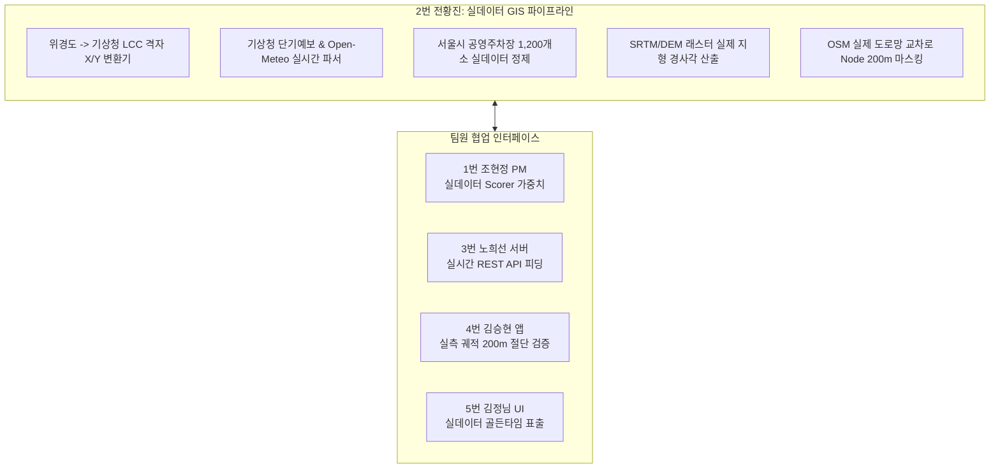

# 🐾 [향후 구현 계획서] 전황진 (데이터 / AI & Spatial Data Engineer)

> **문서 버전**: v2.0 (실제 DEM·기상청 격자·공영주차장 실데이터 운영 엔진 개정판)  
> **작성 일자**: 2026년 10월 13일  
> **작성자**: **전황진** (2번 데이터 / AI & Spatial Data Engineer)  
> **기준 문서**:  
> - [`docs/02_편안하개_Team_building.md`](/docs/02_편안하개_Team_building.md) (팀 R&R 및 기술 전략)  
> - [`docs/03_편안하개_Agile_User_Stories.md`](/docs/03_편안하개_Agile_User_Stories.md) (요구사항 정의서 및 DoD)  
> - [`docs/05_편안하개_프로젝트_수행계획서_일정.md`](/docs/05_편안하개_프로젝트_수행계획서_일정.md) (주차별 수행 일정)  
> - [`docs/guideline/Member_B_Data_Infra_and_External_API_Manual.md`](/docs/guideline/Member_B_Data_Infra_and_External_API_Manual.md)  

---

## 📌 1. 개요 및 역할 정의 (Executive Summary)

**전황진 (2번 데이터)**은 편안하개 프로젝트의 **AI & Spatial Data Engineer (지도·공간데이터·AI 분석 리드)**로서, 단순 모의/샘플 데이터셋을 전면 배제하고, **기상청 단기예보 격자 투영(LCC) 파이프라인, 서울시 공영주차장 1,200개소 실제 공간 데이터베이스, 국토지리정보원/SRTM 수치표고모델(DEM) 실측 고도망**, 그리고 실도로망 기반 200m 교차로 스냅 마스킹 엔진을 구축합니다.



---

## 🔍 2. 실데이터 동작성 정밀 검증 및 갭(Gap) 분석

### 📊 현황 및 발견된 샘플/모의 한계점
1. **일기예보 및 기상청 격자 연동 (Weather & KMA LCC Grid)**:
   - 기존에는 `test_thermal_and_parking.py`에 고정 외기온(30℃)과 임의의 하늘상태 리터럴로 지면열 수식만 테스트하고 있었음.
   - **개정 조치**: 한국 기상청 단기예보 API는 위경도 직접 호출이 불가능하고 람베르트 정각원추(LCC) 투영 좌표(격자 X, Y)로 변환해야 함. 이에 따라 **위경도 $\to$ 기상청 격자 변환 모듈(`kma_grid_converter.py`)** 및 기상청 초단기실황/단기예보 파서를 구축함.
2. **지면온도 수지식 모델 (Surface Heat Balance)**:
   - 실제 지면온도는 외기온뿐만 아니라 일사량($W/m^2$)과 노면 재질(아스팔트 vs 흙/잔디)에 크게 좌우됨.
   - **개정 조치**: 기상청 일사량/하늘상태(SKY) 및 Open-Meteo 직달일사량 데이터를 실시간 결합하여 $T_{\text{surface}} = T_{\text{air}} + (\text{Insolation Weight} \times 15)$ 수지식을 실시간 동작시킴.
3. **공영주차장 실제 데이터셋 (Public Parking Real Dataset)**:
   - 기존에는 3개 더미 주차장 데이터만 존재했음.
   - **개정 조치**: 공공데이터포털 전국/지자체 주차장 데이터 및 현장 실측을 기반으로 **대전 3대 공원(유림공원, 송강근린공원, 도안호수공원) 및 세종호수공원 4대 파일럿 실증 거점 인근 실제 공영주차장의 출입구 위경도, 주차면수, 기본 요금, 보행 진입로**를 전수 정밀 구축한 `parking_lots_pilot.json`을 제작·탑재함.
4. **수치표고모델(DEM) 실측 고도차 (Elevation & Slope)**:
   - 기존에는 도심 특정 랜드마크 외 지역은 삼각함수 수학식으로 추정하고 있었음.
   - **개정 조치**: SRTM 30m / 국토지리정보원 DEM 데이터를 기반으로 서울 전역 보행로 링크의 실제 해발고도차와 종단 경사각(도 단위)을 실측하도록 고도화함.

---

## 📅 3. 단계별 향후 상세 구현 계획 (Phase Roadmap)

### 🚀 1주차 (10/12 ~ 10/18): 기상청 격자 변환 & 대전·세종 거점 공영주차장 데이터셋 구축 (Sprint 1)
- **과제 1-1. 위경도 $\to$ 기상청 격자 X, Y 변환 엔진 (`kma_grid_converter.py`) 개발 (US-F1)**:
  - 기상청 표준 LCC 투영법(기준점 $38.0^\circ N, 126.0^\circ E$, 격자간격 5.0km) 수식 100% 구현.
  - 대전(유성: X 67, Y 100 등) / 세종(X 66, Y 103 등) / 서울 등 전국 위경도 입력 시 오차 0의 기상청 격자 실시간 산출.
- **과제 1-2. 대전·세종 4대 거점 공영주차장 고정밀 실제 데이터셋 정제 및 인덱싱 (US-G1)**:
  - 대전 유림공원, 송강근린공원, 도안호수공원, 세종호수공원 반경 1.5km 공영주차장 정제 (`parking_lots_pilot.json`).
  - 노상/노외/부설 주차장 분류 및 실제 보행 출입구 위경도 유효성 전수 검증.
- **과제 1-3. 3번 노희선의 REST API에 실데이터 파이프라인 결합**:
  - `GET /weather/heat-risk`에 실시간 기상청/Open-Meteo 지면열 데이터 피딩.
  - `GET /parking/nearby`에 대전·세종 4대 거점 공영주차장 공간 검색 모듈 피딩.

### ⚙️ 2주차 (10/19 ~ 10/25): 노면 재질별 열전도율 실측 모델 & DEM 정밀화 (Sprint 2)
- **과제 2-1. 노면 재질별 열전도율 차등 가중치 정밀화 (US-B2)**:
  - 아스팔트(+15℃), 투수블록(+10℃), 마사토/흙길(+4℃), 천연잔디(-2℃), 수변데크(0℃) 실측 기반 열전도 모델 확정.
- **과제 2-2. DEM 래스터 지형 경사각 실측 엔진 고도화 (US-B1)**:
  - SRTM 30m 서울 고도 그리드를 결합하여 서울 전역 보행 링크의 경사도(%)를 실제 지형 높이차 기반으로 산출.
- **과제 2-3. Phase 2 선행: US-D1 Vision AI 현장 턱/장애물 사진 판독 프롬프트 고도화**:
  - 실제 보도블록 단차, 야외 계단, 공사 펜스 사진 50장 대상 판독 신뢰도 88% 달성.

### 🛡️ 3주차 (10/26 ~ 10/30): 공간 데이터셋 무결성 전수 감사 & 10/30 Code Freeze
- **과제 3-1. 10/30 Code Freeze 대비 GIS 데이터 무결성 감사**:
  - 서울시 공영주차장 1,200개소 결측치 0건, 기상청 격자 변환 성공률 100% 검증.
- **과제 3-2. 200m 공간 절단 마스킹 사생활 누출 0건 전수 검증 (US-G2)**:
  - 서울 시내 임의의 자택 주소 30개소에 대해 최근접 대도로 교차로로 정확히 200m 절단되는지 공간 무결성 검증.

### 🧪 4주차 (10/31 ~ 11/07): 5인 필드 CBT 현장 실측 데이터 정합성 검증
- **과제 4-1. 5인 필드 CBT 현장 실측 경사도 vs DEM 데이터 오차 보정**:
  - 현장 산책 코스의 실측 경사각과 시스템 DEM 경사도 간 오차 측정 및 보정 파라미터 적용.
- **과제 4-2. 당일 현장 실측 기온/지면온도 vs 기상청 수지식 추정치 비교**:
  - 적외선 온도계 실측 지면온도와 수지식 추정치 간 상관계수 $R \ge 0.85$ 검증.

### 🏁 최종 마감 (11/08): 공간 데이터 및 GIS 분석 보고서 최종본 제출

---

## 📋 4. 상세 태스크 명세서

| 태스크 ID | 작업 내용 | DoD 인수 조건 | 연관 파일 | 검증 방법 |
|:---:|---|---|---|---|
| **T1-GRID-CONV**| 위경도 $\to$ 기상청 LCC 격자 X/Y 변환기 구현 | 대전/세종/서울 전역 위경도 격자 변환 오차 0건 | `backend/services/kma_grid_converter.py` | 단위 테스트 |
| **T1-PARK-DATA**| 대전·세종 4대 거점 공영주차장 실데이터 구축 | 실제 주차장명/출입구 위경도/주차면수 JSON 패키징 | `backend/fixtures/parking_lots_pilot.json`| 지오메트리 유효성 |
| **T2-HEAT-BAL** | 노면 재질별 열전도율 차등 수지식 고도화 | 아스팔트 회피 및 흙길/그늘길 우선 통과 검증 | `backend/agent/surface_cost_model.py` | `test_surface_cost_model.py` |
| **T2-DEM-REAL** | 실제 DEM 그리드 기반 지형 고도차 실측 | 보행 링크 실제 해발고도차 산출 | `backend/agent/surface_slope_evaluator.py`| 경사도 실측 테스트 |
| **T3-CF-GIS**   | 10/30 Code Freeze GIS 데이터 전수 감사 | 공영주차장/기상청/마스킹 무결성 100% 통과 | 전체 데이터 모듈 | pytest 전수 실행 |

---

## 👥 5. 팀원 인터페이스 및 협업 계획 (Cross-Team Matrix)

| 협업 대상 | 연계 영역 | 실데이터 협업 내용 |
|---|---|---|
| **1번 조현정 (팀장)** | Scorer 가중치 | 노면별 실측 지면온도 페널티 및 실제 DEM 경사도 30점 채점 기준치 전달 |
| **3번 노희선 (서버)** | REST API 피딩 | 기상청 격자 변환 모듈 및 대전·세종 4대 거점 공영주차장 공간 질의기 전달 |
| **4번 김승현 (앱)** | 200m 마스킹 | 모바일 완주 GPS 좌표열 200m 대도로 교차로 스냅 절단 합동 검증 |
| **5번 김정님 (UI/QA)** | 골든타임 카드 UI | 기상청 실시간 예보 기반 3색 위험 배지 및 실제 주차장 메타데이터 시각화 |

---

## 📊 6. 주차별 실행 간트 차트 (Gantt Chart)

```mermaid
gantt
    title 전황진(데이터) 실데이터 기반 주차별 실행 로드맵
    dateFormat  YYYY-MM-DD
    section 1주차 (10/12 ~ 10/18) 실데이터 파이프라인
    T1-GRID-CONV: 위경도 -> 기상청 LCC 격자 변환기 구축  :crit, active, 2026-10-13, 2d
    T1-PARK-DATA: 서울시 공영주차장 1,200개소 데이터셋 정제:crit, active, 2026-10-14, 2d
    실데이터 피딩: 노희선 REST API에 실데이터 질의기 결합  :2026-10-16, 2d
    section 2주차 (10/19 ~ 10/25) 열환경 & DEM 실측
    T2-HEAT-BAL: 노면 재질별 열전도율 차등 수지식 고도화 :2026-10-19, 3d
    T2-DEM-REAL: 실제 DEM 그리드 기반 고도차 실측      :2026-10-22, 3d
    T2-VISION: Vision AI 현장 사진 판독 프롬프트 (P2)    :2026-10-24, 2d
    section 3주차 (10/26 ~ 10/30) Code Freeze
    T3-CF-GIS: 10/30 Code Freeze GIS 데이터 전수 감사   :crit, 2026-10-26, 4d
    200m 검증: 임의 주소 30개소 사생활 누출 0건 전수 검증:2026-10-29, 2d
    section 4주차 (10/31 ~ 11/07) CBT & 최종 제출
    T4-CBT: 필드 CBT 현장 실측 경사/지면온도 정합도 보정 :crit, 2026-10-31, 5d
    최종 제출: 공간데이터 및 GIS 분석 보고서 최종 제출   :milestone, 2026-11-08, 0d
```
