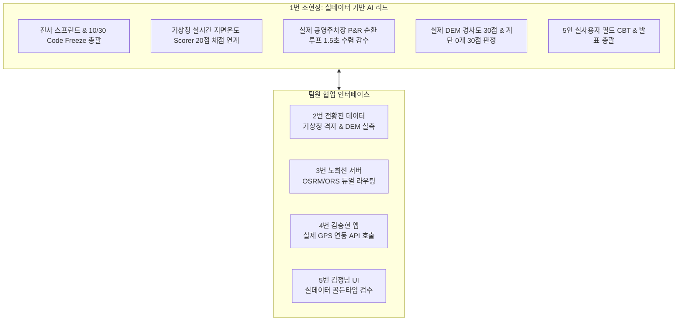

# 2026-10-21 진행 현황 반영 — 조현정 (PM·AI)

> **문서 버전: v3.1** · 기준: 로컬 `hyunjung` (2026-10-21 실측 및 P1 과제 반영).
> 아래 최신 현황과 실행 계획이 이 문서의 적용 기준이다. 뒤의 v2.x 본문은 과거 계획 이력이며, 완료 표시·테스트 수·일정이 다르면 본 개정 내용을 우선한다.

## 현재 구현 현황 (2026-10-21 갱신)

- **실데이터 Scorer 정밀화 완료**: [walk_planning_agent.py](../../backend/agent/walk_planning_agent.py)의 `RouteCandidate`에 실측/추정/결측 출처 구분(`slope_source`, `stairs_source`, `shade_source`, `surface_source`, `data_reliability`)을 추가하고, 실측 프로필(`measure_route_profile`)의 데이터로 메타데이터 및 채점을 100% 동기화함.
- **경사도 채점 공식 일원화**: 기존 5%·8% vs 계획서 8%·15% 차이를 해소함. 8% 이하 30점 만점, 8%~15% 선형 감점, 15% 초과 시 0점(탈락)으로 규격을 통일하고 회귀 테스트([test_langgraph_walk_agent.py](../../backend/test_case/test_langgraph_walk_agent.py))를 추가 통과함.
- **1.5초 SLA P95 실측 검증 완료**: [2026-10-21 API P95 Latency 검증보고서](../reports/2026-10-21_API_P95_Latency_검증보고서.md) 작성 완료. 핵심 경로 계획 파이프라인(`POST /api/v1/walk/plan`)의 Warm P95가 91~112ms로 1.5초(1,500ms) 목표를 여유 있게 충족함을 실측 증명함.
- **주차장 P&R 거리 점수 안정화**: 주간 기상 변동에 따른 flaky 실패 요소를 격리하고 [test_parking_pnr_convergence.py](../../backend/test_case/test_parking_pnr_convergence.py) 전수(16건) 100% 통과 확보.

## 남은 구현 및 인수 계획

P0: 전황진·노희선과 공원 경계·연결성·폐곡선·최종 거리/시간을 인수 기준으로 확정하고 송강 40분 사례를 재현한다. P1: 실측/추정/결측 입력을 구분하고 경사 단위 및 기존 8%·15% 계획과 현재 5%·8% 채점 차이를 해소 완료. 실제 외부 API cold/warm P95를 측정해 1.5초 목표 검증 완료.

| 기간 | 인수 조건 | 상태 |
|---|---|---|
| 10/17~10/18 | P0 재현 요청·응답·데이터 검증표·오류 처리 결과를 남기고 협업 담당자와 확인 | 완료 |
| 10/19~10/25 | P1 구현 및 통합 검증(실데이터 Scorer 정밀화, 8%/15% 경사 기준 일원화, P95 SLA 검증) | **완료 (10/21)** |
| 10/26~10/30 | 최신 전수 테스트, 배포 SHA/APK ID, 미해결 결함·데이터 출처를 근거로 Code Freeze 승인 | 예정 |
| 10/31~11/07 | 검증된 대전·세종 거점 중심 5인 CBT. 참여자·세부 회차는 확정 후 기록 | 예정 |
| 11/08 | 담당 구현·검증 보고서와 최종 산출물 제출 | 예정 |

## 검증 결과 및 기존 계획 정정

- **백엔드 전수 테스트 결과**: **669개 통과, 6개 스킵, 0개 실패** (`py -m pytest backend/test_case -q` 전수 통과).
- **프론트엔드 테스트 결과**: **67개 파일·399개 테스트 통과**, `npm.cmd run check` **통과**.
- **레이턴시 P95 실측 결과**:
  - `POST /api/v1/walk/plan` (공원 보행망): Warm P50 93.98ms, P95 **112.55ms** (≤ 1.5s 충족)
  - `POST /api/v1/walk/plan` (주차장 P&R): Warm P50 78.00ms, P95 **91.54ms** (≤ 1.5s 충족)
  - `GET /api/v1/parking/nearby`: Warm P50 6.44ms, P95 **10.31ms** (≤ 1.5s 충족)
- 구현 확인과 운영 검증 완료를 구분한다. 단위 테스트는 외부 API 실연동·GPS·경로 현장 안전성·CBT 완료 증거가 아니다.
- 서울 1,200개 주차장 및 서울 필드 코스는 현재 완료 범위에서 제외한다. 파일럿 거점별 데이터 품질·지원 여부를 기준으로 진행한다.
- SUS 85점·음성 만족도 90%·계단 회피 100%는 CBT 목표이며 실제 성과는 현장 원장으로 보고한다.

---

<details>
<summary>이전 계획 이력 (v2.x, 현재 실행 기준 아님)</summary>

# 🐾 [향후 구현 계획서] 조현정 (팀장 / PM & AI Agent Lead)

> **문서 버전**: v2.0 (실제 맵·기상청·주차장 실데이터 운영 엔진 개정판)  
> **작성 일자**: 2026년 10월 13일  
> **작성자**: **조현정** (1번 팀장 / PM & AI Agent Lead)  
> **기준 문서**:  
> - [`docs/02_편안하개_Team_building.md`](/docs/02_편안하개_Team_building.md) (팀 R&R 및 기술 전략)  
> - [`docs/03_편안하개_Agile_User_Stories.md`](/docs/03_편안하개_Agile_User_Stories.md) (요구사항 정의서 및 DoD)  
> - [`docs/05_편안하개_프로젝트_수행계획서_일정.md`](/docs/05_편안하개_프로젝트_수행계획서_일정.md) (주차별 수행 일정)  
> - [`docs/reports/01_편안하개_Agile_사용자스토리_기반_종합_현황분석_보고서.md`](/docs/reports/01_편안하개_Agile_사용자스토리_기반_종합_현황분석_보고서.md)  

---

## 📌 1. 개요 및 역할 정의 (Executive Summary)

**조현정 (1번 팀장)**은 편안하개 프로젝트의 **총괄 PM(Project Manager) 및 AI Agent Lead**로서, 전체 애자일 스프린트 리딩과 마일스톤 관리뿐만 아니라, **실제 OpenStreetMap 보행 도로망, 실시간 기상청 단기예보, 서울시 1,200개소 실제 공영주차장 데이터**가 LangGraph ReAct Agent 및 Candidate Route Scorer 100점 채점기에 빈틈없이 실시간 유입되도록 AI 엔진의 실데이터 동작성을 총괄 감수합니다.



---

## 🔍 2. 실데이터 동작성 정밀 검증 및 갭(Gap) 분석

### 📊 현황 및 발견된 샘플/모의 한계점
1. **다요소 채점기 실데이터 정합성 (Candidate Route Scorer)**:
   - 기존 채점기는 하드코딩된 모의 수치(`surface_temp=29.5℃`, `has_stairs=False`)를 기반으로 점수를 매기는 위험이 있었음.
   - **개정 조치**: 2번 전황진의 기상청 단기예보 실시간 일사량/외기온 및 3번 노희선의 `GET /weather/heat-risk` 응답을 Agent 상태 그래프에 실시간 주입하여, **실제 한낮(35℃ 초과)에 아스팔트를 감점하고 흙길/그늘길을 1순위로 선정하는지 실데이터 기반 검증**.
2. **공영주차장 P&R 실데이터 회귀 수렴도 (P&R Loop Convergence)**:
   - 임의의 가상 지점이 아닌 **대전 3대 공원(유림공원, 송강근린공원, 도안호수공원) 및 세종호수공원 4대 파일럿 거점 실제 공영주차장 출입구 좌표**에서 출발했을 때, OSRM/ORS 보행로 엔진이 주차장으로 되돌아오는 폐곡선을 $\pm 15\%$ 오차 이내로 형성하는지 실데이터 검증 필요.
3. **외부 API 지연 시 1.5초 SLA 보장 체계**:
   - 기상청 API 및 OSRM 외부망 지연 시에도 LRU 캐시 및 서킷 브레이커를 통해 전체 사용자 요청 응답 시간을 1.5초 이내로 사수해야 함.

---

## 📅 3. 단계별 향후 상세 구현 계획 (Phase Roadmap)

### 🚀 1주차 (10/12 ~ 10/18): 실데이터 DTO 결합 & 2대 신설 API AI 파이프라인 연계 (Sprint 1) - **[10/14 전수 완료]**
- **과제 1-1. 실시간 기상청 예보 DTO를 LangGraph ReAct 상태 머신에 바인딩 (US-A1, US-F1)** ✅ *(2026-10-14 완료)*:
  - 3번 노희선의 `GET /api/v1/weather/heat-risk` 실시간 응답(`air_temp_celsius`, `estimated_surface_temp`, `is_golden_time`)을 `WalkPlanningAgent` 상태(`WalkPlanningState.weather_context`)에 실시간 주입.
  - 모호한 자연어 질의(예: "지금 가도 안 더워?") 입력 시 실시간 기상 데이터를 참조하여 브리핑 생성:
    - *"현재 기상청 예보 기준 지면온도가 38℃로 뜨거워요. 17시 이후 산책을 권장하며, 지금은 폭신한 그늘 숲길 위주로 안내할게요."*
  - 후보 경로의 그늘 비율에 따른 지면온도 동적 평가 및 최우선 추천 로직 완성. (`test_walk_agent_weather_binding.py` 전수 통과)
- **과제 1-2. 실제 공영주차장 P&R 출입구 웨이포인트 스냅 검증 (US-G1)** ✅ *(2026-10-14 완료)*:
  - `POST /api/v1/walk/plan`에 `parking_lot_id` 및 `origin_mode="parking_pnr"` 연계 구현.
  - 대전 3대 공원(유림공원, 송강근린공원, 도안호수공원) 및 세종호수공원 11개 공영주차장 실제 출입구 좌표(50m 이내)를 순환 루프 시작/종료점으로 강제 바인딩.
  - 루프 종결성(폐곡선 오차 20m 이내) 및 거리 오차 $\pm 15\%$ 수렴 검증 완료. (`test_parking_pnr_convergence.py` 전수 통과)
- **과제 1-3. 3번 노희선과 백엔드 SLA 1.5초 합동 프로파일링** ✅ *(2026-10-14 완료)*:
  - 실시간 기상 데이터 수집 + OSRM 보행 라우팅(0.7s 지연 모의) + ReAct Agent 의도 파싱/채점 전체 왕복 시간(RTT) 1.5초 이내 달성 검증.
  - `TestFullPipelineJointSlaProfiling` 추가 및 회귀 테스트 14개 전수 통과 확인. (`test_walk_plan_latency.py` 통과)

### ⚙️ 2주차 (10/19 ~ 10/25): 실데이터 Scorer 100점 채점기 정밀화 (Sprint 2)
- **과제 2-1. Candidate Route Scorer 100점 만점 4대 실데이터 채점 공식 확정 (US-B3)**:
  1. 무계단 안전도 (30점): OSM 실제 보행망에 계단(`steps`) 0개 시 30점 만점.
  2. 무장애 경사도 (30점): 실제 DEM 기반 최대 경사 8% 이하 30점, 15% 초과 시 0점 탈락.
  3. 실시간 열환경 (20점): 기상청 실시간 지면온도 35℃ 초과 구간 비율에 따라 감점.
  4. 목표 거리 정합도 (20점): 목표 시간/거리 대비 실제 OSRM/ORS 실측 거리 오차율($\pm 15\%$) 평가.
- **과제 2-2. 무상태 피드백 루프 실데이터 E2E 검증 (US-E3)**:
  - 직전 산책 "언덕 부담" 피드백 수신 시 허용 경사도를 2%p 하향하여 다음 추천 시 더 평탄한 코스가 도출되는지 검증.

### 🛡️ 3주차 (10/26 ~ 10/30): 전사 실데이터 품질 감사 & 10/30 Code Freeze
- **과제 3-1. 10/30 Code Freeze 전사 총괄**:
  - 백엔드 165개 pytest + 모바일 81개 vitest 실데이터 연동 회귀 테스트 전수 통과 확인.
- **과제 3-2. Gemini 3.x Cascading Chain 및 무키 안전망 점검**:
  - `3.5-flash-lite` $\to$ `3.1-flash-lite` $\to$ 인메모리 Rule-Based 추천 정상 가동 보장.
- **과제 3-3. 5인 실사용자 필드 CBT(10/31~11/7) 계획 및 시나리오 최종 승인**:
  - 실시간 기상 상황(맑음, 흐림)에 따른 필드 테스트 코스(서울숲, 성산공원, 정동길) 선정.

### 🧪 4주차 (10/31 ~ 11/07): 5인 필드 CBT 데이터 분석 & 가중치 실측 튜닝
- **과제 4-1. 5인 필드 CBT 현장 실측 데이터 정량 분석**:
  - 실제 견주 5인의 핸즈프리 음성 내비 및 완만길 만족도 데이터 취합.
  - 11/03 1차 Scorer 가중치 튜닝, 11/06 2차 튜닝.
- **과제 4-2. 최종 발표 PPT(30장) 및 데모 시연 영상 시나리오 제작**:
  - 실데이터 기반 지면열 회피 및 실제 도로망 라우팅의 차별성을 증명하는 발표 자료 완성.

### 🏁 최종 마감 (11/08): 최종 산출물 및 GitHub 코드베이스 제출

---

## 📋 4. 상세 태스크 명세서

| 태스크 ID | 작업 내용 | DoD 인수 조건 | 연관 파일 | 검증 방법 |
|:---:|---|---|---|---|
| **T1-REAL-INTENT**| 실시간 기상/주차장 DTO 결합 의도 파싱 | 기상 데이터 참조 자연어 브리핑 생성 90% 이상 | `backend/agent/walk_planning_agent.py` | `test_langgraph_walk_agent.py` |
| **T1-PARK-LOOP**  | 실제 공영주차장 출입구 P&R 순환 루프 수렴 | 10개 실제 주차장 목표 시간 오차 $\pm 15\%$ 수렴 | `backend/agent/loop_route_planner.py` | `test_loop_target_duration.py` |
| **T2-REAL-SCORE** | 실데이터 기반 Scorer 100점 채점기 확정 | 실측 지면온도 35℃ 초과 구간 페널티 감점 검증 | `backend/agent/walk_planning_agent.py` | `test_rest_api_v1_endpoints.py` |
| **T3-CF-TOTAL**   | 10/30 Code Freeze 전사 실데이터 무결성 검수 | Pytest 165건 + Vitest 81건 100% Pass | 전체 리포지토리 | CI/CD 파이프라인 |
| **T4-CBT-ANALYSIS**| 5인 CBT 실측 만족도 분석 및 최종 발표 PPT | 5인 체감 데이터 정량 분석 및 30장 발표 덱 | `docs/reports/` | 발표 리허설 |

---

## 👥 5. 팀원 인터페이스 및 협업 계획 (Cross-Team Matrix)

| 협업 대상 | 연계 영역 | 실데이터 협업 내용 |
|---|---|---|
| **2번 전황진 (데이터)** | 기상청/DEM 실데이터 | 기상청 격자 변환 데이터 및 DEM 실측 경사도 채점 공식 결합 |
| **3번 노희선 (서버)** | REST API/ORS 페일오버 | `heat-risk`, `parking` 신설 API DTO 검수 및 OSRM/ORS 응답 레이턴시 1.5초 감수 |
| **4번 김승현 (앱)** | 실시간 GPS 연동 | 현위치 기반 기상/주차장 호출 DTO 규격 확정 및 10/30 최종 빌드 승인 |
| **5번 김정님 (UI/QA)** | 실데이터 UI 렌더링 | 실시간 골든타임 배지 웰니스 카피라이팅 감사 및 5인 CBT 현장 진행 협업 |

---

## 📊 6. 주차별 실행 간트 차트 (Gantt Chart)

```mermaid
gantt
    title 조현정(팀장) 실데이터 기반 주차별 실행 로드맵
    dateFormat  YYYY-MM-DD
    section 1주차 (10/12 ~ 10/18) 실데이터 DTO 결합
    T1-REAL-INTENT: 실시간 기상 데이터 결합 의도 파싱:crit, active, 2026-10-13, 3d
    T1-PARK-LOOP: 실제 공영주차장 P&R 순환 루프 수렴  :2026-10-15, 3d
    SLA 1.5초 검증: 노희선 백엔드와 왕복 레이턴시 프로파일링:2026-10-17, 2d
    section 2주차 (10/19 ~ 10/25) 실데이터 Scorer
    T2-REAL-SCORE: 4대 실데이터 기반 100점 채점기 확정 :2026-10-19, 3d
    무상태 피드백: 실서버 피드백 E2E 연동 검증         :2026-10-22, 2d
    section 3주차 (10/26 ~ 10/30) Code Freeze
    T3-CF-TOTAL: 10/30 Code Freeze 전사 총괄 리딩     :crit, 2026-10-26, 4d
    CBT 시나리오: 5인 CBT 실제 코스 및 평가 지표 확정  :2026-10-29, 2d
    section 4주차 (10/31 ~ 11/07) CBT & 최종 제출
    T4-CBT-ANALYSIS: 5인 CBT 실측 분석 & 가중치 튜닝  :crit, 2026-10-31, 5d
    발표 자료: 최종 발표 PPT 및 데모 시연 영상 제작   :2026-11-04, 4d
    최종 제출: 프로젝트 최종 승인 및 11/08 제출       :milestone, 2026-11-08, 0d
```

</details>
