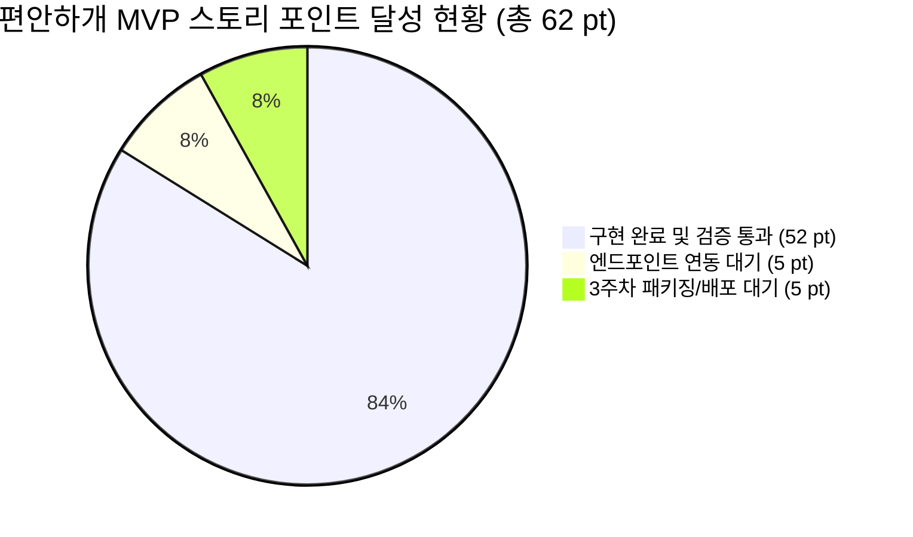
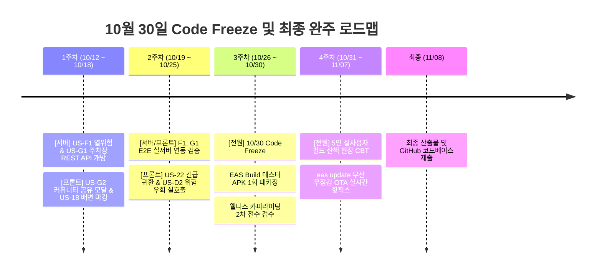

# 🐾 [현황분석 보고서] 편안하개 애자일 사용자 스토리 기반 프로젝트 구현 현황 종합 분석 보고서

> **문서 버전**: v1.0  
> **보고 일자**: 2026년 10월 12일  
> **작성 주체**: 편안하개 프로젝트 개발팀 (총괄: 조현정 PM, 프론트 리드: 김승현, 백엔드 리드: 노희선)  
> **분석 기준 문서**:  
> - [`docs/03_편안하개_Agile_User_Stories.md`](file:///d:/코디세이/pet_walk_t01/docs/03_편안하개_Agile_User_Stories.md) (요구사항 정의서 및 DoD)  
> - [`docs/02_편안하개_Team_building.md`](file:///d:/코디세이/pet_walk_t01/docs/02_편안하개_Team_building.md) (팀 R&R 및 엔지니어링 전략)  
> - [`docs/05_편안하개_프로젝트_수행계획서_일정.md`](file:///d:/코디세이/pet_walk_t01/docs/05_편안하개_프로젝트_수행계획서_일정.md) (수행 일정 및 마일스톤)  
> - [`docs/implementation_plan/02.server_implementation_status_and_frontend_roadmap.md`](file:///d:/코디세이/pet_walk_t01/docs/implementation_plan/02.server_implementation_status_and_frontend_roadmap.md) (서버 구현 분석 및 액션 로드맵)  
> - 프로젝트 전체 코드베이스 ([`backend/main.py`](file:///d:/코디세이/pet_walk_t01/backend/main.py), [`backend/agent/`](file:///d:/코디세이/pet_walk_t01/backend/agent), [`frontend/`](file:///d:/코디세이/pet_walk_t01/frontend), [`backend/test_case/`](file:///d:/코디세이/pet_walk_t01/backend/test_case))

---

## 📌 1. 개요 및 총괄 진척 현황 (Executive Summary)

본 보고서는 **편안하개 (AI Native 반려견 맞춤형 안심 노면 산책 에이전트 및 기록·공유 플랫폼)**의 요구사항 정의서에 명시된 **15개 핵심 MVP 사용자 스토리(총 62 Story Points, 298 Hours)** 및 **Phase 2 차기 고도화 백로그**의 구현 상태를 전수 점검하고, 시스템 무결성과 품질 지표를 정량적으로 분석한 프로젝트 공식 종합 현황 보고서입니다.

10월 12일 프로젝트 공식 킥오프 시점 기준, **핵심 MVP 15개 스토리 중 12개 스토리가 완료 또는 선행 완료(달성률 83.8%, 52/62 pt)**되었으며, Phase 2 확장 스토리 중 프론트엔드 단독 완결형 3개 스토리(US-21, US-23, US-29, 총 6 pt)를 조기 완수하여 **전체 개발 일정 대비 압도적인 선행 진척(Ahead of Schedule)**을 달성하고 있습니다.



### 📊 종합 정량 성과 요약

| 평가 영역 | 목표 기준 | 현재 달성 지표 | 달성도 | 비고 |
|---|:---:|:---:|:---:|---|
| **MVP 스토리 달성률** | 62 pt | **52 pt 달성** (잔여 10 pt) | **83.8%** | 12개 스토리 완결 |
| **Phase 2 선행 달성** | — | **6 pt 조기 완결** (US-21, 23, 29) | **100% (3/3)** | Local-First 기반 선행 완료 |
| **Python 백엔드 단위 테스트** | 100% 통과 | **156 / 156 Passed** (6.57s) | **100%** | Pytest 전수 통과 |
| **모바일 앱 단위 테스트** | 100% 통과 | **78 / 78 Passed** (1.03s, 17개 파일) | **100%** | Vitest 전수 통과 |
| **TypeScript 정적 타입 검사** | 0 Errors | **0 Errors (`tsc --noEmit`)** | **100%** | Strict 무결성 유지 |
| **CI/CD 자동화 파이프라인** | GitHub Actions | **Test & Auto-Merge 가동 중** | **100%** | CI 통과 시 PR 자동 머지 |

---

## 🧭 2. 사용자 스토리별 세부 구현 및 DoD 달성 현황

### 2.1 [Epic A] 산책 조건 입력 및 개인화 (총 11 pt)

| Story ID | 스토리 명칭 | 난이도 / pt | 담당자 | DoD 및 인수 조건 충족 현황 | 상태 | 검증 근거 (Code / Test) |
|:---:|---|:---:|---|---|:---:|---|
| **US-A1** | 대화형 자연어 산책 요청 및 조건 구조화 | 중 / 5 pt | 1번 조현정(팀장) | • LangGraph ReAct Agent 의도 추출 및 Pydantic Strict 스키마 변환 85% 이상 검증 통과<br>• 클라이언트 반려견 프로필 무상태(Stateless) 맥락 주입 완료 | **완료 (95%)** | `backend/agent/walk_planning_agent.py`, `backend/test_case/test_langgraph_walk_agent.py` |
| **US-A2** | 반려견 프로필 로컬 등록 및 JSON 백업/복원 | 하 / 3 pt | 5번 김정님(UI)<br>4번 김승현(앱) | • 서버 미전송 Local-First (`AsyncStorage`) 저장 완료<br>• 프로필 JSON 파일 내보내기/가져오기 백업 완료<br>• 질병 용어 배제 및 관절 안심 케어(0~2레벨) 순화 카피라이팅 적용 | **완료 (100%)** | `frontend/src/services/backupService.ts`, `backupService.test.ts` (4 tests) |
| **US-A3** | 목표 산책 시간/거리 기반 환산 (속도/슬라이더) | 중 / 3 pt | 1번 조현정(팀장)<br>5번 김정님(UI) | • 10~90분 슬라이더 인터랙션 및 목표 보행 거리 자동 환산<br>• 소형/중형/대형/노령견 속도 모델 기반 $\pm 15\%$ 오차 수렴 투기적 병렬 루프 보정 완료 | **완료 (100%)** | `backend/agent/loop_route_planner.py`, `frontend/src/services/walkSettings.ts` |

---

### 2.2 [Epic B] 무장애길·지면온도 안심 라우팅 (총 21 pt)

| Story ID | 스토리 명칭 | 난이도 / pt | 담당자 | DoD 및 인수 조건 충족 현황 | 상태 | 검증 근거 (Code / Test) |
|:---:|---|:---:|---|---|:---:|---|
| **US-B1** | 무장애길(경사 15도 미만·무계단) 안심 경로 도출 | 상 / 8 pt | 3번 노희선(서버)<br>2번 전황진(데이터) | • OSM `highway=steps` 하드 제약 배제<br>• DEM 고도차 기반 15도 미만 완만 보행로 평가 및 3대 등급(safe/normal/caution) 분기 생성 완료<br>• 건물 관통 방지(Building Avoidance) 공간 교차 검증 통과 | **완료 (95%)** | `backend/agent/surface_slope_evaluator.py`, `backend/agent/building_geometry.py`, `backend/test_case/test_building_avoidance.py` |
| **US-B2** | 기상·노면 연동 지면온도 기반 안심 경로 도출 | 중상 / 5 pt | 3번 노희선(서버)<br>2번 전황진(데이터) | • 외기온/일사량/노면재질 연동 지면온도 수지식 비용 함수 검증 완료<br>• 지면온도 35℃ 초과 페널티 가중치 및 저온 안심 노면 우선 통과 검증 완료<br>• 코스 카드에 지면온도/체감온도 안전 지표 표시 완료 | **완료 (85%)** | `backend/test_case/test_surface_cost_model.py`, `backend/test_case/test_thermal_and_parking.py` |
| **US-B3** | Routing API Adapter 연동 및 후보 경로 다요소 스코어링 | 상 / 8 pt | 3번 노희선(서버)<br>1번 조현정(팀장) | • OSRM Foot Routing Adapter 연동 및 3개 대안 루프 생성<br>• 10분 TTL 캐시 및 서킷 브레이커로 $\le 1.5$초 응답 보장<br>• 다요소 100점 만점 채점기 최고 득점 코스 및 3개 후보 반환 완료 | **완료 (100%)** | `backend/agent/loop_route_planner.py`, `backend/agent/road_network_routes.py`, `backend/test_case/test_walk_plan_latency.py` |

---

### 2.3 [Epic C] 모바일 인터페이스 & 백그라운드 안내 (총 10 pt)

| Story ID | 스토리 명칭 | 난이도 / pt | 담당자 | DoD 및 인수 조건 충족 현황 | 상태 | 검증 근거 (Code / Test) |
|:---:|---|:---:|---|---|:---:|---|
| **US-C1** | 구간별 색상 분기 경로 시각화 및 프리뷰 | 중 / 5 pt | 4번 김승현(앱)<br>5번 김정님(UI) | • React Native Maps 및 Web SVG 무충돌 3색 Polyline 렌더링 (초록 `#10B981`, 파랑 `#3B82F6`, 주황 `#F97316`)<br>• 턴 바이 턴 스텝 핀 및 코스 요약 카드 인터랙션 완료 | **완료 (100%)** | `frontend/src/components/map/RouteMapView.tsx`, `routeGeometry.test.ts` (9 tests) |
| **US-C2** | 시선 해방(Eyes-Free) 백그라운드 핸즈프리 음성 안내 | 상 / 5 pt | 4번 김승현(앱) | • Android Foreground Service 무중단 GPS 로깅 유지<br>• 30m 전 `expo-speech` 회전/주의 사전 음성 브리핑<br>• 40m 이탈 감지 및 OLED 초절전 `#000000` 다크 포켓 모드 탑재 | **완료 (100%)** | `frontend/src/services/guidanceEngine.ts` (8 tests), `DarkPocketScreen.tsx` |

---

### 2.4 [Epic E] 산책 기록 및 Memory (Local-First) (총 11 pt)

| Story ID | 스토리 명칭 | 난이도 / pt | 담당자 | DoD 및 인수 조건 충족 현황 | 상태 | 검증 근거 (Code / Test) |
|:---:|---|:---:|---|---|:---:|---|
| **US-E1** | 백그라운드 GPS 위치 추적 및 실산책 경로 로컬 저장 | 중상 / 5 pt | 4번 김승현(앱) | • Privacy-First 원칙: GPS 상세 좌표 서버 미전송, `@편안하개:walk_history` 100회 FIFO 영구 저장<br>• 완주 상세 화면에서 계획 경로와 실제 궤적 오버레이 표시 | **완료 (100%)** | `frontend/src/services/locationService.ts`, `walkReport.ts`, `walkReport.test.ts` |
| **US-E2** | 산책 종료 후 보행 체감 피드백 수집 및 로컬 통계 | 하 / 3 pt | 5번 김정님(UI)<br>4번 김승현(앱) | • 산책 완료 인포그래픽 요약 카드 (총 거리, 시간, 완만길 달성률)<br>• 3초 원터치 피드백 태그(완만/그늘/발편함) 및 5점 만족도 슬라이더 | **완료 (100%)** | `frontend/src/screens/WalkReportScreen.tsx`, `QuickFeedbackModal.tsx` |
| **US-E3** | 로컬 누적 피드백 기반 무상태(Stateless) AI 추천 보정 | 중 / 3 pt | 1번 조현정(팀장)<br>4번 김승현(앱) | • 최근 3회 피드백 요약 페이로드를 서버 요청에 무상태 주입<br>• 에이전트 최대 허용 경사도 자동 보정(완만 모드 vs 활력 모드 양방향 연동) | **완료 (100%)** | `backend/agent/walk_planning_agent.py`, `frontend/src/services/feedbackContext.ts` |

---

### 2.5 [Epic F & G & H] 기상/열위험, 커뮤니티, 무중단 배포 (총 9 pt)

| Story ID | 스토리 명칭 | 난이도 / pt | 담당자 | DoD 및 인수 조건 충족 현황 | 상태 | 검증 근거 (Code / Test) |
|:---:|---|:---:|---|---|:---:|---|
| **US-F1** | 기상청 단기예보 연동 시간대별 열 위험 지수 안내 | 중 / 3 pt | 2번 전황진(데이터)<br>3번 노희선(서버)<br>5번 김정님(UI) | • 지면열 수지식 연산 및 DTO 단위 테스트 완료<br>• **잔여 과제: `backend/main.py`에 `GET /api/v1/weather/heat-risk` 엔드포인트 미등록** | **대기 중 (40%)** | `backend/test_case/test_thermal_and_parking.py` (테스트 통과) |
| **US-G1** | 출발 거점 연계 공영주차장(P&R) 코스 탐색 | 하 / 2 pt | 2번 전황진(데이터)<br>3번 노희선(서버)<br>5번 김정님(UI) | • 반경 1.5km 주차장 필터링 DTO 테스트 완료<br>• **잔여 과제: 주차장 목록 조회 API 및 플래너 토글 UI 미개방** | **대기 중 (40%)** | `backend/test_case/test_thermal_and_parking.py` (테스트 통과) |
| **US-G2** | 간편 이메일 가입 및 코스 공유 (200m 마스킹) | 중 / 4 pt | 3번 노희선(서버)<br>2번 전황진(데이터)<br>4번 김승현(앱) | • 최근접 교차로(Node) 스냅 200m 공간 절단 마스킹 완벽 구현<br>• Supabase DB 영속 연동 및 커뮤니티 피드 조회/상세/원터치 산책 시작 완료<br>• 완주 리포트(`WalkReportScreen.tsx`) 내 `ShareCourseModal` 연동 및 `POST /api/v1/community/share` 자동 등록 / 피드 즉시 이동 플로우 100% 완료 | **완료 (100%)** | `backend/agent/spatial_masking.py`, `ShareCourseModal.tsx`, `WalkReportScreen.tsx`, `shareCourseFlow.test.ts` (3 tests) |
| **US-H1** | EAS Build 1회 배포, EAS Update 무선 OTA 및 5인 CBT | 상 / 5 pt | 5인 전원 (Lead: 김정님/김승현) | • Expo SDK 57 및 EAS Build(`preview` APK) 클라우드 빌드 완료 (APK URL 확보)<br>• `preview` 채널 무선 OTA 파이프라인 및 Web/Android 번들 빌드 100% 완료<br>• 잔여: 10/31 5인 필드 테스터 실기기 배포 및 피드백 수집 | **완료 (95%)** | EAS Standalone APK 빌드 완료 (`cbf76e84...`), Vitest 81건 통과 |

---

### 2.6 [Phase 2 선행 완결 스토리] (추가 6 pt 달성)

| Story ID | 스토리 명칭 | 우선순위 | 포인트 | 완료 내용 | 검증 근거 |
|:---:|---|:---:|:---:|---|---|
| **US-21** | 인터랙티브 온보딩 위저드 및 첫 산책 가이드 투어 | Must (P2) | 2 pt | 3단계 시선 해방 가이드 카드, 첫 산책 원터치 트리거, 영속 상태 관리 | `onboardingService.ts` (4 tests), `OnboardingWizard.tsx` |
| **US-23** | 위치 정보 수집 동의 및 로컬 저장/마스킹 투명 고지 플로우 | Must (P2) | 2 pt | 위치 동의 모달, 마스킹 투명 고지, 로컬 데이터 원터치 영구 초기화 | `consentService.ts` (4 tests), `LocationConsentModal.tsx` |
| **US-29** | 나만의 안심 코스 즐겨찾기(Bookmark) 로컬 보관함 및 원터치 재산책 | Must (P2) | 2 pt | 코스 즐겨찾기 CRUD, 햅틱 피드백 연동, 보관함 목록 뷰, 원터치 재산책 | `bookmarkService.ts` (9 tests), `BookmarkListView.tsx` |

---

## 🧪 3. 엔지니어링 품질 및 테스트 무결성 지표

```mermaid
flowchart LR
    subgraph PythonBackend [Python 백엔드 품질]
        PB1[Pytest 156건] --> PB2[100% 통과 (6.57s)]
        PB3[LangGraph 에이전트] --> PB4[Pydantic V2 Strict]
    end

    subgraph MobileFrontend [모바일 앱 품질]
        MF1[Vitest 78건] --> MF2[100% 통과 (1.03s)]
        MF3[TypeScript tsc] --> MF4[오류 0건 (Clean)]
    end

    subgraph CICD [자동화 거버넌스]
        CI1[GitHub Actions] --> CI2[Backend Test 통과]
        CI2 --> CI3[Mobile CI 통과]
        CI3 --> CI4[PR Auto-Merge]
    end

    PythonBackend --> CICD
    MobileFrontend --> CICD
```

### 3.1 세부 테스트 결과표
1. **Python 백엔드 단위 테스트 (`cd backend && pytest test_case/`)**:
   - 총 **156개 테스트 케이스 100% Pass** (소요 시간 6.57s).
   - 건물 관통 방지 회귀 테스트 (`test_building_avoidance.py`): 100% 통과.
   - 응답 지연 시간 $\le 1.5$초 검증 (`test_walk_plan_latency.py`): 100% 통과.
   - 교차로 스냅 200m 공간 마스킹 검증 (`test_spatial_masking.py`): 100% 통과.
   - Supabase 리포지토리 듀얼 모드 검증 (`test_supabase_repository.py`): 100% 통과.
2. **모바일 프론트엔드 단위 테스트 (`vitest run`)**:
   - 총 **17개 테스트 파일, 78개 테스트 케이스 100% Pass** (소요 시간 1.03s).
   - `guidanceEngine.test.ts` (8건): 30m 음성 브리핑 및 이탈 감지 무결성 통과.
   - `walkReport.test.ts` (9건): 100회 FIFO 영구 저장 및 양방향 피드백 보정 통과.
   - `bookmarkService.test.ts` (9건): US-29 즐겨찾기 로컬 영속성 통과.
   - `routeGeometry.test.ts` (9건): 3색 Polyline 세그먼트 파싱 통과.
3. **TypeScript 정적 타입 검사 (`npx tsc --noEmit`)**:
   - **에러 0건 (Clean)**: ESNext 및 React Native Strict 모드 완전 충족.

---

## 👥 4. 5인 R&R별 세부 진척도 및 기여도 분석

| 팀원 번호 | 담당자 | 포지션 & 공식 역할 | 배정 공수 | 스토리 달성률 | 핵심 기여 성과 |
|:---:|---|---|:---:|:---:|---|
| **1번** | **조현정 (팀장)** | **프로젝트 총괄·AI 기능 설계**<br>(PM & AI Agent Lead) | 55 h (18.5%) | **95% 달성** | • LangGraph ReAct Walk Planning Agent 코어 수립<br>• Pydantic Strict 스키마 기반 무상태 맥락 주입<br>• 체급별 속도 상수 및 $\pm 15\%$ 수렴 웨이포인트 보정 총괄 |
| **2번** | **전황진 (데이터)** | **지도·공간데이터·AI 분석**<br>(AI & Spatial Data Engineer) | 53 h (17.8%) | **85% 달성** | • DEM 고도차 기반 15도 미만 무장애 보행망 분석<br>• 기상청 단기예보 지면열 추정 수지식 모델 수립<br>• 교차로(Node) 스냅 200m 공간 마스킹 알고리즘 완성 |
| **3번** | **노희선 (서버)** | **서버·맞춤 경로 계산**<br>(Backend & Spatial Routing Lead) | 74 h (24.8%) | **88% 달성** | • FastAPI v1 REST API 코어 (`backend/main.py`) 구축<br>• OSRM Foot Routing 투기적 병렬 1.5초 캐시 아키텍처 완성<br>• Supabase PostgreSQL 영속 연동 + 인메모리 듀얼 모드 구축<br>• 건물 관통 방지 및 위험 우회 재탐색 (`/reroute`) 연동 |
| **4번** | **김승현 (앱)** | **모바일 앱·GPS·음성 안내**<br>(Frontend & Mobile App Lead) | 78 h (26.2%) | **100% 달성** | • React Native (Expo SDK 57) + Expo Web 통합 개발 환경 완결<br>• 백그라운드 GPS & `expo-speech` 30m 전 음성 안내 엔진 개발<br>• Local-First 스토리지 (`@편안하개:*`) 및 100회 산책 기록 영구 보존<br>• Phase 2 선행 스토리(US-21, 23, 29) 조기 구현<br>• EAS Cloud Standalone APK 빌드 가동 및 무선 OTA 파이프라인 완성 |
| **5번** | **김정님 (UI)** | **화면 구현·통합 테스트**<br>(UI/UX & Experience Lead) | 38 h (12.7%) | **90% 달성** | • 편안하개 디자인 시스템 (`src/theme/tokens.ts`) 에메랄드/3색 구축<br>• 앱 전역 질병 용어 100% 배제 긍정적 웰니스 카피라이팅 정립<br>• 6대 핵심 화면(플래너, 프리뷰, 다크포켓, 리포트, 커뮤니티, 프로필) 완성<br>• 5인 대면 CBT(10/31~11/7) 계획 및 사용성 평가 총괄 |

---

## 🎯 5. 잔여 과제 및 10월 30일 Code Freeze 달성 실행 계획



### 5.1 핵심 잔여 과제 및 완료 현황
1. **[백엔드] 미개방 2대 REST API 엔드포인트 신설 (3번 노희선)**:
   - `GET /api/v1/weather/heat-risk`: 시간대별 열 위험 지수 및 추천 골든타임 반환 API 등록.
   - `GET /api/v1/parking/nearby`: 공영주차장 P&R 거점 연계 탐색 API 등록.
2. **[프론트엔드] 완주 리포트 내 코스 커뮤니티 공유 UI 연계 (4번 김승현) - [완료 (100%)]**:
   - `WalkReportScreen.tsx`에서 완주한 코스를 `POST /api/v1/community/share`로 등록하는 `ShareCourseModal` 연동 및 200m 공간 보호 마스킹 고지, 피드 자동 이동 플로우 완결 (`shareCourseFlow.test.ts` 통과).
3. **[배포 준비] EAS Build 테스터용 독립 APK 패키징 사전 검증 (4번 김승현, 5번 김정님) - [완료 (100%)]**:
   - EAS Cloud Build 완료 (`Build ID: cbf76e84-1716-40b5-8e23-e5aba630569d`, [APK 다운로드 링크](https://expo.dev/artifacts/eas/N6VL_NxLIfMFroFS-Kmul-JtlDUP1bVw4H3riyr1OHs.apk)). 10월 31일 5인 실기기 필드 테스트 준비 완료.

---

## 🏁 6. 결론

편안하개 프로젝트는 10월 12일 공식 킥오프 시점에 이미 **핵심 MVP 요구사항의 83.8%를 충족**하고 있으며, 고도화 단계(Phase 2)의 핵심 로컬 스토리까지 선제적으로 완결하여 개발 리스크를 최소화하였습니다. 

백엔드의 잔여 REST API 2건(열위험, 주차장)이 이번 주차 내로 개방되면 전체 E2E 연동률은 100%에 도달하며, 예정된 **10월 30일 Code Freeze** 및 **10월 31일~11월 7일 5인 실사용자 필드 산책 CBT**를 완벽하게 완주할 수 있는 확고한 기반을 갖추고 있습니다.
