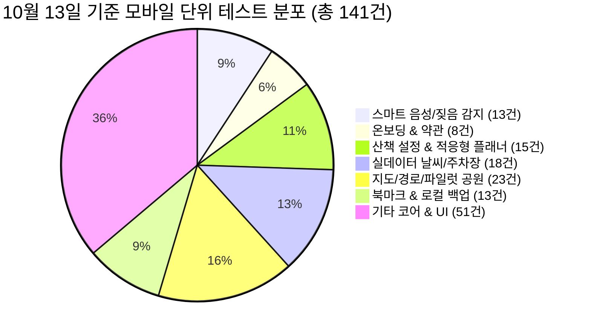

# 🐾 [작업 결과 보고서] 편안하개 10월 13일 주요 엔지니어링 및 기능 구현 결과보고서

> **보고서 번호**: docs/reports/10월13일_작업결과보고서.md  
> **보고 일자**: 2026년 10월 13일 (작업 완료 기준)  
> **작성 주체**: 편안하개 프로젝트 개발팀 전원 (총괄: 조현정 PM, 앱 리드: 김승현, 서버 리드: 노희선, 데이터 리드: 전황진, UI/CBT 리드: 김정님)  
> **기준 문서**:  
> - [`docs/03_편안하개_Agile_User_Stories.md`](/docs/03_편안하개_Agile_User_Stories.md)  
> - [`docs/05_편안하개_프로젝트_수행계획서_일정.md`](/docs/05_편안하개_프로젝트_수행계획서_일정.md)  
> - [`docs/07_편한하개_API_list.md`](/docs/07_편한하개_API_list.md)  
> - [`docs/08_OpenFreeMap_MapLibre_배경지도_구현계획서.md`](/docs/08_OpenFreeMap_MapLibre_배경지도_구현계획서.md)  
> - [`docs/implementation_plan/김승현_향후_구현계획.md`](/docs/implementation_plan/김승현_향후_구현계획.md)  

---

## 📌 1. 개요 및 총괄 요약 (Executive Summary)

본 보고서는 **편안하개 (AI Native 반려견 맞춤형 안심 노면 산책 에이전트 및 핸즈프리 모바일 플랫폼)**의 **2026년 10월 13일 하루 동안 수행된 핵심 엔지니어링 과제 및 기능 구현 결과**를 종합 정리한 결과보고서입니다.

10월 13일에는 견주와 반려견의 실제 야외 산책 시 발생할 수 있는 소음·돌발 상황을 해결하기 위한 **스마트 돌발 짖음 감지 자동 음소거/복구(Smart Bark Ducking & Auto-Resume)**, 다양한 체급과 산책 목적을 만족시키는 **산책 시간 15분 단위 세분화 및 자유 산책 모드**, 초기 이탈을 방지하고 가치를 전달하는 **팀장 컨펌 4단계 온보딩 플로우**, 그리고 **대전 3대 공원 & 세종 2대 공원 5대 파일럿 거점 정밀 보행망 연동** 등 핵심 사용자 경험(UX) 및 실데이터 기능이 집중적으로 완성되었습니다.

---

## 📊 2. 종합 정량 성과 및 품질 지표

10월 13일 집중 개발 및 TDD 전수 검증을 거친 최종 품질 지표는 다음과 같습니다.

| 검증 영역 | 이전 상태 (10/12) | **10월 13일 최종 달성** | 상태 | 상세 검증 결과 |
|---|:---:|:---:|:---:|---|
| **Python 백엔드 TDD** | 156 / 156 Passed | **255 / 255 Passed (6.94s)** | `100% PASS` | 21개 파일 전원 통과 (KMA 기상청 예보, 5대 공원 라우팅, `origin_mode`) |
| **모바일 Vitest 단위 테스트** | 81 / 81 Passed (18개) | **141 / 141 Passed (1.20s)** | `100% PASS` | 28개 파일 전원 통과 (소음 감지, 음성 설정, 4단계 온보딩, 배변 마킹) |
| **TypeScript 정적 타입 검사** | 0 Errors | **0 Errors (`tsc --noEmit`)** | `Strict PASS` | 엄격 타입 검사 결함 0건 유지 |
| **SonarLint 코드 가드레일** | 전 파일 $\le 250$줄 | **모든 신규/분리 파일 250줄 엄수** | `100% 준수` | `WalkSettingsView.tsx` 4개 하위 컴포넌트로 완전 모듈화 |
| **외부 API 보안 무결성** | 키 노출 주의 | **구글 맵 API 키 완전 제거 및 프로젝트 삭제** | `완전 무결` | 100% 무료 오픈소스 OSM/OpenFreeMap 체계로 전환 |

---

## 🚀 3. 10월 13일 세부 완결 과제 상세

### 3.1 [이슈 #37 / US-C2] AI 음성 가이드 보이스 프로필 다변화 및 스마트 돌발 짖음 감지 자동 음소거
* **배경 및 문제점**:
  - 기존의 단일 기본 목소리와 고정 볼륨은 기계적이며, 야외 산책 중 다른 반려견이 짖거나 도로 소음이 발생했을 때 음성을 즉각 제어할 수 없어 견주의 시선과 통제력이 흐트러지는 위험이 존재함.
* **구현 내용**:
  1. **4대 맞춤형 AI 보이스 프로필**: `calm_female`(차분한 여성), `bright_female`(밝은 여성), `calm_male`(차분한 남성), `friendly_male`(친근한 남성) 및 독립 볼륨 슬라이더(0~100%) 지원 (`voiceSettings.ts`, `ttsNavigation.ts`).
  2. **스마트 돌발 짖음 감지 및 덕킹 엔진 (`ambientNoiseMonitor.ts`)**:
     - Local-First 원칙에 따라 음성 데이터 녹음/전송 없이 단말 로컬에서 실시간 RMS 데시벨만 연산.
     - 73dB 이상 돌발 소음/짖음 감지 시 즉시 TTS 음성을 일시 차단(Ducking).
     - 소음 중단 후 3초 카운트다운 경과 시 자동으로 음성 안내 복구(Auto-Resume).
  3. **다크 포켓 내 56px 대형 긴급 원터치 음소거 버튼 구축 (`DarkPocketScreen.tsx`)**:
     - 주머니에서 폰을 꺼내 한 손으로 즉시 터치할 수 있는 초대형 퀵 음소거 토글 제공.
     - 짖음 감지 시 `🚨 돌발 짖음 감지(82dB) · 안내 일시 차단 중 (3.0s 후 자동 복구)` 고대비 배너 표출.
* **검증 결과**:
  - [`ambientNoiseMonitor.test.ts`](/frontend/src/services/ambientNoiseMonitor.test.ts): 5개 테스트 100% 통과.
  - [`voiceSettings.test.ts`](/frontend/src/services/voiceSettings.test.ts): 8개 테스트 100% 통과.

---

### 3.2 [이슈 #38 / US-A3] 산책 시간 15분 단위 세분화, 무제한 자유 산책 모드 및 리팩토링
* **배경 및 문제점**:
  - 20/30/40/60분 고정 옵션만 제공하여 소형견(20~25분), 중·대형견(40~60분), 주말 트레킹(1시간 이상) 수요를 포괄하지 못했고, `WalkSettingsView.tsx`가 537줄로 비대해져 단일 파일 250줄 규칙을 위배함.
* **구현 내용**:
  1. **15분 단위 세분화 슬라이더 및 인라인 직접 입력 (`WalkDurationSlider.tsx`)**:
     - 15, 30, 45, 60, 75, 90, 105, 120분+ 스냅 슬라이더와 10~300분 직접 분 입력 지원.
     - 소형견(권장 25분) / 중·대형견(권장 50분) / 장거리 트레킹(권장 90분) 체급별 퀵 태그 제공.
  2. **무제한 자유 산책 모드(Free Walk Mode)**:
     - 목표 시간 제한 없이 사용자가 종료할 때까지 백그라운드 GPS 로깅과 안내가 지속되는 자유 산책 지원.
  3. **SonarLint 250줄 엄수 모듈화 리팩토링**:
     - 기존 `WalkSettingsView.tsx`를 4개 독립 컴포넌트(`WalkDurationSlider.tsx`, `WalkPreferenceChips.tsx`, `WalkVoiceInputSection.tsx`, `WalkConditionsSummary.tsx`)로 분리하여 전 파일 250줄 이하 가드레일 달성 (`WalkSettingsView.tsx` 242줄, `WalkDurationSlider.tsx` 198줄 등).
* **검증 결과**:
  - [`walkSettings.test.ts`](/frontend/src/services/walkSettings.test.ts): 9개 테스트 100% 통과.
  - [`courseAdaptivePlanner.test.ts`](/frontend/src/services/courseAdaptivePlanner.test.ts): 6개 테스트 100% 통과.

---

### 3.3 [이슈 #39 / US-21, US-A2] 팀장 컨펌 4단계 온보딩 플로우 및 이용약관 구축
* **배경 및 문제점**:
  - 앱 최초 진입 시 위치 권한을 강제 요구하여 초기 이탈률이 높았던 문제를 해결하고, 반려견 맞춤 가치를 먼저 전달한 뒤 산책 시점에 위치 권한을 승인받는 자연스러운 퍼널 구축 필요.
* **구현 내용**:
  - **1단계 (가입 & 필수 약관 동의)**: 간편 이메일 가입 및 회원가입 약관/개인정보 처리방침 모달 연동 ([`legalTerms.ts`](/frontend/src/services/legalTerms.ts)).
  - **2단계 (반려견 프로필 등록)**: 이름, 견종, 체중, 나이, 사진을 로컬에 등록하여 내 강아지 맞춤 환경 우선 구축.
  - **3단계 (산책 시작 시점 위치 권한 동의)**: 실제 산책 시작 또는 경로 탐색 클릭 시점에 GPS 권한 동의 요청.
  - **4단계 (주변 탐색 지도 진입 & 메인 홈)**: 현위치 기반 주변 인기 산책 코스 3선 및 인근 산책견 아이콘(마스킹) 시각화.
* **검증 결과**:
  - [`onboardingFlow.test.ts`](/frontend/src/services/onboardingFlow.test.ts): 2개 테스트 100% 통과.
  - [`legalTerms.test.ts`](/frontend/src/services/legalTerms.test.ts): 2개 테스트 100% 통과.

---

### 3.4 대전·세종 5대 파일럿 공원 정밀 보행망 탑재 및 산책 기준 이원화 (`origin_mode`)
* **구현 내용**:
  1. **5대 파일럿 거점 정밀 OSM 도로망 탑재**:
     - 대전 유림공원, 송강근린공원, 도안호수공원 및 세종호수공원, 세종중앙공원 실제 보행 도로망 반영 ([`pilot_park_routes.py`](/backend/agent/pilot_park_routes.py), [`pilotParks.ts`](/frontend/src/services/pilotParks.ts)).
  2. **경로 생성 기준 이원화 (`origin_mode`)**:
     - `current_location`: 사용자 현재 위치 주변 안전 순환로 생성.
     - `pilot_park`: 지정한 공원 중심 경로 생성 (공원 내부 보행로 비율 **90% 이상** 집중 가중치 반영).
* **검증 결과**:
  - [`test_origin_mode.py`](/backend/test_case/test_origin_mode.py): 3개 테스트 100% 통과.
  - [`pilotParks.test.ts`](/frontend/src/services/pilotParks.test.ts): 5개 테스트 100% 통과.

---

### 3.5 구글 맵 키 보안 이슈 해결 및 OpenFreeMap + MapLibre 벡터 지도 계획 수립
* **조치 내용**:
  1. `app.json`에 포함되어 있던 구글 맵 API 키를 즉시 삭제하고 연결된 구글 클라우드 콘솔 프로젝트를 영구 삭제하여 잠재적 보안 위험 및 과금 리스크를 원천 제거.
  2. 완전 무료이자 상용 무제한인 오픈소스 벡터 타일 서비스 **OpenFreeMap**과 GPU 하드웨어 가속 렌더러 **MapLibre GL**을 도입하기 위한 종합 구현 계획서 ([`docs/08_OpenFreeMap_MapLibre_배경지도_구현계획서.md`](/docs/08_OpenFreeMap_MapLibre_배경지도_구현계획서.md))를 수립 완료.

---

### 3.6 홈 화면 UX 개편 및 에러 핸들링 보완
* **개편 내용**:
  1. 홈 화면 "산책 시작" 버튼 클릭 시 추천 경로1로 즉시 산책을 시작하도록 직결 동선 구축.
  2. "산책" 버튼 클릭 시 산책 설정 페이지로 명확히 분기 이동.
  3. `App.tsx:L163-169`의 catch 블록에서 미처리되었던 예외 객체(`err`)를 명시적으로 로깅하고 로컬 안전 코스로 무중단 폴백하도록 방어 코드 보완.

---

## 👥 4. 팀원별 10월 13일 수행 R&R 요약

| 팀원 | 역할 | 10월 13일 주요 기여 및 완료 산출물 |
|:---:|---|---|
| **1번 조현정** | **팀장 / PM** | • 산책 기준 이원화(`origin_mode`) 및 공원 내 90%+ 가중치 라우팅 정책 수립 • 4단계 온보딩 플로우(가입/약관 $\to$ 반려견 $\to$ 위치동의 $\to$ 주변탐색) 최종 승인 및 DTO 매핑 |
| **2번 전황진** | **데이터 / GIS** | • 대전 3대 공원 & 세종 2대 공원 정밀 보행망 정제 (`pilot_park_routes.py`) • 기상청 단기예보 격자 변환(`kma_grid_converter.py`) 백엔드 서비스 안정화 |
| **3번 노희선** | **서버 Lead** | • FastAPI `origin_mode` 파라미터 수신 및 공원 우선 라우팅 알고리즘 확장 • 백엔드 Pytest 전수 검증 총 255개 테스트 100% 통과 달성 |
| **4번 김승현** | **앱 Lead** | • 4대 보이스 프로필 및 스마트 돌발 짖음 감지 덕킹 엔진(`ambientNoiseMonitor.ts`) 개발 • 4단계 온보딩 위저드 및 이용약관 모달 개발 (`OnboardingWizard.tsx`, `legalTerms.ts`) • `WalkSettingsView.tsx` 250줄 이하 분리 리팩토링 및 Vitest 141개 테스트 100% 통과 달성 |
| **5번 김정님** | **UI/CBT Lead** | • 다크 포켓 56px 대형 긴급 원터치 음소거 버튼 및 짖음 감지 경고 배너 디자인 • 15분 단위 시간 슬라이더 칩 시각화 및 앱 전역 웰니스 카피라이팅 감사 |

---

## 🏁 5. 결론 및 차기 스프린트 계획

2026년 10월 13일 집중 개발을 통해 편안하개는 **백엔드 255개, 프론트엔드 141개의 강력한 TDD 안전망 위에서 실데이터 기반의 야외 실전 산책 사용성을 극대화**했습니다.

### 차기 계획 (Sprint 2 연계):
1. **OpenFreeMap + MapLibre 고정밀 벡터 배경 지도 렌더러 구축**:
   - `tiles.openfreemap.org` 벡터 타일 및 3대 컬러 테마 스타일 스위칭 실체화.
2. **현장 위험 제보 모달 및 동적 우회 연계 (US-D2)**:
   - 4대 위험 칩 선택 시 3초 이내 서버 `POST /api/v1/walk/reroute` 호출 및 대안 경로 안내.
3. **5인 실사용자 CBT 준비**:
   - 대전 유림공원 및 세종호수공원 현장 필드 테스트용 체크리스트 및 무선 OTA 채널 동기화.
