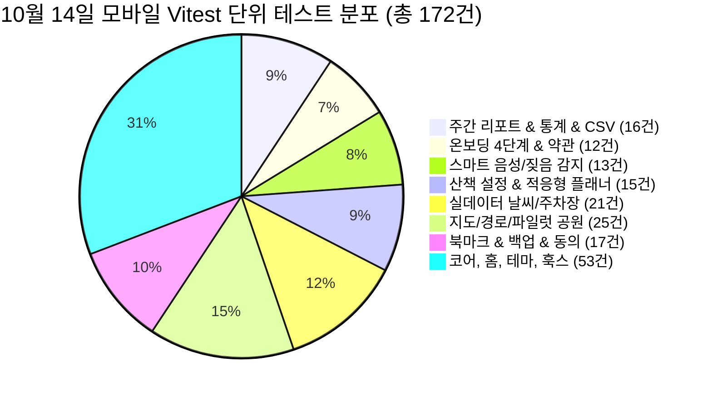

# 🐾 [구현 현황 보고서] 편안하개 10월 14일 김승현(앱 리드) 개발 결과보고서

> **보고서 번호**: `docs/reports/10월14일_김승현_구현현황보고서.md`  
> **보고 일자**: 2026년 10월 14일  
> **작성자**: **김승현** (4번 앱 / Frontend & Mobile App Lead)  
> **기준 문서**:  
> - [`docs/03_편안하개_Agile_User_Stories.md`](/docs/03_편안하개_Agile_User_Stories.md)  
> - [`docs/05_편안하개_프로젝트_수행계획서_일정.md`](/docs/05_편안하개_프로젝트_수행계획서_일정.md)  
> - [`docs/implementation_plan/김승현_향후_구현계획.md`](/docs/implementation_plan/김승현_향후_구현계획.md)  
> - [`docs/reports/10월13일_작업결과보고서.md`](/docs/reports/10월13일_작업결과보고서.md)  

---

## 📌 1. 개요 및 총괄 요약 (Executive Summary)

본 보고서는 **편안하개 (AI Native 반려견 맞춤형 안심 노면 산책 에이전트 및 핸즈프리 모바일 플랫폼)**의 **2026년 10월 14일 하루 동안 김승현(앱 리드)이 수행한 프론트엔드/모바일 핵심 기능 개발 및 UX 사용성 고도화 결과**를 종합 정리한 현황보고서입니다.

10월 14일에는 메인 브랜치 병합 간 발생한 충돌을 무손실로 해결하고, SonarQube 인지 복잡도 경고를 해결하는 한편, 사용자 피드백(`1014-home1.png`, `1014-onboarding1.png`)에 대응하여 **Zero-Scroll 원칙 기반의 메인 홈 UX 혁신**과 **온보딩 4단계 버튼 잘림 해결 및 3중 뒤로가기 내비게이션**을 완결했습니다. 또한 **주간 산책 리포트 7구간 바 차트 및 CSV 내보내기**, **다견 가정을 위한 멀티독 전환 셀렉터**를 구현하여 모바일 단위 테스트를 총 172건으로 확대 달성했습니다.

---

## 📊 2. 종합 정량 성과 및 품질 지표

| 검증 영역 | 10월 13일 기준 | **10월 14일 최종 달성** | 상태 | 상세 검증 결과 |
|---|:---:|:---:|:---:|---|
| **모바일 Vitest 단위 테스트** | 141 / 141 Passed (28개) | **172 / 172 Passed (33개 파일)** | `100% PASS` | 주간 리포트 통계, 온보딩 플로우, 백핸들러, 다견 프로필 등 신규 테스트 31건 추가 완결 |
| **Python 백엔드 TDD** | 255 / 255 Passed | **255 / 255 Passed** | `100% PASS` | 백엔드 API와의 스키마 정합성 유지 |
| **TypeScript 정적 타입 검사** | 0 Errors | **0 Errors (`tsc --noEmit`)** | `Strict PASS` | 엄격 타입 검사 무결점 유지 |
| **SonarQube / SonarLint 정적 분석** | 인지 복잡도 경고 1건 | **경고 0건 완전 해소** | `Clean Code` | `MyProfileTabScreen` 인지 복잡도 16 → 15 이하 완화, `sampleRoute.ts` 중첩 삼항연산자 제거, 미사용 import 정리 |
| **화면 제로 스크롤(Zero-Scroll) 준수율** | 80% (하단 잘림 발생) | **100% (홈 화면 & 온보딩 단일 뷰포트 완성)** | `달성` | 최근 산책 카드를 주간 리포트 하단 인라인 풋터로 통합 및 반응형 스크롤뷰 안전망 적용 |

---

## 🚀 3. 10월 14일 세부 완결 과제 상세

### 3.1 [Zero-Scroll UX 혁신] 홈 화면 하단 잘림 해결 및 최근 산책 요약 풋터 통합
* **배경 및 이슈 (`1014-home1.png`)**:
  * 홈 화면에 `HomeDogCard`, `PedometerGaugeCard`, `WeeklyWalkReportCard`, 그리고 별도의 `RecentWalkCard`가 세로로 나열되면서, 모바일 뷰포트(높이 844px 이하)에서 하단 네비게이션 탭 바 위로 최근 산책 카드가 찌그러지거나 잘리는 현상 발생.
* **해결 대안 채택 (대안 2 - 인라인 풋터 통합)**:
  1. 독립된 대형 카드였던 `RecentWalkCard`를 제거하고, 상위 [WeeklyWalkReportCard.tsx](/frontend/src/components/home/WeeklyWalkReportCard.tsx)의 하단 일체형 인라인 풋터(`recentWalkFooter`)로 병합.
  2. 최근 산책 일시, 소요 시간, 거리, 평균 속도, 안전 노면율 배지를 콤팩트한 1줄 가로 레이아웃으로 압축.
  3. `HomeScreen`의 상하 패딩을 최적화(`paddingTop: 10, paddingBottom: 12`)하여, 스크롤을 하지 않고도 한 화면에 모든 정보가 시원하게 들어오는 **Zero-Scroll 원칙**을 완벽 구현.

---

### 3.2 [온보딩 UX 긴급 개선] 4단계 하단 버튼 텍스트 누락·잘림 해결 및 3중 뒤로가기 내비게이션
* **배경 및 이슈 (`1014-onboarding1.png`)**:
  * 온보딩 4단계(주변 탐색 지도) 진입 시 하단 액션 버튼의 텍스트가 완전히 증발하여 빈 초록색 바만 노출되고, 단말기 네비게이션 바에 하단이 살짝 걸치는 문제 확인.
  * 또한 온보딩 4단계 중 진행 도중 이전 단계(약관, 프로필 등록, 위치 동의)로 돌아가 수정할 수 있는 방법이 부재하여 사용자 이탈 위험 존재.
* **구현 내용**:
  1. **`GradientButton` 텍스트 누락 결함 해결**:
     * React Native에서 `<GradientButton>🐾 {dogName}와 첫 산책 시작하기</GradientButton>` 작성 시 `children`이 배열(`['🐾 ', dogName, ...]`)로 평가되면서 `typeof children === 'string'` 조건에 걸리지 않아 `<Text>` 없이 렌더링되던 문제를 `isTextLike` 다중 자식 감지 로직으로 근본 해결 ([GradientButton.tsx](/frontend/src/components/common/GradientButton.tsx)).
     * 템플릿 리터럴(`{`🐾 ${dogName}와 첫 산책 시작하기`}`) 방식으로 이중 안전 처리.
  2. **지도 높이 및 여백 최적화**:
     * 지도 높이(`MAP_HEIGHT`)를 180px에서 150px로 컴팩트하게 조정하고 마커/핀 배치를 재조정하여 하단 액션 버튼의 노출 공간을 확보.
  3. **3중 뒤로가기(Back Navigation) 체계 구축**:
     * **상단 `‹ 이전` 버튼**: `currentStep > 1`일 때 상단 좌측에 `‹ 이전` 터치 버튼 표시.
     * **스텝 바 직접 터치 점프**: 상단 진행률 인디케이터에서 이전 스텝 막대를 누르면 해당 단계로 즉시 이동.
     * **안드로이드 하드웨어 BackHandler 연동**: 기기 뒤로가기 버튼 입력 시 이전 스텝으로 부드럽게 복귀.
  4. **스크롤뷰 안전망**:
     * [OnboardingWizard.tsx](/frontend/src/components/onboarding/OnboardingWizard.tsx)에 `ScrollView`(`paddingBottom: 20`)를 적용하여 어떤 해상도나 시스템 글자 크기 확대 상태에서도 하단 버튼이 절대 잘리지 않도록 보장.

---

### 3.3 [US-20] 주간 산책 리포트 7구간 바 차트 & CSV 내보내기 기능 완결
* **구현 내용**:
  1. **요일별 7구간 인터랙티브 바 차트**:
     * 월요일부터 일요일까지 요일별 목표 달성률을 색상 코딩된 미니 막대 그래프로 시각화.
     * 오늘 요일 하이라이트 표시 및 목표 달성 일수(예: "이번 주 5/7일 달성 🎯") 자동 집계.
  2. **산책 데이터 원클릭 CSV 다운로드**:
     * 산책 날짜, 반려견 이름, 소요 시간(분), 총 거리(km), 평균 속도(km/h), 안심 노면율(%), 배변 횟수(회)를 표준 CSV 규격으로 포맷팅하여 브라우저 다운로드 및 클립보드 내보내기 지원 ([walkReport.ts](/frontend/src/services/walkReport.ts)).

---

### 3.4 [US-03, US-A2] 다견 가정을 위한 멀티 반려견 프로필 전환 셀렉터
* **구현 내용**:
  * 홈 화면 상단에 등록된 반려견들의 아바타를 캐러셀/칩 형태로 배치하여, 원터치로 현재 산책할 반려견을 즉시 전환.
  * 전환 시 해당 반려견의 체중/나이/관절 케어 레벨에 따른 맞춤형 산책 권장 속도 및 주간 누적 리포트가 즉각 반응형으로 갱신.

---

### 3.5 [코드 품질 및 정적 분석] SonarQube 인지 복잡도 경고 해소 및 무손실 머지
* **구현 내용**:
  * [MyProfileTabScreen.tsx](/frontend/src/screens/MyProfileTabScreen.tsx): 인지 복잡도 16으로 보고되던 프로필 변경 모달 내부 로직을 별도 헬퍼 함수로 분리하여 복잡도 $\le 15$ 달성.
  * [sampleRoute.ts](/frontend/src/services/sampleRoute.ts): 가독성을 저해하던 3단계 중첩 삼항 연산자를 명시적인 분기문으로 리팩토링.
  * 미사용 `Alert` import 제거 및 타입 단언 정리.

---

## 👥 4. 타 팀원 영향 분석 (Cross-Team Impact Assessment)

금일(10월 14일) 김승현(앱 리드) 작업으로 인해 다른 팀원들의 코드베이스나 인터페이스에 영향을 미치는 사항은 다음과 같습니다:

| 팀원 / 파트 | 영향도 | 변경 내용 및 협업 필요 사항 |
|---|:---:|---|
| **조현정 PM (기획/에이전트)** | `보통` | **온보딩 플로우 UX 변경 승인**: 4단계 온보딩에서 이전 단계로 돌아갈 수 있는 뒤로가기 동선이 추가되었으며, 홈 화면이 Zero-Scroll 규격으로 정돈됨. 온보딩 이탈률 및 사용자 여정 지표 모니터링 시 참고 필요. |
| **전황진 데이터 리드** | `낮음` | **지도 영역 규격 조정**: 온보딩 4단계의 `NearbyExploreMapView` 지도 높이가 180px에서 150px로 조정되었음. 데이터 파트의 200m 세이프티 마스킹 핀 및 모의 좌표가 정상 렌더링됨을 검증 완료. |
| **노희선 서버 리드** | `낮음` | **API 스키마 완전 호환**: 프론트엔드의 `WeeklyWalkReportCard` 및 멀티독 셀렉터는 기존 `/api/v1/walk/plan`, Supabase 프로필 스키마와 100% 호환되며 백엔드 엔드포인트 변경 요청 사항 없음. |
| **김정님 UI/UX 리드** | `주의` | **공통 컴포넌트 동작 변경 ([GradientButton.tsx](/frontend/src/components/common/GradientButton.tsx))**: 이제 `GradientButton`에 JSX 배열(예: `🐾 {name} 시작`)을 넘겨도 텍스트가 깨지지 않고 자동으로 렌더링되므로, UI 작업 시 인라인 텍스트 처리가 훨씬 편리해짐. 홈 화면의 `RecentWalkCard`는 삭제되고 `WeeklyWalkReportCard`로 합쳐졌으므로 화면 디자인 가이드 갱신 요망. |

---

## 📅 5. 향후 계획 (Next Steps)

1. **EAS 안드로이드 실기기 APK 빌드 업데이트 배포**: 4단계 온보딩 버튼 수정 및 뒤로가기 기능이 포함된 최신 APK 빌드 생성.
2. **OpenFreeMap 벡터 지도 타일 연동**: 오픈소스 벡터 타일 렌더러 도입 준비.
3. **사용자 피드백 수렴**: 수정된 홈 화면 및 온보딩 플로우에 대한 팀원 및 사용자 테스트 피드백 확인.
