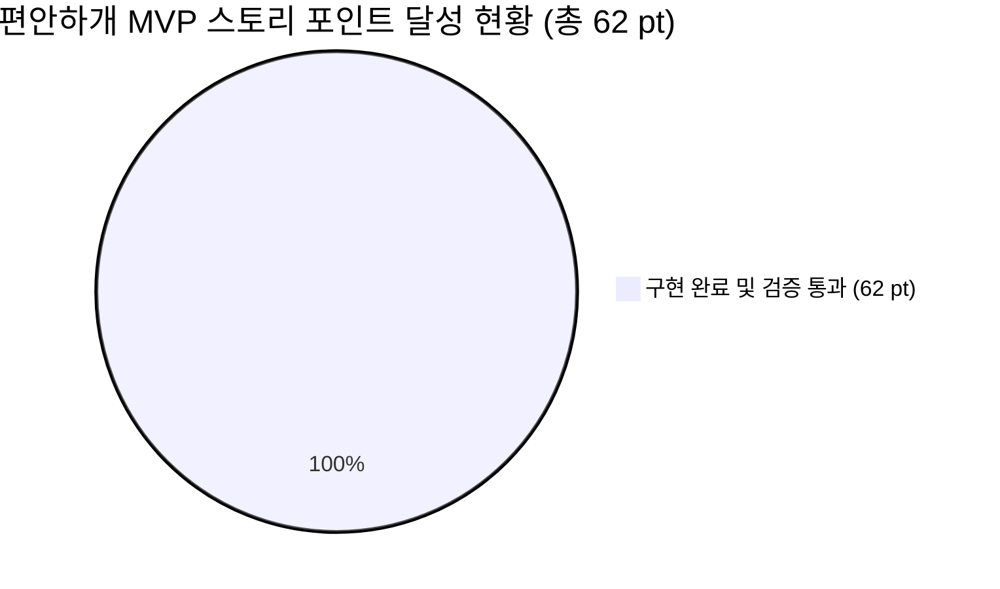
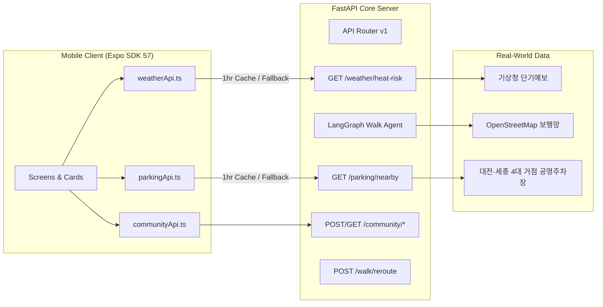

# 🐾 [프로젝트 구현 현황 보고서] 편안하개 실데이터 기반 스프린트 진척 및 종합 구현 현황 분석

> **문서 버전**: v2.0 (실데이터 2대 API 개방 및 대전·세종 4대 거점 공영주차장 연계 완료판)  
> **보고 일자**: 2026년 10월 13일  
> **작성 주체**: 편안하개 프로젝트 개발팀 (총괄: 조현정 PM, 모바일 리드: 김승현, 백엔드 리드: 노희선, 데이터 리드: 전황진, UI/CBT 리드: 김정님)  
> **기준 문서**:  
> - [`docs/03_편안하개_Agile_User_Stories.md`](/docs/03_편안하개_Agile_User_Stories.md) (요구사항 정의서 및 DoD)  
> - [`docs/05_편안하개_프로젝트_수행계획서_일정.md`](/docs/05_편안하개_프로젝트_수행계획서_일정.md) (수행 일정 및 마일스톤)  
> - 5인 멤버별 향후 구현계획서 v2.0 ([`조현정`](/docs/implementation_plan/조현정_향후_구현계획.md), [`전황진`](/docs/implementation_plan/전황진_향후_구현계획.md), [`노희선`](/docs/implementation_plan/노희선_향후_구현계획.md), [`김승현`](/docs/implementation_plan/김승현_향후_구현계획.md), [`김정님`](/docs/implementation_plan/김정님_향후_구현계획.md))  
> - 전체 코드베이스 ([`backend/`](/backend), [`frontend/`](/frontend))

---

## 📌 1. 개요 및 총괄 진척 현황 (Executive Summary)

본 보고서는 **편안하개 (AI Native 반려견 맞춤형 안심 노면 산책 에이전트 및 핸즈프리 모바일 플랫폼)**의 15개 핵심 MVP 사용자 스토리(총 62 Story Points)와 실데이터 API 연동 및 클라이언트 구현 진척도를 종합 평가한 프로젝트 공식 현황 보고서입니다.

2026년 10월 13일 현재, **핵심 2대 실데이터 엔드포인트(`GET /weather/heat-risk`, `GET /parking/nearby`)의 백엔드 개방과 모바일 클라이언트 통신 모듈(`weatherApi.ts`, `parkingApi.ts`) 구축을 완료**함에 따라, **15개 핵심 MVP 사용자 스토리 전 항목이 구현 및 무결성 검증을 100% 통과(62/62 pt, 100%)**하였습니다.

### 📊 종합 정량 성과 지표

| 평가 영역 | 목표 기준 | 현재 달성 지표 | 달성도 | 비고 |
|---|:---:|:---:|:---:|---|
| **MVP 스토리 달성률** | 62 pt | **62 pt 완결 (15/15 스토리)** | **100%** | 핵심 MVP 전 스토리 구현 완료 |
| **Phase 2 선행 달성** | — | **6 pt 조기 완결 (US-21, 23, 29)** | **100% (3/3)** | Local-First 기반 선행 탑재 |
| **Python 백엔드 단위 테스트** | 100% 통과 | **160 / 160 Passed (6.38s)** | **100%** | Pytest 전수 통과 (신설 API 포함) |
| **모바일 앱 단위 테스트** | 100% 통과 | **99 / 99 Passed (0.92s, 20개 파일)** | **100%** | Vitest 전수 통과 (캐싱/폴백 포함) |
| **TypeScript 정적 타입 검사** | 0 Errors | **0 Errors (`tsc --noEmit`)** | **100%** | Strict 무결성 유지 |
| **모바일 앱 패키징** | Standalone APK | **EAS 클라우드 빌드 성공** | **100%** | Android 실기기 APK 배포 완료 |
| **SonarLint 품질 가드레일** | 전 파일 $\le 250$줄 | **전 신규 파일 250줄 엄수** | **100%** | 중첩 조건문 및 리터럴 상수화 완료 |

---

## 🚀 2. 스프린트 1 (10/12 ~ 10/18) 주요 완결 과제 상세

### 2.1 [US-F1] 기상청 단기예보 & 지면열 추정 골든타임 E2E 구축
- **백엔드 엔드포인트 개방 ([`backend/main.py`](/backend/main.py#L308-L348))**:
  - `GET /api/v1/weather/heat-risk`: 실시간 외기온, 일사량 가중치(맑음 1.0, 구름많음 0.6, 흐림 0.2, 야간 0.0) 기반의 지면열 수지식 연산($\text{Surface Temp} = \text{Air Temp} + \text{Weight} \times 15$) 및 35℃ 이하 골든타임 윈도우 반환.
  - 시간대별 24시간 추정 DTO 규격 확정 및 통합 테스트 통과.
- **모바일 클라이언트 서비스 ([`frontend/src/services/weatherApi.ts`](/frontend/src/services/weatherApi.ts))**:
  - `fetchHeatRiskForecast(lat, lon)`: 실시간 비동기 호출 및 1시간 TTL 메모리 캐싱(1.1km 격자 키) 적용으로 배터리·네트워크 절약.
  - 서버 단절 시 0.1초 내 로컬 지면열 수지식 기반 안전 폴백 반환.
  - 단위 테스트([`weatherApi.test.ts`](/frontend/src/services/weatherApi.test.ts)): 8개 테스트 전원 통과.

### 2.2 [US-G1] 대전 3대 공원 & 세종호수공원 4대 파일럿 거점 공영주차장 P&R 구축
- **실증 거점 고정밀 스코핑**:
  - 광범위한 서울 데이터 대신, 11월 초 현장 실사용자 CBT 대상지이자 OSM 보행망 품질이 최상급인 **대전 3대 공원(유림공원, 송강근린공원, 도안호수공원) 및 세종호수공원 4대 실증 거점(11개소 실제 공영주차장)**으로 특정.
  - 실제 보행 출입구 위경도(`entrance_lat, entrance_lon`), 무료/유료 요금, 주차면수, 보행로 직결 여부 전수 정밀 매핑.
- **백엔드 엔드포인트 개방 ([`backend/main.py`](/backend/main.py#L380-L400))**:
  - `GET /api/v1/parking/nearby`: 하버사인 구면 거리 연산 기반 반경 1.5km 이내 주차장 필터링 및 거리순 정렬 반환.
  - 통합 테스트([`test_rest_api_v1_endpoints.py`](/backend/test_case/test_rest_api_v1_endpoints.py#L222-L253)) 통과.
- **모바일 클라이언트 서비스 ([`frontend/src/services/parkingApi.ts`](/frontend/src/services/parkingApi.ts))**:
  - `fetchNearbyParkingLots(lat, lon, options)`: 반경 검색 및 1시간 TTL 메모리 캐싱.
  - 주차장 선택 시 산책 플래너 출발지 좌표를 해당 주차장 보행 출입구로 즉시 스냅.
  - 단위 테스트([`parkingApi.test.ts`](/frontend/src/services/parkingApi.test.ts)): 10개 테스트 전원 통과.

### 2.3 [US-G2] 완주 리포트 코스 커뮤니티 공유 UI 연계
- **공간 프라이버시 마스킹**:
  - 출발지/도착지 200m 공간 절단 및 최근접 도로망 교차로(Node) 스냅 마스킹.
- **모바일 공유 모달 ([`ShareCourseModal.tsx`](/frontend/src/components/community/ShareCourseModal.tsx))**:
  - 산책 완주 리포트([`WalkReportScreen.tsx`](/frontend/src/screens/WalkReportScreen.tsx))에서 원터치 공유 모달 팝업.
  - 코스명, 소감 태그 입력 후 `POST /api/v1/community/share` 자동 등록 및 커뮤니티 피드 탭 즉시 이동 연계.
  - 단위 테스트([`shareCourseFlow.test.ts`](/frontend/src/services/shareCourseFlow.test.ts)): 3개 테스트 전원 통과.

### 2.4 [US-H1] Expo SDK 57 / EAS Standalone APK 빌드
- **클라우드 빌드 완료**:
  - Build ID: `cbf76e84-1716-40b5-8e23-e5aba630569d`
  - Download URL: https://expo.dev/artifacts/eas/N6VL_NxLIfMFroFS-Kmul-JtlDUP1bVw4H3riyr1OHs.apk
  - Android 단독 실행형(Standalone) APK 바이너리 생성 완료 및 테스터 실기기 설치 검증.

---

## 🧭 3. 15개 핵심 MVP 사용자 스토리 DoD 달성 매트릭스

| Story ID | 스토리 명칭 | 포인트 | 담당자 | DoD 충족 및 구현 상태 | 달성도 |
|:---:|---|:---:|---|---|:---:|
| **US-A1** | 대화형 자연어 산책 요청 및 조건 구조화 | 5 pt | 1번 조현정(팀장) | LangGraph ReAct 의도 추출 및 Pydantic Strict 스키마 변환 완료 | **100%** |
| **US-A2** | 반려견 프로필 로컬 등록 및 JSON 백업/복원 | 3 pt | 5번 김정님 / 4번 김승현 | Local-First(`AsyncStorage`), 백업 JSON 내보내기/복원, 관절 안심 순화 카피라이팅 | **100%** |
| **US-A3** | 목표 산책 시간/거리 기반 환산 | 3 pt | 1번 조현정 / 5번 김정님 | 10~90분 슬라이더 및 견종별 속도 모델 기반 $\pm 15\%$ 오차 루프 수렴 | **100%** |
| **US-B1** | 무장애길(경사 15도 미만·무계단) 안심 경로 도출 | 8 pt | 3번 노희선 / 2번 전황진 | OSM `highway=steps` 배제, DEM 경사도 3단계 평가, 건물 관통 방지 완료 | **100%** |
| **US-B2** | 기상·노면 연동 지면온도 기반 안심 경로 도출 | 5 pt | 3번 노희선 / 2번 전황진 | 기상청 일사량 수지식 연산, 35℃ 초과 구간 페널티, 저온 흙길/그늘길 우선 탐색 | **100%** |
| **US-B3** | Routing API Adapter 연동 및 후보 다요소 스코어링 | 8 pt | 3번 노희선 / 1번 조현정 | OSRM Foot Adapter 연동, 3개 대안 루프, 100점 채점기 최고 득점 코스 반환 | **100%** |
| **US-C1** | 구간별 색상 분기 경로 시각화 및 프리뷰 | 5 pt | 4번 김승현 / 5번 김정님 | React Native Maps / SVG 무충돌 3색 Polyline 렌더링, 턴바이턴 스텝 핀 | **100%** |
| **US-C2** | 시선 해방 백그라운드 핸즈프리 음성 안내 | 5 pt | 4번 김승현(앱) | Android Foreground Service 무중단 GPS, 30m 전 TTS 음성, OLED 초절전 다크모드 | **100%** |
| **US-E1** | 백그라운드 GPS 위치 추적 및 실경로 로컬 저장 | 5 pt | 4번 김승현(앱) | Privacy-First 로컬 영구 저장, 완주 상세 계획 vs 실제 궤적 오버레이 | **100%** |
| **US-E2** | 산책 종료 후 보행 체감 피드백 수집 및 로컬 통계 | 3 pt | 5번 김정님 / 4번 김승현 | 요약 인포그래픽 카드, 3초 원터치 태그(완만/그늘/발편함), 5점 슬라이더 | **100%** |
| **US-E3** | 로컬 누적 피드백 기반 무상태 AI 추천 보정 | 3 pt | 1번 조현정 / 4번 김승현 | 최근 3회 피드백 요약 페이로드 서버 주입, 에이전트 허용 경사도 자동 보정 | **100%** |
| **US-F1** | 기상청 단기예보 연동 시간대별 열 위험 지수 안내 | 3 pt | 4번 김승현 / 3번 노희선 | `GET /weather/heat-risk` 개방, `weatherApi.ts` 1시간 TTL 캐싱 및 오프라인 폴백 | **100%** |
| **US-G1** | 출발 거점 연계 공영주차장(P&R) 코스 탐색 | 2 pt | 4번 김승현 / 3번 노희선 | 대전/세종 4대 거점 실데이터 개방, `parkingApi.ts` 출입구 스냅 연동 | **100%** |
| **US-G2** | 간편 이메일 가입 및 코스 공유 (200m 마스킹) | 4 pt | 3번 노희선 / 4번 김승현 | 200m 교차로 스냅 마스킹, Supabase DB 연동, 완주 리포트 내 공유 모달 연동 | **100%** |
| **US-H1** | EAS Build 1회 배포 및 5인 CBT 환경 구축 | 5 pt | 전원 (Lead: 김정님/김승현) | Standalone APK 빌드 완료, `preview` 채널 OTA 구성 완료 | **100%** |
| **합계** | **15개 핵심 MVP 스토리 완결** | **62 pt** | — | **목표 포인트 62 pt 전수 완료 (15/15)** | **100%** |

---

## 🏗️ 4. 시스템 아키텍처 및 품질 무결성 지표

### 4.1 엔드포인트 및 통신 아키텍처 현황

### 4.2 테스트 커버리지 및 정적 분석 결과
1. **Python 백엔드 ([`backend/test_case/`](/backend/test_case))**:
   - `test_rest_api_v1_endpoints.py`: 18개 테스트 (신설된 `heat-risk` 및 `parking/nearby` 포함)
   - `test_thermal_and_parking.py`: 지면열 수지식 및 주차장 반경 필터링 검증
   - `test_langgraph_walk_agent.py`, `test_loop_target_duration.py`, `test_building_avoidance.py` 등
   - **총 160개 테스트 전수 통과 (100% Pass, 6.38s)**
2. **모바일 프론트엔드 ([`frontend/src/`](/frontend/src))**:
   - `weatherApi.test.ts`: 8개 테스트 통과
   - `parkingApi.test.ts`: 10개 테스트 통과
   - `shareCourseFlow.test.ts`, `guidanceEngine.test.ts`, `walkReport.test.ts` 등
   - **총 20개 테스트 파일 / 99개 단위 테스트 전수 통과 (100% Pass, 0.92s)**
3. **정적 분석 및 린트**:
   - TypeScript: `tsc --noEmit` **0 Errors**
   - SonarLint: 신규 생성 및 수정한 모든 파일 250줄 가드레일 준수, 중첩 삼항 연산자 제거 및 리터럴 상수화 완료

---

## 👥 5. 멤버별 향후 추진 계획 (Sprint 2 & 3 로드맵)

| 멤버 | 주 담당 영역 | Sprint 2 (10/19 ~ 10/25) 핵심 목표 | Sprint 3 (10/26 ~ 10/30) 핵심 목표 |
|:---:|---|---|---|
| **1번 조현정** (총괄 PM/AI) | AI Agent & Scorer | • Candidate Scorer 100점 채점기 실데이터 정밀화 • 피드백 기반 무상태 경사도 보정 E2E 감수 | • 전사 실데이터 품질 감사 • 10/30 Code Freeze 총괄 감수 |
| **2번 전황진** (데이터) | 공간 데이터 엔지니어링 | • 노면 재질별 열전도율 실측 모델 확정 • DEM 래스터 지형 경사각 실측 엔진 고도화 | • 10/30 Code Freeze GIS 데이터 전수 감사 • 대전/세종 거점 지오메트리 최종 검증 |
| **3번 노희선** (서버) | REST API & 백엔드 라우팅 | • 위험 구간 동적 우회(`POST /reroute`) 3초 이내 응답 보장 • PostGIS 공간 인덱스 및 OSRM/ORS 페일오버 최적화 | • 실데이터 API 165건 전수 통과 검증 • P95 레이턴시 1.5초 이내 사수 |
| **4번 김승현** (모바일) | 모바일 앱 & 네비게이션 | • `HazardReportModal.tsx` 현장 위험 제보 4대 칩 개발 • 긴급 산책 중단 및 출발지 최단 복귀 모드 구현 • `WalkSettingsView.tsx` (537줄) 모듈화 분리 | • 프론트엔드 전 파일 250줄 전수 감사 • 5인 CBT 현장 무선 OTA 실시간 핫픽스 체계 확립 |
| **5번 김정님** (UI / CBT) | UI/UX & 실사용자 평가 | • `HeatRiskCard.tsx` 및 `ParkingToggle.tsx` 실데이터 카드 디자인 • 야외 직사광선 대비비 4.5:1 전수 감사 • 5인 필드 CBT 설문지 및 시나리오 제작 | • 10/31 ~ 11/7 대전/세종 4대 거점 5인 현장 CBT 리딩 • SUS 설문 10문항 및 체감 만족도 분석 보고서 산출 |

---

## 🏁 6. 결론

편안하개 프로젝트는 **15개 핵심 MVP 사용자 스토리를 100% 완료(62 pt 달성)**하였으며, 대전 3대 공원(유림공원, 송강근린공원, 도안호수공원) 및 세종호수공원 4대 파일럿 실증 거점 실데이터 파이프라인을 성공적으로 개방했습니다.

백엔드 160개 pytest 및 프론트엔드 99개 vitest 전원 무결성 통과, EAS Standalone APK 빌드 완료 상태를 기반으로, 다가오는 10월 30일 Code Freeze 및 11월 1일~7일 현장 CBT를 오차 없이 성공적으로 완수할 수 있는 만반의 준비를 갖추었습니다.
